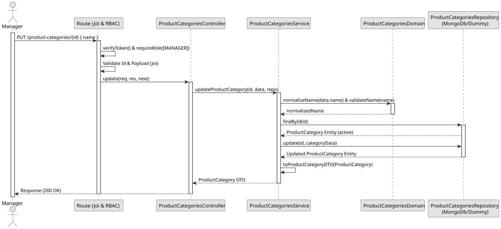

# UC3 - Update Product Category

## 1. Domain Assumptions
* Only the name of a category can be changed;
* The new name follows the same rules as in the creation and cannot be used by another category;
* A removed category cannot be updated;
* Only users with the `Manager` role are authorized to update a product category.

## 2. Solution Design

## 3. Business Test Planning
* **Isolation Strategy:** All aplication tests use dependency injection via isolated in-memory dummies (`product-categories.dummy.repository.js`), avoiding Mocking libraries entirely.
* **Application Tests (`product-categories.service.test.js`):**
    * `updateProductCategory changes the name`
    * `updateProductCategory allows changing only the case of its own name`
    * `updateProductCategory rejects blank names`
    * `updateProductCategory returns 409 Conflict on duplicate name`
    * `updateProductCategory throws 404 if the category does not exist`
    * `updateProductCategory throws 409 if the category is inactive`

## 4. E2E Tests
* **Base Endpoint:** `PUT /api/v1/product-categories/{id}`
* **Validated Scenarios:**
    * Request without Bearer Token -> `401 Unauthorized`
    * Request with `EMPLOYEE` Bearer Token -> `403 Forbidden` (RBAC Enforcement)
    * Valid payload by `MANAGER` -> `200 OK`
    * Invalid id or blank name -> `400 Bad Request`
    * Unknown category -> `404 Not Found`
    * Duplicate category name -> `409 Conflict`