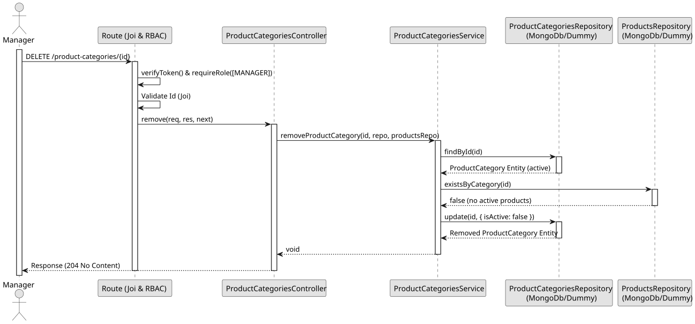

# UC4 - Remove Product Category

## 1. Domain Assumptions
* The removal is logical: the category becomes inactive;
* A category referenced by a product cannot be removed;
* Only users with the `Manager` role are authorized to remove a product category.

## 2. Solution Design

## 3. Business Test Planning
* **Isolation Strategy:** All aplication tests use dependency injection via isolated in-memory dummies (`product-categories.dummy.repository.js`), avoiding Mocking libraries entirely.
* **Application Tests (`product-categories.service.test.js`):**
    * `removeProductCategory disables a product category`
    * `removeProductCategory throws 404 if category does not exist`
    * `removeProductCategory throws 404 if the category is already inactive`
    * `removeProductCategory throws 409 if an active product references the category`
    * `removeProductCategory ignores inactive products`

## 4. E2E Tests
* **Base Endpoint:** `DELETE /api/v1/product-categories/{id}`
* **Validated Scenarios:**
    * Request without Bearer Token -> `401 Unauthorized`
    * Request with `EMPLOYEE` Bearer Token -> `403 Forbidden` (RBAC Enforcement)
    * Category without products by `MANAGER` -> `204 No Content`
    * Invalid ID -> `400 Bad Request` (Joi validation)
    * Unknown category -> `404 Not Found`
    * Category referenced by a product -> `409 Conflict`