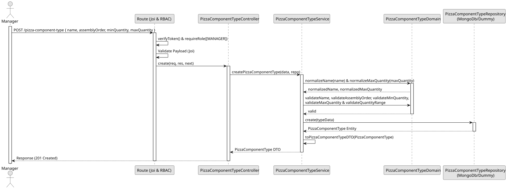

# UC1 - Create Pizza Component Type

## 1. Domain Assumptions
* A Pizza Component Type defines the role that a product plays in a pizza configuration;
* The name is mandatory, cannot be blank and must be unique;
* The assembly order is an integer greater than or equal to 1, and must be unique; 
* The minimum quantity is an integer greater than or equal to 0;
* The maximum quantity is an integer greater than or equal to 1, or unbounded, and cannot be lower than the minimum quantity;
* The name and assembly order of a removed type can be reused by a new one;
* Only users with the `MANAGER` role are authorized to create a new pizza component type.

## 2. Solution Design

## 3. Business Test Planning

* **Issolation Strategy:** All application tests use dependency injection via isolated in-memory dummies (`pizza-component-type.dummy.repository.js`), avoiding Mocking libraries entirely.
* **Domain Tests (`pizza-component-type.domain.test.js`):** 
    * `normalizeName trims and collapses whitespaces`
    * `normalizeName returns non-string values unchanged`
    * `normalizeMaxQuantity turns an omitted maximum into null (unbounded)`
    * `normalizeMaxQuantity keeps null and any other value unchanged`
    * `validateName rejects missing, blank and non-string names`
    * `validateName accepts non-blank names`
    * `validateAssemblyOrder rejects values that are not integers greater than or equal to 1`
    * `validateAssemblyOrder accepts integers greater than or equal to 1`
    * `validateMinQuantity rejects values that are not non-negative integers`
    * `validateMinQuantity accepts zero and positive integers`
    * `validateMaxQuantity rejects zero, negatives, decimals and non-numbers`
    * `validateMaxQuantity accepts null (unbounded) and integers greater than or equal to 1`
    * `validateQuantityRange rejects a maximum lower than the minimum`
    * `validateQuantityRange accepts equal values and a maximum greater than the minimum`
    * `validateQuantityRange accepts any minimum when the maximum is unbounded (null)`
    * `default pizza component types match the ones required by the US (BCK07)`
    * `default pizza component types have unique names and assembly orders`
    * `default pizza component types respect every domain rule`
    * `default pizza component types cannot be modified`
* **Application Tests (`pizza-component-type.service.test.js`):**
    * `toPizzaComponentTypeDTO exposes the identifier as id and hides database fields`
    * `createPizzaComponentType saves a normalized name and returns an active DTO`
    * `createPizzaComponentType treats an omitted or null maximum as unbounded`
    * `createPizzaComponentType accepts a minimum equal to the maximum`
    * `createPizzaComponentType rejects invalid data without saving`
    * `createPizzaComponentType returns 409 Conflict on duplicate name`
    * `createPizzaComponentType returns 409 Conflict on duplicate assembly order`
    * `createPizzaComponentType rethrows errors that are not duplicates`
    * `removing a type frees its name and assembly order to be used again`

## 4. E2E Tests
* **Base Endpoint:** `POST /api/v1/pizza-component-type`
* **Validated Scenarios:**
    * Request with Bearer Token -> `401 Unauthorized`
    * Request with `EMPLOYEE` Bearer Token -> `403 Forbidden` (RBAC Enforcement)
    * Valid payload by `MANAGER` -> `201 Created`
    * Omitted or `null` maximum -> `201 Created` with `maxQuantity: null` (unbounded)
    * Minimum equal to maximum -> `201 Created`
    * Missing, blank or invalid fields, or maximum lower than the minimum -> `400 Bad Request`
    * Duplicate name or assembly order -> `409 Conflict`