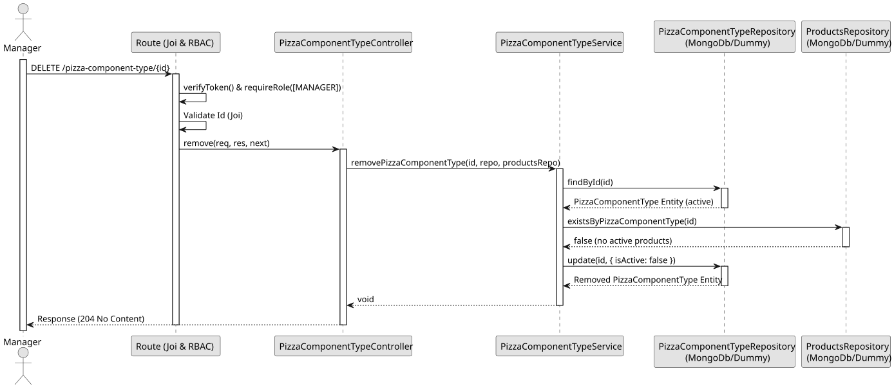

# UC4 - Remove Pizza Component Type

## 1. Domain Assumptions
* The removal is logical: the type becomes inactive;
* A removed type is not listed, but it can still be consulted by its identifier and found by its name;
* A type referenced by an active product cannot be removed, so that products are never left with a type that does not exist;
* The name and the assembly order of a removed type become available to be used again;
* Only users with the `MANAGER` role are authorized to remove a pizza component type.

## 2. Solution Design 

## 3. Business Test Planning

* **Issolation Strategy:** All application tests use dependency injection via isolated in-memory dummies (`pizza-component-type.dummy.repository.js`), avoiding Mocking libraries entirely.
* **Application Tests (`pizza-component-type.service.test.js`):**
    * `removePizzaComponentType deactivates the type without deleting it`
    * `removePizzaComponentType throws 404 if the type does not exist`
    * `removePizzaComponentType throws 404 if the type was already removed`
    * `removing a type frees its name and assembly order to be used again`
    * `removePizzaComponentType throws 409 Conflict if a product references the type`
    * `removePizzaComponentType ignores inactive products`
    * `removePizzaComponentType only checks the products of the type being removed`
    * `removePizzaComponentType removes the type once no product references it`
    * `removePizzaComponentType checks that the type exists before looking at the products`

## 4. E2E Tests
* **Base Endpoint:** `DELETE /api/v1/pizza-component-type/{id}`
* **Validated Scenarios:**
    * Request with Bearer Token -> `401 Unauthorized`
    * Request with `EMPLOYEE` Bearer Token -> `403 Forbidden` (RBAC Enforcement)
    * Type without products by `MANAGER` -> `204 No Content`
    * Invalid id -> `400 Bad Request`
    * Unknown type -> `404 Not Found`
    * Type referenced by a product -> `409 Conflict`