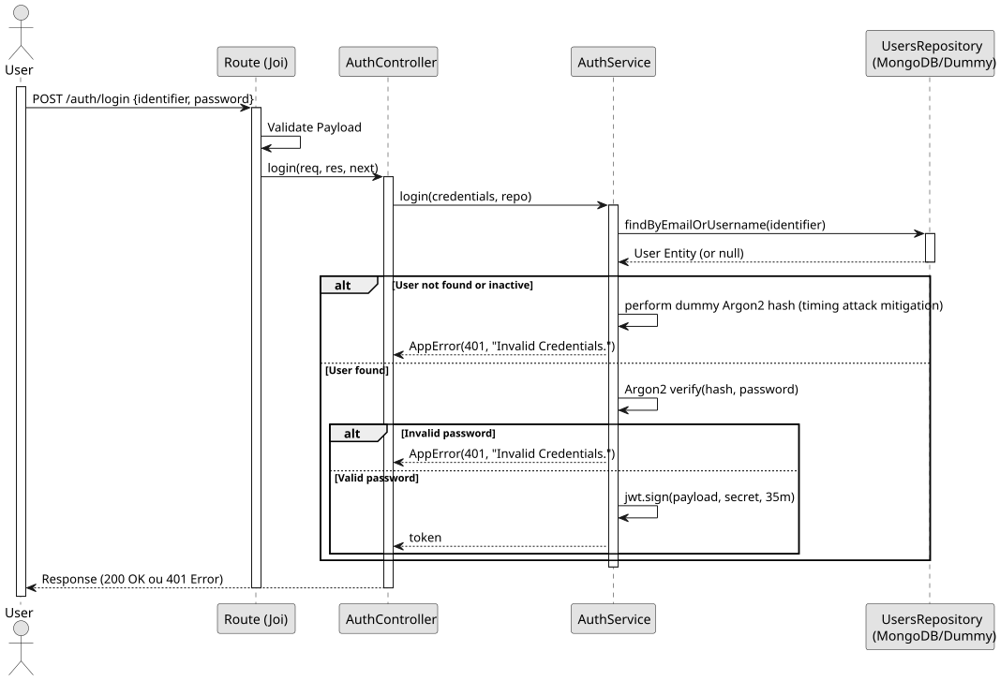

# UC1: Authenticate User (Login)

## 1. Domain Assumptions
Due to a lack of client clarification, the following domain restrictions were inquired in the code:
    * Authentication uses `Argon2` for password hashing verification;
    * Upon successful authentication, a JSON Web Token (JWT) is generated with a 35-minute expiration time;
    * A timing attack mitigation mechanism is implemented: if a user is not found or is inactive, the system performs a dummy `Argon2` hash calculation to maintain consistent response times.

## 2. Solution Design

## 3. Business Test Planning
* All unit tests use isolated in-memory Dummy Repositories (`users.dummy.repository.js`). The Mockito library isn't used in this project.
* **Scenario A:** Provide valid existing credentials. Result: A valid JWT token populated with the `userId` and `role`.
* **Scenario B:** Provide incorrect password for an existing user. Result: Throws `AppError` (401 Unauthorized).
* **Scenario C:** Provide an email that does not exist in the database. Result: System delays execution (dummy hash) and throws `AppError` (401 Unauthorized).

## 4. Postman E2E Tests

* **Base Endpoint:** `POST /api/v1/auth/login`
* **Validated Scenarios:**
    * Complete playload with valid credentials -> `200 OK` (Returns token)
    * Missing identifier/password -> `400 Bad Request` (Blocked by Joi validation)
    * Incorrect credentials -> `401 Unauthorized`