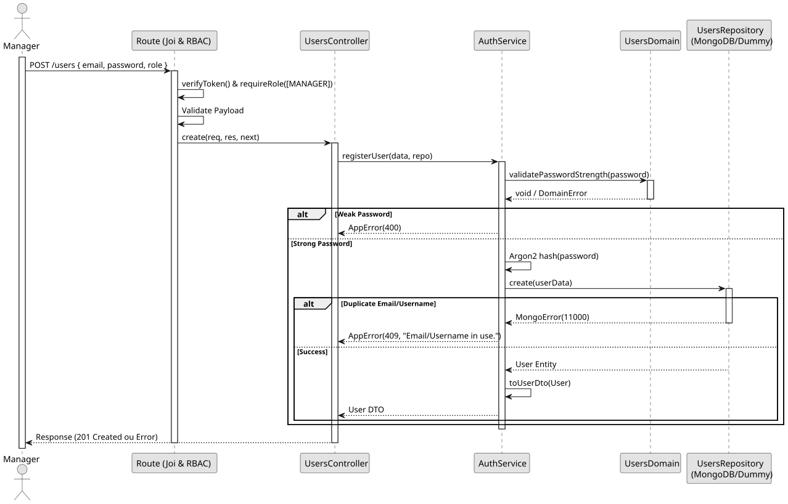

# UC2: Register User

## 1. Domain Assumptions
* Due to a lack of client clarification, the following domain restrictions were implemented in the code:
    * Passwords must comply with the strict NIST guidelines (8-64 characters, at least one uppercase letter, and one special character);
    * User roles are strictly limited to `MANAGER`, `EMPLOYEE`, or `CUSTOMER`;
    * Only users assigned the `CUSTOMER` role can have an associated `customerId`;
    * Usernames and emails must be unique across the system.

## 2. Solution Design
.

## 3. Business Logic Testing Planning
* All unit tests use isolated in-memory Dummy Repositories (`users.dummy.repository.js`). The Mockito library isn't used in this project.
* **Scenario A:** Attempt to register a user with a weak password (e.g., '123'). Result: The domain rejects the input, throwing an `app-error` (400 Bad Request) without interacting with the database.
* **Scenario B:** Provide an email already in use. Result: The Dummy Repository throws a duplicate key error (11000), which the service translates to an `app-error` (409 Conflict).
* **Scenario C:** Provide valid data with a strong password. Result: Password is hashed via `Argon2`, saved to the database, and mapped to a DTO (omitting the password and exposing `id` instead of `_id`).

## 4. Postman E2E Tests
* **Base Endpoint:** `POST /api/v1/users`
* **Validated Scenarios:**
    * Request without Bearer Token -> `401 Unauthorized`
    * Request with EMPLOYEE Bearer Token -> `403 Forbidden` (RBAC enforcement)
    * Valid payload by MANAGER -> `201 Created`
    * Missing mandatory fields (e.g., role or password) -> `400 Bad Request`
    * Duplicate email or username -> `409 Conflict`