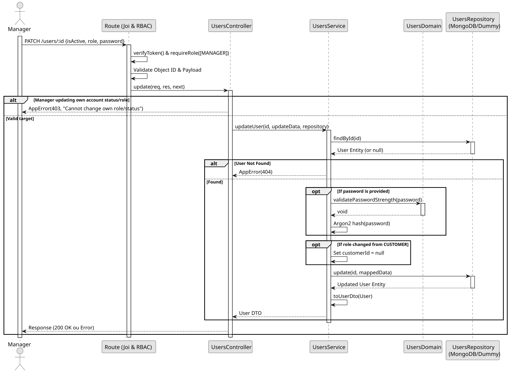

# UC3: Update User

## 1. Domain Assumptions
* Due to a lack of client clarification, the following domain restrictions were implemented in the code:
    * **Self-protection Rule:** A user with the `MANAGER` role cannot change their own role or deactivate their own account (`isActive: false`);
    * If a user's role is updated from `CUSTOMER` to another role, their associated `customerId` is automatically nullified to maintain consistency;
    * If a password update is requested, the new password is re-evaluated against NIST rules and securely hashed before persistence.

## 2. Solution Design

## 3. Business Logic Testing Planning
* All unit tests use isolated in-memory Dummy Repositories (`users.dummy.repository.js`). The Mockito library isn't used in this project.
* **Scenario A:** A Manager attempts to set `isActive: false` on their own `userId`. Result: Controller intercepts the request and throws an `AppError` (403 Forbidden).
* **Scenario B:** Change a Customer's role to Employee. Result: Role is updated and `customerId` is successfully set to `null`.
* **Scenario C:** Update the password with a valid string. Result: Repository persists the new Argon2 hash. A subsequent login attempt with the old password fails (401 Unauthorized), while the new one succeeds.

## 4. Postman E2E Tests
* **Base Endpoint:** `PATCH /api/v1/users/:id`
* **Validated Scenarios:**
  * Request without Bearer Token -> `401 Unauthorized`
  * Request with EMPLOYEE Bearer Token -> `403 Forbidden` (RBAC)
  * Empty JSON payload -> `400 Bad Request` (Requires at least one field to update)
  * Invalid `id` format (CastError prevention) -> `400 Bad Request`
  * Valid update by MANAGER -> `200 OK`