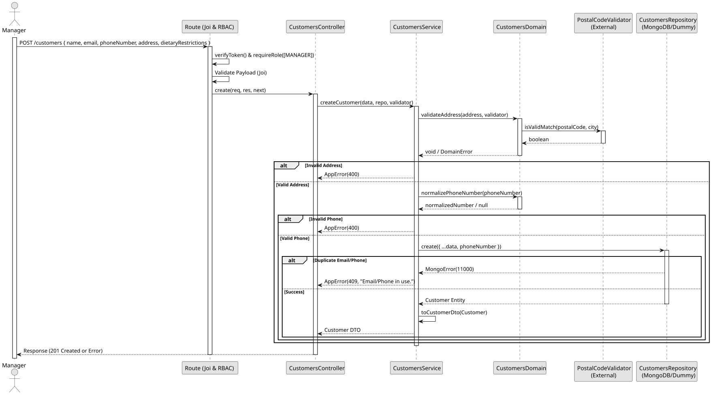

# UC1: Register Customer

## 1. Domain Assumptions
* Due to a lack of client clarification, the following domain restrictions were inquired in the code:
    * Customers must have a unique email address and a unique phone number;
    * Phone numbers must be valid Portuguese phone numbers (9 digits starting with 9, 2, or +351/00351 prefixes) and are normalized before persistence;
    * Dietary restrictions can be associated with a customer by referencing existing Allergen IDs. Duplicate restrictions are blocked;
    * Only users with the `MANAGER` role are authorized to register a new customer.

## 2. Solution Design

## 3. Business Test PLanning
* All unit tests use isolated in-memory Dummy Repositories (`customers.dummy.repository.js`) and a Dummy Postal Code Validator.
* **Scenario A:** Attempt to register a customer with an invalid phone number or unmatched postal code. Result: The domain/service rejects the input, throwing an `AppError` (400 Bad Request) without interacting with the database.
* **Scenario B:** Provide an email or phone number already in use. Result: The Dummy Repository throws a duplicate key error (11000), which the service translates to an `AppError` (409 Conflict).
* **Scenario C:** Provide valid data. Result: The phone number is normalized, the address is validated, the customer is saved to the database, and mapped to a DTO (exposing `id` instead of `_id`).

## 4. Postman E2E Tests
* **Base Endpoint:** `POST /api/v1/customers`
* **Validated Scenarios:**
    * Request without Bearer Token -> `401 Unauthorized`
    * Request with `EMPLOYEE` Bearer Token -> `403 Forbidden` (RBAC enforcement)
    * Valid payload by `MANAGER` -> `201 Created`
    * Missing mandatory fields or duplicate allergens in array -> `400 Bad Request` (Joi validation)
    * Postal code and city mismatch -> `400 Bad Request`
    * Duplicate email or phone number -> `409 Conflict`