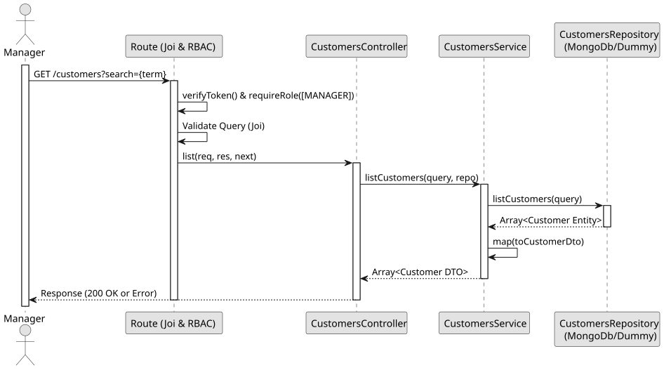

# UC2: List and Search Customers

## 1. Domain Assumptions
* Due to a lack of client clarification, the following domain restrictions were inquired in the code:
    * The system allows listing all customers or filtering them based on a search term;
    * The search term performs a case-insensitive partial match across the customer's name, email, and phone number;
    * Only users with the `MANAGER` role can view the customer list.

## 2. Solution Design

## 3. Business Test PLanning
* All unit tests use isolated in-memory Dummy Repositories (`customers.dummy.repository.js`) and a Dummy Postal Code Validator.
* **Scenario A:** Request the list without a seach parameter. Result: Returns an array of all customer DTOs.
* **Scenario B:** Provide a search term that matches a specific customer's email or phone number. Result: Returns an array with the matched customer DTOs.
* **Scenario C:** Provide a search term that matches no customers. Result: Returns an empty array.

## 4. Postman E2E Tests
* **Base Endpoint:** `GET /api/v1/customers`
* **Validated Scenarios:**
    * Request without Bearer Token -> `401 Unauthorized`
    * Request with `EMPLOYEE` Bearer Token -> `403 Forbidden` (RBAC enforcement)
    * Valid request without search query -> `200 OK` (Returns all customers)
    * Valid request with matching search query -> `200 OK` (Returns matched customers)
    * Valid request with non-matching search query -> `200 OK` (Returns `[]`)