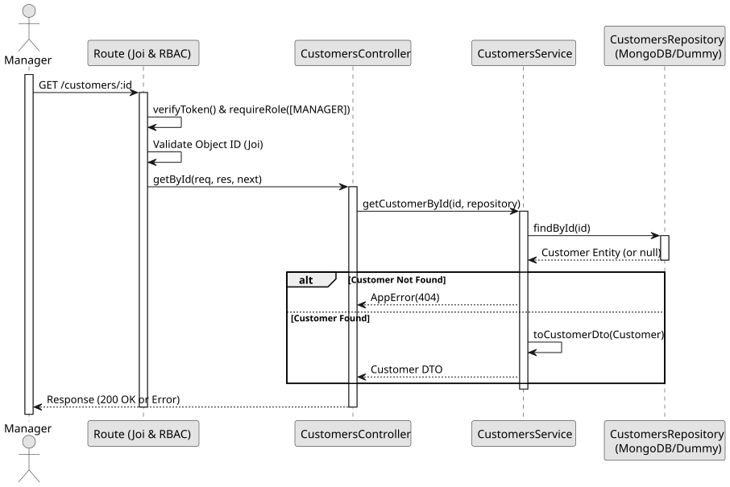

# UC3: Get Customer by ID

## 1. Domain Assumptions
* Due to a lack of client clarification, the following domain restrictions were inquired in the code:
    * Customers can be queried individually by their ID;
    * The ID must conform to the MongoDB ObjectId format;
    * Only users with the `MANAGER` role can view customer details.

## 2. Solution Design

## 3. Business Test Planning
* All unit tests use isolated in-memory Dummy Repositories (`customers.dummy.repository.js`).
* **Scenario A:** Request with a valid existing ID. Result: Returns the corresponding customer DTO.
* **Scenario B:** Request with an ID that does not exist in the database. Result: Throws an `AppError` (404 Not Found).

## 4. Postman E2E Tests
* **Base Endpoint:** `GET /api/v1/customers/:id`
* **Validated Scenarios:**
    * Request without Bearer Token -> `401 Unauthorized`
    * Request with `EMPLOYEE` Bearer Token -> `403 Forbidden` (RBAC enforcement)
    * Request with invalid ID format -> `400 Bad Request` (Joi CastError prevention)
    * Request with non-existent ID -> `404 Not Found`
    * Request with valid ID -> `200 OK` (Returns customer DTO)