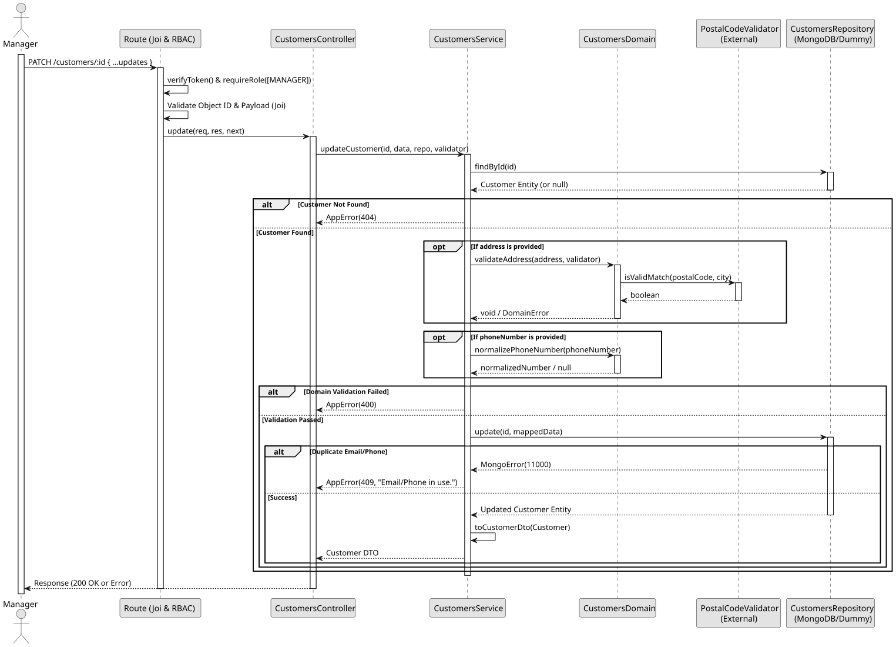

# UC4: Update Customer

## 1. Domain Assumptions
* Due to a lack of client clarification, the following domain restrictions were inquired in the code:
    * Customers can have their details partially updated (name, email, phone number, address, dietary restrictions);
    * Customers can be logically deleted (deactivated) by setting `isActive: false`;
    * Updating the phone number triggers validation and normalization. The new phone number must be unique;
    * Updating the address triggers validation against the external Postal Code Validator.
    * Updating the email requires the new email to be unique;
    * Only users with the `MANAGER` role can update customer details.

## 2. Solution Design

## 3. Business Test Planning
* **Isolation Strategy:** All application tests use dependency injection via isolated in-memory Dummies (`customers.dummy.repository.js`) and a Dummy Postal Code Validator, avoiding Mocking libraries entirely.
* **Domain Tests (`customers.domain.test.js`):**
    * `validatePhoneNumber validates strictly Portuguese formats`
    * `normalizePhoneNumber returns the 9 national digits or null`
    * `validateAddress relies securely on the injected validator`
* **Application Tests (`customers.service.test.js`):**
    * `updateCustomer applies partial changes and preserves existing data`
    * `updateCustomer rejects a phone or email used by another customer`
    * `createCustomer and updateCustomer turn an address mismatch into a 400 AppError`

## 4. Postman E2E Tests
* **Base Endpoint:** `PATCH /api/v1/customers/:id`
* **Validated Scenarios:**
    * Request without Bearer Token -> `401 Unauthorized`
    * Request with `EMPLOYEE` Bearer Token -> `403 Forbidden` (RBAC enforcement)
    * Empty JSON payload -> `400 Bad Request` (Requires at least one field to update)
    * Invalid ID format -> `400 Bad Request`
    * Non-existent ID -> `404 Not Found`
    * Postal code and city mismatch -> `400 Bad Request`
    * Duplicate email or phone number -> `409 Conflict`
    * Valid partial update or deactivation -> `200 OK`