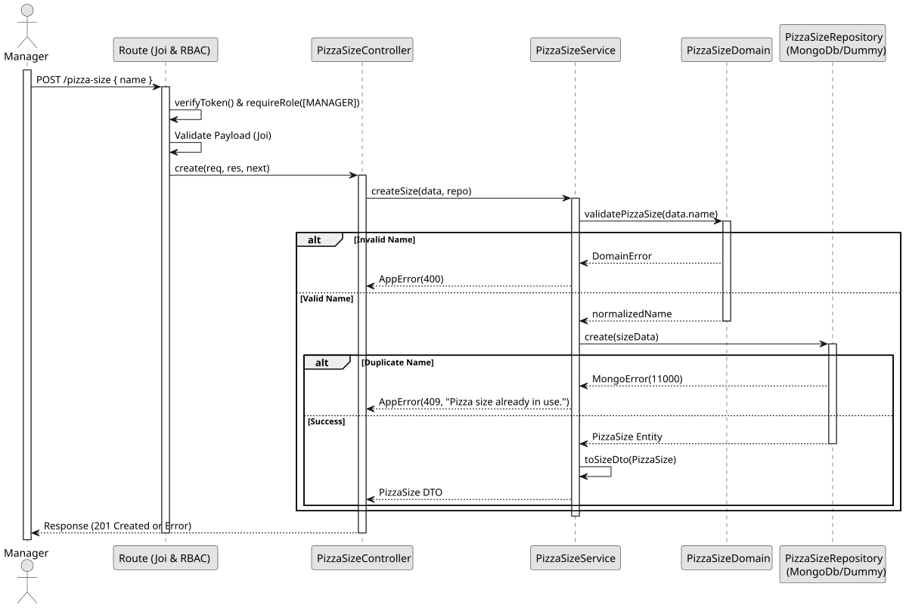

# UC1: Create Pizza Size

## 1. Domain Assumptions
* Pizza Sizes must have a unique and descriptive name;
* The name is mandatory and cannot be empty;
* Only users with the `MANAGER` role are authorized to create a new pizza size.

## 2. Solution Design

## 3. Business Test Planning
* **Isolation Strategy:** All application tests use dependency injection via isolated in-memory Dummies (`pizza-size.dummy.repository.js`), avoiding Mocking libraries entirely.
* **Domain Tests (`pizza-size.domain.test.js`):**
    * `validatePizzaSize rejects invalid data types and formats`
    * `validatePizzaSize accepts valid strings`
* **Application Tests (`pizza-size.service.test.js`):**
    * `createSize creates a new size and returns DTO`
    * `createSize returns 409 Conflict on duplicate name`

## 4. Postman E2E Tests
* **Base Endpoint:** `POST /api/v1/pizza-size`
* **Validated Scenarios:**
    * Request without Bearer Token -> `401 Unauthorized`
    * Request with `EMPLOYEE` Bearer Token -> `403 Forbidden` (RBAC enforcement)
    * Valid payload by `MANAGER` -> `201 Created`
    * Missing mandatory fields -> `400 Bad Request` (Joi validation)
    * Duplicate pizza size name -> `409 Conflict`