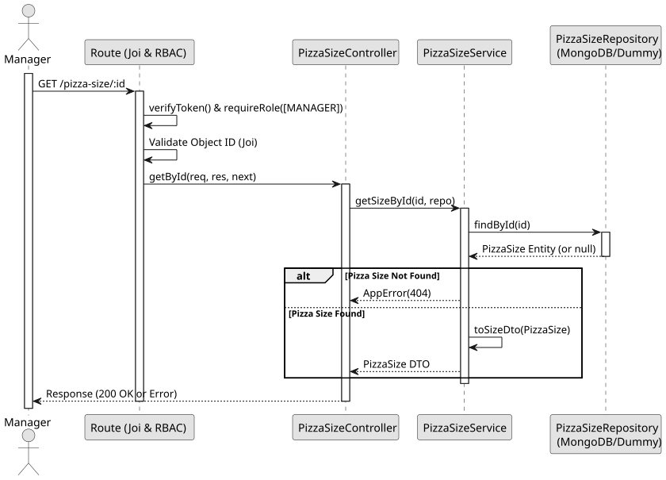

# UC3: Get Pizza Size by ID

## 1. Domain Assumptions
* Pizza sizes can be queried individually by their unique ID;
* The ID must conform to the MongoDB ObjectId format;
* Only users with the `MANAGER` role can view pizza size details directly.

## 2. Solution Design

## 3. Business Test Planning
* **Isolation Strategy:** All application tests use dependency injection via isolated in-memory Dummies (`pizza-size.dummy.repository.js`), avoiding Mocking libraries entirely.
* **Application Tests (`pizza-size.service.test.js`):**
    * `getSizeById returns correct size or throws 404`

## 4. Postman E2E Tests
* **Base Endpoint:** `GET /api/v1/pizza-size/:id`
* **Validated Scenarios:**
  * Request without Bearer Token -> `401 Unauthorized`
  * Request with `EMPLOYEE` Bearer Token -> `403 Forbidden` (RBAC enforcement)
  * Request with invalid ID format -> `400 Bad Request` (Joi CastError prevention)
  * Request with non-existent ID -> `404 Not Found`
  * Request with valid ID -> `200 OK` (Returns pizza size DTO)