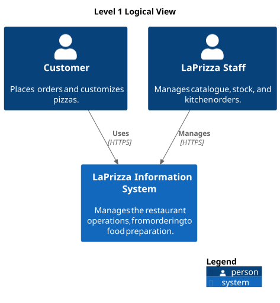

# Context

The system is developed in the LEI-ISEP 5th Semester Integrative Project (2026/27).   The project simulates a **Request for Proposal** issued by **LaPrizza**. Each team acts as an independent IT company and builds a prototype (proof of concept) that shows the integration of several technologies and the feasibility of the proposed architecture.   The participating course units are ASIST, ARQSI, IARTI, LAPR5 and SGRAI. The work is organized in three sprints, each delivering an integrated MVP.

| **Sprint** | **Period**               | **Participating UCs**             | **Focus**                                                                                                              |
| :--------: | :----------------------- | :-------------------------------- | :--------------------------------------------------------------------------------------------------------------------- |
|     1      | 14/09/2026 to 25/10/2026 | LAPR5, ARQSI                      | Project setup;   Domain modelling;   System architecture;   First iteration of the back-end and its REST APIs |
|     2      | 26/10/2026 to 22/11/2026 | LAPR5, ARQSI, ASIST, IARTI, SGRAI | Development and integration of the second MVP                                                                          |
|     3      | 23/11/2026 to 20/12/2026 | LAPR5, ARQSI, ASIST, IARTI, SGRAI | Development;   Integration and consolidation of the third MVP                                                       |

The final assessment takes place between **04/01/2027** and **07/01/2027**.

**Goals Of The Architecture:**

- Identify the principal applications, modules and external systems, their responsibilities and their interactions (ARC02);
- Allow the progressive integration of the **Web Application**, **3D Visualization**, **AI Scheduling** and **Infrastructure** without redesigning what already exists;
- Keep domain and business rules independent of presentation, persistence and infrastructure mechanisms.
- Define a clear architecture for the back-end delivered in Sprint 1, and keep the implementation consistent with the documented architecture;
- Record the relevant architectural decisions and their rationale, so that the stakeholders listed in section 1.2 can find what they need.

## Level 1 Logical View

Each actor has different functionalities in the system.

- The `Customers` can **place orders** and **customize pizzas**;
- The `Staff` can **manage catalogue**, **stock** and **kitchen orders**;
- `Managers` **maintain the business information** (users and roles, customers, products and their categories, allergens, pizza sizes and component types, component size configurations, stock and predefined pizzas).

### Element Catalog

| **Element**                   | **Type**        | **Responsibility**                                                                                                                            |
| :---------------------------- | :-------------- | :-------------------------------------------------------------------------------------------------------------------------------------------- |
| `Customer`                    | Person          | Consumer of the restaurant's products.   Consults the product catalogue;   Customizes pizzas and places orders.                         |
| `LaPrizza Staff`              | Person          | Restaurant staff, in the roles of Manager (maintains the business information);   Employee (handles orders and food preparation, planned). |
| `LaPrizza Information System` | Software System | Manages the restaurant operations, from ordering to food preparation.                                                                         |
