# Dependencies

This document identifies and justifies the **classes dependencies**, as required by the User Story **ARC01**, as well as **aggregate dependencies**, required by User Story **ARC02**.

## Classes Dependencies

A class needs to navigate through other to meet its responsibility.

## Aggregates Dependencies

It's the aggregation of class dependencies at aggregate diagram level, relevant to the architecture in modules, like requested by ARC02.

## Class Level Dependencies Table

| From                         | To                    | Nature           | Mandatory Direction?                        | 
|------------------------------|-----------------------|------------------|---------------------------------------------|
| `User`                       | `Role`                | Composition      | Yes                                         |
| `Customer`                   | `Address`             | Composition      | Yes                                         |
| `Customer`                   | `DietaryRestriction`  | Composition      | Yes                                         |
| `Customer`                   | `Order`               | Association      | In future sprints                           |
| `DietaryRestriction`         | `Allergen`            | Association      | No                                          |
| `Product`                    | `ProductCategory`     | Association      | Yes                                         |
| `Product`                    | `Allergen`            | Association      | No                                          |
| `Product`                    | `StockInformation`    | Composition      | No                                          |
| `Product`                    | `PizzaComponentType`  | Association      | No                                          |
| `ComponentSizeConfiguration` | `Product`             | Association      | Yes                                         |
| `ComponentSizeConfiguration` | `PizzaSize`           | Association      | Yes                                         |
| `PizzaConfiguration`         | `PredefinedPizza`     | Association      | No                                          |
| `PizzaConfiguration`         | `Product`             | Association      | Yes                                         |
| `PredefinedPizza`            | `Product`             | Association      | Yes                                         |
| `PredefinedPizza`            | `PizzaConfiguration`  | Composition      | Yes                                         |
| `Order`                      | `Customer`            | Association      | Yes                                         |
| `Order`                      | `Orderitem`           | Composition      | Yes                                         |
| `Orderitem`                  | `Product`             | Association      | Conditional (XOR with `PizzaConfiguration`) |
| `Orderitem`                  | `PizzaConfiguration`  | Association      | Conditional (XOR with `Product`)            |  
| `Orderitem`                  | `PreparationActivity` | Association      | No                                          |
| `PreparationActivity`        | `KitchenResource`     | Association      | No                                          |
| `PreparationActivity`        | `PreparationActivity` | Auto-Association | No                                          |

***Note:** No User Story from Sprint 1 depends on others from future sprints. The dependency is inverted.*

## Aggregate Level Dependencies

According to the project's Domain Model, the aggregate dependencies are represented by the following graph:

**Graph Clarification:**
1. `User` is the most **independent aggregate of the system**, not depending on any business concepts.
2. `Stock` and `Kitchen` are **not dependent on any other aggregates**.
3. `Customer` depends on `Product` as this may maintain information about `DietaryRestriction`.
4. `Order` **depends on everything** that is set to be implemented in **Sprint 1**.