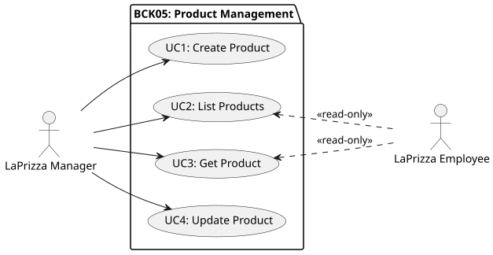
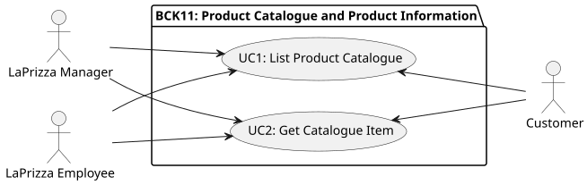
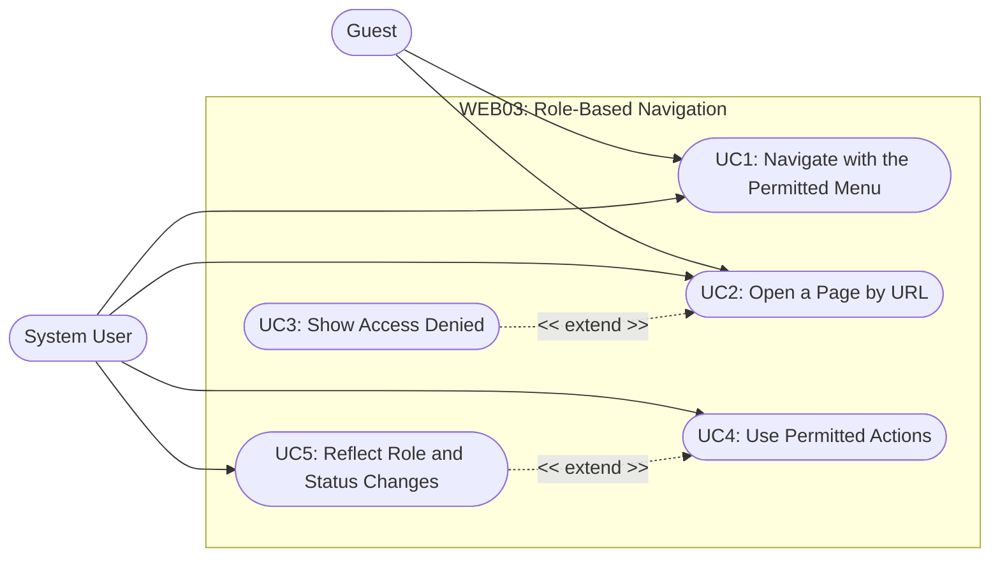
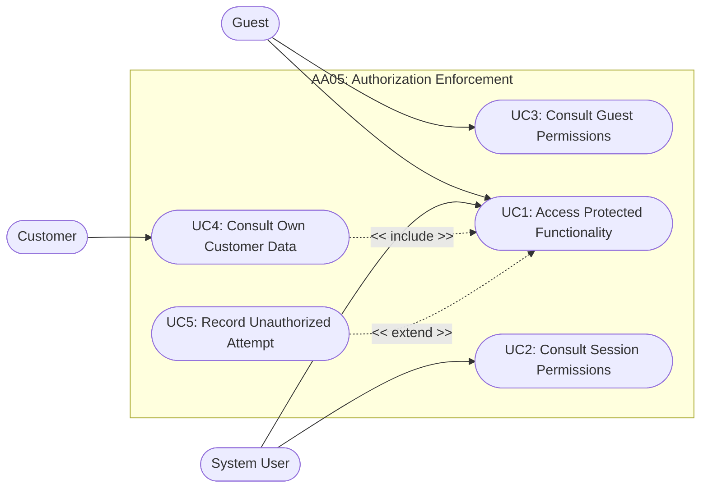
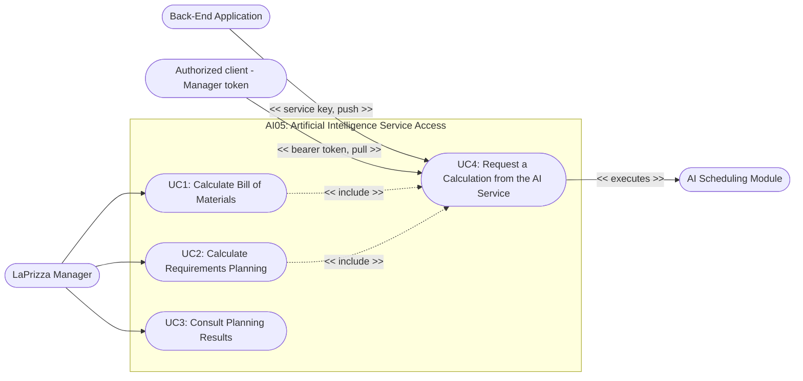

# Use Case Views

This document shows who uses the LaPrizza information system and which business capabilities are available to each actor in Sprint 1, plus the Kitchen Configuration, AI Planning, AI Service Access, AI Knowledge Base, Scene Lighting, Light Controls, Local Authentication and Account Activation user stories (WEB06, WEB07, VIS05, VIS06, AA01, AA07, AI05, AI06) of Sprint 2. The system is treated as a black box: only actors and use cases are represented, with no internal components.

- [Use Case Views](#use-case-views)
  - [Actors](#actors)
  - [Use Cases Diagram](#use-cases-diagram)
  - [User Stories](#user-stories)
    - [BCK01: User and Authentication Management](#bck01-user-and-authentication-management)
      - [Flow Mapping](#flow-mapping)
    - [BCK02: Customer Management](#bck02-customer-management)
      - [Flow Mapping](#flow-mapping-1)
    - [BCK03: Product Category Management](#bck03-product-category-management)
      - [Flow Mapping](#flow-mapping-2)
    - [BCK04: Allergen Management](#bck04-allergen-management)
      - [Flow Mapping](#flow-mapping-3)
    - [BCK05: Product Management](#bck05-product-management)
      - [Flow Mapping](#flow-mapping-4)
    - [BCK06: Pizza Size Management](#bck06-pizza-size-management)
      - [Flow Mapping](#flow-mapping-5)
    - [BCK07: Pizza Component Type Management](#bck07-pizza-component-type-management)
      - [Flow Mapping](#flow-mapping-6)
    - [BCK08: Pizza Component Configuration](#bck08-pizza-component-configuration)
      - [Flow Mapping](#flow-mapping-7)
    - [BCK09: Stock Information Management](#bck09-stock-information-management)
      - [Flow Mapping](#flow-mapping-8)
    - [BCK10: Predefined Pizza Management](#bck10-predefined-pizza-management)
      - [Flow Mapping](#flow-mapping-9)
    - [BCK11: Product Catalogue and Product Information](#bck11-product-catalogue-and-product-information)
      - [Flow Mapping](#flow-mapping-10)
    - [WEB03: Role-Based Navigation](#web03-role-based-navigation)
      - [Use Case Descriptions](#use-case-descriptions)
      - [Flow Mapping](#flow-mapping-11)
    - [WEB06: Kitchen Configuration and 3D Integration](#web06-kitchen-configuration-and-3d-integration)
      - [Use Case Descriptions](#use-case-descriptions-1)
      - [Flow Mapping](#flow-mapping-12)
    - [WEB07: Artificial Intelligence Configuration and Execution](#web07-artificial-intelligence-configuration-and-execution)
      - [Use Case Descriptions](#use-case-descriptions-2)
      - [Flow Mapping](#flow-mapping-13)
    - [AA01: Local Authentication](#aa01-local-authentication)
      - [Use Case Descriptions](#use-case-descriptions-3)
      - [Flow Mapping](#flow-mapping-14)
    - [AA05: Authorization Enforcement](#aa05-authorization-enforcement)
      - [Use Case Descriptions](#use-case-descriptions-4)
      - [Flow Mapping](#flow-mapping-15)
    - [AA07: Secure Account Activation](#aa07-secure-account-activation)
      - [Use Case Descriptions](#use-case-descriptions-5)
      - [Flow Mapping](#flow-mapping-16)
    - [VIS05: Scene Lighting](#vis05-scene-lighting)
      - [Use Case Descriptions](#use-case-descriptions-6)
      - [Flow Mapping](#flow-mapping-17)
    - [VIS06: Interactive Light Controls](#vis06-interactive-light-controls)
      - [Use Case Descriptions](#use-case-descriptions-7)
      - [Flow Mapping](#flow-mapping-18)
    - [AI05: Artificial Intelligence Service Access](#ai05-artificial-intelligence-service-access)
      - [Use Case Descriptions](#use-case-descriptions-6)
      - [Flow Mapping](#flow-mapping-17)
    - [AI06: Back-End Data and Prolog Knowledge Base](#ai06-back-end-data-and-prolog-knowledge-base)
      - [Use Case Descriptions](#use-case-descriptions-8)
      - [Flow Mapping](#flow-mapping-19)

## Actors

| Actor                          | Description                                                                                                                                                                                                                                                    |
| :----------------------------- | :------------------------------------------------------------------------------------------------------------------------------------------------------------------------------------------------------------------------------------------------------------- |
| **System User**                | Any registered entity capable of authenticating into the system. Acts as the base role.                                                                                                                                                                        |
| **LaPrizza Manager**           | Back-office user who manages customers, products, categories, allergens, pizza configurations, stock, kitchen configurations, forecasts, supplier scenarios and planning. User administration is not part of this role (AA06).                                 |
| **Employee**                   | Restaurant staff member with read-only operational access: the catalogue, products and pizza configurations, and the stock of active products (AA05).                                                                                                          |
| **Customer**                   | External client interacting with the system to consult the catalog and their own customer data.                                                                                                                                                                |
| **Guest**                      | Person without a session. Has only the Guest permissions: browse the public catalogue (with the allergens of each product) and use the authentication entry points (AA05).                                                                                     |
| **3D Visualization Module**    | Secondary (system) actor. The embedded 3D viewer that consumes the active kitchen configuration to render the kitchen, and renders its lighting.                                                                                                               |
| **AI Scheduling Module**       | Secondary (system) actor. The SWI-Prolog service that calculates the Bill of Materials and the requirements planning (AI05). The Web Application reaches it only through the Back-End Application, which calls it with a service key; direct calls with a Manager token are used for tests and demos.                                                                       |
| **Invited User**               | Person with an inactive account and an activation invitation (AA06), not yet authenticated. Completes the activation (AA07).                                                                                                                                   |
| **E-mail Server**              | Secondary (system) actor. SMTP server that delivers the e-mails sent by the back end: password recovery links (AA01) and activation invitations (AA06). Mailpit in every environment ([ADR-0045](../adr/0045-e-mail-delivery-with-nodemailer-and-mailpit.md)). |
| **External Identity Provider** | Secondary (external) actor. OpenID Connect provider (Google, Microsoft) that authenticates external users (AA02) and confirms the identity of an invited external user (AA07).                                                                                 |

## Use Cases Diagram

## User Stories

### BCK01: User and Authentication Management

#### Flow Mapping

| User Story | Use Case               | Primary Actor    | Flow Document (SAD)                                       |
| :--------- | :--------------------- | :--------------- | :-------------------------------------------------------- |
| **BCK01**  | UC1: Authenticate User | System User      | [Login](../flows/authentication/login.md)                 |
| **BCK01**  | UC2: Register User     | LaPrizza Manager | [Register User](../flows/authentication/register-user.md) |
| **BCK01**  | UC3: List Users        | LaPrizza Manager | [List Users](../flows/user/list-users.md)                 |
| **BCK01**  | UC4: Get User          | LaPrizza Manager | [Get User](../flows/user/get-user.md)                     |
| **BCK01**  | UC5: Update User       | LaPrizza Manager | [Update User](../flows/user/update-user.md)               |

### BCK02: Customer Management

#### Flow Mapping

| User Story | Use Case               | Primary Actor    | Flow Document (SAD)                                         |
| :--------- | :--------------------- | :--------------- | :---------------------------------------------------------- |
| **BCK02**  | UC1: Register Customer | LaPrizza Manager | [Register Customer](../flows/customer/register-customer.md) |
| **BCK02**  | UC2: List Customers    | LaPrizza Manager | [List Customers](../flows/customer/list-search-customer.md) |
| **BCK02**  | UC3: Update Customer   | LaPrizza Manager | [Update Customer](../flows/customer/update-customer.md)     |

### BCK03: Product Category Management

#### Flow Mapping

| User Story | Use Case                     | Primary Actor    | Flow Document (SAD)                                                                  |
| :--------- | :--------------------------- | :--------------- | :----------------------------------------------------------------------------------- |
| **BCK03**  | UC1: Create Product Category | LaPrizza Manager | [Create Product Category](../flows/product-category/create-product-category.md)      |
| **BCK03**  | UC2: List Product Categories | LaPrizza Manager | [List Product Categories](../flows/product-category/list-search-product-category.md) |
| **BCK03**  | UC3: Update Product Category | LaPrizza Manager | [Update Product Category](../flows/product-category/update-product-category.md)      |
| **BCK03**  | UC4: Remove Product Category | LaPrizza Manager | [Remove Product Category](../flows/product-category/remove-product-category.md)      |

### BCK04: Allergen Management

#### Flow Mapping

| User Story | Use Case                      | Primary Actor               | Flow Document (SAD)                                                       |
| :--------- | :---------------------------- | :-------------------------- | :------------------------------------------------------------------------ |
| **BCK04**  | UC1: Create Allergen          | LaPrizza Manager            | [Create Allergen](../flows/allergen/create-allergen.md)                   |
| **BCK04**  | UC2: List Allergens           | LaPrizza Manager / Employee | [List Allergens](../flows/allergen/list-search-allergens.md)              |
| **BCK04**  | UC3: Consult Allergen by Id   | LaPrizza Manager / Employee | [Consult Allergen by Id](../flows/allergen/consult-allergen-by-id.md)     |
| **BCK04**  | UC4: Consult Allergen by Name | LaPrizza Manager / Employee | [Consult Allergen by Name](../flows/allergen/consult-allergen-by-name.md) |
| **BCK04**  | UC5: Deactivate Allergen      | LaPrizza Manager            | [Deactivate Allergen](../flows/allergen/deactivate-allergen.md)           |

### BCK05: Product Management

#### Flow Mapping

| User Story | Use Case            | Primary Actor               | Flow Document (SAD)                                      |
| :--------- | :------------------ | :-------------------------- | :------------------------------------------------------- |
| **BCK05**  | UC1: Create Product | LaPrizza Manager            | [Create Product](../flows/product/create-product.md)     |
| **BCK05**  | UC2: List Products  | LaPrizza Manager / Employee | [List Products](../flows/product/list-search-product.md) |
| **BCK05**  | UC3: Get Product    | LaPrizza Manager / Employee | [Get Product](../flows/product/get-product.md)           |
| **BCK05**  | UC4: Update Product | LaPrizza Manager            | [Update Product](../flows/product/update-product.md)     |

### BCK06: Pizza Size Management

#### Flow Mapping

| User Story | Use Case               | Primary Actor    | Flow Document (SAD)                                               |
| :--------- | :--------------------- | :--------------- | :---------------------------------------------------------------- |
| **BCK06**  | UC1: Create Pizza Size | LaPrizza Manager | [Create Pizza Size](../flows/pizza-size/create-pizza-size.md)     |
| **BCK06**  | UC2: List Pizza Sizes  | LaPrizza Manager | [List Pizza Sizes](../flows/pizza-size/list-search-pizza-size.md) |
| **BCK06**  | UC3: Get Pizza Size    | LaPrizza Manager | [Get Pizza Sizes](../flows/pizza-size/get-pizza-size.md)          |
| **BCK06**  | UC4: Update Pizza Size | LaPrizza Manager | [Update Pizza Size](../flows/pizza-size/update-pizza-size.md)     |

### BCK07: Pizza Component Type Management

#### Flow Mapping

| User Story | Use Case                         | Primary Actor    | Flow Document (SAD)                                                                             |
| :--------- | :------------------------------- | :--------------- | :---------------------------------------------------------------------------------------------- |
| **BCK07**  | UC1: Create Pizza Component Type | LaPrizza Manager | [Create Pizza Component Type](../flows/pizza-component-type/create-pizza-component-type.md)     |
| **BCK07**  | UC2: List Pizza Component Types  | LaPrizza Manager | [List Pizza Component Types](../flows/pizza-component-type/list-search-pizza-component-type.md) |
| **BCK07**  | UC3: Update Pizza Component Type | LaPrizza Manager | [Update Pizza Component Type](../flows/pizza-component-type/update-pizza-component-type.md)     |
| **BCK07**  | UC4: Remove Pizza Component Type | LaPrizza Manager | [Remove Pizza Component Type](../flows/pizza-component-type/remove-pizza-component-type.md)     |

### BCK08: Pizza Component Configuration

#### Flow Mapping

| User Story | Use Case                                  | Primary Actor    | Flow Document (SAD)                                                                                                       |
| :--------- | :---------------------------------------- | :--------------- | :------------------------------------------------------------------------------------------------------------------------ |
| **BCK08**  | UC1: Create Pizza Component Configuration | LaPrizza Manager | [Create Pizza Component Configuration](../flows/pizza-component-configuration/create-component-size-configuration.md)     |
| **BCK08**  | UC2: List Pizza Component Configurations  | LaPrizza Manager | [List Pizza Component Configurations](../flows/pizza-component-configuration/list-search-component-size-configuration.md) |
| **BCK08**  | UC3: Update Pizza Component Configuration | LaPrizza Manager | [Update Pizza Component Configuration](../flows/pizza-component-configuration/update-component-size-configuration.md)     |
| **BCK08**  | UC4: Remove Pizza Component Configuration | LaPrizza Manager | [Remove Pizza Component Configuration](../flows/pizza-component-configuration/remove-component-size-configuration.md)     |

### BCK09: Stock Information Management

#### Flow Mapping

| User Story | Use Case                  | Primary Actor    | Flow Document (SAD)                                       |
| :--------- | :------------------------ | :--------------- | :-------------------------------------------------------- |
| **BCK09**  | UC1: List Product Stock   | LaPrizza Manager | [List Product Stock](../flows/stock/list-search-stock.md) |
| **BCK09**  | UC2: Get Product Stock    | LaPrizza Manager | [Get Product Stock](../flows/stock/get-stock.md)          |
| **BCK09**  | UC3: Adjust Product Stock | LaPrizza Manager | [Adjust Product Stock](../flows/stock/adjust-stock.md)    |

### BCK10: Predefined Pizza Management

#### Flow Mapping

| User Story | Use Case                              | Primary Actor    | Flow Document (SAD)                                                                               |
| :--------- | :------------------------------------ | :--------------- | :------------------------------------------------------------------------------------------------ |
| **BCK10**  | UC1: Define Predefined Pizza          | LaPrizza Manager | [Define Predefined Pizza](../flows/predefined-pizza/define-predefined-pizza.md)                   |
| **BCK10**  | UC2: List Predefined Pizzas           | LaPrizza Manager | [List Predefined Pizzas](../flows/predefined-pizza/list-search-predefined-pizzas.md)              |
| **BCK10**  | UC3: Consult Predefined Pizza by Id   | LaPrizza Manager | [Consult Predefined Pizza by Id](../flows/predefined-pizza/consult-predefined-pizza-by-id.md)     |
| **BCK10**  | UC4: Consult Predefined Pizza by Name | LaPrizza Manager | [Consult Predefined Pizza by Name](../flows/predefined-pizza/consult-predefined-pizza-by-name.md) |
| **BCK10**  | UC5: Update Predefined Pizza          | LaPrizza Manager | [Update Predefined Pizza](../flows/predefined-pizza/update-predefined-pizza.md)                   |
| **BCK10**  | UC6: Deactivate Predefined Pizza      | LaPrizza Manager | [Deactivate Predefined Pizza](../flows/predefined-pizza/deactivate-predefined-pizza.md)           |

### BCK11: Product Catalogue and Product Information

#### Flow Mapping

| User Story | Use Case                    | Primary Actor    | Flow Document (SAD)                                                           |
| :--------- | :-------------------------- | :--------------- | :---------------------------------------------------------------------------- |
| **BCK11**  | UC1: List Product Catalogue | LaPrizza Manager | [List Product Catalogue](../flows/product-catalogue/list-search-catalogue.md) |
| **BCK11**  | UC2: Get Catalogue Item     | LaPrizza Manager | [Get Catalogue Item](../flows/product-catalogue/get-catalogue-item.md)        |

### WEB03: Role-Based Navigation

The Web Application shows each user only the sections and actions they may use. The menu, the protection of each page and the buttons of each action are decided with the permissions returned by the back end for the session (or, without a session, the Guest permissions), never with role names, so they always follow Table 1 and give users with several roles the union of their access. Typing the URL of an unauthorized section shows a generic "access denied" page (or the login, for a Guest) and never loads its data. Role and account changes made by an Administrator reach an open tab when the user returns to it or when the API refuses a request. Hiding is only a convenience: the back end checks every request (AA05).

#### Use Case Descriptions

| Use Case | Primary Actor | Description | Main Rules | ADRs |
| :------- | :------------ | :---------- | :--------- | :--- |
| **UC1: Navigate with the Permitted Menu** | Guest, System User | Opens the Web Application and sees a menu with only the sections they may use. | The session is restored and the Guest permissions are loaded before the first page. The menu uses the permissions of the session, or the Guest ones without a session, and shows each page whose permission is granted. A user with several roles sees the union of their sections; a user without roles sees only what a Guest sees. The Web Application keeps no copy of the permission matrix. | [ADR-0046](../adr/0046-permission-based-authorization-matrix.md), [ADR-0047](../adr/0047-permission-driven-navigation-in-the-web-application.md) |
| **UC2: Open a Page by URL** | Guest, System User | Opens a section from the menu or by typing its URL. | The same guard protects both paths, using the access rule of the page in the registry. While the session is being restored nothing is decided. A Guest goes to the login and returns to the requested page afterwards. Only an allowed page is loaded, so a refused page never requests its data. Unknown URLs show "page not found". | [ADR-0047](../adr/0047-permission-driven-navigation-in-the-web-application.md) |
| **UC3: Show Access Denied** | - (extends UC2) | A user with a session opens a section they may not use. | Shown at the requested URL, inside the normal layout, with a link to the home page. The message is generic: it never names the permission, the role or anything of the page. | [ADR-0047](../adr/0047-permission-driven-navigation-in-the-web-application.md) |
| **UC4: Use Permitted Actions** | System User | Uses the buttons and forms of a page (for example adjusting stock). | Each action is offered only with the permission of its API route; read-only pages say so. The back end checks the request anyway: a refused request shows the error and triggers UC5. | [ADR-0046](../adr/0046-permission-based-authorization-matrix.md), [ADR-0047](../adr/0047-permission-driven-navigation-in-the-web-application.md) |
| **UC5: Reflect Role and Status Changes** | System User | After an Administrator changes the roles or the status of the account, the open tab shows the new access. | The user is reloaded from the back end when the tab becomes visible again and after any `403`. The menu, the guards and the buttons update at once; an open page that is no longer allowed becomes "access denied". A disabled account or an ended session (`401`) ends the session in the Web Application and leads to the login. | [ADR-0032](../adr/0032-secure-session-handling-in-the-api-and-the-spa.md), [ADR-0047](../adr/0047-permission-driven-navigation-in-the-web-application.md) |

#### Flow Mapping

| User Story | Use Case | Primary Actor | Flow Document (SAD) |
| :--------- | :------- | :------------ | :------------------ |
| **WEB03**  | UC1: Navigate with the Permitted Menu | Guest, System User | [Navigate with the Permitted Menu](../flows/role-based-navigation/navigate-with-permitted-menu.md) |
| **WEB03**  | UC2: Open a Page by URL | Guest, System User | [Open a Page by URL](../flows/role-based-navigation/open-page-by-url.md) |
| **WEB03**  | UC3: Show Access Denied | - | Shown in [Open a Page by URL](../flows/role-based-navigation/open-page-by-url.md) |
| **WEB03**  | UC4: Use Permitted Actions | System User | [Use Permitted Actions](../flows/role-based-navigation/use-permitted-actions.md) |
| **WEB03**  | UC5: Reflect Role and Status Changes | System User | [Reflect Role and Status Changes](../flows/role-based-navigation/reflect-role-and-status-changes.md) |

The page registry, the business rules and the element catalogue of the feature are in the [Role-Based Navigation README](../flows/role-based-navigation/README.md).

### WEB06: Kitchen Configuration and 3D Integration

The Kitchen Configuration and 3D Integration page lets a Manager import kitchen configurations (dimensions, equipment positions and visual properties), choose the one that is active and keep them up to date. The 3D Visualization Module renders the active configuration, which Managers and Employees can also see on the page. Employees have a read-only view: they can list and consult the configurations and see the viewer, but the page offers no create, edit, activate or delete controls and the API refuses those operations. The accepted JSON format is in [Kitchen Configuration JSON Format](../flows/kitchen-configuration/kitchen-configuration-json-format.md).

#### Use Case Descriptions

| Use Case                                 | Primary Actor                                         | Description                                                                                                                                                                                                                                                                                                              | Main Rules                                                                                                                                                                                                                                                                                                                                                                                                               | ADRs                                                                                                                                                                                                                          |
| :--------------------------------------- | :---------------------------------------------------- | :----------------------------------------------------------------------------------------------------------------------------------------------------------------------------------------------------------------------------------------------------------------------------------------------------------------------- | :----------------------------------------------------------------------------------------------------------------------------------------------------------------------------------------------------------------------------------------------------------------------------------------------------------------------------------------------------------------------------------------------------------------------- | :---------------------------------------------------------------------------------------------------------------------------------------------------------------------------------------------------------------------------- |
| **UC1: Create/Import Configuration**     | LaPrizza Manager                                      | Creates a kitchen configuration from a JSON document. On the page, an imported file is read in the browser and loaded into the editor for review; saving sends it as `application/json` to the same endpoint used to create a configuration through the API. A dry-run endpoint validates a document without storing it. | The domain validates the structure with a JSON Schema (valid dimensions, scale limits) and enforces the business invariants (unique equipment ids, asset references that are absolute http(s) URLs or root-relative paths). All violations are returned together, each with its property path. The configuration is stored as a nested BSON object, keeps its assets as self-contained URL/URIs and is created inactive. | [ADR-0020](../adr/0020-strorage-model-of-kitchen-configurations.md), [ADR-0021](../adr/0021-asset-references-strategy.md), [ADR-0022](../adr/0022-content-validation-strategy.md), [ADR-0026](../adr/0026-import-approach.md) |
| **UC2: Activate Configuration**          | LaPrizza Manager                                      | Makes a stored configuration the one in use. The previously active configuration is deactivated.                                                                                                                                                                                                                         | Exactly one configuration is active at a time. The switch is atomic (partial unique index on the active flag and a transaction); concurrent activations answer 409 and activating the already active configuration is a no-op. After the switch, the page reloads the 3D viewer without a full page refresh.                                                                                                             | [ADR-0023](../adr/0023-atomic-activation-strategy.md), [ADR-0027](../adr/0027-viewer-reload-mechanism-in-the-frontend.md)                                                                                                     |
| **UC3: Get Active Configuration**        | LaPrizza Manager / Employee / 3D Visualization Module | Returns the active configuration so that the 3D viewer can render the kitchen.                                                                                                                                                                                                                                           | A dedicated endpoint serves it to the staff roles, and the viewer requests it every time it is mounted. When no configuration is active the answer is 404, the viewer shows an empty state and no hardcoded fallback layout is returned. The payload is self-sufficient, so assets are loaded directly from their URL/URIs.                                                                                              | [ADR-0021](../adr/0021-asset-references-strategy.md), [ADR-0025](../adr/0025-active-configuration-endpoint-and-no-fallback-policy.md)                                                                                         |
| **UC4: List and Consult Configurations** | LaPrizza Manager / Employee                           | Lists the stored configurations, showing which one is active, and consults one of them (name and JSON content).                                                                                                                                                                                                          | Read-only for the Employee: the page hides the Create, Edit, Activate and Delete controls.                                                                                                                                                                                                                                                                                                                               | [ADR-0025](../adr/0025-active-configuration-endpoint-and-no-fallback-policy.md)                                                                                                                                               |
| **UC5: Edit Configuration**              | LaPrizza Manager                                      | Changes the content of a stored configuration, including the active one.                                                                                                                                                                                                                                                 | An edit is validated again with the same rules as the creation. Editing the active configuration is allowed if the new content passes all validations, and the page then remounts the viewer so that it fetches the updated layout.                                                                                                                                                                                      | [ADR-0022](../adr/0022-content-validation-strategy.md), [ADR-0024](../adr/0024-rules-for-editing-and-deleting-the-active-configuration.md), [ADR-0027](../adr/0027-viewer-reload-mechanism-in-the-frontend.md)                |
| **UC6: Delete Configuration**            | LaPrizza Manager                                      | Removes a stored configuration.                                                                                                                                                                                                                                                                                          | The active configuration cannot be deleted (409), and the page does not offer the Delete button for it, so that the viewer never ends up without a configuration.                                                                                                                                                                                                                                                        | [ADR-0024](../adr/0024-rules-for-editing-and-deleting-the-active-configuration.md)                                                                                                                                            |

#### Flow Mapping

| User Story | Use Case                             | Primary Actor                                         | Flow Document (SAD)                                                                                            |
| :--------- | :----------------------------------- | :---------------------------------------------------- | :------------------------------------------------------------------------------------------------------------- | --- |
| **WEB06**  | UC1: Create/Import Configuration     | LaPrizza Manager                                      | [Create / Import Kitchen Configuration](../flows/kitchen-configuration/create-import-kitchen-configuration.md) |
| **WEB06**  | UC2: Activate Configuration          | LaPrizza Manager                                      | [Activate Kitchen Configuration](../flows/kitchen-configuration/activate-kitchen-configuration.md)             |
| **WEB06**  | UC3: Get Active Configuration        | LaPrizza Manager / Employee / 3D Visualization Module | [Get Active Kitchen Configuration](../flows/kitchen-configuration/get-active-kitchen-configuration.md)         |
| **WEB06**  | UC4: List and Consult Configurations | LaPrizza Manager / Employee                           | [List and Consult Configurations](../flows/kitchen-configuration/list-and-consult-configurations.md)           |     |
| **WEB06**  | UC5: Edit Configuration              | LaPrizza Manager                                      | [Edit Configuration](../flows/kitchen-configuration/edit-configuration.md)                                     |
| **WEB06**  | UC6: Delete Configuration            | LaPrizza Manager                                      | [Delete Configuration](../flows/kitchen-configuration/delete-configuration.md)                                 |

The C4 context, container and component views of the feature are in [Kitchen Configuration C4 Views](../flows/kitchen-configuration/c4-views.md).

### WEB07: Artificial Intelligence Configuration and Execution

The AI configuration and execution page lets a Manager prepare the inputs of the requirements planning and run it through the AI Scheduling Module. The Manager creates, consults, edits and deactivates daily product-consumption forecasts, exports the products as JSON, imports a supplier scenario prepared by hand or with an LLM after inspecting it, executes a saved forecast version with a chosen supplier scenario, and consults every saved result together with the versions of the inputs it used. Forecasts and supplier scenarios are immutable and versioned: an edit saves the next version and a delete is a deactivation, so earlier results keep their meaning. Every calculation is a simulation: it never changes the stored stock nor creates purchase orders. The page and all its endpoints are restricted to the Manager: the back end checks a permission on every request (403 otherwise), the route `/ai` requires `planning:execute` and the navigation hides the page from other users. The accepted supplier JSON format is in [Supplier Scenario JSON Format](../flows/ai-planning/supplier-json-format.md).

#### Use Case Descriptions

| Use Case                                     | Primary Actor    | Description                                                                                                                                                                                                                                                                                | Main Rules                                                                                                                                                                                                                                                                                                                                                                                                                                                                                                             | ADRs                                                                                                                                                                   |
| :------------------------------------------- | :--------------- | :----------------------------------------------------------------------------------------------------------------------------------------------------------------------------------------------------------------------------------------------------------------------------------------- | :--------------------------------------------------------------------------------------------------------------------------------------------------------------------------------------------------------------------------------------------------------------------------------------------------------------------------------------------------------------------------------------------------------------------------------------------------------------------------------------------------------------------- | :--------------------------------------------------------------------------------------------------------------------------------------------------------------------- |
| **UC1: Create Forecast**                     | LaPrizza Manager | Creates a forecast: name, period (start and end dates) and daily entries (date, sellable product, size when the product is a pizza, quantity). The page checks the form with the same rules as the back end before sending it.                                                             | Quantities are non-negative integers and omitted entries mean zero consumption. Every rule is checked and all problems are returned together: real dates, end not before start, at least one entry, dates inside the period, known and sellable product, size required for a predefined pizza and only one of its sizes, no size for other products, no duplicate date/product/size. The back end assigns the version (1, or the next one of the same name, ignoring case); a `version` sent by the client is ignored. | [ADR-0033](../adr/0033-immutable-versioned-forecasts-and-supplier-scenarios.md), [ADR-0005](../adr/0005-contract-first-rest-api.md)                                    |
| **UC2: List and Consult Forecasts**          | LaPrizza Manager | Lists the active forecasts, grouped by name with every active version (newest first, tagged "Latest"), and shows one version with its entries, totals and the "omitted entries mean zero" note.                                                                                            | Only active versions are listed or returned; a deactivated or unknown id answers 404. The page builds the detail from the list; `GET /forecasts/{id}` is available through the API.                                                                                                                                                                                                                                                                                                                                    | [ADR-0033](../adr/0033-immutable-versioned-forecasts-and-supplier-scenarios.md)                                                                                        |
| **UC3: Edit Forecast (new version)**         | LaPrizza Manager | Opens the editor prefilled with an existing version and saves the changes as the next version of the same name.                                                                                                                                                                            | The name is read-only in the editor. Saving is a `POST` with the same name and the same rules as UC1; the edited version is never changed, so the results calculated with it stay linked to it.                                                                                                                                                                                                                                                                                                                        | [ADR-0033](../adr/0033-immutable-versioned-forecasts-and-supplier-scenarios.md), [ADR-0034](../adr/0034-recording-planning-runs-with-their-input-versions.md)          |
| **UC4: Delete (Deactivate) Forecast**        | LaPrizza Manager | Removes a forecast version from the list after a confirmation dialog.                                                                                                                                                                                                                      | Soft delete: only `{ "isActive": false }` is accepted. The document stays in the database, the saved results keep its reference, its version number is never reused, and it can no longer be chosen for a new execution.                                                                                                                                                                                                                                                                                               | [ADR-0033](../adr/0033-immutable-versioned-forecasts-and-supplier-scenarios.md)                                                                                        |
| **UC5: Export Products**                     | LaPrizza Manager | Downloads the products that can be bought as a JSON file, the input to prepare the supplier file manually or with an LLM.                                                                                                                                                                  | Includes raw materials, purchased aggregates and stock-controlled products sold directly; excludes produced aggregates and products without stock control (pizzas). Each product has its id, name, kind and the abstract stock unit; the selling price is optional and never excludes a product. Always a fresh export.                                                                                                                                                                                                | [ADR-0035](../adr/0035-supplier-import-with-client-side-checks-and-server-dry-run.md)                                                                                  |
| **UC6: Import Supplier Scenario**            | LaPrizza Manager | Pastes or loads a supplier JSON file, inspects it (parse, local checks and a server dry-run that stores nothing), reviews the preview and confirms to save it.                                                                                                                             | Suppliers with unique ids (name optional); products that exist, each listed once, with offers from listed suppliers, at most one per supplier; offer price in EUR ≥ 0, positive integer stock units, lead time in days ≥ 0, optional supply limit. Missing fields and invalid values are rejected with their path. A rejected file saves nothing, so the previous scenario stays in use. Saved offers are always marked simulated. Versioned like the forecasts.                                                       | [ADR-0033](../adr/0033-immutable-versioned-forecasts-and-supplier-scenarios.md), [ADR-0035](../adr/0035-supplier-import-with-client-side-checks-and-server-dry-run.md) |
| **UC7: List and Consult Supplier Scenarios** | LaPrizza Manager | Lists the active supplier scenarios and shows the offers of one.                                                                                                                                                                                                                           | Products without offers, or exported products missing from the scenario, are shown as "No configured supplier"; every offer is tagged "Simulated".                                                                                                                                                                                                                                                                                                                                                                     | [ADR-0033](../adr/0033-immutable-versioned-forecasts-and-supplier-scenarios.md)                                                                                        |
| **UC8: Deactivate Supplier Scenario**        | LaPrizza Manager | Removes a supplier scenario version from the list after a confirmation dialog.                                                                                                                                                                                                             | Same soft delete as UC4. Saved results keep their reference; the scenario is no longer the default for new executions.                                                                                                                                                                                                                                                                                                                                                                                                 | [ADR-0033](../adr/0033-immutable-versioned-forecasts-and-supplier-scenarios.md)                                                                                        |
| **UC9: Execute Forecast**                    | LaPrizza Manager | Runs the requirements planning of a chosen forecast version with a chosen supplier scenario (by default the latest active ones) and shows daily needs, production, replenishment by product, the daily purchase plan with suppliers and expected delivery dates, unmet needs and warnings. | The back end builds the input snapshot (catalogue and BOM, stock, AI scenario, forecast, supplier scenario) and calls the AI Scheduling Module with a service key. The calculation is synchronous and read-only: stock and the scenario stock are never changed. The page shows progress, sends one request per click and maps each failure to invalid input, missing information or service unavailable. Only a successful calculation is saved as a run.                                                             | [ADR-0034](../adr/0034-recording-planning-runs-with-their-input-versions.md), [ADR-0036](../adr/0036-synchronous-ai-execution-with-duplicate-submission-guard.md)      |
| **UC10: Consult Planning Results**           | LaPrizza Manager | Lists the saved results, optionally for one forecast version, and opens the full plan of one of them.                                                                                                                                                                                      | Each run records the request, the forecast and supplier scenario versions, the snapshot id, the BOM version, the stock source and the full result, taken from the snapshot built by the back end. The list (100 most recent) has no full result; the detail has it.                                                                                                                                                                                                                                                    | [ADR-0034](../adr/0034-recording-planning-runs-with-their-input-versions.md)                                                                                           |

#### Flow Mapping

| User Story | Use Case                                 | Primary Actor    | Flow Document (SAD)                                                                                |
| :--------- | :--------------------------------------- | :--------------- | :------------------------------------------------------------------------------------------------- |
| **WEB07**  | UC1: Create Forecast                     | LaPrizza Manager | [Create Forecast](../flows/ai-planning/create-forecast.md)                                         |
| **WEB07**  | UC2: List and Consult Forecasts          | LaPrizza Manager | [List and Consult Forecasts](../flows/ai-planning/list-and-consult-forecasts.md)                   |
| **WEB07**  | UC3: Edit Forecast (new version)         | LaPrizza Manager | [Edit Forecast](../flows/ai-planning/edit-forecast.md)                                             |
| **WEB07**  | UC4: Delete (Deactivate) Forecast        | LaPrizza Manager | [Deactivate Forecast](../flows/ai-planning/deactivate-forecast.md)                                 |
| **WEB07**  | UC5: Export Products                     | LaPrizza Manager | [Export Products](../flows/ai-planning/export-products.md)                                         |
| **WEB07**  | UC6: Import Supplier Scenario            | LaPrizza Manager | [Import Supplier Scenario](../flows/ai-planning/import-supplier-scenario.md)                       |
| **WEB07**  | UC7: List and Consult Supplier Scenarios | LaPrizza Manager | [List and Consult Supplier Scenarios](../flows/ai-planning/list-and-consult-supplier-scenarios.md) |
| **WEB07**  | UC8: Deactivate Supplier Scenario        | LaPrizza Manager | [Deactivate Supplier Scenario](../flows/ai-planning/deactivate-supplier-scenario.md)               |
| **WEB07**  | UC9: Execute Forecast                    | LaPrizza Manager | [Execute Forecast](../flows/ai-planning/execute-forecast.md)                                       |
| **WEB07**  | UC10: Consult Planning Results           | LaPrizza Manager | [Consult Planning Results](../flows/ai-planning/consult-planning-results.md)                       |

The REST API summary, the business rules and the element catalogue of the feature are in the [AI Planning README](../flows/ai-planning/README.md); the container interactions of the execution are in the Level 2 Process View of [Views](../design/views.md).

### AA01: Local Authentication

A System User signs in with a local account: the e-mail of the account and its password, without an external identity provider. The login page is opened from the **Login** button of the header; once signed in, the header shows the account menu, with **Change password** and **Logout**, and the Change password page also offers **Logout on all devices**. A user who forgot the password asks for a recovery link, receives it by e-mail and sets a new password with it. Local accounts follow the same activation, role, logout and access-control rules as external accounts (AA02): both end in the same session, and roles are always read from the database (AA03). All paths are under `/api/v2`.

The password rules are the same everywhere a password is chosen (AA01, AA07): 8 to 64 characters, with at least one uppercase letter and one of `! @ # $ % ^ & * . , - _ ?`. They are shown on every page where a password is chosen and checked by the back end.

#### Use Case Descriptions

| Use Case                             | Primary Actor | Description                                                                                                                                                                          | Main Rules                                                                                                                                                                                                                                                                                                                                                                                                                                                                                                                                                                                                                                                                                                                                                                                                                                                                                                   | ADRs                                                                                                                                                                                                                                                                                                                                                                          |
| :----------------------------------- | :------------ | :----------------------------------------------------------------------------------------------------------------------------------------------------------------------------------- | :----------------------------------------------------------------------------------------------------------------------------------------------------------------------------------------------------------------------------------------------------------------------------------------------------------------------------------------------------------------------------------------------------------------------------------------------------------------------------------------------------------------------------------------------------------------------------------------------------------------------------------------------------------------------------------------------------------------------------------------------------------------------------------------------------------------------------------------------------------------------------------------------------------- | :---------------------------------------------------------------------------------------------------------------------------------------------------------------------------------------------------------------------------------------------------------------------------------------------------------------------------------------------------------------------------- |
| **UC1: Log In with a Local Account** | System User   | Opens the login page from the **Login** button of the header and signs in with the e-mail and the password of the account. On success the user returns to the page that was requested and the header shows the account menu. | The e-mail is normalized (trim, lowercase). An unknown account and a wrong password answer the same `401 INVALID_CREDENTIALS`, and a fictitious Argon2 verification runs for unknown accounts so the time is the same. From the 3rd consecutive failure the account waits 1, 5 and then 30 minutes (`429 TOO_MANY_ATTEMPTS` with `Retry-After`), also for unknown e-mails, which are counted by their hash. Failed attempts are also limited per IP. Only with the correct password does an inactive or disabled account get `403 ACCOUNT_INACTIVE` (the user is told to use the activation invitation) or `403 ACCOUNT_DISABLED`. A successful login reads the roles from the database, creates a session and returns a 60-minute access token kept only in memory, plus a 7-day refresh token in an `HttpOnly`, `Secure`, `SameSite=Strict` cookie. Passwords are stored with Argon2id and never returned. | [ADR-0004](../adr/0004-authentication-and-authorization.md), [ADR-0008](../adr/0008-implement-rate-limiting-policies.md), [ADR-0011](../adr/0011-implement-refresh-tokens-for-secure-sessions.md), [ADR-0032](../adr/0032-secure-session-handling-in-the-api-and-the-spa.md), [ADR-0043](../adr/0043-local-login-without-account-enumeration-and-with-progressive-lockout.md) |
| **UC2: End Sessions**                | System User   | Chooses **Logout** in the account menu of the header (this session), or **Logout on all devices** on the Change password page, after a confirmation.                                 | Logout revokes the session identified by the access token and clears the refresh cookie (`204`). Logout on all devices also increments `tokenVersion` and revokes every session of the user. An ended session is refused on the next request (`401 SESSION_REVOKED`) and its refresh token can no longer be used, even before the access token expires.                                                                                                                                                                                                                                                                                                                                                                                                                                                                                                                                                      | [ADR-0011](../adr/0011-implement-refresh-tokens-for-secure-sessions.md), [ADR-0032](../adr/0032-secure-session-handling-in-the-api-and-the-spa.md)                                                                                                                                                                                                                            |
| **UC3: Request Password Recovery**   | System User   | From the login page, opens "Forgot your password?" and types the e-mail of the account.                                                                                              | Always the same answer (`202`) and the same message, whether the account exists or not; the work is done after the answer. Only active accounts receive the e-mail, with a link to `/reset-password#token=...` valid for 30 minutes. The token is 256 random bits and only its SHA-256 is stored; a new request invalidates the previous links. Passwords are never sent by e-mail. Limited to 3 requests per hour per IP.                                                                                                                                                                                                                                                                                                                                                                                                                                                                                   | [ADR-0008](../adr/0008-implement-rate-limiting-policies.md), [ADR-0044](../adr/0044-password-recovery-with-single-use-hashed-tokens.md), [ADR-0045](../adr/0045-e-mail-delivery-with-nodemailer-and-mailpit.md)                                                                                                                                                               |
| **UC4: Reset Password**              | System User   | Opens the link of the e-mail and chooses a new password with its confirmation.                                                                                                       | The page reads the token from the fragment and removes it from the address bar. The password policy is checked before the link is used, so a weak password does not spend it. The link is used atomically (single use) and expires after 30 minutes; every refusal answers `400 RESET_TOKEN_INVALID`. A reset ends every session of the user and clears the login wait. No session is opened: the user logs in afterwards (UC1).                                                                                                                                                                                                                                                                                                                                                                                                                                                                             | [ADR-0044](../adr/0044-password-recovery-with-single-use-hashed-tokens.md)                                                                                                                                                                                                                                                                                                    |
| **UC5: Change Password**             | System User   | Opens **Change password** in the account menu of the header and types the current password, the new one and its confirmation.                                                        | Requires a session and the current password (`400 CURRENT_PASSWORD_INCORRECT` otherwise, without ending the session). Same password policy as UC4. The current session is kept and every other session of the user is revoked. Failed attempts count in the per-IP login limit.                                                                                                                                                                                                                                                                                                                                                                                                                                                                                                                                                                                                                              | [ADR-0032](../adr/0032-secure-session-handling-in-the-api-and-the-spa.md), [ADR-0044](../adr/0044-password-recovery-with-single-use-hashed-tokens.md)                                                                                                                                                                                                                         |

#### Flow Mapping

| User Story | Use Case                         | Primary Actor | Flow Document (SAD)                                                               |
| :--------- | :------------------------------- | :------------ | :-------------------------------------------------------------------------------- |
| **AA01**   | UC1: Log In with a Local Account | System User   | [Local Login](../flows/authentication/local-login.md)                             |
| **AA01**   | UC2: End Sessions                | System User   | [End Sessions](../flows/authentication/end-sessions.md)                           |
| **AA01**   | UC3: Request Password Recovery   | System User   | [Request Password Recovery](../flows/authentication/request-password-recovery.md) |
| **AA01**   | UC4: Reset Password              | System User   | [Reset Password](../flows/authentication/reset-password.md)                       |
| **AA01**   | UC5: Change Password             | System User   | [Change Password](../flows/authentication/change-password.md)                     |

The REST API summary, the business rules and the element catalogue of the feature are in the [Authentication README](../flows/authentication/README.md). The session renewal, the restore after a reload and the route guard of the SPA are in [Session Handling (AA04)](../flows/authentication/session-handling.md).

### AA05: Authorization Enforcement

The back end checks the permissions of the requester whenever protected information or functionality is requested. Permissions come from a single role → permission matrix (Table 1, least privilege): a user with several roles gets the union of their permissions, and a request without a session is a Guest with only the Guest permissions (the public catalogue and the authentication entry points). An authentication failure answers `401` and a lack of permission answers `403`, and every refused attempt is recorded without passwords or session secrets. The Web Application reads the same permissions from the back end and shows only the sections and actions the user may use (WEB03), but the API still checks every request. A customer reads only their own personal data, through an endpoint that takes the customer from the session.

#### Use Case Descriptions

| Use Case                                | Primary Actor      | Description                                                                                                                                | Main Rules                                                                                                                                                                                                                                                                                                                                                                                                                                                             | ADRs                                                                                                                                        |
| :-------------------------------------- | :----------------- | :----------------------------------------------------------------------------------------------------------------------------------------- | :--------------------------------------------------------------------------------------------------------------------------------------------------------------------------------------------------------------------------------------------------------------------------------------------------------------------------------------------------------------------------------------------------------------------------------------------------------------------- | :------------------------------------------------------------------------------------------------------------------------------------------ |
| **UC1: Access Protected Functionality** | Guest, System User | Requests a protected page, list, record or action. The back end checks the permission of the route before any business logic runs.         | Routes check permissions, never role names. Roles are read from the database on every request and turned into permissions (union of the roles plus the Guest set), so role changes apply without a new login. No session or an invalid, expired or revoked one answers `401`; a valid session without the permission answers `403 FORBIDDEN`, without naming the permission. Every route is either guarded or a listed public entry point, checked by automated tests. | [ADR-0046](../adr/0046-permission-based-authorization-matrix.md)                                                                            |
| **UC2: Consult Session Permissions**    | System User        | The Web Application asks for the current user, roles and permissions after the session is restored and when the tab becomes visible again. | Any authenticated user, whatever the roles. Read from the database, never from the token. No secrets in the answer, never cached, not rate limited.                                                                                                                                                                                                                                                                                                                    | [ADR-0032](../adr/0032-secure-session-handling-in-the-api-and-the-spa.md), [ADR-0046](../adr/0046-permission-based-authorization-matrix.md) |
| **UC3: Consult Guest Permissions**      | Guest              | The Web Application asks what a user without a session may use, to build the public menu.                                                  | Public, the same for everyone, no user data. The Web Application keeps no copy of the matrix.                                                                                                                                                                                                                                                                                                                                                                          | [ADR-0046](../adr/0046-permission-based-authorization-matrix.md)                                                                            |
| **UC4: Consult Own Customer Data**      | Customer           | Reads their own customer record.                                                                                                           | The customer comes from the session, never from a parameter. The generic `/customers/{id}` needs `customers:read` (Manager), so changing the id answers `403`. An account without a linked customer gets `404`.                                                                                                                                                                                                                                                        | [ADR-0046](../adr/0046-permission-based-authorization-matrix.md)                                                                            |
| **UC5: Record Unauthorized Attempt**    | - (extends UC1)    | Every `401` and `403` is written to the security log.                                                                                      | User and roles (when known), IP, method, path, route, user agent, required permission and reason. Fields named like a secret are dropped and values that look like a token or a password hash are redacted.                                                                                                                                                                                                                                                            | [ADR-0046](../adr/0046-permission-based-authorization-matrix.md)                                                                            |

#### Flow Mapping

| User Story | Use Case                            | Primary Actor      | Flow Document (SAD)                                                                                 |
| :--------- | :---------------------------------- | :----------------- | :-------------------------------------------------------------------------------------------------- |
| **AA05**   | UC1: Access Protected Functionality | Guest, System User | [Access Protected Functionality](../flows/authorization/access-protected-functionality.md)          |
| **AA05**   | UC2: Consult Session Permissions    | System User        | [Consult Session Permissions](../flows/authorization/consult-session-permissions.md)                |
| **AA05**   | UC3: Consult Guest Permissions      | Guest              | [Consult Guest Permissions](../flows/authorization/consult-guest-permissions.md)                    |
| **AA05**   | UC4: Consult Own Customer Data      | Customer           | [Consult Own Customer Data](../flows/authorization/consult-own-customer-data.md)                    |
| **AA05**   | UC5: Record Unauthorized Attempt    | -                  | Shown in [Access Protected Functionality](../flows/authorization/access-protected-functionality.md) |

The permission matrix, the permission of each resource, the business rules and the element catalogue of the feature are in the [Authorization README](../flows/authorization/README.md).

### AA07: Secure Account Activation

The activation page lets an invited user complete the activation of an inactive account with the single-use invitation sent by AA06 (`{APP_BASE_URL}/activate#token=...`). The page first checks the link and then shows one of two steps. An account created by an Administrator is a local account: the user chooses its password. An account created by a first external login (AA02) is an external account: the user signs in at the identity provider linked to it, and the account is activated only if the authenticated identity is that one. Activation never opens a session, never changes the roles assigned by AA06 and never grants an optional consent: the user signs in afterwards with the normal login (AA01 or AA02). The page and its endpoints are public, because the account is not active yet; the token of the link is what protects them.

#### Use Case Descriptions

| Use Case                           | Primary Actor | Description                                                                                                                                                                                                                      | Main Rules                                                                                                                                                                                                                                                                                                                                                                                                                                                                    | ADRs                                                                                                                                                                            |
| :--------------------------------- | :------------ | :------------------------------------------------------------------------------------------------------------------------------------------------------------------------------------------------------------------------------- | :---------------------------------------------------------------------------------------------------------------------------------------------------------------------------------------------------------------------------------------------------------------------------------------------------------------------------------------------------------------------------------------------------------------------------------------------------------------------------- | :------------------------------------------------------------------------------------------------------------------------------------------------------------------------------ |
| **UC1: Check Activation Link**     | Invited User  | Opens the link of the invitation e-mail. The page reads the token from the fragment, removes it from the address bar and asks the back end which step to show, with the masked e-mail of the account and the expiry of the link. | Nothing is used or changed. Unknown, used, replaced or expired links, and accounts that are not waiting for their first activation (active, disabled or activated before), all answer the same `INVITATION_INVALID`, so the answer never tells whether an account exists. Only the hash of the token is looked up. Failed attempts are rate limited per IP.                                                                                                                   | [ADR-0041](../adr/0041-administrator-role-role-change-records-and-activation-invitations.md), [ADR-0042](../adr/0042-account-activation-method-session-and-oidc-transaction.md) |
| **UC2: Activate Local Account**    | Invited User  | Chooses and confirms the password of an account created by an Administrator and activates it.                                                                                                                                    | Same password policy as AA01, checked before the link is used, so a weak password does not spend it. The invitation is used atomically (single use) and the account is activated with a conditional update (only if it is still inactive and was never activated). Only status, activation date, login counters and the password hash change: roles stay as assigned. No session and no cookie: 204, then the normal login. An external account cannot be activated this way. | [ADR-0041](../adr/0041-administrator-role-role-change-records-and-activation-invitations.md), [ADR-0042](../adr/0042-account-activation-method-session-and-oidc-transaction.md) |
| **UC3: Activate External Account** | Invited User  | Presses "Continue with <provider>", signs in at the provider linked to the account and comes back with the account activated.                                                                                                    | The token goes in a form POST, never in a URL. The OIDC transaction cookie keeps the hash of the token and is marked as an activation, so the callback can neither create an account nor open a session. The authenticated identity must have the same issuer and subject as the identity linked to the account; another identity answers `INVITATION_MISMATCH`, leaves the link unused and the account inactive.                                                             | [ADR-0042](../adr/0042-account-activation-method-session-and-oidc-transaction.md)                                                                                               |

#### Flow Mapping

| User Story | Use Case                       | Primary Actor | Flow Document (SAD)                                                                   |
| :--------- | :----------------------------- | :------------ | :------------------------------------------------------------------------------------ |
| **AA07**   | UC1: Check Activation Link     | Invited User  | [Check Activation Link](../flows/account-activation/inspect-activation-link.md)       |
| **AA07**   | UC2: Activate Local Account    | Invited User  | [Activate Local Account](../flows/account-activation/activate-local-account.md)       |
| **AA07**   | UC3: Activate External Account | Invited User  | [Activate External Account](../flows/account-activation/activate-external-account.md) |

The REST API summary, the business rules and the element catalogue of the feature are in the [Account Activation README](../flows/account-activation/README.md).

### VIS05: Scene Lighting

The 3D viewer lights the kitchen so that every object is visible, realistically rendered and easy to read from any viewpoint. The lighting is client-side only: it lives in the 3D Visualization module embedded in the Web Application and needs no endpoint of its own, since the layout comes from the active kitchen configuration (WEB06 UC3). It has five light sources at fixed positions in world space, derived only from the kitchen dimensions and the assembly line placement: an ambient light, a hemisphere light, a directional light that casts shadows, a spotlight over the kitchen that casts shadows and a spotlight over the assembly line. The viewer is shown on the 3D Visualization page and on the Kitchen Configuration page, which require the `kitchen:read` permission (Manager).

#### Use Case Descriptions

| Use Case                        | Primary Actor               | Description                                                                                                                                                                              | Main Rules                                                                                                                                                                                                                                                                                                                                                                                                                                                                                                                                                                                                                                                                                                                    | ADRs                                                                                                                  |
| :------------------------------ | :-------------------------- | :--------------------------------------------------------------------------------------------------------------------------------------------------------------------------------------- | :---------------------------------------------------------------------------------------------------------------------------------------------------------------------------------------------------------------------------------------------------------------------------------------------------------------------------------------------------------------------------------------------------------------------------------------------------------------------------------------------------------------------------------------------------------------------------------------------------------------------------------------------------------------------------------------------------------------------------- | :-------------------------------------------------------------------------------------------------------------------- |
| **UC1: View Lit Kitchen Scene** | LaPrizza Manager / Employee | When the viewer opens, the active kitchen and its assembly line are rendered with the default lighting and shadows. The Manager orbits and zooms freely and the lighting stays the same. | At least an ambient light and a spotlight: the scene has ambient, hemisphere, directional and two spotlights. Low base light (ambient 0.35, hemisphere 0.45 with a dark ground colour) plus a directional light and spotlights give depth and contours without overexposure or pitch-black faces. Only two lights cast shadows (2048 and 1024 shadow maps), the pixel ratio is capped at 2 and meshes are marked for shadows once, checked every 30 frames. Light positions do not depend on the camera, the shadow frustum is fitted to the room and the orbit controls keep the camera between a minimum and maximum distance and above the floor. Without an active configuration the viewer shows an empty state (WEB06). | [ADR-0030](../adr/0030-adoption-of-r3f-for-3d-module-integration.md), [ADR-0037](../adr/0037-scene-lighting-setup.md) |

#### Flow Mapping

| User Story | Use Case                    | Primary Actor               | Flow Document (SAD)                                                         |
| :--------- | :-------------------------- | :-------------------------- | :-------------------------------------------------------------------------- |
| **VIS05**  | UC1: View Lit Kitchen Scene | LaPrizza Manager / Employee | [View Lit Kitchen Scene](../flows/scene-lighting/view-lit-kitchen-scene.md) |

The light sources, the element catalogue and the notes of the feature are in the [Scene Lighting README](../flows/scene-lighting/README.md).

### VIS06: Interactive Light Controls

The viewer has a lighting panel that lets the user switch each light source on and off and change its colour and intensity, plus the cutoff angle and penumbra of the two spotlights. The panel is built with lil-gui (the build bundled with Three.js), has a title "Lighting", is open by default and sits in the top-right corner of the viewer, with one folder per light source and a Reset button. The light positions stay fixed (VIS05). The settings live only in the browser: they are not stored, call no endpoint and go back to the defaults every time the viewer is mounted. Like the viewer, the panel is shown to every user with the `kitchen:read` permission (Manager).

#### Use Case Descriptions

| Use Case                                            | Primary Actor               | Description                                                                                           | Main Rules                                                                                                                                                                                                                             | ADRs                                                                                                       |
| :-------------------------------------------------- | :-------------------------- | :---------------------------------------------------------------------------------------------------- | :------------------------------------------------------------------------------------------------------------------------------------------------------------------------------------------------------------------------------------- | :--------------------------------------------------------------------------------------------------------- |
| **UC1: Switch a Light On/Off**                      | LaPrizza Manager / Employee | Switches a light source on or off with the "On" checkbox of its folder.                               | A light that is off stays in the scene with intensity 0 (no shader recompilation), and the other controls of its folder (colour, intensity and, for spotlights, cutoff angle and penumbra) are disabled until it is switched on again. | [ADR-0038](../adr/0038-lighting-controls-with-lil-gui.md), [ADR-0037](../adr/0037-scene-lighting-setup.md) |
| **UC2: Change Light Colour and Intensity**          | LaPrizza Manager / Employee | Changes the colour of a light with a colour picker and its intensity with a slider.                   | Intensity limits per light, step 0.01: ambient and hemisphere 0 to 2, directional 0 to 3, spotlights 0 to 10. The scene is updated on every change.                                                                                    | [ADR-0038](../adr/0038-lighting-controls-with-lil-gui.md)                                                  |
| **UC3: Adjust Spotlight Cutoff Angle and Penumbra** | LaPrizza Manager / Employee | Changes the cutoff angle and the penumbra of the kitchen spotlight or of the assembly line spotlight. | Only in the two spotlight folders. Cutoff angle 5° to 90° (step 1), converted to radians for Three.js; penumbra 0 to 1 (step 0.01).                                                                                                    | [ADR-0038](../adr/0038-lighting-controls-with-lil-gui.md)                                                  |
| **UC4: Reset Lighting**                             | LaPrizza Manager / Employee | Restores the default lighting with the Reset button.                                                  | Every light goes back to `DEFAULT_LIGHTING` (the VIS05 look), every control shows the restored value and the controls are enabled or disabled again according to the on/off state.                                                     | [ADR-0038](../adr/0038-lighting-controls-with-lil-gui.md), [ADR-0037](../adr/0037-scene-lighting-setup.md) |

#### Flow Mapping

| User Story | Use Case                                        | Primary Actor               | Flow Document (SAD)                                                                                          |
| :--------- | :---------------------------------------------- | :-------------------------- | :----------------------------------------------------------------------------------------------------------- |
| **VIS06**  | UC1: Switch a Light On/Off                      | LaPrizza Manager / Employee | [Switch a Light On/Off](../flows/scene-lighting/switch-light-on-off.md)                                      |
| **VIS06**  | UC2: Change Light Colour and Intensity          | LaPrizza Manager / Employee | [Change Light Colour and Intensity](../flows/scene-lighting/change-light-colour-and-intensity.md)            |
| **VIS06**  | UC3: Adjust Spotlight Cutoff Angle and Penumbra | LaPrizza Manager / Employee | [Adjust Spotlight Cutoff Angle and Penumbra](../flows/scene-lighting/adjust-spotlight-angle-and-penumbra.md) |
| **VIS06**  | UC4: Reset Lighting                             | LaPrizza Manager / Employee | [Reset Lighting](../flows/scene-lighting/reset-lighting.md)                                                  |

The light sources, the GUI controls, the element catalogue and the notes of the feature are in the [Scene Lighting README](../flows/scene-lighting/README.md).

### AI05: Artificial Intelligence Service Access

The AI Scheduling Module exposes the Bill of Materials and the Requirements Planning as documented REST endpoints. The Web Application never calls it directly. It calls the back end (`POST /planning/bom`, `POST /planning/requirements`, `GET /planning/runs`), which authenticates the user, checks the permission `planning:execute` (Manager only), builds the planning snapshot (AI06) and calls the Prolog service with its service identity (`X-Api-Key`). A client with a Manager token can also call the Prolog service directly (`POST /bom`, `POST /requirements`). The service then fetches the snapshot with that token, so the back end still decides who may calculate. Requests and results are JSON and use the identifiers of the back end. Every answer is one of four outcomes: a successful calculation, invalid input, missing information, or service unavailable. Calculations are simulations: they never change stock nor register purchase orders, and the only record they leave is the planning run. Representative requests, responses and errors are in [AI Service Interface](../flows/ai-service-access/service-interface.md).

#### Use Case Descriptions

| Use Case | Primary Actor | Description | Main Rules | ADRs |
| :--- | :--- | :--- | :--- | :--- |
| **UC1: Calculate Bill of Materials** | LaPrizza Manager | Chooses an AI scenario and a stock mode in the Execution tab of `/ai` and runs the BOM. The page shows the required, available, used and remaining quantities per item, the shortages, the production of aggregates and the warnings. | Same validation in the page and in the back end (`scenarioId` `^[A-Z0-9-]{1,64}$`, `stockMode` `live` or `scenario`). The back end builds a fresh snapshot and calls `POST /service/bom` with the service key. Shortages are a result, not an error (`feasible: false`). Warnings never block. A successful calculation is saved as a run with `kind: "bom"`. | [ADR-0039](../adr/0039-planning-snapshot-as-the-data-contract-with-the-ai-service.md), [ADR-0034](../adr/0034-recording-planning-runs-with-their-input-versions.md), [ADR-0036](../adr/0036-synchronous-ai-execution-with-duplicate-submission-guard.md) |
| **UC2: Calculate Requirements Planning** | LaPrizza Manager | Runs the requirements planning of a forecast version with a supplier scenario and consults the quantities, the purchases by supplier and the warnings (WEB07 UC9). | Same service access as UC1, through `POST /service/requirements`. Purchases are suggestions only. | [ADR-0034](../adr/0034-recording-planning-runs-with-their-input-versions.md), [ADR-0036](../adr/0036-synchronous-ai-execution-with-duplicate-submission-guard.md) |
| **UC3: Consult Planning Results** | LaPrizza Manager | Lists the saved runs and opens one with its full result and the versions of its inputs (WEB07 UC10). | `GET /planning/runs[?kind&forecastId&supplierScenarioId]`, 100 most recent, without `result`; `GET /planning/runs/{id}` with `result`. | [ADR-0034](../adr/0034-recording-planning-runs-with-their-input-versions.md) |
| **UC4: Request a Calculation from the AI Service** | Back-End Application / authorized client | Sends a calculation request to the Prolog service and gets the JSON result or a JSON error. | Push: `X-Api-Key` equal to `AI_SERVICE_KEY` and the snapshot in the body. The routes are closed when no key is configured, and a user token is not a service identity (401 `SERVICE_UNAUTHORIZED`). Pull: the Bearer token is forwarded to the back end, which answers 401/403 to users without `planning:execute`. The service listens only on `127.0.0.1`. Errors are 400 (invalid input), 422 (missing information) and 503/504 (unavailable). | [ADR-0039](../adr/0039-planning-snapshot-as-the-data-contract-with-the-ai-service.md), [ADR-0017](../adr/0017-secrets-management-strategy.md), [ADR-0040](../adr/0040-knowledge-base-loaded-per-calculation.md) |

#### Flow Mapping

| User Story | Use Case | Primary Actor | Flow Document (SAD) |
| :--------- | :------- | :------------ | :------------------ |
| **AI05** | UC1: Calculate Bill of Materials | LaPrizza Manager | [Calculate Bill of Materials](../flows/ai-service-access/calculate-bom.md) |
| **AI05** | UC2: Calculate Requirements Planning | LaPrizza Manager | [Execute Forecast](../flows/ai-planning/execute-forecast.md) (WEB07 UC9) |
| **AI05** | UC3: Consult Planning Results | LaPrizza Manager | [Consult Planning Results](../flows/ai-planning/consult-planning-results.md) (WEB07 UC10) |
| **AI05** | UC4: Request a Calculation from the AI Service | Back-End Application / authorized client | [Request a Calculation from the AI Service](../flows/ai-service-access/request-calculation.md) |

The REST API summary, the outcomes seen by the page, the access control and the element catalogue are in the [AI Service Access README](../flows/ai-service-access/README.md).

### AI06: Back-End Data and Prolog Knowledge Base

The AI Scheduling Module obtains the business data it needs from the back end, never from the database. There is a single data contract, the planning snapshot of `GET /ai-data/snapshot`, built by the back end from the catalogue and pizza BOM, the stock, the AI scenario (simulated orders and, optionally, its own stock), the forecast and the supplier scenario confirmed in WEB07. Each snapshot records the selected scenario and the origin and version or retrieval time of every input. The snapshot reaches the Prolog service in two ways: in the main path (AI05, used by the Web Application) the back end builds it and sends it in the body of `POST /service/{bom,requirements}` with a service key; in the alternative path the service fetches it itself with the Manager's token when it is called directly on `POST /bom` or `POST /requirements`. In both, the snapshot is validated and loaded as facts for one calculation only, and the facts are removed afterwards. Calculations only read: stock and purchase orders are owned by the back end and are never changed.

#### Use Case Descriptions

| Use Case                              | Primary Actor                                             | Description                                                                                                                                                                                                                                                                      | Main Rules                                                                                                                                                                                                                                                                                                                                                                                                                                                                                    | ADRs                                                                                                                                                    |
| :------------------------------------ | :-------------------------------------------------------- | :------------------------------------------------------------------------------------------------------------------------------------------------------------------------------------------------------------------------------------------------------------------------------- | :-------------------------------------------------------------------------------------------------------------------------------------------------------------------------------------------------------------------------------------------------------------------------------------------------------------------------------------------------------------------------------------------------------------------------------------------------------------------------------------------- | :------------------------------------------------------------------------------------------------------------------------------------------------------ |
| **UC1: Provide Planning Snapshot**    | AI Scheduling Module (pull) / Back-End Application (push) | Returns the planning data of the selected AI scenario and stock mode as one JSON document: products, sizes, pizza BOM per size, aggregates with their classification and composition, pizzas and sizes, stock, simulated orders, forecast, supplier scenario, issues and `meta`. | Authorized access only (`planning:execute`, Manager); no customer data. Quantities in abstract stock units. Missing or invalid BOM consumptions and stock rows are reported in `issues`, never defaulted. `meta` records the snapshot id (hash of the content), one retrieval time and the source and version of the catalogue, stock, orders, forecast and supplier scenario; a snapshot with a scenario is a simulation. Unknown scenario 404, scenario stock missing in scenario mode 400. | [ADR-0039](../adr/0039-planning-snapshot-as-the-data-contract-with-the-ai-service.md), [ADR-0005](../adr/0005-contract-first-rest-api.md)               |
| **UC2: Build Knowledge Base**         | AI Scheduling Module                                      | Validates the snapshot and turns it into Prolog facts with the business identifiers of the back end (products, sizes, BOM, aggregates, stock, orders, forecast, suppliers and offers).                                                                                           | Every problem is collected (missing fields, invalid quantities, duplicates, unknown references, stock of products without stock control, incomplete or nested aggregates, pizzas used as components, purchased aggregates with a composition, invalid forecast or supplier data). With any problem nothing is loaded and the answer is 422 `AI_INVALID_DATA`. Each offer keeps its product, price in EUR, quoted stock units and lead time; a supply limit exists only when given.            | [ADR-0040](../adr/0040-knowledge-base-loaded-per-calculation.md)                                                                                        |
| **UC3: Refresh Data per Calculation** | AI Scheduling Module                                      | Every calculation uses a snapshot obtained for it, loads it, calculates and clears the knowledge base.                                                                                                                                                                           | The snapshot with a scenario is never cached. Loading is serialized (mutex) and done in one transaction, and the facts are always removed at the end, so two calculations never mix versions. If the back end does not answer, the calculation fails (503 or 504) and nothing is calculated with older data.                                                                                                                                                                                  | [ADR-0039](../adr/0039-planning-snapshot-as-the-data-contract-with-the-ai-service.md), [ADR-0040](../adr/0040-knowledge-base-loaded-per-calculation.md) |

#### Flow Mapping

| User Story | Use Case                          | Primary Actor                               | Flow Document (SAD)                                                                   |
| :--------- | :-------------------------------- | :------------------------------------------ | :------------------------------------------------------------------------------------ |
| **AI06**   | UC1: Provide Planning Snapshot    | AI Scheduling Module / Back-End Application | [Provide Planning Snapshot](../flows/ai-knowledge-base/provide-planning-snapshot.md)  |
| **AI06**   | UC2: Build Knowledge Base         | AI Scheduling Module                        | [Build Knowledge Base](../flows/ai-knowledge-base/build-knowledge-base.md)            |
| **AI06**   | UC3: Refresh Data per Calculation | AI Scheduling Module                        | [Refresh Data per Calculation](../flows/ai-knowledge-base/refresh-per-calculation.md) |

The REST API summary, the snapshot format, the facts of the knowledge base and the element catalogue are in the [AI Knowledge Base README](../flows/ai-knowledge-base/README.md).
