# Use Case Views

This document shows who uses the LaPrizza information system and which business capabilities are available to each actor in Sprint 1. The system is treated as a black box: only actors and use cases are represented, with no internal components.

- [Actors](#actors)
- [Use Cases Diagram](#use-cases-diagram)
- [User Stories](#user-stories)
  - [BCK01: User and Authentication Management](#bck01-user-and-authentication-management)
  - [BCK02: Customer Management](#bck02-customer-management)
  - [BCK03: Product Category Management](#bck03-product-category-management)
  - [BCK04: Allergen Management](#bck04-allergen-management)
  - [BCK05: Product Management](#bck05-product-management)
  - [BCK06: Pizza Size Management](#bck06-pizza-size-management)
  - [BCK07: Pizza Component Type Management](#bck07-pizza-component-type-management)
  - [BCK08: Pizza Component Configuration](#bck08-pizza-component-configuration)
  - [BCK09: Stock Information Management](#bck09-stock-information-management)
  - [BCK10: Predefined Pizza Management](#bck10-predefined-pizza-management)
  - [BCK11: Product Catalogue and Product Information](#bck11-product-catalogue-and-product-information)

## Actors

| Actor                | Description                                                                                                       |
| :------------------- | :---------------------------------------------------------------------------------------------------------------- |
| **System User**      | Any registered entity capable of authenticating into the system. Acts as the base role.                           |
| **LaPrizza Manager** | Administrator with full back-office access to manage users, customers, products, stock, and configurations.       |
| **Employee**         | Restaurant staff member with operational access (e.g., consult catalogs, adjust stock, manage predefined pizzas). |
| **Customer**         | External client interacting with the system to consult the catalog or register their data.                        |

## Use Cases Diagram

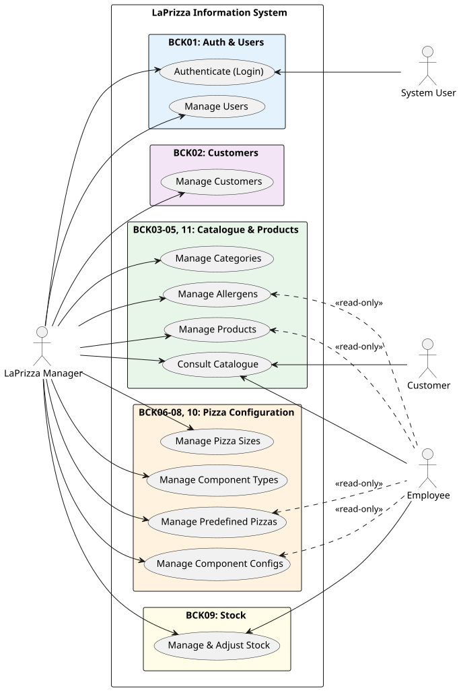

## User Stories

### BCK01: User and Authentication Management

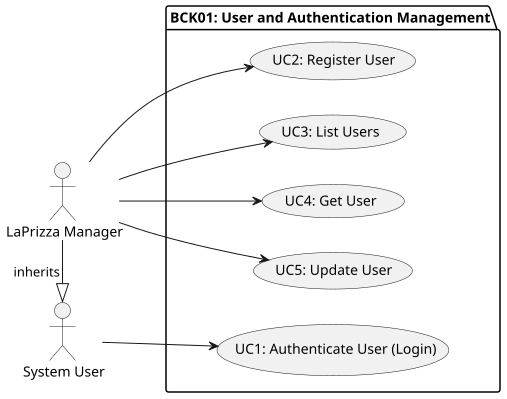

#### Flow Mapping

| User Story | Use Case               | Primary Actor    | Flow Document (SAD)                                  |
| :--------- | :--------------------- | :--------------- | :--------------------------------------------------- |
| **BCK01**  | UC1: Authenticate User | System User      | [Login](../flows/authentication/login.md)            |
| **BCK01**  | UC2: Register User     | LaPrizza Manager | [Register User](../flows/authentication/register.md) |
| **BCK01**  | UC3: List Users        | LaPrizza Manager | [List Users](../flows/user/list.md)                  |
| **BCK01**  | UC4: Get User          | LaPrizza Manager | [Get User](../flows/user/get.md)                     |
| **BCK01**  | UC5: Update User       | LaPrizza Manager | [Update User](../flows/user/update.md)               |

### BCK02: Customer Management

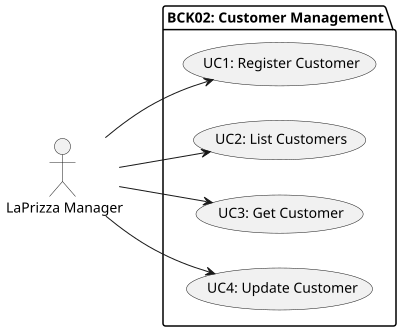

#### Flow Mapping

| User Story | Use Case               | Primary Actor    | Flow Document (SAD)                                         |
| :--------- | :--------------------- | :--------------- | :---------------------------------------------------------- |
| **BCK02**  | UC1: Register Customer | LaPrizza Manager | [Register Customer](../flows/customer/register-customer.md) |
| **BCK02**  | UC2: List Customers    | LaPrizza Manager | [List Customers](../flows/customer/list-search-customer.md) |
| **BCK02**  | UC3: Get Customer      | LaPrizza Manager | [Get Customer](../flows/customer/get-customer.md)           |
| **BCK02**  | UC4: Update Customer   | LaPrizza Manager | [Update Customer](../flows/customer/update-customer.md)     |

### BCK03: Product Category Management

#### Flow Mapping

| User Story | Use Case                     | Primary Actor    | Flow Document (SAD)                                                                  |
| :--------- | :--------------------------- | :--------------- | :----------------------------------------------------------------------------------- |
| **BCK03**  | UC1: Create Product Category | LaPrizza Manager | [Create Product Category](../flows/product-category/create-product-category.md)      |
| **BCK03**  | UC2: List Product Categories | LaPrizza Manager | [List Product Categories](../flows/product-category/list-search-product-category.md) |
| **BCK03**  | UC3: Update Product Category | LaPrizza Manager | [Update Product Category](../flows/product-category/update-product-category.md)      |
| **BCK03**  | UC4: Remove Product Category | LaPrizza Manager | [Remove Product Category](../flows/product-category/remove-product-category.md)      |

### BCK04: Allergen Management


#### Flow Mapping

| User Story | Use Case                      | Primary Actor               | Flow Document (SAD)                                                       |
| :--------- | :---------------------------- | :-------------------------- | :------------------------------------------------------------------------ |
| **BCK04**  | UC1: Create Allergen          | LaPrizza Manager            | [Create Allergen](../flows/allergen/create-allergen.md)                   |
| **BCK04**  | UC2: List Allergens           | LaPrizza Manager / Employee | [List Allergens](../flows/allergen/list-search-allergens.md)              |
| **BCK04**  | UC3: Consult Allergen by Id   | LaPrizza Manager / Employee | [Consult Allergen by Id](../flows/allergen/consult-allergen-by-id.md)     |
| **BCK04**  | UC4: Consult Allergen by Name | LaPrizza Manager / Employee | [Consult Allergen by Name](../flows/allergen/consult-allergen-by-name.md) |
| **BCK04**  | UC5: Deactivate Allergen      | LaPrizza Manager            | [Deactivate Allergen](../flows/allergen/deactivate-allergen.md)           |

### BCK05: Product Management

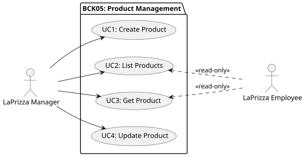

#### Flow Mapping

| User Story | Use Case            | Primary Actor               | Flow Document (SAD)                                      |
| :--------- | :------------------ | :-------------------------- | :------------------------------------------------------- |
| **BCK05**  | UC1: Create Product | LaPrizza Manager            | [Create Product](../flows/product/create-product.md)     |
| **BCK05**  | UC2: List Products  | LaPrizza Manager / Employee | [List Products](../flows/product/list-search-product.md) |
| **BCK05**  | UC3: Get Product    | LaPrizza Manager / Employee | [Get Product](../flows/product/get-product.md)           |
| **BCK05**  | UC4: Update Product | LaPrizza Manager            | [Update Product](../flows/product/update-product.md)     |

### BCK06: Pizza Size Management

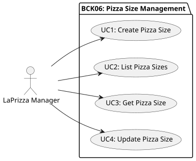

#### Flow Mapping

| User Story | Use Case               | Primary Actor    | Flow Document (SAD)                                               |
| :--------- | :--------------------- | :--------------- | :---------------------------------------------------------------- |
| **BCK06**  | UC1: Create Pizza Size | LaPrizza Manager | [Create Pizza Size](../flows/pizza-size/create-pizza-size.md)     |
| **BCK06**  | UC2: List Pizza Sizes  | LaPrizza Manager | [List Pizza Sizes](../flows/pizza-size/list-search-pizza-size.md) |
| **BCK06**  | UC3: Get Pizza Size    | LaPrizza Manager | [Get Pizza Sizes](../flows/pizza-size/get-pizza-size.md)          |
| **BCK06**  | UC4: Update Pizza Size | LaPrizza Manager | [Update Pizza Size](../flows/pizza-size/update-pizza-size.md)     |

### BCK07: Pizza Component Type Management

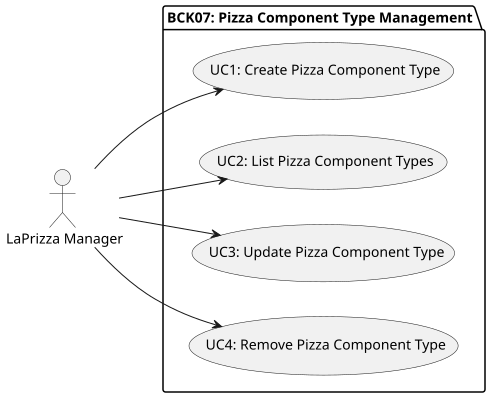

#### Flow Mapping

| User Story | Use Case                         | Primary Actor    | Flow Document (SAD)                                                                             |
| :--------- | :------------------------------- | :--------------- | :---------------------------------------------------------------------------------------------- |
| **BCK07**  | UC1: Create Pizza Component Type | LaPrizza Manager | [Create Pizza Component Type](../flows/pizza-component-type/create-pizza-component-type.md)     |
| **BCK07**  | UC2: List Pizza Component Types  | LaPrizza Manager | [List Pizza Component Types](../flows/pizza-component-type/list-search-pizza-component-type.md) |
| **BCK07**  | UC3: Update Pizza Component Type | LaPrizza Manager | [Update Pizza Component Type](../flows/pizza-component-type/update-pizza-component-type.md)     |
| **BCK07**  | UC4: Remove Pizza Component Type | LaPrizza Manager | [Remove Pizza Component Type](../flows/pizza-component-type/remove-pizza-component-type.md)     |

### BCK08: Pizza Component Configuration


#### Flow Mapping

| User Story | Use Case                                  | Primary Actor    | Flow Document (SAD)                                                                                                       |
| :--------- | :---------------------------------------- | :--------------- | :------------------------------------------------------------------------------------------------------------------------ |
| **BCK08**  | UC1: Create Pizza Component Configuration | LaPrizza Manager | [Create Pizza Component Configuration](../flows/pizza-component-configuration/create-component-size-configuration.md)     |
| **BCK08**  | UC2: List Pizza Component Configurations  | LaPrizza Manager | [List Pizza Component Configurations](../flows/pizza-component-configuration/list-search-component-size-configuration.md) |
| **BCK08**  | UC3: Update Pizza Component Configuration | LaPrizza Manager | [Update Pizza Component Configuration](../flows/pizza-component-configuration/update-component-size-configuration.md)     |
| **BCK08**  | UC4: Remove Pizza Component Configuration | LaPrizza Manager | [Remove Pizza Component Configuration](../flows/pizza-component-configuration/remove-component-size-configuration.md)     |

### BCK09: Stock Information Management


#### Flow Mapping

| User Story | Use Case                  | Primary Actor    | Flow Document (SAD)                                       |
| :--------- | :------------------------ | :--------------- | :-------------------------------------------------------- |
| **BCK09**  | UC1: List Product Stock   | LaPrizza Manager | [List Product Stock](../flows/stock/list-search-stock.md) |
| **BCK09**  | UC2: Get Product Stock    | LaPrizza Manager | [Get Product Stock](../flows/stock/get-stock.md)          |
| **BCK09**  | UC3: Adjust Product Stock | LaPrizza Manager | [Adjust Product Stock](../flows/stock/adjust-stock.md)    |

### BCK10: Predefined Pizza Management


#### Flow Mapping

| User Story | Use Case                              | Primary Actor    | Flow Document (SAD)                                                                               |
| :--------- | :------------------------------------ | :--------------- | :------------------------------------------------------------------------------------------------ |
| **BCK10**  | UC1: Define Predefined Pizza          | LaPrizza Manager | [Define Predefined Pizza](../flows/predefined-pizza/define-predefined-pizza.md)                   |
| **BCK10**  | UC2: List Predefined Pizzas           | LaPrizza Manager | [List Predefined Pizzas](../flows/predefined-pizza/list-search-predefined-pizzas.md)              |
| **BCK10**  | UC3: Consult Predefined Pizza by Id   | LaPrizza Manager | [Consult Predefined Pizza by Id](../flows/predefined-pizza/consult-predefined-pizza-by-id.md)     |
| **BCK10**  | UC4: Consult Predefined Pizza by Name | LaPrizza Manager | [Consult Predefined Pizza by Name](../flows/predefined-pizza/consult-predefined-pizza-by-name.md) |
| **BCK10**  | UC5: Update Predefined Pizza          | LaPrizza Manager | [Update Predefined Pizza](../flows/predefined-pizza/update-predefined-pizza.md)                   |
| **BCK10**  | UC6: Deactivate Predefined Pizza      | LaPrizza Manager | [Deactivate Predefined Pizza](../flows/predefined-pizza/deactivate-predefined-pizza.md)           |

### BCK11: Product Catalogue and Product Information

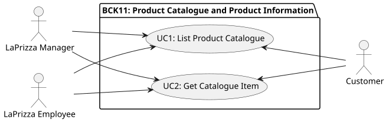

#### Flow Mapping

| User Story | Use Case                    | Primary Actor    | Flow Document (SAD)                                                           |
| :--------- | :-------------------------- | :--------------- | :---------------------------------------------------------------------------- |
| **BCK11**  | UC1: List Product Catalogue | LaPrizza Manager | [List Product Catalogue](../flows/product-catalogue/list-search-catalogue.md) |
| **BCK11**  | UC2: Get Catalogue Item     | LaPrizza Manager | [Get Catalogue Item](../flows/product-catalogue/get-catalogue-item.md)        |
