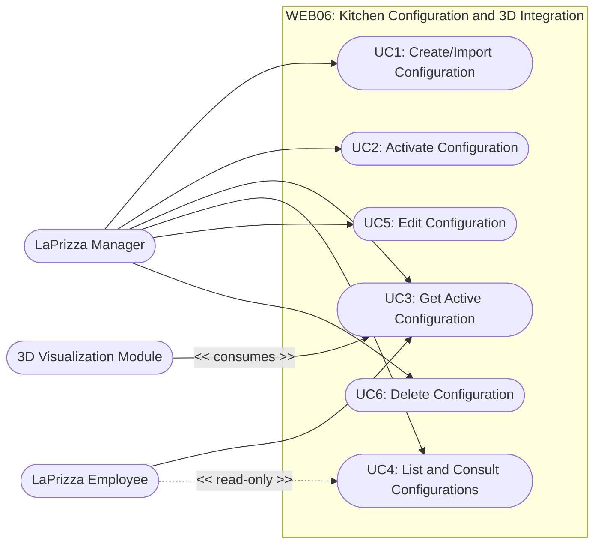

# Use Case Views

This document shows who uses the LaPrizza information system and which business capabilities are available to each actor in Sprint 1, plus the Kitchen Configuration user story (WEB06) of Sprint 2. The system is treated as a black box: only actors and use cases are represented, with no internal components.

- [Use Case Views](#use-case-views)
  - [Actors](#actors)
  - [Use Cases Diagram](#use-cases-diagram)
  - [User Stories](#user-stories)
    - [BCK01: User and Authentication Management](#bck01-user-and-authentication-management)
      - [Flow Mapping](#flow-mapping)
    - [BCK02: Customer Management](#bck02-customer-management)
      - [Flow Mapping](#flow-mapping-1)
    - [BCK03: Product Category Management](#bck03-product-category-management)
      - [Flow Mapping](#flow-mapping-2)
    - [BCK04: Allergen Management](#bck04-allergen-management)
      - [Flow Mapping](#flow-mapping-3)
    - [BCK05: Product Management](#bck05-product-management)
      - [Flow Mapping](#flow-mapping-4)
    - [BCK06: Pizza Size Management](#bck06-pizza-size-management)
      - [Flow Mapping](#flow-mapping-5)
    - [BCK07: Pizza Component Type Management](#bck07-pizza-component-type-management)
      - [Flow Mapping](#flow-mapping-6)
    - [BCK08: Pizza Component Configuration](#bck08-pizza-component-configuration)
      - [Flow Mapping](#flow-mapping-7)
    - [BCK09: Stock Information Management](#bck09-stock-information-management)
      - [Flow Mapping](#flow-mapping-8)
    - [BCK10: Predefined Pizza Management](#bck10-predefined-pizza-management)
      - [Flow Mapping](#flow-mapping-9)
    - [BCK11: Product Catalogue and Product Information](#bck11-product-catalogue-and-product-information)
      - [Flow Mapping](#flow-mapping-10)
    - [WEB06: Kitchen Configuration and 3D Integration](#web06-kitchen-configuration-and-3d-integration)
      - [Use Case Descriptions](#use-case-descriptions)
      - [Flow Mapping](#flow-mapping-11)

## Actors

| Actor                | Description                                                                                                       |
| :------------------- | :---------------------------------------------------------------------------------------------------------------- |
| **System User**      | Any registered entity capable of authenticating into the system. Acts as the base role.                           |
| **LaPrizza Manager** | Administrator with full back-office access to manage users, customers, products, stock, and configurations.       |
| **Employee**         | Restaurant staff member with operational access (e.g., consult catalogs, adjust stock, manage predefined pizzas). |
| **Customer**         | External client interacting with the system to consult the catalog or register their data.                        |
| **3D Visualization Module** | Secondary (system) actor. The embedded 3D viewer that consumes the active kitchen configuration to render the kitchen. |

## Use Cases Diagram

## User Stories

### BCK01: User and Authentication Management

#### Flow Mapping

| User Story | Use Case               | Primary Actor    | Flow Document (SAD)                                  |
| :--------- | :--------------------- | :--------------- | :--------------------------------------------------- |
| **BCK01**  | UC1: Authenticate User | System User      | [Login](../flows/authentication/login.md)            |
| **BCK01**  | UC2: Register User     | LaPrizza Manager | [Register User](../flows/authentication/register-user.md) |
| **BCK01**  | UC3: List Users        | LaPrizza Manager | [List Users](../flows/user/list-users.md)                  |
| **BCK01**  | UC4: Get User          | LaPrizza Manager | [Get User](../flows/user/get-user.md)                     |
| **BCK01**  | UC5: Update User       | LaPrizza Manager | [Update User](../flows/user/update-user.md)               |

### BCK02: Customer Management

#### Flow Mapping

| User Story | Use Case               | Primary Actor    | Flow Document (SAD)                                         |
| :--------- | :--------------------- | :--------------- | :---------------------------------------------------------- |
| **BCK02**  | UC1: Register Customer | LaPrizza Manager | [Register Customer](../flows/customer/register-customer.md) |
| **BCK02**  | UC2: List Customers    | LaPrizza Manager | [List Customers](../flows/customer/list-search-customer.md) |
| **BCK02**  | UC3: Update Customer   | LaPrizza Manager | [Update Customer](../flows/customer/update-customer.md)     |

### BCK03: Product Category Management

#### Flow Mapping

| User Story | Use Case                     | Primary Actor    | Flow Document (SAD)                                                                  |
| :--------- | :--------------------------- | :--------------- | :----------------------------------------------------------------------------------- |
| **BCK03**  | UC1: Create Product Category | LaPrizza Manager | [Create Product Category](../flows/product-category/create-product-category.md)      |
| **BCK03**  | UC2: List Product Categories | LaPrizza Manager | [List Product Categories](../flows/product-category/list-search-product-category.md) |
| **BCK03**  | UC3: Update Product Category | LaPrizza Manager | [Update Product Category](../flows/product-category/update-product-category.md)      |
| **BCK03**  | UC4: Remove Product Category | LaPrizza Manager | [Remove Product Category](../flows/product-category/remove-product-category.md)      |

### BCK04: Allergen Management

#### Flow Mapping

| User Story | Use Case                      | Primary Actor               | Flow Document (SAD)                                                       |
| :--------- | :---------------------------- | :-------------------------- | :------------------------------------------------------------------------ |
| **BCK04**  | UC1: Create Allergen          | LaPrizza Manager            | [Create Allergen](../flows/allergen/create-allergen.md)                   |
| **BCK04**  | UC2: List Allergens           | LaPrizza Manager / Employee | [List Allergens](../flows/allergen/list-search-allergens.md)              |
| **BCK04**  | UC3: Consult Allergen by Id   | LaPrizza Manager / Employee | [Consult Allergen by Id](../flows/allergen/consult-allergen-by-id.md)     |
| **BCK04**  | UC4: Consult Allergen by Name | LaPrizza Manager / Employee | [Consult Allergen by Name](../flows/allergen/consult-allergen-by-name.md) |
| **BCK04**  | UC5: Deactivate Allergen      | LaPrizza Manager            | [Deactivate Allergen](../flows/allergen/deactivate-allergen.md)           |

### BCK05: Product Management

#### Flow Mapping

| User Story | Use Case            | Primary Actor               | Flow Document (SAD)                                      |
| :--------- | :------------------ | :-------------------------- | :------------------------------------------------------- |
| **BCK05**  | UC1: Create Product | LaPrizza Manager            | [Create Product](../flows/product/create-product.md)     |
| **BCK05**  | UC2: List Products  | LaPrizza Manager / Employee | [List Products](../flows/product/list-search-product.md) |
| **BCK05**  | UC3: Get Product    | LaPrizza Manager / Employee | [Get Product](../flows/product/get-product.md)           |
| **BCK05**  | UC4: Update Product | LaPrizza Manager            | [Update Product](../flows/product/update-product.md)     |

### BCK06: Pizza Size Management

#### Flow Mapping

| User Story | Use Case               | Primary Actor    | Flow Document (SAD)                                               |
| :--------- | :--------------------- | :--------------- | :---------------------------------------------------------------- |
| **BCK06**  | UC1: Create Pizza Size | LaPrizza Manager | [Create Pizza Size](../flows/pizza-size/create-pizza-size.md)     |
| **BCK06**  | UC2: List Pizza Sizes  | LaPrizza Manager | [List Pizza Sizes](../flows/pizza-size/list-search-pizza-size.md) |
| **BCK06**  | UC3: Get Pizza Size    | LaPrizza Manager | [Get Pizza Sizes](../flows/pizza-size/get-pizza-size.md)          |
| **BCK06**  | UC4: Update Pizza Size | LaPrizza Manager | [Update Pizza Size](../flows/pizza-size/update-pizza-size.md)     |

### BCK07: Pizza Component Type Management

#### Flow Mapping

| User Story | Use Case                         | Primary Actor    | Flow Document (SAD)                                                                             |
| :--------- | :------------------------------- | :--------------- | :---------------------------------------------------------------------------------------------- |
| **BCK07**  | UC1: Create Pizza Component Type | LaPrizza Manager | [Create Pizza Component Type](../flows/pizza-component-type/create-pizza-component-type.md)     |
| **BCK07**  | UC2: List Pizza Component Types  | LaPrizza Manager | [List Pizza Component Types](../flows/pizza-component-type/list-search-pizza-component-type.md) |
| **BCK07**  | UC3: Update Pizza Component Type | LaPrizza Manager | [Update Pizza Component Type](../flows/pizza-component-type/update-pizza-component-type.md)     |
| **BCK07**  | UC4: Remove Pizza Component Type | LaPrizza Manager | [Remove Pizza Component Type](../flows/pizza-component-type/remove-pizza-component-type.md)     |

### BCK08: Pizza Component Configuration

#### Flow Mapping

| User Story | Use Case                                  | Primary Actor    | Flow Document (SAD)                                                                                                       |
| :--------- | :---------------------------------------- | :--------------- | :------------------------------------------------------------------------------------------------------------------------ |
| **BCK08**  | UC1: Create Pizza Component Configuration | LaPrizza Manager | [Create Pizza Component Configuration](../flows/pizza-component-configuration/create-component-size-configuration.md)     |
| **BCK08**  | UC2: List Pizza Component Configurations  | LaPrizza Manager | [List Pizza Component Configurations](../flows/pizza-component-configuration/list-search-component-size-configuration.md) |
| **BCK08**  | UC3: Update Pizza Component Configuration | LaPrizza Manager | [Update Pizza Component Configuration](../flows/pizza-component-configuration/update-component-size-configuration.md)     |
| **BCK08**  | UC4: Remove Pizza Component Configuration | LaPrizza Manager | [Remove Pizza Component Configuration](../flows/pizza-component-configuration/remove-component-size-configuration.md)     |

### BCK09: Stock Information Management

#### Flow Mapping

| User Story | Use Case                  | Primary Actor    | Flow Document (SAD)                                       |
| :--------- | :------------------------ | :--------------- | :-------------------------------------------------------- |
| **BCK09**  | UC1: List Product Stock   | LaPrizza Manager | [List Product Stock](../flows/stock/list-search-stock.md) |
| **BCK09**  | UC2: Get Product Stock    | LaPrizza Manager | [Get Product Stock](../flows/stock/get-stock.md)          |
| **BCK09**  | UC3: Adjust Product Stock | LaPrizza Manager | [Adjust Product Stock](../flows/stock/adjust-stock.md)    |

### BCK10: Predefined Pizza Management

#### Flow Mapping

| User Story | Use Case                              | Primary Actor    | Flow Document (SAD)                                                                               |
| :--------- | :------------------------------------ | :--------------- | :------------------------------------------------------------------------------------------------ |
| **BCK10**  | UC1: Define Predefined Pizza          | LaPrizza Manager | [Define Predefined Pizza](../flows/predefined-pizza/define-predefined-pizza.md)                   |
| **BCK10**  | UC2: List Predefined Pizzas           | LaPrizza Manager | [List Predefined Pizzas](../flows/predefined-pizza/list-search-predefined-pizzas.md)              |
| **BCK10**  | UC3: Consult Predefined Pizza by Id   | LaPrizza Manager | [Consult Predefined Pizza by Id](../flows/predefined-pizza/consult-predefined-pizza-by-id.md)     |
| **BCK10**  | UC4: Consult Predefined Pizza by Name | LaPrizza Manager | [Consult Predefined Pizza by Name](../flows/predefined-pizza/consult-predefined-pizza-by-name.md) |
| **BCK10**  | UC5: Update Predefined Pizza          | LaPrizza Manager | [Update Predefined Pizza](../flows/predefined-pizza/update-predefined-pizza.md)                   |
| **BCK10**  | UC6: Deactivate Predefined Pizza      | LaPrizza Manager | [Deactivate Predefined Pizza](../flows/predefined-pizza/deactivate-predefined-pizza.md)           |

### BCK11: Product Catalogue and Product Information

#### Flow Mapping

| User Story | Use Case                    | Primary Actor    | Flow Document (SAD)                                                           |
| :--------- | :-------------------------- | :--------------- | :---------------------------------------------------------------------------- |
| **BCK11**  | UC1: List Product Catalogue | LaPrizza Manager | [List Product Catalogue](../flows/product-catalogue/list-search-catalogue.md) |
| **BCK11**  | UC2: Get Catalogue Item     | LaPrizza Manager | [Get Catalogue Item](../flows/product-catalogue/get-catalogue-item.md)        |

### WEB06: Kitchen Configuration and 3D Integration

The Kitchen Configuration and 3D Integration page lets a Manager import kitchen configurations (dimensions, equipment positions and visual properties), choose the one that is active and keep them up to date. The 3D Visualization Module renders the active configuration, which Managers and Employees can also see on the page. Employees have a read-only view: they can list and consult the configurations and see the viewer, but the page offers no create, edit, activate or delete controls and the API refuses those operations. The accepted JSON format is in [Kitchen Configuration JSON Format](../flows/kitchen-configuration/kitchen-configuration-json-format.md).

#### Use Case Descriptions

| Use Case | Primary Actor | Description | Main Rules | ADRs |
| :------- | :------------ | :---------- | :--------- | :--- |
| **UC1: Create/Import Configuration** | LaPrizza Manager | Creates a kitchen configuration from a JSON document. On the page, an imported file is read in the browser and loaded into the editor for review; saving sends it as `application/json` to the same endpoint used to create a configuration through the API. A dry-run endpoint validates a document without storing it. | The domain validates the structure with a JSON Schema (valid dimensions, scale limits) and enforces the business invariants (unique equipment ids, asset references that are absolute http(s) URLs or root-relative paths). All violations are returned together, each with its property path. The configuration is stored as a nested BSON object, keeps its assets as self-contained URL/URIs and is created inactive. | [ADR-0020](../adr/0020-strorage-model-of-kitchen-configurations.md), [ADR-0021](../adr/0021-asset-references-strategy.md), [ADR-0022](../adr/0022-content-validation-strategy.md), [ADR-0026](../adr/0026-import-approach.md) |
| **UC2: Activate Configuration** | LaPrizza Manager | Makes a stored configuration the one in use. The previously active configuration is deactivated. | Exactly one configuration is active at a time. The switch is atomic (partial unique index on the active flag and a transaction); concurrent activations answer 409 and activating the already active configuration is a no-op. After the switch, the page reloads the 3D viewer without a full page refresh. | [ADR-0023](../adr/0023-atomic-activation-strategy.md), [ADR-0027](../adr/0027-viewer-reload-mechanism-in-the-frontend.md) |
| **UC3: Get Active Configuration** | LaPrizza Manager / Employee / 3D Visualization Module | Returns the active configuration so that the 3D viewer can render the kitchen. | A dedicated endpoint serves it to the staff roles, and the viewer requests it every time it is mounted. When no configuration is active the answer is 404, the viewer shows an empty state and no hardcoded fallback layout is returned. The payload is self-sufficient, so assets are loaded directly from their URL/URIs. | [ADR-0021](../adr/0021-asset-references-strategy.md), [ADR-0025](../adr/0025-active-configuration-endpoint-and-no-fallback-policy.md) |
| **UC4: List and Consult Configurations** | LaPrizza Manager / Employee | Lists the stored configurations, showing which one is active, and consults one of them (name and JSON content). | Read-only for the Employee: the page hides the Create, Edit, Activate and Delete controls. | [ADR-0025](../adr/0025-active-configuration-endpoint-and-no-fallback-policy.md) |
| **UC5: Edit Configuration** | LaPrizza Manager | Changes the content of a stored configuration, including the active one. | An edit is validated again with the same rules as the creation. Editing the active configuration is allowed if the new content passes all validations, and the page then remounts the viewer so that it fetches the updated layout. | [ADR-0022](../adr/0022-content-validation-strategy.md), [ADR-0024](../adr/0024-rules-for-editing-and-deleting-the-active-configuration.md), [ADR-0027](../adr/0027-viewer-reload-mechanism-in-the-frontend.md) |
| **UC6: Delete Configuration** | LaPrizza Manager | Removes a stored configuration. | The active configuration cannot be deleted (409), and the page does not offer the Delete button for it, so that the viewer never ends up without a configuration. | [ADR-0024](../adr/0024-rules-for-editing-and-deleting-the-active-configuration.md) |

#### Flow Mapping

| User Story | Use Case                                 | Primary Actor                                         | Flow Document (SAD)                                                                                       |
| :--------- | :--------------------------------------- | :---------------------------------------------------- | :-------------------------------------------------------------------------------------------------------- |
| **WEB06**  | UC1: Create/Import Configuration         | LaPrizza Manager                                      | [Create / Import Kitchen Configuration](../flows/kitchen-configuration/create-import-kitchen-configuration.md) |
| **WEB06**  | UC2: Activate Configuration              | LaPrizza Manager                                      | [Activate Kitchen Configuration](../flows/kitchen-configuration/activate-kitchen-configuration.md)         |
| **WEB06**  | UC3: Get Active Configuration            | LaPrizza Manager / Employee / 3D Visualization Module | [Get Active Kitchen Configuration](../flows/kitchen-configuration/get-active-kitchen-configuration.md)     |
| **WEB06**  | UC4: List and Consult Configurations     | LaPrizza Manager / Employee                           | [List and Consult Configurations](../flows/kitchen-configuration/list-and-consult-configurations.md) |                                                                             |
| **WEB06**  | UC5: Edit Configuration                  | LaPrizza Manager                                      | [Edit Configuration](../flows/kitchen-configuration/edit-configuration.md)                                                                             |
| **WEB06**  | UC6: Delete Configuration                | LaPrizza Manager                                      | [Delete Configuration](../flows/kitchen-configuration/delete-configuration.md)                                                                             |

The C4 context, container and component views of the feature are in [Kitchen Configuration C4 Views](../flows/kitchen-configuration/c4-views.md).
