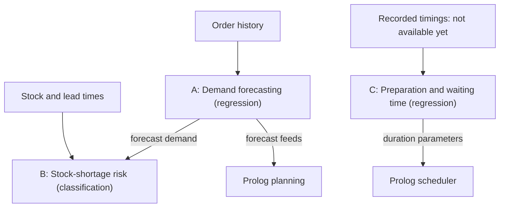
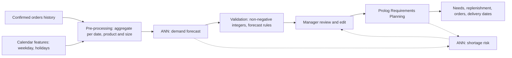
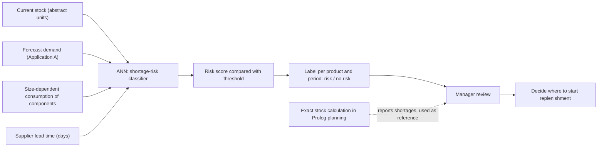
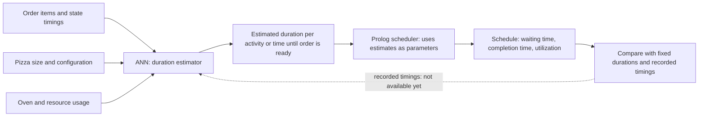
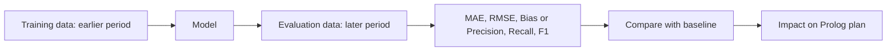

# AI03 - Artificial Neural Networks for Restaurant Management at LaPrizza

---

## 1. What is a neural network and how does it work?

A neural network is a machine-learning model: instead of a programmer writing the rules by hand, the program is obtained from data and the desired outputs. It is built from artificial neurons; each one multiplies its inputs by weights, adds them together with a bias and applies a threshold to decide its output. Neurons are arranged in an input layer, one or more hidden layers and an output layer, each layer feeding the next, and the more neurons the network has, the more closely it can approximate the shape of the problem it is learning.

The weights are not known in advance, so the network has to be trained. Examples are fed in, the output is compared with the desired value to obtain the error, and the error is propagated backwards (backpropagation) to adjust the weights, usually by gradient descent, where each weight changes according to the error and the learning rate. Repeating this many times makes the outputs approach the desired values. The practical consequences are that a network needs enough data to learn from, only identifies what it was trained for, and has difficulty explaining its results. This is why the applications in Section 2 are tasks where examples exist, and why Sections 3 to 5 deal with data quality, evaluation and risks.

---

## 2. Applications of ANNs to LaPrizza's management

Useful applications are described by their problem, inputs, outputs, expected benefits and limitations.




### 2.1 Application A - Demand forecasting per product and size

| | |
|---|---|
|**Problem** | The Manager must prepare daily consumption forecasts of sellable products, pizzas by size included, for a chosen period. Producing them by hand is slow and depends on individual judgement. The forecast is the input from which Prolog Requirements Planning derives material needs, replenishment, suppliers, order dates and delivery dates. |
| **Inputs** | Past daily quantities of each product and size from confirmed orders; calendar information such as weekday and holidays; product active/inactive status. No customer-identifying data. |
| **Outputs** | Forecast entries: date, product, applicable size and a non-negative integer quantity. The conversion to stock is deterministic. |
| **Expected benefits** | Faster preparation of forecasts; a consistent starting point the Manager can edit; earlier visibility of unmet needs and late requirements in the resulting plan. |
| **Limitations** | Needs history that the prototype lacks; results from simulated data are only a simulation; the model is a black box; network outputs are real numbers that must become non-negative integers; a proposal must pass the same validation as a manual forecast. |
| **Model type** | Proposed: a feed-forward network (multilayer perceptron) for regression, with one output per product and size and date. Inputs are recent daily quantities and calendar features (weekday, holiday). The output layer is constrained to non-negative values and then rounded to integers, as the forecast rules require. |



### 2.2 Application B - Stock-shortage risk

| | |
|---|---|
| **Problem** | With many stock-controlled products, the Manager needs to know which are likely to run short soon, in order to decide where to start replenishment under the confirmation rule. |
| **Inputs** | Current stock in abstract units; forecast demand (Application A); size-dependent consumption of components; supplier lead time in days. |
| **Outputs** | A risk/no-risk label per product and period - a binary classification for instance. |
| **Expected benefits** | An early-warning layer on top of the next calculation, which already reports shortages without negative remaining stock; useful when forecast inputs are uncertain. |
| **Limitations** | Largely redundant with the exact calculation once forecasts, stock and BOM are known; it may never change stock or create purchase orders; shortages are rare events and therefore hard to learn. |
| **Model type** | Proposed: a feed-forward network for binary classification, with a single output interpreted as shortage probability and compared with a threshold. Inputs are current stock, forecast demand (Application A) and supplier lead time.



### 2.3 Application C - Preparation-time and customer-waiting-time

| | |
|---|---|
| **Problem** | Preparation work depends on activity durations, resources and dependencies, with ovens as limited resources; estimates of activity durations and of when an order will be ready are needed to reduce customer waiting and improve utilization. |
| **Inputs** | Order items and their state timings; pizza size and configuration; oven and resource usage. |
| **Outputs** | Estimated duration per activity, or time until an order is ready (regression). |
| **Expected benefits** | More realistic durations for the scheduler than fixed values, supporting the goals of shorter waiting and better kitchen utilization. | 
| **Limitations** |  Needs recorded durations from a real operation; the schedule itself is a Prolog planning problem, so the ANN would supply parameters only. |
| **Model type** | Proposed: a feed-forward network for regression with a single output (duration in minutes), taking order and pizza configuration and resource usage as inputs. |



---

## 3. Data quality

Machine Learning identifies only what it was trained for, and deep learning performs better as the amount of data grows; the quality and amount of data are therefore decisive.

### 3.1 Data needed, availability and issues per application

| App. | Data needed | Availability in the prototype | Main quality issues |
|---|---|---|---|
| A | Daily quantities per date, product and size | Orders may be predefined or generated | Simulated data teach the generator, not customers; omitted entries mean zero, so "no sales" and "missing record" must be distinguished |
| B | Stock snapshots over time plus shortage outcomes | Stock exists; outcomes need history | Shortages are rare, so examples are few |
| C | Recorded activity and order-state timings | None | Timing must be recorded consistently per activity and resource |

### 3.2 Cross-cutting issues

- **Provenance:** Results from generated data must be labelled as simulation.
- **Units:** Quantities are product-specific abstract units; products cannot be mixed without a common basis (the planning also flags incompatible units).
- **Granularity:** Data are per date, product and size, and components consume different units by size; the aggregation level must be fixed.
- **Catalogue drift:** Products may be deactivated without losing history, and the set of sizes may evolve; models trained on an old catalogue may not fit a new one.
- **Calendar effects:** Weekday, holidays and events must be explicit features, otherwise they appear as noise.
- **Splitting:** Evaluation data must be separate from training data and respect time order.
- **Appropriate data:** Only aggregated product-level or process-level data; no customer names, contacts or dietary profiles.

---

## 4. Evaluation criteria



### 4.1 Regression metrics (Applications A and C)

The slides define no regression metrics; the following standard definitions are proposed:

```
MAE = (1/n) Σ |yᵢ − ŷᵢ| (average error, in stock units or minutes)
RMSE = sqrt( (1/n) Σ (yᵢ − ŷᵢ)² ) (penalises large errors)
Bias = (1/n) Σ (ŷᵢ − yᵢ)  (systematic over/under-forecast)
```
### 4.2  Classification metrics (Application B)

The slides define the confusion matrix with true positives (PV), true negatives (NV), false positives (PF) and false negatives (NF) and the metrics accuracy, error, precision, recall and F1:

```
Accuracy = (PV + NV) / (PV + NV + PF + NF)     Error = 1 - Accuracy
Precision = PV / (PV + PF)
Recall = PV / (PV+ NF)
F1 = 2 * Precision * Recall / (Precision + Recall) = 2 * PV / (2*PV + NF + PF)
```

---

### 4.3 Business-oriented criteria
| Criterion | Question |
|---|---|
| Baseline | Does the ANN beat a trivial method (e.g. repeat the previous period)? |
| Plan Impact | Does using ANN forecasts reduce unmet needs and late requirements in the Prolog plan, compared with manual forecasts? |
| Error direction | Under-forecast causes shortages, over-forecast excess replenishment: measured separately |
| Robustness | Behaviour on atypical days and after catalogue changes |
| Usability | Can the Manager understand and correct a proposal? |
| Kitchen goals | Waiting time, completion time, idle resources, utilization |

---

## 5. Risks of unsuitable predictions (only some examples)

| # | Risk | Applies to | Description | Mitigation |
|---|---|---|---|---|
| R1 | Black-Box decisions | All | ANNs predict but have difficulty explaining | Advisory use; Manager review; show history next to the prediction |
| R2 | Invalid output format | A | Real-valued outputs versus non-negative integers | Post-process and validate with the forecast rules |
| R3 | False alarms | B | Alarm fatigue; wrongly suspecting staff | Track precision; human review |
| R4 | Wrong time estimates | C | Errors propagate into the schedule | Compare with fixed durations; keep schedule explainable | 

---

## 6. Conclusion

Of the three applications studied, demand forecasting per product and size (Application A) is the most promising for LaPrizza: it addresses a task the Manager performs manually, its output fits the existing forecast format, and it feeds the Prolog Requirements Planning, so errors can be measured through their effect on the plan. Its main obstacle is data: the prototype has no real sales history, so any result obtained from generated orders is only a simulation.

Stock-shortage risk (Application B) is largely redundant with the exact stock calculation once forecasts, stock and BOM are known, so its value would be limited to an early-warning layer under certain forecasts. Preparation and waiting-time estimation (Application C) could make the scheduler more realistic, but it requires recorded durations that do not exist yet, and the schedule itself would remain a Prolog planning problem.

In all cases, an ANN should be used as an advisory tool where proposals are validated by the same rules as manual input and reviewed by the Manager. Its potential can be assessed with the criteria in Section 4, starting with a comparison against a simple baseline. Applying it in practice would only make sense once real, consistently recorded data, are available.

---

## 7. Use of generative AI

| Tool | Used for | How the output was checked | How it was incorporated |
|---|---|---|---|
| Claude | Drafting the structure and reviewing wording | Compared with the slides and the requirements | Text was rewritten accordingly |
| Gemini | Reviewing wording | Validated if everything was well written | Text was rewritten accordingly |


---

## 8. Sources consulted

- Ramos, C. *5 - Redes Neuronais Artificiais e Aprendizagem Profunda*. Inteligência Artificial, ISEP, 2025-2026 (theoretical slides).
- *LEI-ISEP 5th Semester Integrative Project - PART II - System Specification*, v1.0, 2026/27.
- *LEI-ISEP 5th Semester Integrative Project - PART III - Sprint 1 - User Stories*, v1.0, 2026/2027.
- *LEI-ISEP 5th Semester Integrative Project - PART IV - Sprint 2 - User Stories*, v1.0, 2026/27.


