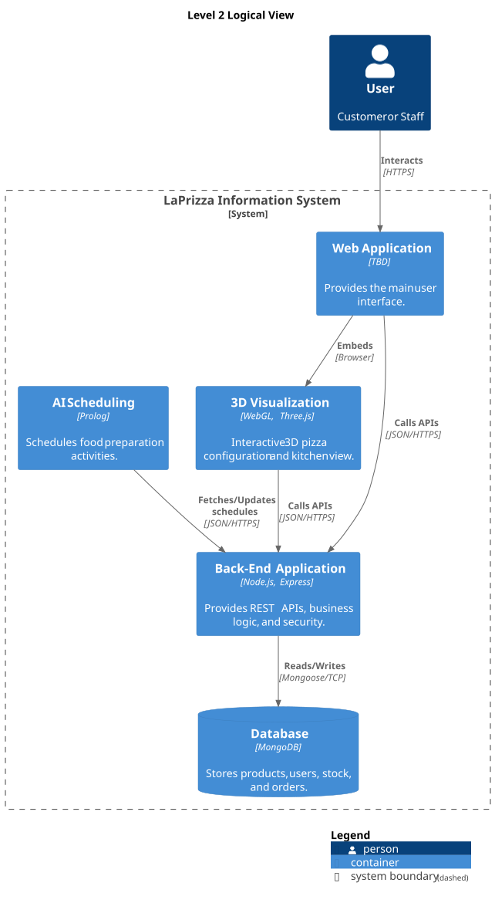
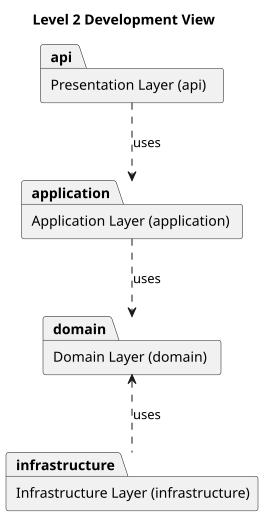
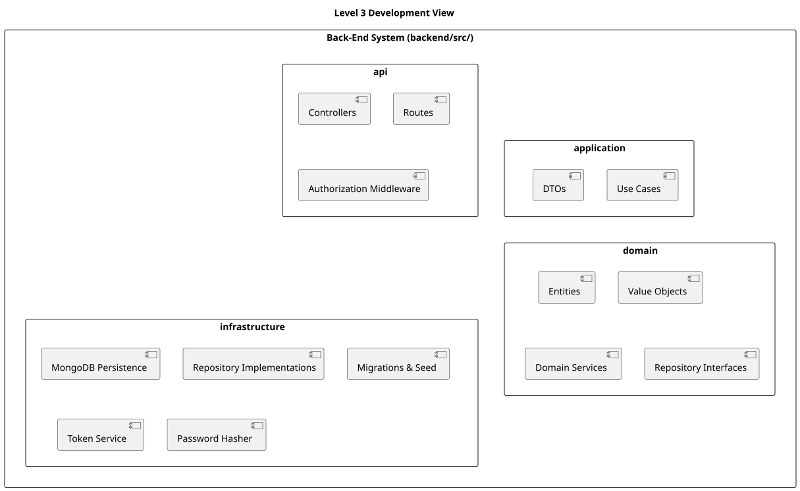
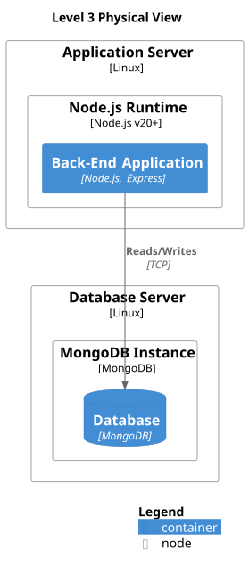

# Views

This section describes the architecture through five views, chosen to answer the concerns of stakeholders mentioned in 1.2 and 1.3.

These views are:

- [Views](#views)
  - [Level 2 Logical View](#level-2-logical-view)
    - [Element Catalog](#element-catalog)
    - [Interfaces](#interfaces)
  - [Level 2 Development View](#level-2-development-view)
  - [Level 3 Development View](#level-3-development-view)
    - [Element Catalog](#element-catalog-1)
  - [Level 3 Physical View](#level-3-physical-view)
    - [Element Catalog](#element-catalog-2)
  - [Non-Functional View](#non-functional-view)

## Level 2 Logical View

### Element Catalog

| Element              | Type      | Responsibility                                                                                                                         | Technology                |
| :------------------- | :-------- | :------------------------------------------------------------------------------------------------------------------------------------- | :------------------------ |
| Customer             | Person    | Consumer of the restaurant's products. Consults the catalogue, customizes pizzas and places orders.                                    |                           |
| LaPrizza Staff       | Person    | Restaurant staff (Manager and Employee roles). Manages the business information, catalogue, orders and food preparation.               |                           |
| Web Application      | Container | Main user interface for customers and staff; hosts the 3D Visualization                                                                | React, Vite, React Router |
| 3D Visualization     | Container | Interactive 3D pizza configuration and kitchen view, using data obtained from the Back-End Application                                 | WebGL, Three.js           |
| AI Scheduling        | Container | Plans and schedules food-preparation activities on the available kitchen resources                                                     | Prolog                    |
| Back-End Application | Container | Exposes the REST API, enforces business rules and invariants, handles authentication and authorization, and persists the business data | Node.js, Express          |
| Database             | Container | Persistent store of the business data; accessed only by the Back-End Application                                                       | MongoDB                   |

### Interfaces

| Connector                                | Protocol            | Purpose                                                 |
| :--------------------------------------- | :------------------ | :------------------------------------------------------ |
| Customer to Web Application              | HTTPS               | User Interaction                                        |
| LaPrizza Staff to Web Application        | HTTPS               | User Interaction                                        |
| Web Application to 3D Visualization      | Browser (embedding) | Loads the 3D modules inside the web interface           |
| Web Application to Back-End Application  | JSON/HTTPS (REST)   | Reads and writes business data through `/api/v1`        |
| 3D Visualization to Back-End Application | JSON/HTTPS (REST)   | Reads catalogue data (sizes, components, rules, prices) |
| AI Scheduling to Back-End Application    | JSON/HTTPS          | Fetches/Updates schedules                               |
| Back-End Application to Database         | Mongoose / TCP      | Reads and writes                                        |

## Level 2 Development View

This view demonstrates the dependencies between each module of the system.

**Element Catalog**

| Module           | Responsibility                                                                                                                                                                                                                  | May Use     |
| :--------------- | :------------------------------------------------------------------------------------------------------------------------------------------------------------------------------------------------------------------------------ | :---------- |
| `api`            | Exposes the REST API under `/api/v1`: routing, input validation, authentication and authorization middleware, translation of errors to the standard JSON error format, and the OpenAPI documentation                            | application |
| `application`    | Implements the use cases, orchestrating domain objects and repositories; contains no business rules                                                                                                                             | domain      |
| `domain`         | Entities, value objects, business rules and invariants, and the repository interfaces; independent of any framework, driver or database                                                                                         | nothing     |
| `infrastructure` | Implements the repository interfaces on the database (MongoDB Atlas), maps between domain objects and persisted data and handles technical services (password hashing, JWT token generation, database migrations and seed data) | domain      |

**Constraints**

- A module may only use the modules listed in its "May use" column; `domain` uses no other module.
- The repository interfaces are defined in `domain` and implemented in `infrastructure`.
- `api` does not access `domain` or `infrastructure` directly.
- The application entry point (`src/index.js`) is the only place allowed to wire the layers together (creating the repositories and injecting them into the use cases); it is not a layer.

## Level 3 Development View

This view shows how each module is decomposed into elements.

### Element Catalog

|       Module       | Element                    | Responsibility                                                                                      |
| :----------------: | :------------------------- | :-------------------------------------------------------------------------------------------------- |
|      **api**       |                            | Entry point of the back-end for HTTP clients                                                        |
|                    | Routes                     | Map the HTTP endpoints under `/api/v1` to the controllers                                           |
|                    | Controllers                | Receive requests, invoke the use cases and build the HTTP responses and status codes                |
|                    | Authorization Middleware   | Intercepts requests to protected routes, verifying the JWT and enforcing role-based access control  |
|  **application**   |                            | Orchestrates the business functionality                                                             |
|                    | Use Cases                  | Implement each use case, coordinating domain objects and repositories                               |
|                    | DTOs                       | Carry data between the api and the use cases, so that the domain objects are not exposed to clients |
|     **domain**     |                            | Business knowledge, independent of frameworks and persistence                                       |
|                    | Entities                   | Objects with identity that enforce their own business rules and invariants                          |
|                    | Value Objects              | Immutable objects defined by their value, validated when created                                    |
|                    | Domain Services            | Business rules that do not belong to a single entity or value object                                |
|                    | Repository Interfaces      | Contracts through which the domain and the use cases access persisted data                          |
| **infrastructure** |                            | Technical implementations that support the other modules                                            |
|                    | Repository Implementations | Implement the repository interfaces defined in the domain                                           |
|                    | MongoDB Persistence        | Database connection, document schemas and mapping between documents and domain objects              |
|                    | Password Hasher            | Secures user passwords using the Argon2 algorithm                                                   |
|                    | Token Service              | Generates and validates JSON Web Tokens (JWT) for authenticated sessions                            |
|                    | Migrations & Seed          | Evolves the database structures and loads the initial reproducible data                             |

## Level 3 Physical View

This view details the system's infrastructure and the responsibility of each component.

### Element Catalog

| Element                | Type         | Technology / Detail | Description & Responsibilities                                                                                                                                        |
| :--------------------- | :----------- | :------------------ | :-------------------------------------------------------------------------------------------------------------------------------------------------------------------- |
| Application Server     | Node         | Linux               | Server (physical or virtual) responsible for hosting the runtime environment required for the back-end application.                                                   |
| Node.js Runtime        | Node         | Node.js v22.13.0+   | Runtime environment installed on the server. Provides the infrastructure and libraries needed to execute the back-end application.                                    |
| Back-End Application   | Container    | Node.js, Express    | The application itself. Responsible for exposing the API, processing requests, enforcing business rules, and coordinating data access.                                |
| Cloud Database Service | Node         | MongoDB Atlas       | Managed cloud database service hosting the MongoDB instance. Responsible for high availability, storage processes, security, and data access.                         |
| Database               | Container    | MongoDB             | The specific schema or database within the instance. It is the logical/physical location where system information is persistently stored, read, and updated.          |
| Reads/Writes           | Relationship | TCP                 | Represents the communication channel. Indicates that the back-end establishes a connection via TCP to perform read and write operations to persist and retrieve data. |

## Non-Functional View

| Attribute                       | Scenario and Expected Result                                                                                                                                                                                                                                           | Architectural Response                                                                                                                                                                                                                                                                                                                                                                                                                                                                                                                         | Status                                                          |
| :------------------------------ | :--------------------------------------------------------------------------------------------------------------------------------------------------------------------------------------------------------------------------------------------------------------------- | :--------------------------------------------------------------------------------------------------------------------------------------------------------------------------------------------------------------------------------------------------------------------------------------------------------------------------------------------------------------------------------------------------------------------------------------------------------------------------------------------------------------------------------------------- | :-------------------------------------------------------------- |
| Security and access control     | A request without valid credentials, or from roles without permission, reaches a protected operation: it is rejected (401 when unauthenticated, 403 when the roles are not allowed); passwords are never stored in clear text; only the personal data needed is stored | Passwords hashed with Argon2 before being stored; JSON Web Tokens with a 35-minute expiration carrying the user id and roles; roles defined as enum (`MANAGER`, `EMPLOYEE`, `CUSTOMER`); a middleware in the `api` module enforces the roles on protected routes (e.g. `/api/v1/users` requires `MANAGER`), and only `/api/v1/auth/login` is public; credentials (`User`) are kept separate from the customer profile through an optional `customerId`; the first `MANAGER` is created by a seed script ([ADR-0004](./decisions/0004-auth.md)) | Sprint 1                                                        |
| Data integrity                  | A category, allergen, size or product referenced elsewhere is removed: the removal is refused or becomes a deactivation; the business invariants hold                                                                                                                  | Invariants in the domain; checks in the use cases; unique indexes ([ADR-0003](./decisions/0003-persistence-seed.md)); module views (3.2, 3.3)                                                                                                                                                                                                                                                                                                                                                                                                  | Sprint 1                                                        |
| Recoverability                  | Business data is accidentally deleted or corrupted: it can be restored                                                                                                                                                                                                 | Products deactivated instead of deleted; reproducible schema and seed data ([ADR-0003](./decisions/0003-persistence-seed.md)); database backups (depends on the Atlas plan)                                                                                                                                                                                                                                                                                                                                                                    | Partly Sprint 1; backups and recovery procedure planned (ASIST) |
| Stability and scalability       | The number of clients or requests grows: the system keeps working; the System Specification gives no numeric targets                                                                                                                                                   | Separate components over a versioned REST API (3.4); configuration in the environment; stateless authentication, since the token carries the identity and roles and no session state is kept ([ADR-0004](./decisions/0004-auth.md)); further measures (replication, load balancing, containers) planned with ASIST                                                                                                                                                                                                                             | Considered; not assessed                                        |
| Interoperability                | A new client (Web Application, 3D Visualization, AI) is integrated: it uses only the OpenAPI contract                                                                                                                                                                  | Contract-first REST API under `/api/v1` ([ADR-0005](./decisions/0005-api-contract.md)); Level 2 Logical View (3.4)                                                                                                                                                                                                                                                                                                                                                                                                                             | Sprint 1                                                        |
| Maintainability and testability | A new Pizza Component Type is added, or a team member runs the tests without a database: no source code change; tests pass without external services                                                                                                                   | Layers and repository interfaces in `domain` ([ADR-0002](decisions/0002-layered-ddd.md)); configurable data and seed data ([ADR-0003](./decisions/0003-persistence-seed.md)); dummies; CI                                                                                                                                                                                                                                                                                                                                                      | Sprint 1                                                        |

**Trade-offs and limitations**

- **Session length vs usability:** the 35-minute expiration limits the time a stolen token is useful, but users are logged out frequently. A refresh token strategy is the planned remedy if this affects usability (ADR-0004).
- **Roles in the token:** keeping the roles in the token avoids a database lookup per request, but a role change or a deactivated user only takes effect when the token expires.
- **Roles in code:** the roles are fixed in the code, so adding a new role requires a code change.
