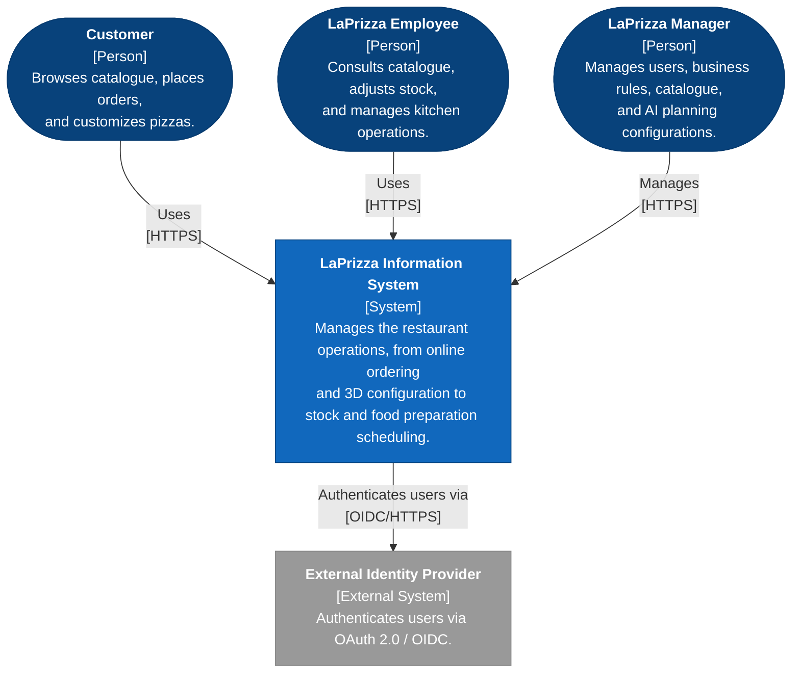
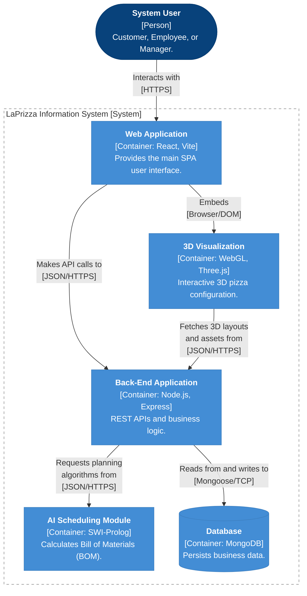
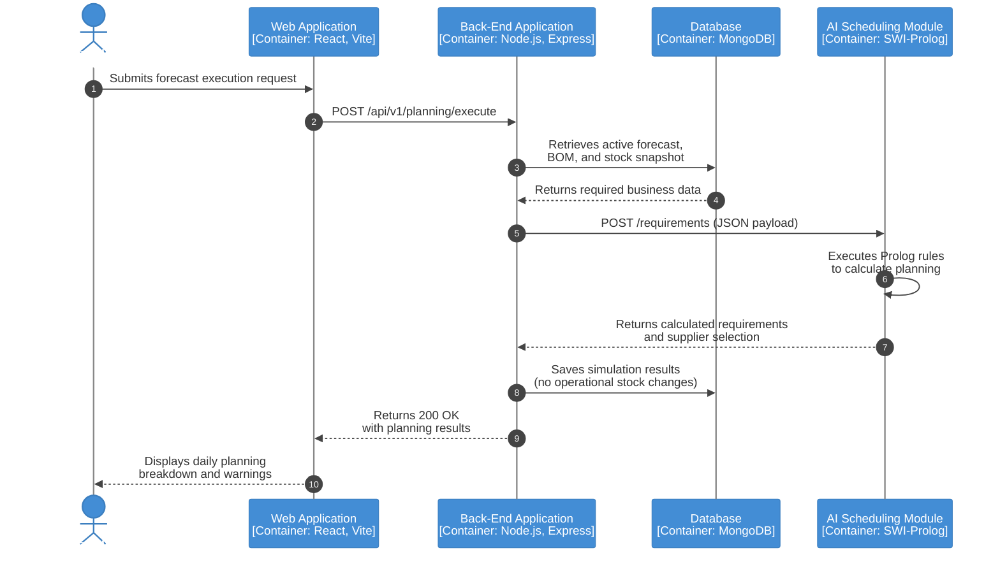
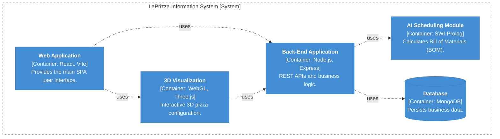
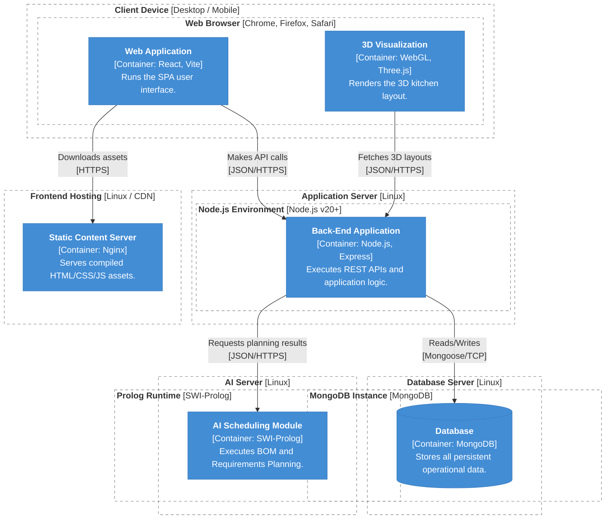
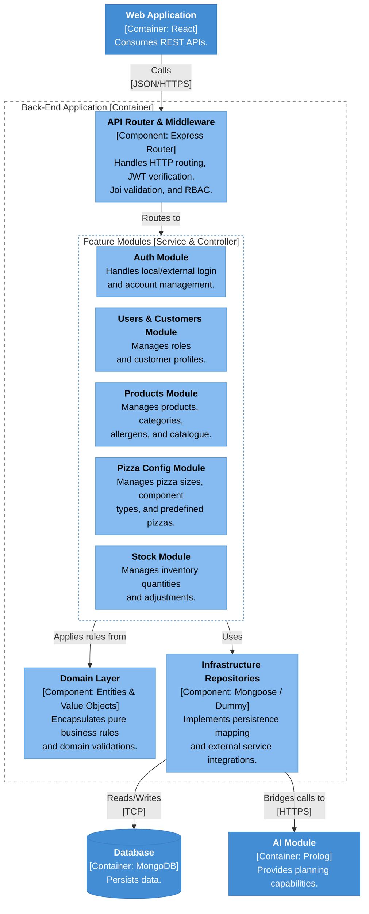
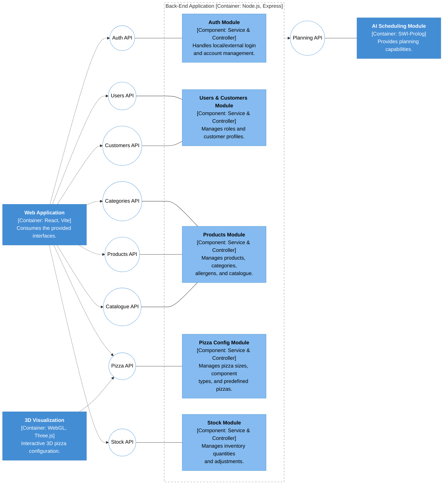

# Views

This section describes the architecture through the views listed below, chosen to answer the concerns of stakeholders mentioned in 1.2 and 1.3.

These views are:

- [Views](#views)
  - [Level 1](#level-1)
    - [Level 1 Logical View](#level-1-logical-view)
      - [Element Catalogue](#element-catalogue)
  - [Level 2](#level-2)
    - [Level 2 Logical View](#level-2-logical-view)
      - [Element Catalogue](#element-catalogue-1)
      - [Interfaces](#interfaces)
    - [Level 2 Process View](#level-2-process-view)
      - [Interaction Steps](#interaction-steps)
    - [Level 2 Development View](#level-2-development-view)
      - [Element Catalogue](#element-catalogue-2)
      - [Constraints](#constraints)
    - [Level 2 Physical View](#level-2-physical-view)
      - [Element Catalogue](#element-catalogue-3)
      - [Interfaces](#interfaces-1)
  - [Level 3](#level-3)
    - [Level 3 Logical View](#level-3-logical-view)
      - [Element Catalogue](#element-catalogue-4)
      - [Interfaces](#interfaces-2)
    - [Level 3 Development View](#level-3-development-view)
      - [Element Catalogue](#element-catalogue-5)
    - [High-Level Component and Connector View](#high-level-component-and-connector-view)
      - [Element Catalogue](#element-catalogue-6)
      - [Interfaces](#interfaces-3)
  - [Non-Functional View](#non-functional-view)

## Level 1

### Level 1 Logical View

#### Element Catalogue

| Element                     | Type            | Description                                                                                                            |
| :-------------------------- | :-------------- | :--------------------------------------------------------------------------------------------------------------------- |
| Customer                    | Person          | Browses catalogue, places orders, and customizes pizzas.                                                               |
| LaPrizza Employee           | Person          | Consults catalogue, adjusts stock, and manages kitchen operations.                                                     |
| LaPrizza Manager            | Person          | Manages users, business rules, catalogue, and AI planning configurations.                                              |
| LaPrizza Information System | System          | Manages the restaurant operations, from online ordering and 3D configuration to stock and food preperation scheduling. |
| External Identity Provider  | External System | Authenticates users via OAuth 2.0 / OIDC.                                                                              |

## Level 2

### Level 2 Logical View

#### Element Catalogue

| Element              | Type      | Responsibility                                                                                                                         | Technology                |
| :------------------- | :-------- | :------------------------------------------------------------------------------------------------------------------------------------- | :------------------------ |
| System User          | Person    | Customer, Employee, or Manager (LaPrizza Staff). Consults the catalogue, customizes pizzas, places orders and manages the business information. |                           |
| Web Application      | Container | Main user interface for customers and staff; hosts the 3D Visualization                                                                | React, Vite, React Router |
| 3D Visualization     | Container | Interactive 3D pizza configuration and kitchen view, using data obtained from the Back-End Application                                 | WebGL, Three.js           |
| AI Scheduling Module | Container | Plans and schedules food-preparation activities on the available kitchen resources                                                     | Prolog                    |
| Back-End Application | Container | Exposes the REST API, enforces business rules and invariants, handles authentication and authorization, and persists the business data | Node.js, Express          |
| Database             | Container | Persistent store of the business data; accessed only by the Back-End Application                                                       | MongoDB                   |

#### Interfaces

| Connector                                | Protocol            | Purpose                                                 |
| :--------------------------------------- | :------------------ | :------------------------------------------------------ |
| System User to Web Application           | HTTPS               | User Interaction                                        |
| Web Application to 3D Visualization      | Browser (embedding) | Loads the 3D modules inside the web interface           |
| Web Application to Back-End Application  | JSON/HTTPS (REST)   | Reads and writes business data through `/api/v1`        |
| 3D Visualization to Back-End Application | JSON/HTTPS (REST)   | Reads catalogue data (sizes, components, rules, prices) |
| Back-End Application to AI Scheduling    | JSON/HTTPS          | Requests planning (BOM and requirements) calculations   |
| Back-End Application to Database         | Mongoose / TCP      | Reads and writes                                        |

### Level 2 Process View

This view shows the interactions between the containers when the AI requirements planning is executed (Sprint 2).

#### Interaction Steps

| Step | From                 | To                   | Interaction                                                                 |
| :--: | :------------------- | :------------------- | :-------------------------------------------------------------------------- |
|  1   | LaPrizza Manager     | Web Application      | Submits the forecast execution request on the AI Configuration page         |
|  2   | Web Application      | Back-End Application | `POST /api/v1/planning/execute`                                             |
|  3   | Back-End Application | Database             | Retrieves the active forecast, the BOM and the stock snapshot               |
|  4   | Database             | Back-End Application | Returns the required business data                                          |
|  5   | Back-End Application | AI Scheduling Module | `POST /requirements` with the data as JSON payload                          |
|  6   | AI Scheduling Module | AI Scheduling Module | Executes the Prolog rules that calculate the planning                       |
|  7   | AI Scheduling Module | Back-End Application | Returns the calculated requirements and the supplier selection              |
|  8   | Back-End Application | Database             | Saves the simulation results (no operational stock changes)                 |
|  9   | Back-End Application | Web Application      | Returns `200 OK` with the planning results                                  |
|  10  | Web Application      | LaPrizza Manager     | Displays the daily planning breakdown and the warnings                      |

### Level 2 Development View

This view demonstrates the dependencies between each module of the system.

#### Element Catalogue

| Element              | Type      | Responsibility                                                                                  | May Use                                  |
| :------------------- | :-------- | :---------------------------------------------------------------------------------------------- | :--------------------------------------- |
| Web Application      | Container | Provides the main SPA user interface and hosts the 3D Visualization                             | 3D Visualization, Back-End Application   |
| 3D Visualization     | Container | Interactive 3D pizza configuration, using data obtained from the Back-End Application           | Back-End Application                     |
| Back-End Application | Container | Exposes the REST API under `/api/v1`, enforces the business rules and persists the business data | AI Scheduling Module, Database           |
| AI Scheduling Module | Container | Calculates the Bill of Materials (BOM) and plans the food-preparation requirements              | nothing                                  |
| Database             | Container | Persistent store of the business data                                                           | nothing                                  |

#### Constraints

- A container may only use the containers listed in its "May Use" column.
- The Web Application and the 3D Visualization access the business data only through the REST API of the Back-End Application.
- The Database is accessed only by the Back-End Application.
- The AI Scheduling Module is used only by the Back-End Application.

### Level 2 Physical View

This view shows how the containers are deployed on the infrastructure nodes (Sprint 2).

#### Element Catalogue

| Element                | Type                  | Responsibility                                          | Technology                |
| :--------------------- | :-------------------- | :------------------------------------------------------ | :------------------------ |
| Client Device          | Deployment node       | End-user device that runs the browser                   | Desktop / Mobile          |
| Web Browser            | Execution environment | Runs the SPA and the 3D module                          | Chrome, Firefox, Safari   |
| Web Application        | Container             | Runs the SPA user interface                             | React, Vite               |
| 3D Visualization       | Container             | Renders the 3D kitchen layout                           | WebGL, Three.js           |
| Frontend Hosting       | Deployment node       | Hosts the compiled front-end                            | Linux / CDN               |
| Static Content Server  | Container             | Serves compiled HTML/CSS/JS assets                      | Nginx                     |
| Application Server     | Deployment node       | Hosts the Back-End Application                          | Linux                     |
| Node.js Environment    | Execution environment | Runtime of the Back-End Application                     | Node.js v20+              |
| Back-End Application   | Container             | Executes REST APIs and application logic                | Node.js, Express          |
| AI Server              | Deployment node       | Hosts the AI Scheduling Module                          | Linux                     |
| Prolog Runtime         | Execution environment | Runtime of the AI Scheduling Module                     | SWI-Prolog                |
| AI Scheduling Module   | Container             | Executes BOM and Requirements Planning                  | SWI-Prolog                |
| Database Server        | Deployment node       | Hosts the database                                      | Linux                     |
| MongoDB Instance       | Execution environment | Runs the database                                       | MongoDB                   |
| Database               | Container             | Stores all persistent operational data                  | MongoDB                   |

#### Interfaces

| Connector                                     | Protocol          | Purpose                                      |
| :-------------------------------------------- | :---------------- | :------------------------------------------- |
| Web Application to Static Content Server      | HTTPS             | Downloads the compiled assets                |
| Web Application to Back-End Application       | JSON/HTTPS (REST) | Reads and writes business data               |
| 3D Visualization to Back-End Application      | JSON/HTTPS (REST) | Fetches the 3D layouts                       |
| Back-End Application to AI Scheduling Module  | JSON/HTTPS        | Requests the planning results                |
| Back-End Application to Database              | Mongoose / TCP    | Reads and writes                             |

## Level 3

### Level 3 Logical View

This view shows the components of the Back-End Application and how they relate to the other containers.

#### Element Catalogue

| Element                      | Type      | Responsibility                                                            | Technology            |
| :--------------------------- | :-------- | :------------------------------------------------------------------------ | :-------------------- |
| API Router & Middleware      | Component | Handles HTTP routing, JWT verification, Joi validation, and RBAC          | Express Router        |
| Auth Module                  | Component | Handles local/external login and account management                       | Service & Controller  |
| Users & Customers Module     | Component | Manages roles and customer profiles                                       | Service & Controller  |
| Products Module              | Component | Manages products, categories, allergens, and catalogue                    | Service & Controller  |
| Pizza Config Module          | Component | Manages pizza sizes, component types, and predefined pizzas               | Service & Controller  |
| Stock Module                 | Component | Manages inventory quantities and adjustments                              | Service & Controller  |
| Domain Layer                 | Component | Encapsulates pure business rules and domain validations                   | Entities & Value Objects |
| Infrastructure Repositories  | Component | Implements persistence mapping and external service integrations          | Mongoose / Dummy      |
| Web Application              | Container | External to this view; consumes the REST APIs                             | React, Vite           |
| AI Scheduling Module         | Container | External to this view; provides planning capabilities                     | SWI-Prolog            |
| Database                     | Container | External to this view; persists the business data                         | MongoDB               |

The five feature modules (Auth, Users & Customers, Products, Pizza Config and Stock) are grouped in the diagram because they all relate to the other components in the same way.

#### Interfaces

| Connector                                                    | Protocol          | Purpose                                                          |
| :----------------------------------------------------------- | :---------------- | :--------------------------------------------------------------- |
| Web Application to API Router & Middleware                   | JSON/HTTPS (REST) | Calls the `/api/v1` endpoints                                    |
| API Router & Middleware to each feature module               | In-process        | Routes the validated, authorized request to the module           |
| Each feature module to Domain Layer                          | In-process        | Applies the business rules and domain validations                |
| Each feature module to Infrastructure Repositories           | In-process        | Reads and writes persisted data                                  |
| Infrastructure Repositories to Database                      | TCP               | Reads and writes                                                 |
| Infrastructure Repositories to AI Scheduling Module          | HTTPS             | Bridges the planning calls                                       |

### Level 3 Development View

This view shows how each module is decomposed into elements.

```mermaid
flowchart LR
    subgraph backend["Back-End Application [Container: Node.js, Express] - src/&nbsp;&nbsp;&nbsp;&nbsp;&nbsp;&nbsp;&nbsp;&nbsp;&nbsp;&nbsp;&nbsp;&nbsp;&nbsp;&nbsp;&nbsp;&nbsp;&nbsp;&nbsp;&nbsp;&nbsp;&nbsp;&nbsp;&nbsp;&nbsp;&nbsp;&nbsp;&nbsp;&nbsp;&nbsp;&nbsp;&nbsp;&nbsp;&nbsp;&nbsp;&nbsp;&nbsp;&nbsp;&nbsp;&nbsp;&nbsp;&nbsp;&nbsp;&nbsp;&nbsp;&nbsp;&nbsp;&nbsp;&nbsp;&nbsp;&nbsp;&nbsp;&nbsp;&nbsp;&nbsp;&nbsp;&nbsp;&nbsp;&nbsp;&nbsp;&nbsp;&nbsp;&nbsp;&nbsp;&nbsp;&nbsp;&nbsp;&nbsp;&nbsp;&nbsp;&nbsp;"]
        subgraph api["<b>api</b> [Module]"]
            Routes["<b>Routes</b><br/>[Element: api]<br/>Map the HTTP endpoints under<br/>/api/v1 to the controllers."]
            Controllers["<b>Controllers</b><br/>[Element: api]<br/>Receive requests, invoke the use cases<br/>and build the HTTP responses."]
            AuthMiddleware["<b>Authorization Middleware</b><br/>[Element: api]<br/>Verifies the JWT and enforces<br/>role-based access control."]
        end
        subgraph app["<b>application</b> [Module]"]
            UseCases["<b>Use Cases</b><br/>[Element: application]<br/>Implement each use case, coordinating<br/>domain objects and repositories."]
            DTOs["<b>DTOs</b><br/>[Element: application]<br/>Carry data between the api<br/>and the use cases."]
        end
        subgraph dom["<b>domain</b> [Module]"]
            Entities["<b>Entities</b><br/>[Element: domain]<br/>Objects with identity that enforce<br/>their own business rules."]
            ValueObjects["<b>Value Objects</b><br/>[Element: domain]<br/>Immutable objects defined by<br/>their value."]
            DomainServices["<b>Domain Services</b><br/>[Element: domain]<br/>Business rules that do not belong<br/>to a single entity or value object."]
            RepositoryInterfaces["<b>Repository Interfaces</b><br/>[Element: domain]<br/>Contracts through which persisted<br/>data is accessed."]
        end
        subgraph infra["<b>infrastructure</b> [Module]"]
            RepoImpl["<b>Repository Implementations</b><br/>[Element: infrastructure]<br/>Implement the repository<br/>interfaces defined in the domain."]
            PasswordHasher["<b>Password Hasher</b><br/>[Element: infrastructure]<br/>Secures user passwords<br/>using the Argon2 algorithm."]
            TokenService["<b>Token Service</b><br/>[Element: infrastructure]<br/>Generates and validates JWTs<br/>for authenticated sessions."]
            Mongo["<b>MongoDB Persistence</b><br/>[Element: infrastructure]<br/>Database connection, schemas<br/>and document mapping."]
            Migrations["<b>Migrations & Seed</b><br/>[Element: infrastructure]<br/>Evolve the database structures<br/>and load the initial data."]
            Config["<b>Config</b><br/>[Element: infrastructure]<br/>Environment and secrets."]
        end
    end

    api -.->|"imports"| app
    app -.->|"imports"| dom
    infra -.->|"imports"| dom

    classDef person fill:#08427b,stroke:#073b6f,color:#fff
    classDef container fill:#438dd5,stroke:#3c7fc0,color:#fff
    classDef component fill:#85bbf0,stroke:#5d9fd8,color:#000
    classDef iface fill:#fff,stroke:#5d9fd8,color:#000

    class Routes,Controllers,AuthMiddleware,UseCases,DTOs,Entities,ValueObjects,DomainServices,RepositoryInterfaces,RepoImpl,PasswordHasher,TokenService,Mongo,Migrations,Config component
    style backend fill:none,stroke:#888,stroke-dasharray:5 5
    style api fill:none,stroke:#888,stroke-dasharray:5 5
    style app fill:none,stroke:#888,stroke-dasharray:5 5
    style dom fill:none,stroke:#888,stroke-dasharray:5 5
    style infra fill:none,stroke:#888,stroke-dasharray:5 5
```

#### Element Catalogue

|       Module       | Element                    | Responsibility                                                                                      |
| :----------------: | :------------------------- | :-------------------------------------------------------------------------------------------------- |
|      **api**       |                            | Entry point of the back-end for HTTP clients                                                        |
|                    | Routes                     | Map the HTTP endpoints under `/api/v1` to the controllers                                           |
|                    | Controllers                | Receive requests, invoke the use cases and build the HTTP responses and status codes                |
|                    | Authorization Middleware   | Intercepts requests to protected routes, verifying the JWT and enforcing role-based access control  |
|  **application**   |                            | Orchestrates the business functionality                                                             |
|                    | Use Cases                  | Implement each use case, coordinating domain objects and repositories                               |
|                    | DTOs                       | Carry data between the api and the use cases, so that the domain objects are not exposed to clients |
|     **domain**     |                            | Business knowledge, independent of frameworks and persistence                                       |
|                    | Entities                   | Objects with identity that enforce their own business rules and invariants                          |
|                    | Value Objects              | Immutable objects defined by their value, validated when created                                    |
|                    | Domain Services            | Business rules that do not belong to a single entity or value object                                |
|                    | Repository Interfaces      | Contracts through which the domain and the use cases access persisted data                          |
| **infrastructure** |                            | Technical implementations that support the other modules                                            |
|                    | Repository Implementations | Implement the repository interfaces defined in the domain                                           |
|                    | MongoDB Persistence        | Database connection, document schemas and mapping between documents and domain objects              |
|                    | Password Hasher            | Secures user passwords using the Argon2 algorithm                                                   |
|                    | Token Service              | Generates and validates JSON Web Tokens (JWT) for authenticated sessions                            |
|                    | Migrations & Seed          | Evolves the database structures and loads the initial reproducible data                             |
|                    | Config                     | Environment configuration and secrets used by the infrastructure                                    |

### High-Level Component and Connector View

This view shows the interfaces provided and required by the main components of the system.

A circle is an interface provided by the component it is attached to; a dotted arrow means the source component requires that interface.

#### Element Catalogue

| Element                  | Type      | Provides                                          | Requires                                                         |
| :----------------------- | :-------- | :------------------------------------------------ | :--------------------------------------------------------------- |
| Auth Module              | Component | Auth API                                          |                                                                  |
| Users & Customers Module | Component | Users API, Customers API                          |                                                                  |
| Products Module          | Component | Categories API, Products API, Catalogue API       |                                                                  |
| Pizza Config Module      | Component | Pizza API                                         |                                                                  |
| Stock Module             | Component | Stock API                                         |                                                                  |
| Back-End Application     | Container | The APIs above                                    | Planning API                                                     |
| AI Scheduling Module     | Container | Planning API                                      |                                                                  |
| Web Application          | Container |                                                   | Auth, Users, Customers, Categories, Products, Pizza, Stock and Catalogue APIs |
| 3D Visualization         | Container |                                                   | Pizza API                                                        |

#### Interfaces

| Interface      | Provided by              | Required by                  | Purpose                                                   |
| :------------- | :----------------------- | :--------------------------- | :-------------------------------------------------------- |
| Auth API       | Auth Module              | Web Application              | Login and account management                              |
| Users API      | Users & Customers Module | Web Application              | Management of users and roles                             |
| Customers API  | Users & Customers Module | Web Application              | Management of customer profiles                           |
| Categories API | Products Module          | Web Application              | Management of product categories                          |
| Products API   | Products Module          | Web Application              | Management of products and allergens                      |
| Catalogue API  | Products Module          | Web Application              | Consultation of the catalogue                             |
| Pizza API      | Pizza Config Module      | Web Application, 3D Visualization | Pizza sizes, component types and predefined pizzas   |
| Stock API      | Stock Module             | Web Application              | Inventory quantities and adjustments                      |
| Planning API   | AI Scheduling Module     | Back-End Application         | BOM and requirements planning                             |

## Non-Functional View

| Attribute                       | Scenario and Expected Result                                                                                                                                                                                                                                           | Architectural Response                                                                                                                                                                                                                                                                                                                                                                                                                                                                                                                         | Status                                                          |
| :------------------------------ | :--------------------------------------------------------------------------------------------------------------------------------------------------------------------------------------------------------------------------------------------------------------------- | :--------------------------------------------------------------------------------------------------------------------------------------------------------------------------------------------------------------------------------------------------------------------------------------------------------------------------------------------------------------------------------------------------------------------------------------------------------------------------------------------------------------------------------------------- | :-------------------------------------------------------------- |
| Security and access control     | A request without valid credentials, or from roles without permission, reaches a protected operation: it is rejected (401 when unauthenticated, 403 when the roles are not allowed); passwords are never stored in clear text; only the personal data needed is stored | Passwords hashed with Argon2 before being stored; JSON Web Tokens with a 35-minute expiration carrying the user id and roles; roles defined as enum (`MANAGER`, `EMPLOYEE`, `CUSTOMER`); a middleware in the `api` module enforces the roles on protected routes (e.g. `/api/v1/users` requires `MANAGER`), and only `/api/v1/auth/login` is public; credentials (`User`) are kept separate from the customer profile through an optional `customerId`; the first `MANAGER` is created by a seed script ([ADR-0004](./decisions/0004-auth.md)) | Sprint 1                                                        |
| Data integrity                  | A category, allergen, size or product referenced elsewhere is removed: the removal is refused or becomes a deactivation; the business invariants hold                                                                                                                  | Invariants in the domain; checks in the use cases; unique indexes ([ADR-0003](./decisions/0003-persistence-seed.md)); module views (3.2, 3.3)                                                                                                                                                                                                                                                                                                                                                                                                  | Sprint 1                                                        |
| Recoverability                  | Business data is accidentally deleted or corrupted: it can be restored                                                                                                                                                                                                 | Products deactivated instead of deleted; reproducible schema and seed data ([ADR-0003](./decisions/0003-persistence-seed.md)); database backups (depends on the Atlas plan)                                                                                                                                                                                                                                                                                                                                                                    | Partly Sprint 1; backups and recovery procedure planned (ASIST) |
| Stability and scalability       | The number of clients or requests grows: the system keeps working; the System Specification gives no numeric targets                                                                                                                                                   | Separate components over a versioned REST API (3.4); configuration in the environment; stateless authentication, since the token carries the identity and roles and no session state is kept ([ADR-0004](./decisions/0004-auth.md)); further measures (replication, load balancing, containers) planned with ASIST                                                                                                                                                                                                                             | Considered; not assessed                                        |
| Interoperability                | A new client (Web Application, 3D Visualization, AI) is integrated: it uses only the OpenAPI contract                                                                                                                                                                  | Contract-first REST API under `/api/v1` ([ADR-0005](./decisions/0005-api-contract.md)); Level 2 Logical View (3.4)                                                                                                                                                                                                                                                                                                                                                                                                                             | Sprint 1                                                        |
| Maintainability and testability | A new Pizza Component Type is added, or a team member runs the tests without a database: no source code change; tests pass without external services                                                                                                                   | Layers and repository interfaces in `domain` ([ADR-0002](decisions/0002-layered-ddd.md)); configurable data and seed data ([ADR-0003](./decisions/0003-persistence-seed.md)); dummies; CI                                                                                                                                                                                                                                                                                                                                                      | Sprint 1                                                        |

**Trade-offs and limitations**

- **Session length vs usability:** the 35-minute expiration limits the time a stolen token is useful, but users are logged out frequently. A refresh token strategy is the planned remedy if this affects usability (ADR-0004).
- **Roles in the token:** keeping the roles in the token avoids a database lookup per request, but a role change or a deactivated user only takes effect when the token expires.
- **Roles in code:** the roles are fixed in the code, so adding a new role requires a code change.
