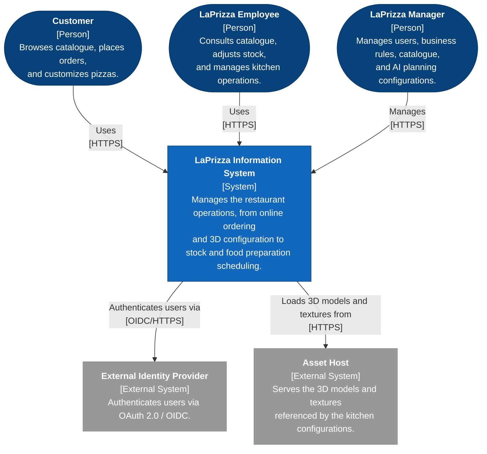
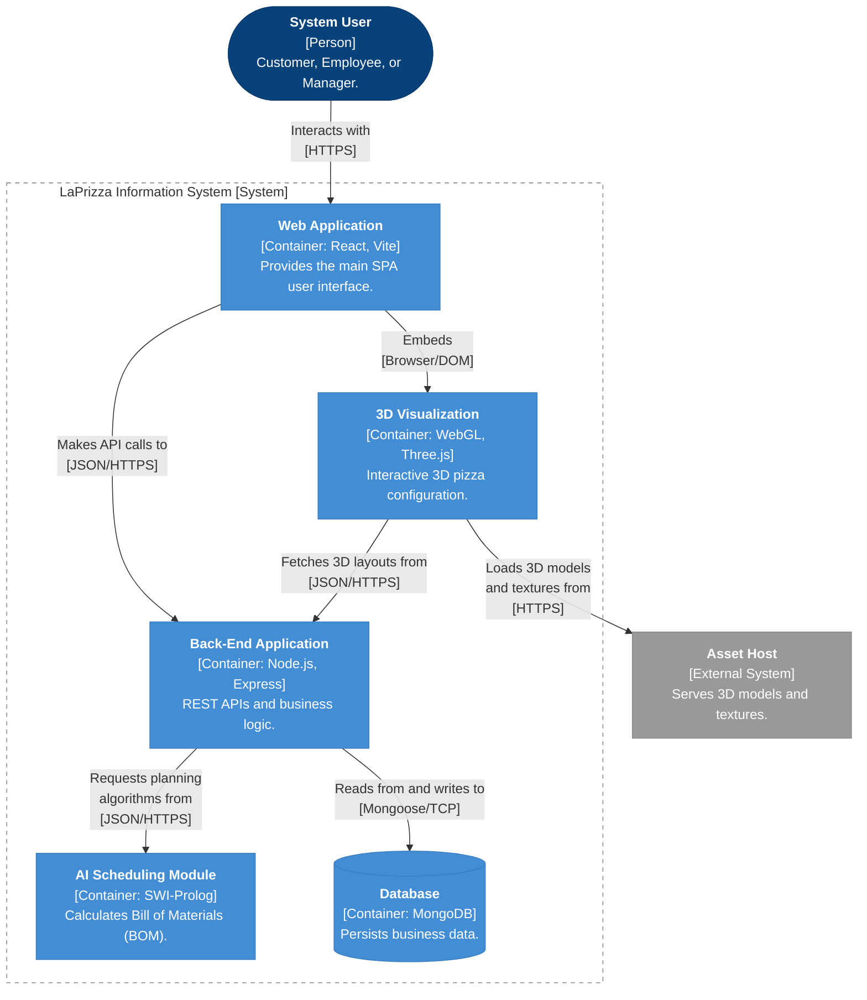
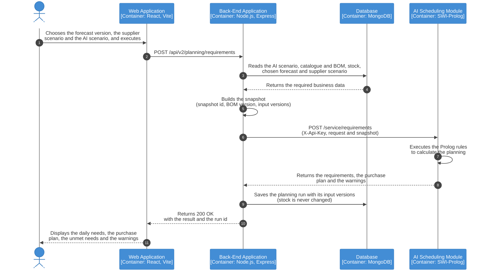
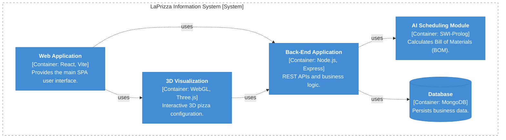
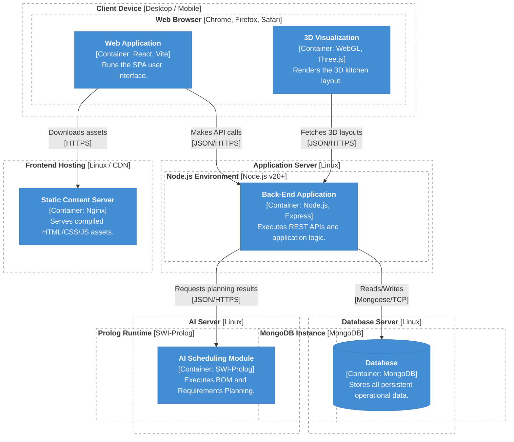
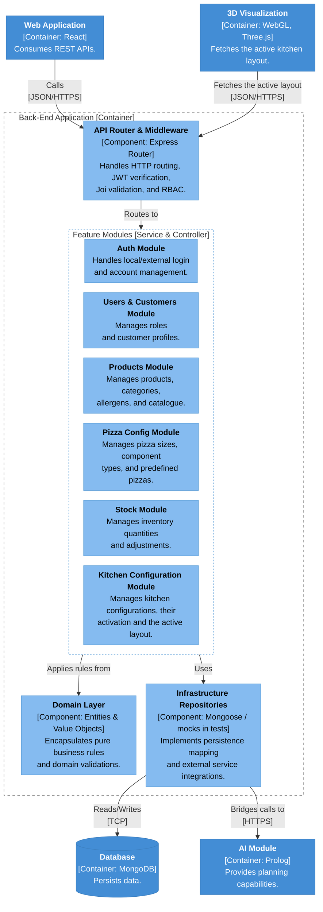
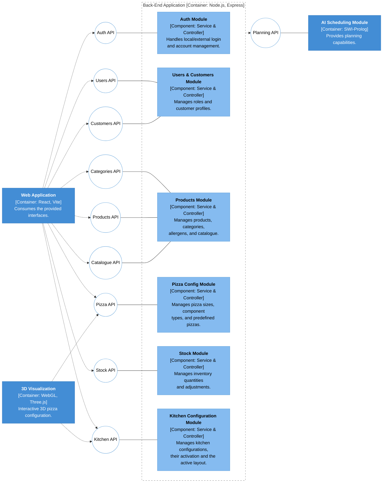

# Views

This section describes the architecture through the views listed below, chosen to answer the concerns of stakeholders mentioned in 1.2 and 1.3.

These views are:

- [Views](#views)
  - [Level 1](#level-1)
    - [Level 1 Logical View](#level-1-logical-view)
      - [Element Catalogue](#element-catalogue)
  - [Level 2](#level-2)
    - [Level 2 Logical View](#level-2-logical-view)
      - [Element Catalogue](#element-catalogue-1)
      - [Interfaces](#interfaces)
    - [Level 2 Process View](#level-2-process-view)
      - [Interaction Steps](#interaction-steps)
    - [Level 2 Development View](#level-2-development-view)
      - [Element Catalogue](#element-catalogue-2)
      - [Constraints](#constraints)
    - [Level 2 Physical View](#level-2-physical-view)
      - [Element Catalogue](#element-catalogue-3)
      - [Interfaces](#interfaces-1)
  - [Level 3](#level-3)
    - [Level 3 Logical View](#level-3-logical-view)
      - [Element Catalogue](#element-catalogue-4)
      - [Interfaces](#interfaces-2)
    - [Level 3 Development View](#level-3-development-view)
      - [Element Catalogue](#element-catalogue-5)
    - [High-Level Component and Connector View](#high-level-component-and-connector-view)
      - [Element Catalogue](#element-catalogue-6)
      - [Interfaces](#interfaces-3)
    - [Level 3 Process View](#level-3-process-view)
      - [Kitchen Configuration Flows](#kitchen-configuration-flows)
      - [Kitchen Layout Flows](#kitchen-layout-flows)
      - [AI Planning Flows](#ai-planning-flows)
      - [AI Bill of Materials Flows](#ai-bill-of-materials-flows)
      - [AI Requirements Planning Flows](#ai-requirements-planning-flows)
      - [AI Knowledge Base Flows](#ai-knowledge-base-flows)
      - [User Feedback Flows](#user-feedback-flows)
  - [Non-Functional View](#non-functional-view)

## Level 1

### Level 1 Logical View

#### Element Catalogue

| Element                     | Type            | Description                                                                                                            |
| :-------------------------- | :-------------- | :--------------------------------------------------------------------------------------------------------------------- |
| Customer                    | Person          | Browses catalogue, places orders, and customizes pizzas.                                                               |
| LaPrizza Employee           | Person          | Consults catalogue, adjusts stock, and manages kitchen operations.                                                     |
| LaPrizza Manager            | Person          | Manages users, business rules, catalogue, and AI planning configurations.                                              |
| LaPrizza Information System | System          | Manages the restaurant operations, from online ordering and 3D configuration to stock and food preperation scheduling. |
| External Identity Provider  | External System | Authenticates users via OAuth 2.0 / OIDC.                                                                              |
| Asset Host                  | External System | Serves the 3D models and textures that a kitchen configuration references by URL/URI (ADR-0026). Its location is not constrained by the ADR.                 |

## Level 2

### Level 2 Logical View

#### Element Catalogue

| Element              | Type      | Responsibility                                                                                                                         | Technology                |
| :------------------- | :-------- | :------------------------------------------------------------------------------------------------------------------------------------- | :------------------------ |
| System User          | Person    | Customer, Employee, or Manager (LaPrizza Staff). Consults the catalogue, customizes pizzas, places orders and manages the business information. |                           |
| Web Application      | Container | Main user interface for customers and staff; hosts the 3D Visualization                                                                | React, Vite, React Router |
| 3D Visualization     | Container | Interactive 3D pizza configuration and kitchen view, using data obtained from the Back-End Application                                 | WebGL, Three.js           |
| AI Scheduling Module | Container | Calculates the Bill of Materials and the requirements planning with supplier selection (AI01, AI02); food-preparation scheduling is not part of Sprint 2 | Prolog                    |
| Back-End Application | Container | Exposes the REST API, enforces business rules and invariants, handles authentication and authorization, and persists the business data | Node.js, Express          |
| Database             | Container | Persistent store of the business data; accessed only by the Back-End Application                                                       | MongoDB                   |
| Asset Host           | External System | Serves the 3D models and textures referenced by the kitchen configurations; used only by the 3D Visualization (ADR-0026)             | HTTPS                     |

#### Interfaces

| Connector                                | Protocol            | Purpose                                                 |
| :--------------------------------------- | :------------------ | :------------------------------------------------------ |
| System User to Web Application           | HTTPS               | User Interaction                                        |
| Web Application to 3D Visualization      | Browser (embedding) | Loads the 3D modules inside the web interface           |
| Web Application to Back-End Application  | JSON/HTTPS (REST)   | Reads and writes business data through `/api/v1`        |
| 3D Visualization to Back-End Application | JSON/HTTPS (REST)   | Reads catalogue data (sizes, components, rules, prices) and the active kitchen configuration |
| 3D Visualization to Asset Host           | HTTPS               | Loads the models and textures referenced by the kitchen configuration |
| Back-End Application to AI Scheduling    | JSON/HTTPS          | Requests planning (BOM and requirements) calculations   |
| Back-End Application to Database         | Mongoose / TCP      | Reads and writes                                        |

### Level 2 Process View

This view shows the interactions between the containers when a forecast is executed through the AI requirements planning (Sprint 2, WEB07). The Manager chooses the forecast version and the supplier scenario; without them, the back end uses the most recently created active ones. The full flow, with its components and error cases, is in [UC9 - Execute Forecast](../flows/ai-planning/execute-forecast.md).

#### Interaction Steps

| Step | From                 | To                   | Interaction                                                                 |
| :--: | :------------------- | :------------------- | :-------------------------------------------------------------------------- |
|  1   | LaPrizza Manager     | Web Application      | Chooses the forecast version, the supplier scenario, the AI scenario and the stock mode on the AI page, and executes |
|  2   | Web Application      | Back-End Application | `POST /api/v2/planning/requirements` with `{ scenarioId, stockMode, forecastId?, supplierScenarioId? }` (`/api/v1` is a deprecated alias) |
|  3   | Back-End Application | Database             | Reads the AI scenario, the catalogue and BOM, the stock (live, or the AI scenario's own stock), the chosen forecast and supplier scenario (the most recent active ones when no id is given) |
|  4   | Database             | Back-End Application | Returns the required business data                                          |
|  5   | Back-End Application | Back-End Application | Builds the snapshot: content hash (`snapshotId`), BOM version and the versions of the forecast and supplier scenario |
|  6   | Back-End Application | AI Scheduling Module | `POST /service/requirements` with the service key (`X-Api-Key`, never the user's token) and `{ request, snapshot }`; waits at most 15 s |
|  7   | AI Scheduling Module | AI Scheduling Module | Executes the Prolog rules that calculate the planning                       |
|  8   | AI Scheduling Module | Back-End Application | Returns the daily requirements, production, purchase plan by supplier, unmet needs and warnings (422 when data is missing) |
|  9   | Back-End Application | Database             | Saves the planning run with the versions of its inputs; stock and purchase orders are never changed, and a failure saves nothing |
|  10  | Back-End Application | Web Application      | Returns `200 OK` with the result and the `runId`                            |
|  11  | Web Application      | LaPrizza Manager     | Displays the daily needs, the purchase plan with suppliers and delivery dates, the unmet needs and the warnings |

### Level 2 Development View

This view demonstrates the dependencies between each module of the system.

#### Element Catalogue

| Element              | Type      | Responsibility                                                                                  | May Use                                  |
| :------------------- | :-------- | :---------------------------------------------------------------------------------------------- | :--------------------------------------- |
| Web Application      | Container | Provides the main SPA user interface and hosts the 3D Visualization                             | 3D Visualization, Back-End Application   |
| 3D Visualization     | Container | Interactive 3D kitchen and assembly line, drawn from the active kitchen configuration of the Back-End Application | Back-End Application                     |
| Back-End Application | Container | Exposes the REST API under `/api/v1`, enforces the business rules and persists the business data | AI Scheduling Module, Database           |
| AI Scheduling Module | Container | Calculates the Bill of Materials (BOM) and the requirements planning with supplier selection   | nothing                                  |
| Database             | Container | Persistent store of the business data                                                           | nothing                                  |

#### Constraints

- A container may only use the containers listed in its "May Use" column.
- The Web Application and the 3D Visualization access the business data only through the REST API of the Back-End Application.
- The Database is accessed only by the Back-End Application.
- The AI Scheduling Module is used only by the Back-End Application.
- The 3D Visualization loads the assets referenced by a kitchen configuration directly from their URL/URIs, without going through the Back-End Application ([ADR-0026](../adr/0026-asset-references-strategy.md)).

### Level 2 Physical View

This view shows how the containers are deployed on the infrastructure nodes (Sprint 2).

#### Element Catalogue

| Element                | Type                  | Responsibility                                          | Technology                |
| :--------------------- | :-------------------- | :------------------------------------------------------ | :------------------------ |
| Client Device          | Deployment node       | End-user device that runs the browser                   | Desktop / Mobile          |
| Web Browser            | Execution environment | Runs the SPA and the 3D module                          | Chrome, Firefox, Safari   |
| Web Application        | Container             | Runs the SPA user interface                             | React, Vite               |
| 3D Visualization       | Container             | Renders the 3D kitchen layout                           | WebGL, Three.js           |
| Frontend Hosting       | Deployment node       | Hosts the compiled front-end                            | Linux / CDN               |
| Static Content Server  | Container             | Serves compiled HTML/CSS/JS assets                      | Nginx                     |
| Application Server     | Deployment node       | Hosts the Back-End Application                          | Linux                     |
| Node.js Environment    | Execution environment | Runtime of the Back-End Application                     | Node.js v20+              |
| Back-End Application   | Container             | Executes REST APIs and application logic                | Node.js, Express          |
| AI Server              | Deployment node       | Hosts the AI Scheduling Module                          | Linux                     |
| Prolog Runtime         | Execution environment | Runtime of the AI Scheduling Module                     | SWI-Prolog                |
| AI Scheduling Module   | Container             | Executes BOM and Requirements Planning                  | SWI-Prolog                |
| Database Server        | Deployment node       | Hosts the database                                      | Linux                     |
| MongoDB Instance       | Execution environment | Runs the database as a replica set (single-node in local environments), required by the transaction that activates a kitchen configuration ([ADR-0028](../adr/0028-atomic-activation-strategy.md)) | MongoDB (replica set)     |
| Database               | Container             | Stores all persistent operational data                  | MongoDB                   |

#### Interfaces

| Connector                                     | Protocol          | Purpose                                      |
| :-------------------------------------------- | :---------------- | :------------------------------------------- |
| Web Application to Static Content Server      | HTTPS             | Downloads the compiled assets                |
| Web Application to Back-End Application       | JSON/HTTPS (REST) | Reads and writes business data               |
| 3D Visualization to Back-End Application      | JSON/HTTPS (REST) | Fetches the 3D layouts                       |
| Back-End Application to AI Scheduling Module  | JSON/HTTPS        | Requests the planning results                |
| Back-End Application to Database              | Mongoose / TCP    | Reads and writes                             |

## Level 3

### Level 3 Logical View

This view shows the components of the Back-End Application and how they relate to the other containers.

#### Element Catalogue

| Element                      | Type      | Responsibility                                                            | Technology            |
| :--------------------------- | :-------- | :------------------------------------------------------------------------ | :-------------------- |
| API Router & Middleware      | Component | Handles HTTP routing, JWT verification, Joi validation, and RBAC          | Express Router        |
| Auth Module                  | Component | Handles local/external login and account management                       | Service & Controller  |
| Users & Customers Module     | Component | Manages roles and customer profiles                                       | Service & Controller  |
| Products Module              | Component | Manages products, categories, allergens, and catalogue                    | Service & Controller  |
| Pizza Config Module          | Component | Manages pizza sizes, component types, and predefined pizzas               | Service & Controller  |
| Stock Module                 | Component | Manages inventory quantities and adjustments                              | Service & Controller  |
| Kitchen Configuration Module | Component | Manages kitchen configurations, their activation and the active layout    | Service & Controller  |
| Domain Layer                 | Component | Encapsulates pure business rules and domain validations                   | Entities & Value Objects |
| Infrastructure Repositories  | Component | Implements persistence mapping and external service integrations          | Mongoose / mocks      |
| Web Application              | Container | External to this view; consumes the REST APIs                             | React, Vite           |
| 3D Visualization            | Container | External to this view; fetches the active kitchen layout                  | WebGL, Three.js       |
| AI Scheduling Module         | Container | External to this view; provides planning capabilities                     | SWI-Prolog            |
| Database                     | Container | External to this view; persists the business data                         | MongoDB               |

The six feature modules (Auth, Users & Customers, Products, Pizza Config, Stock and Kitchen Configuration) are grouped in the diagram because they all relate to the other components in the same way. The components inside the Kitchen Configuration Module are detailed in the [Kitchen Configuration C4 Views](../flows/kitchen-configuration/c4-views.md#level-3-components-of-the-back-end-module).

#### Interfaces

| Connector                                                    | Protocol          | Purpose                                                          |
| :----------------------------------------------------------- | :---------------- | :--------------------------------------------------------------- |
| Web Application to API Router & Middleware                   | JSON/HTTPS (REST) | Calls the `/api/v1` endpoints                                    |
| 3D Visualization to API Router & Middleware                  | JSON/HTTPS (REST) | Calls the `/api/v1` endpoints to fetch the active kitchen configuration |
| API Router & Middleware to each feature module               | In-process        | Routes the validated, authorized request to the module           |
| Each feature module to Domain Layer                          | In-process        | Applies the business rules and domain validations                |
| Each feature module to Infrastructure Repositories           | In-process        | Reads and writes persisted data                                  |
| Infrastructure Repositories to Database                      | TCP               | Reads and writes; multi-document transactions for the activation of a kitchen configuration |
| Infrastructure Repositories to AI Scheduling Module          | HTTPS             | Bridges the planning calls                                       |

### Level 3 Development View

This view shows how each module is decomposed into elements.

```mermaid
flowchart LR
    subgraph backend["Back-End Application [Container: Node.js, Express] - src/&nbsp;&nbsp;&nbsp;&nbsp;&nbsp;&nbsp;&nbsp;&nbsp;&nbsp;&nbsp;&nbsp;&nbsp;&nbsp;&nbsp;&nbsp;&nbsp;&nbsp;&nbsp;&nbsp;&nbsp;&nbsp;&nbsp;&nbsp;&nbsp;&nbsp;&nbsp;&nbsp;&nbsp;&nbsp;&nbsp;&nbsp;&nbsp;&nbsp;&nbsp;&nbsp;&nbsp;&nbsp;&nbsp;&nbsp;&nbsp;&nbsp;&nbsp;&nbsp;&nbsp;&nbsp;&nbsp;&nbsp;&nbsp;&nbsp;&nbsp;&nbsp;&nbsp;&nbsp;&nbsp;&nbsp;&nbsp;&nbsp;&nbsp;&nbsp;&nbsp;&nbsp;&nbsp;&nbsp;&nbsp;&nbsp;&nbsp;&nbsp;&nbsp;&nbsp;&nbsp;"]
        subgraph api["<b>api</b> [Module]"]
            Routes["<b>Routes</b><br/>[Element: api]<br/>Map the HTTP endpoints under<br/>/api/v1 to the controllers."]
            Controllers["<b>Controllers</b><br/>[Element: api]<br/>Receive requests, invoke the use cases<br/>and build the HTTP responses."]
            AuthMiddleware["<b>Authorization Middleware</b><br/>[Element: api]<br/>Verifies the JWT and enforces<br/>role-based access control."]
        end
        subgraph app["<b>application</b> [Module]"]
            UseCases["<b>Use Cases</b><br/>[Element: application]<br/>Implement each use case, coordinating<br/>domain objects and repositories."]
            DTOs["<b>DTOs</b><br/>[Element: application]<br/>Carry data between the api<br/>and the use cases."]
        end
        subgraph dom["<b>domain</b> [Module]"]
            Entities["<b>Entities</b><br/>[Element: domain]<br/>Objects with identity that enforce<br/>their own business rules."]
            ValueObjects["<b>Value Objects</b><br/>[Element: domain]<br/>Immutable objects defined by<br/>their value."]
            DomainServices["<b>Domain Services</b><br/>[Element: domain]<br/>Business rules that do not belong<br/>to a single entity or value object."]
            RepositoryInterfaces["<b>Repository Interfaces</b><br/>[Element: domain]<br/>Contracts through which persisted<br/>data is accessed."]
        end
        subgraph infra["<b>infrastructure</b> [Module]"]
            RepoImpl["<b>Repository Implementations</b><br/>[Element: infrastructure]<br/>Implement the repository<br/>interfaces defined in the domain."]
            PasswordHasher["<b>Password Hasher</b><br/>[Element: infrastructure]<br/>Secures user passwords<br/>using the Argon2 algorithm."]
            TokenService["<b>Token Service</b><br/>[Element: infrastructure]<br/>Generates and validates JWTs<br/>for authenticated sessions."]
            Mongo["<b>MongoDB Persistence</b><br/>[Element: infrastructure]<br/>Database connection, schemas<br/>and document mapping."]
            Migrations["<b>Migrations & Seed</b><br/>[Element: infrastructure]<br/>Evolve the database structures<br/>and load the initial data."]
            Config["<b>Config</b><br/>[Element: infrastructure]<br/>Environment and secrets."]
        end
    end

    api -.->|"imports"| app
    app -.->|"imports"| dom
    infra -.->|"imports"| dom

    classDef person fill:#08427b,stroke:#073b6f,color:#fff
    classDef container fill:#438dd5,stroke:#3c7fc0,color:#fff
    classDef component fill:#85bbf0,stroke:#5d9fd8,color:#000
    classDef iface fill:#fff,stroke:#5d9fd8,color:#000

    class Routes,Controllers,AuthMiddleware,UseCases,DTOs,Entities,ValueObjects,DomainServices,RepositoryInterfaces,RepoImpl,PasswordHasher,TokenService,Mongo,Migrations,Config component
    style backend fill:none,stroke:#888,stroke-dasharray:5 5
    style api fill:none,stroke:#888,stroke-dasharray:5 5
    style app fill:none,stroke:#888,stroke-dasharray:5 5
    style dom fill:none,stroke:#888,stroke-dasharray:5 5
    style infra fill:none,stroke:#888,stroke-dasharray:5 5
```

#### Element Catalogue

|       Module       | Element                    | Responsibility                                                                                      |
| :----------------: | :------------------------- | :-------------------------------------------------------------------------------------------------- |
|      **api**       |                            | Entry point of the back-end for HTTP clients                                                        |
|                    | Routes                     | Map the HTTP endpoints under `/api/v1` to the controllers                                           |
|                    | Controllers                | Receive requests, invoke the use cases and build the HTTP responses and status codes                |
|                    | Authorization Middleware   | Intercepts requests to protected routes, verifying the JWT and enforcing role-based access control  |
|  **application**   |                            | Orchestrates the business functionality                                                             |
|                    | Use Cases                  | Implement each use case, coordinating domain objects and repositories                               |
|                    | DTOs                       | Carry data between the api and the use cases, so that the domain objects are not exposed to clients |
|     **domain**     |                            | Business knowledge, independent of frameworks and persistence                                       |
|                    | Entities                   | Objects with identity that enforce their own business rules and invariants                          |
|                    | Value Objects              | Immutable objects defined by their value, validated when created                                    |
|                    | Domain Services            | Business rules that do not belong to a single entity or value object                                |
|                    | Repository Interfaces      | Contracts through which the domain and the use cases access persisted data                          |
| **infrastructure** |                            | Technical implementations that support the other modules                                            |
|                    | Repository Implementations | Implement the repository interfaces defined in the domain                                           |
|                    | MongoDB Persistence        | Database connection, document schemas and mapping between documents and domain objects              |
|                    | Password Hasher            | Secures user passwords using the Argon2 algorithm                                                   |
|                    | Token Service              | Generates and validates JSON Web Tokens (JWT) for authenticated sessions                            |
|                    | Migrations & Seed          | Evolves the database structures and loads the initial reproducible data                             |
|                    | Config                     | Environment configuration and secrets used by the infrastructure                                    |

### High-Level Component and Connector View

This view shows the interfaces provided and required by the main components of the system.

A circle is an interface provided by the component it is attached to; a dotted arrow means the source component requires that interface.

#### Element Catalogue

| Element                  | Type      | Provides                                          | Requires                                                         |
| :----------------------- | :-------- | :------------------------------------------------ | :--------------------------------------------------------------- |
| Auth Module              | Component | Auth API                                          |                                                                  |
| Users & Customers Module | Component | Users API, Customers API                          |                                                                  |
| Products Module          | Component | Categories API, Products API, Catalogue API       |                                                                  |
| Pizza Config Module      | Component | Pizza API                                         |                                                                  |
| Stock Module             | Component | Stock API                                         |                                                                  |
| Kitchen Configuration Module | Component | Kitchen API                                       |                                                                  |
| Back-End Application     | Container | The APIs above                                    | Planning API                                                     |
| AI Scheduling Module     | Container | Planning API                                      |                                                                  |
| Web Application          | Container |                                                   | Auth, Users, Customers, Categories, Products, Pizza, Stock, Catalogue and Kitchen APIs |
| 3D Visualization         | Container |                                                   | Pizza and Kitchen APIs                                           |

#### Interfaces

| Interface      | Provided by              | Required by                  | Purpose                                                   |
| :------------- | :----------------------- | :--------------------------- | :-------------------------------------------------------- |
| Auth API       | Auth Module              | Web Application              | Login and account management                              |
| Users API      | Users & Customers Module | Web Application              | Management of users and roles                             |
| Customers API  | Users & Customers Module | Web Application              | Management of customer profiles                           |
| Categories API | Products Module          | Web Application              | Management of product categories                          |
| Products API   | Products Module          | Web Application              | Management of products and allergens                      |
| Catalogue API  | Products Module          | Web Application              | Consultation of the catalogue                             |
| Pizza API      | Pizza Config Module      | Web Application, 3D Visualization | Pizza sizes, component types and predefined pizzas   |
| Kitchen API    | Kitchen Configuration Module | Web Application, 3D Visualization | Import, activation and consultation of kitchen configurations, and the active kitchen layout |
| Stock API      | Stock Module             | Web Application              | Inventory quantities and adjustments                      |
| Planning API   | AI Scheduling Module     | Back-End Application         | BOM and requirements planning                             |

### Level 3 Process View

This view shows how the components of the containers interact in each use case. It is documented per aggregate as C4 dynamic diagrams in the `docs/flows` folder, where the README of each aggregate holds the notation key and the element catalogue.

#### Kitchen Configuration Flows

| Use Case                                   | Interaction                                                                                                    | Containers involved                              | ADRs                                |
| :----------------------------------------- | :------------------------------------------------------------------------------------------------------------- | :----------------------------------------------- | :---------------------------------- |
| [UC1 - Create / Import Kitchen Configuration](../flows/kitchen-configuration/create-import-kitchen-configuration.md) | The file is read in the browser and sent as JSON; the structure and the domain rules are validated; the configuration is stored inactive | Web Application, Back-End Application, Database | [ADR-0025](../adr/0025-strorage-model-of-kitchen-configurations.md), [ADR-0026](../adr/0026-asset-references-strategy.md), [ADR-0027](../adr/0027-content-validation-strategy.md), [ADR-0031](../adr/0031-import-approach.md) |
| [UC2 - Activate Kitchen Configuration](../flows/kitchen-configuration/activate-kitchen-configuration.md) | The active configuration is switched atomically in a transaction; the 3D viewer is remounted with a new React key | Web Application, 3D Visualization, Back-End Application, Database | [ADR-0028](../adr/0028-atomic-activation-strategy.md), [ADR-0032](../adr/0032-viewer-reload-mechanism-in-the-frontend.md) |
| [UC3 - Get Active Kitchen Configuration](../flows/kitchen-configuration/get-active-kitchen-configuration.md) | The viewer fetches the active layout and loads its assets by URL/URI; 404 when none is active, with no fallback | Web Application, 3D Visualization, Back-End Application, Database, Asset Host | [ADR-0026](../adr/0026-asset-references-strategy.md), [ADR-0030](../adr/0030-active-configuration-endpoint-and-no-fallback-policy.md) |

The context, container and component views of the feature, for the Back-End Application module and for the Web Application page, are in the [Kitchen Configuration C4 Views](../flows/kitchen-configuration/c4-views.md).

#### Kitchen Layout Flows

| Use Case | Interaction | Containers involved | ADRs |
| :------- | :---------- | :------------------ | :--- |
| [VIS02 UC1 - View the Kitchen Layout](../flows/kitchen-layout/view-kitchen-layout.md) | The viewer reads the active configuration and draws the floor, the walls and each element at its position, rotation and size, with the furniture model of the element; without an active configuration nothing is drawn | Web Application, 3D Visualization, Back-End Application, Database | [ADR-0030](../adr/0030-active-configuration-endpoint-and-no-fallback-policy.md), [ADR-0039](../adr/0039-adoption-of-r3f-for-3d-module-integration.md) |

The layout properties, the models of each element and the element catalogue are in the [Kitchen Layout README](../flows/kitchen-layout/README.md).

#### AI Planning Flows

| Use Case | Interaction | Containers involved | ADRs |
| :------- | :---------- | :------------------ | :--- |
| [UC1 - Create Forecast](../flows/ai-planning/create-forecast.md) | The form is checked in the browser; the back end validates with Joi and the forecast rules and assigns the next version of the name | Web Application, Back-End Application, Database | [ADR-0046](../adr/0046-immutable-versioned-forecasts-and-supplier-scenarios.md) |
| [UC2 - List and Consult Forecasts](../flows/ai-planning/list-and-consult-forecasts.md) | Only active versions are listed, grouped by name; the detail comes from the list | Web Application, Back-End Application, Database | [ADR-0046](../adr/0046-immutable-versioned-forecasts-and-supplier-scenarios.md) |
| [UC3 - Edit Forecast (new version)](../flows/ai-planning/edit-forecast.md) | Saving with the same name creates the next version; the edited version is never changed | Web Application, Back-End Application, Database | [ADR-0046](../adr/0046-immutable-versioned-forecasts-and-supplier-scenarios.md), [ADR-0047](../adr/0047-recording-planning-runs-with-their-input-versions.md) |
| [UC4 - Delete (Deactivate) Forecast](../flows/ai-planning/deactivate-forecast.md) | After a confirmation, the forecast is deactivated and kept for the saved runs | Web Application, Back-End Application, Database | [ADR-0046](../adr/0046-immutable-versioned-forecasts-and-supplier-scenarios.md) |
| [UC5 - Export Products](../flows/ai-planning/export-products.md) | The products that can be bought are exported as JSON | Web Application, Back-End Application, Database | [ADR-0048](../adr/0048-supplier-import-with-client-side-checks-and-server-dry-run.md) |
| [UC6 - Import Supplier Scenario](../flows/ai-planning/import-supplier-scenario.md) | Parse and structure checks in the browser, server dry-run, preview, then save on confirmation | Web Application, Back-End Application, Database | [ADR-0046](../adr/0046-immutable-versioned-forecasts-and-supplier-scenarios.md), [ADR-0048](../adr/0048-supplier-import-with-client-side-checks-and-server-dry-run.md) |
| [UC7 - List and Consult Supplier Scenarios](../flows/ai-planning/list-and-consult-supplier-scenarios.md) | Only active versions are listed; offers are shown as simulated, products without offers as "No configured supplier" | Web Application, Back-End Application, Database | [ADR-0046](../adr/0046-immutable-versioned-forecasts-and-supplier-scenarios.md) |
| [UC8 - Deactivate Supplier Scenario](../flows/ai-planning/deactivate-supplier-scenario.md) | After a confirmation, the scenario is deactivated and kept for the saved runs | Web Application, Back-End Application, Database | [ADR-0046](../adr/0046-immutable-versioned-forecasts-and-supplier-scenarios.md) |
| [UC9 - Execute Forecast](../flows/ai-planning/execute-forecast.md) | The back end builds the snapshot, calls the AI Scheduling Module with a service key and saves the run; stock is never changed | Web Application, Back-End Application, Database, AI Scheduling Module | [ADR-0047](../adr/0047-recording-planning-runs-with-their-input-versions.md), [ADR-0049](../adr/0049-synchronous-ai-execution-with-duplicate-submission-guard.md) |
| [UC10 - Consult Planning Results](../flows/ai-planning/consult-planning-results.md) | Saved runs are listed with the versions of their inputs; one run is opened with its full plan | Web Application, Back-End Application, Database | [ADR-0047](../adr/0047-recording-planning-runs-with-their-input-versions.md) |

The REST API summary, the business rules and the element catalogue of the feature are in the [AI Planning README](../flows/ai-planning/README.md).

#### AI Bill of Materials Flows

| Use Case | Interaction | Containers involved | ADRs |
| :------- | :---------- | :------------------ | :--- |
| [UC1 - Define Product Aggregates](../flows/ai-bill-of-materials/define-product-aggregates.md) | The aggregate is validated with Joi and the domain rules (one level, items active and not pizzas) and saved with the product; the planning caches are invalidated | Back-End Application, Database | [ADR-0040](../adr/0040-product-aggregates-and-stock-first-bom-expansion.md) |
| [UC2 / UC3 - Calculate Bill of Materials](../flows/ai-bill-of-materials/calculate-bill-of-materials.md) | The AI Scheduling Module fetches the scenario snapshot with the Manager token (live or scenario stock), loads it and expands the orders with the aggregate stock first; nothing is written | AI Scheduling Module, Back-End Application, Database | [ADR-0040](../adr/0040-product-aggregates-and-stock-first-bom-expansion.md), [ADR-0041](../adr/0041-simulated-bom-scenarios-with-selectable-stock-and-a-resettable-demo-seed.md), [ADR-0020](../adr/0020-planning-snapshot-as-the-data-contract-with-the-ai-service.md) |

The calculation rules, the demonstration scenarios and the element catalogue are in the [AI Bill of Materials README](../flows/ai-bill-of-materials/README.md).

#### AI Requirements Planning Flows

| Use Case | Interaction | Containers involved | ADRs |
| :------- | :---------- | :------------------ | :--- |
| [UC1 / UC3 - Calculate Requirements Planning](../flows/ai-requirements-planning/calculate-requirements-planning.md) | The AI Scheduling Module fetches the scenario snapshot (forecast, supplier scenario, live or scenario stock) with the Manager token, derives the daily needs through the BOM and the stock, and plans the purchases; nothing is written | AI Scheduling Module, Back-End Application, Database | [ADR-0058](../adr/0058-requirements-planning-with-chronological-net-needs-and-on-time-cheapest-supplier.md), [ADR-0020](../adr/0020-planning-snapshot-as-the-data-contract-with-the-ai-service.md) |
| [UC2 - Select Suppliers](../flows/ai-requirements-planning/select-suppliers.md) | For each product with needs: cheapest on-time offer on a stock-unit price, then the earliest late delivery; limits cumulative, missing limits flagged | AI Scheduling Module | [ADR-0058](../adr/0058-requirements-planning-with-chronological-net-needs-and-on-time-cheapest-supplier.md) |

The calculation and supplier selection rules, a worked example and the element catalogue are in the [AI Requirements Planning README](../flows/ai-requirements-planning/README.md).

#### AI Knowledge Base Flows

| Use Case | Interaction | Containers involved | ADRs |
| :------- | :---------- | :------------------ | :--- |
| [UC1 - Provide Planning Snapshot](../flows/ai-knowledge-base/provide-planning-snapshot.md) | The back end builds the planning snapshot from the current data; the Prolog service fetches it with the Manager token (pull) or receives it from the back end (push) | AI Scheduling Module, Back-End Application, Database | [ADR-0020](../adr/0020-planning-snapshot-as-the-data-contract-with-the-ai-service.md) |
| [UC2 - Build Knowledge Base](../flows/ai-knowledge-base/build-knowledge-base.md) | The snapshot is validated as a whole and loaded as facts in one transaction, or rejected with 422 | AI Scheduling Module | [ADR-0021](../adr/0021-knowledge-base-loaded-per-calculation.md) |
| [UC3 - Refresh Data per Calculation](../flows/ai-knowledge-base/refresh-per-calculation.md) | Each calculation gets a new snapshot; the knowledge base is serialized by a mutex and cleared after use | Web Application, Back-End Application, Database, AI Scheduling Module | [ADR-0020](../adr/0020-planning-snapshot-as-the-data-contract-with-the-ai-service.md), [ADR-0021](../adr/0021-knowledge-base-loaded-per-calculation.md) |

The REST API summary, the snapshot format and the facts of the knowledge base are in the [AI Knowledge Base README](../flows/ai-knowledge-base/README.md).

#### User Feedback Flows

| Use Case | Interaction | Containers involved | ADRs |
| :------- | :---------- | :------------------ | :--- |
| [WEB04 UC1 - Submit a Form](../flows/user-feedback/submit-form.md) | Client rules first, one submission at a time; the API answers 400 with structured details shown on the fields, typed values kept, success toast | Web Application, Back-End Application, Database | [ADR-0055](../adr/0055-ui-consistency-and-input-validation-after-the-sprint-2-review.md) |
| [WEB04 UC2 - Confirm a Significant Action](../flows/user-feedback/confirm-significant-action.md) | A dialog states the consequence; cancelling sends nothing | Web Application, Back-End Application, Database | [ADR-0055](../adr/0055-ui-consistency-and-input-validation-after-the-sprint-2-review.md) |
| [WEB04 UC3 - Wait for Information](../flows/user-feedback/wait-for-information.md) | Every request feeds the progress bar; lists keep their room while loading | Web Application, Back-End Application, Database | [ADR-0055](../adr/0055-ui-consistency-and-input-validation-after-the-sprint-2-review.md) |
| [WEB04 UC4 - Recover from a Failure](../flows/user-feedback/recover-from-failure.md) | Errors translated by kind without internal details; global failures as one toast; "Try again" on lists; a write without answer is reported as possibly done | Web Application, Back-End Application | [ADR-0055](../adr/0055-ui-consistency-and-input-validation-after-the-sprint-2-review.md) |

The error contract and the shared components are in the [User Feedback and Validation README](../flows/user-feedback/README.md).

## Non-Functional View

| Attribute                       | Scenario and Expected Result                                                                                                                                                                                                                                           | Architectural Response                                                                                                                                                                                                                                                                                                                                                                                                                                                                                                                         | Status                                                          |
| :------------------------------ | :--------------------------------------------------------------------------------------------------------------------------------------------------------------------------------------------------------------------------------------------------------------------- | :--------------------------------------------------------------------------------------------------------------------------------------------------------------------------------------------------------------------------------------------------------------------------------------------------------------------------------------------------------------------------------------------------------------------------------------------------------------------------------------------------------------------------------------------- | :-------------------------------------------------------------- |
| Security and access control     | A request without valid credentials, or from roles without permission, reaches a protected operation: it is rejected (401 when unauthenticated, 403 when the roles are not allowed); passwords are never stored in clear text; only the personal data needed is stored | Passwords hashed with Argon2 before being stored; JSON Web Tokens with a 35-minute expiration carrying the user id and roles; roles defined as enum (`MANAGER`, `EMPLOYEE`, `CUSTOMER`); a middleware in the `api` module enforces the roles on protected routes (e.g. `/api/v1/users` requires `MANAGER`), and only `/api/v1/auth/login` is public; credentials (`User`) are kept separate from the customer profile through an optional `customerId`; the first `MANAGER` is created by a seed script ([ADR-0003](../adr/0003-authentication-and-authorization.md)) | Sprint 1                                                        |
| Data integrity                  | A category, allergen, size or product referenced elsewhere is removed: the removal is refused or becomes a deactivation; the business invariants hold                                                                                                                  | Invariants in the domain; checks in the use cases; unique indexes ([ADR-0002](../adr/0002-persistence-and-seed-data-mechanism.md)); module views (3.2, 3.3)                                                                                                                                                                                                                                                                                                                                                                                                  | Sprint 1                                                        |
| Recoverability                  | Business data is accidentally deleted or corrupted: it can be restored                                                                                                                                                                                                 | Products deactivated instead of deleted; reproducible schema and seed data ([ADR-0002](../adr/0002-persistence-and-seed-data-mechanism.md)); database backups (depends on the Atlas plan)                                                                                                                                                                                                                                                                                                                                                                    | Partly Sprint 1; backups and recovery procedure planned (ASIST) |
| Stability and scalability       | The number of clients or requests grows: the system keeps working; the System Specification gives no numeric targets                                                                                                                                                   | Separate components over a versioned REST API (3.4); configuration in the environment; stateless authentication, since the token carries the identity and roles and no session state is kept ([ADR-0003](../adr/0003-authentication-and-authorization.md)); further measures (replication, load balancing, containers) planned with ASIST                                                                                                                                                                                                                             | Considered; not assessed                                        |
| Interoperability                | A new client (Web Application, 3D Visualization, AI) is integrated: it uses only the OpenAPI contract                                                                                                                                                                  | Contract-first REST API under `/api/v1` ([ADR-0004](../adr/0004-contract-first-rest-api.md)); Level 2 Logical View (3.4)                                                                                                                                                                                                                                                                                                                                                                                                                             | Sprint 1                                                        |
| Maintainability and testability | A new Pizza Component Type is added, or a team member runs the tests without a database: no source code change; tests pass without external services                                                                                                                   | Layers and repository interfaces in `domain` ([ADR-0001](../adr/0001-layered-domain-driven-design-%28ddd%29-architecture.md)); configurable data and seed data ([ADR-0002](../adr/0002-persistence-and-seed-data-mechanism.md)); native `node:test` mocks ([ADR-0033](../adr/0033-mock-based-unit-testing.md)); CI                                                                                                                                                                                                                                                                                                                                                      | Sprint 1                                                        |
| Consistency and availability of the active configuration | Two Managers activate different kitchen configurations at the same time, a Manager tries to delete the active configuration, or no configuration is active: there is never more than one active configuration, the active one cannot be deleted, and a missing active configuration is reported explicitly (404) instead of being hidden | Boolean flag with a partial unique index and a transaction that swaps the active configuration atomically, on a MongoDB replica set ([ADR-0028](../adr/0028-atomic-activation-strategy.md)); deletion of the active configuration is rejected and edits are validated again ([ADR-0029](../adr/0029-rules-for-editing-and-deleting-the-active-configuration.md)); dedicated endpoint with a strict 404 and no fallback layout ([ADR-0030](../adr/0030-active-configuration-endpoint-and-no-fallback-policy.md)); the viewer is remounted with a React key reset ([ADR-0032](../adr/0032-viewer-reload-mechanism-in-the-frontend.md)) | Sprint 2 (WEB06) |
| Validation of imported content | A Manager imports a file that is not valid JSON, does not follow the expected structure or breaks a physical rule (for example duplicated equipment ids): it is rejected with the exact property paths and nothing is stored | File read and parsed in the browser ([ADR-0031](../adr/0031-import-approach.md)); JSON Schema for the structure, with path-based errors, plus domain rules for the business invariants ([ADR-0027](../adr/0027-content-validation-strategy.md)); nested BSON object stored as a free-form document, so the structure is guaranteed by the validation in the domain, not by the persistence layer ([ADR-0025](../adr/0025-strorage-model-of-kitchen-configurations.md)) | Sprint 2 (WEB06) |
| Load time of the 3D viewer | The 3D viewer loads the active kitchen layout: it needs one request to the Back-End Application and fetches its assets directly | Self-contained configuration payload with URL/URI asset references, without joins or secondary requests to the Back-End Application ([ADR-0026](../adr/0026-asset-references-strategy.md)); configuration read as a single document ([ADR-0025](../adr/0025-strorage-model-of-kitchen-configurations.md)) | Sprint 2 (WEB06); not measured |

**Trade-offs and limitations**

- **Session length vs usability:** the 35-minute expiration limits the time a stolen token is useful, but users are logged out frequently. A refresh token strategy is the planned remedy if this affects usability (ADR-0003).
- **Roles in the token:** keeping the roles in the token avoids a database lookup per request, but a role change or a deactivated user only takes effect when the token expires.
- **Roles in code:** the roles are fixed in the code, so adding a new role requires a code change.
- **Replica set requirement:** the atomic activation of a kitchen configuration needs MongoDB multi-document transactions, which require a replica set, so local environments must run a single-node replica set ([ADR-0028](../adr/0028-atomic-activation-strategy.md)).
- **Duplicated asset URLs:** self-contained URL/URIs keep the viewer fast and the backend simple, but the same URL is repeated in several configurations and a changed URL must be updated by hand ([ADR-0026](../adr/0026-asset-references-strategy.md)).
- **New 3D properties:** the content is stored as a free-form nested object and validated by the JSON Schema in the domain, so a property required by the viewer needs an update of `kitchen-configuration.schema.json`, not a database migration ([ADR-0025](../adr/0025-strorage-model-of-kitchen-configurations.md)).
- **Viewer remount:** the React key reset gives a clean Three.js scene after an activation or an edit of the active configuration, at the cost of a brief loading flicker ([ADR-0032](../adr/0032-viewer-reload-mechanism-in-the-frontend.md)).
