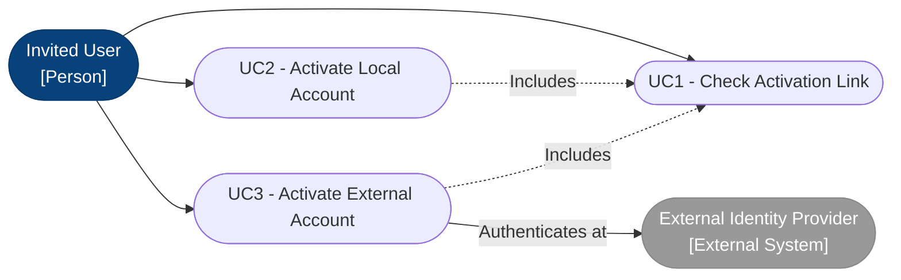

# Account Activation - Design Diagrams (Mermaid)

The Account Activation feature (AA07) lets an invited user complete the activation of an inactive account with the single-use invitation issued by AA06. A local account, created by an Administrator, is activated by setting its password. An external account is validated by a successful sign-in at the identity provider linked to it: since 2026-11-21 the first external login creates it active (AA02), and an older external account still waiting for activation is activated by its next external login (or by its invitation, only if the authenticated identity is the linked one). Activation never opens a session, never changes the roles assigned by AA06 and never grants an optional consent: the user signs in afterwards with the normal login (AA01 or AA02).

Process View (SAD), Level 3, documented as C4 dynamic diagrams of the **Web Application** and **Back-end API** containers (and of the **External Identity Provider** for the external activation).

## Use Cases

The use cases are described in the [Use Case Views](../../analysis/use-case-views.md#aa07-secure-account-activation).

## Diagrams

| Use case | Endpoint | Roles | Success | Document |
|---|---|---|---|---|
| [UC1 - Check Activation Link](./inspect-activation-link.md) | `POST /auth/activation/inspect` | Public (Guest) | 200 OK | `inspect-activation-link.md` |
| [UC2 - Activate Local Account](./activate-local-account.md) | `POST /auth/activation/local` | Public (Guest) | 204 No Content | `activate-local-account.md` |
| [UC3 - Activate External Account](./activate-external-account.md) | `POST /auth/external/activate`, `GET /auth/external/{provider}/callback` | Public (Guest) | 303 to the identity provider, then 302 to `/auth/callback?status=activated` | `activate-external-account.md` |

## REST API summary

All paths are under `/api/v2` (current version). `/api/v1` is a deprecated alias served by the same router (`api-versions.js`). The endpoints are public on purpose: the account is not active yet, so there is no session to require. `POST /auth/activation/inspect` and `POST /auth/activation/local` are listed in `PUBLIC_ENTRY_POINTS` (`test/support/authorization-matrix.js`), so `api.route-permissions.test.js` keeps them unguarded. `POST /auth/external/activate` exists only when external login is enabled. Every answer has `Cache-Control: no-store`.

| Method and path | Use case | Body | Success | Errors |
|---|---|---|---|---|
| `POST /auth/activation/inspect` | UC1 | `{ "token" }` | 200 `{ method: "local" \| "external", provider?, email (masked), expiresAt }` | 400 `VALIDATION_FAILED` (malformed token; the value is never echoed), 400 `INVITATION_INVALID`, 429 `RATE_LIMITED` |
| `POST /auth/activation/local` | UC2 | `{ "token", "newPassword" }` | 204 (no session, no cookie) | 400 `VALIDATION_FAILED`, 400 `PASSWORD_POLICY_VIOLATION`, 400 `INVITATION_INVALID` (also for an external account), 429 `RATE_LIMITED` |
| `POST /auth/external/activate` | UC3 | form (`application/x-www-form-urlencoded`) `token=...` | 303 to the identity provider, with the `lp_oidc` transaction cookie | 303 to `/auth/callback?status=error&code=INVITATION_INVALID` (malformed, unknown, used or expired link, local account) or `AUTH_FAILED` (origin not allowed, provider disabled) |
| `GET /auth/external/{provider}/callback` | UC3 | - | 302 to `/auth/callback?status=activated` (no refresh cookie) | 302 with `code=INVITATION_MISMATCH`, `INVITATION_INVALID`, `ACCESS_DENIED` or `AUTH_FAILED` |

The token is 256 random bits in base64url (43 characters); Joi checks the format (`^[A-Za-z0-9_-]{43}$`) before any lookup. The `activation` rate limiter works per IP with the window and limit of the login (`AUTH_RATE_LIMIT_WINDOW_MINUTES`, `AUTH_RATE_LIMIT_MAX`) and counts only failed requests, so a user who opens the link and then activates is never blocked. It is disabled with `RATE_LIMIT_ENABLED=false` (`test-flows/.env.flows`).

Errors follow `{ "error": { "status", "code", "message", "details"? } }`. The OpenAPI description is in `src/api/auth/activation.openapi.js` and `src/api/auth/external-auth.openapi.js` (`/auth/external/activate`), exported to `openapi.v1.json` and `openapi.v2.json`.

## Business rules shown in the diagrams

- **Single-use, time-limited link.** AA06 stores only the SHA-256 of the token, with its expiry (72 h by default, `INVITATION_TTL_HOURS`), `usedAt` and `revokedAt`. `consume()` marks the invitation used with one conditional update (`usedAt: null`, `revokedAt: null`, `expiresAt > now`), so two concurrent activations cannot both succeed. Issuing a new invitation revokes the previous one.
- **Only accounts waiting for their first activation** (`evaluateAccountActivation`): the invitation is usable, its account exists, is `inactive` with `activatedAt: null`, and still has the e-mail the invitation was sent to. A disabled account, or one activated before, is never enabled through an old link.
- **Same answer for every refusal.** Unknown, used, replaced and expired links, and accounts not waiting for activation, all answer `400 INVITATION_INVALID`, so the answer never tells whether an account exists. The real reason (`INVITATION_UNKNOWN`, `INVITATION_USED`, `INVITATION_REPLACED`, `INVITATION_EXPIRED`, `ACCOUNT_NOT_FOUND`, `ACCOUNT_NOT_PENDING`, `EMAIL_CHANGED`, `METHOD_MISMATCH`, `IDENTITY_MISMATCH`) is only written to the security log (`ACCOUNT_ACTIVATION_FAILED`), never with the token, its hash, the password or the e-mail.
- **Activation method** (`activationMethodFor`). An account with a linked external identity was created by its first external login (AA02) and is activated at that provider; any other account was created by an Administrator (AA06) and is activated by setting its password. The client cannot choose: a local activation of an external account, or an external activation of a local account, is refused ([ADR-0052](../../adr/0052-account-activation-method-session-and-oidc-transaction.md)).
- **Password.** Chosen by the user and never sent by e-mail. Same policy as AA01 (8 to 64 characters, at least one uppercase letter and one of `! @ # $ % ^ & * . , - _ ?`), checked before the link is used, so a weak password does not spend it. Stored with Argon2id.
- **Intended identity (external).** The identity authenticated at the provider must have the same issuer and subject as the identity linked to the account (`isInvitedIdentity`). The e-mail is not enough, because it can change at the provider. Another identity answers `INVITATION_MISMATCH`, leaves the link unused and the account inactive.
- **Token never in a URL.** The e-mail link carries it in the fragment (`#token=`), which browsers never send to a server nor put in the `Referer`; the page removes it from the address bar as soon as it reads it. The API receives it in a JSON body (UC1, UC2) or a form body (UC3), and the OIDC transaction cookie keeps only its hash.
- **No session, no roles, no consents.** `activateAccount` only sets `status`, `activatedAt`, `failedLoginCount`, `lockedUntil` and, for a local account, `passwordHash`. Roles stay as AA06 assigned them, no consent field is touched, and no refresh cookie is set: the user signs in afterwards with AA01 or AA02.
- **No transactions.** MongoDB runs standalone: the invitation is consumed first and the account activated next, both with conditional updates. If an Administrator disables the account between the two, the link is spent and the account stays disabled; the Administrator can issue a new invitation.

## Related ADRs

| ADR | Decision | Status |
|---|---|---|
| [ADR-0004](../../adr/0004-contract-first-rest-api.md) | Contract-first REST API | Accepted |
| [ADR-0015](../../adr/0015-api-uri-routing-versioning-strategy.md) | API URI versioning (`/api/v2`, `/api/v1` deprecated alias) | Accepted |
| [ADR-0019](../../adr/0019-internationalization-of-the-web-application-%28english-and-portuguese%29.md) | Internationalization of the Web Application (English and Portuguese) | Accepted |
| [ADR-0033](../../adr/0033-mock-based-unit-testing.md) | Mock-based unit testing with `node:test` | Accepted |
| [ADR-0043](../../adr/0043-secure-session-handling-in-the-api-and-the-spa.md) | Secure session handling in the API and the SPA | Accepted |
| [ADR-0051](../../adr/0051-administrator-role-role-change-records-and-activation-invitations.md) | Administrator role, role change records and activation invitations | Accepted |
| [ADR-0052](../../adr/0052-account-activation-method-session-and-oidc-transaction.md) | Account activation: method from the linked identity, no session, marked OIDC transaction | Accepted |

## Notation key

| Notation | Meaning |
|---|---|
| Actor (stick figure) | Person using the system, with the role shown in the label |
| Shaded box "Web Application" | Container (React, Vite) that holds the page components |
| Shaded box "Back-end API" | System boundary of the container (Node.js, Express) that holds all the components |
| Shaded box "External Identity Provider" | System outside the LaPrizza boundary (OpenID Connect) |
| Participant label | `Name`, followed by `[Type: technology]` |
| Solid arrow | Call or request |
| Dashed arrow | Return value or response |
| Arrow to the same participant | Work done inside that component |
| Number on an arrow | Order of the interaction (autonumber) |
| `alt` / `else` frame | Alternative flows, only one of them runs |
| `opt` frame | Optional flow |
| `Note` | Reference to another diagram or a remark |

## Element catalogue

| Element | Type | Technology | Responsibility | Used in |
|---|---|---|---|---|
| Invited User | Person | - | Person with an inactive account and an activation invitation | All diagrams |
| External Identity Provider | External System | OpenID Connect (Google, Microsoft) | Authenticates the user and returns the validated id_token (issuer, subject) | [UC3](./activate-external-account.md) |
| ActivateAccountPage | Component | React page | Public page `/activate` (`showInNav: false`): reads and removes the token, checks the link, shows the local form, the external button or the error | [UC1](./inspect-activation-link.md), [UC2](./activate-local-account.md), [UC3](./activate-external-account.md) |
| LocalActivation | Component | React form | Password and confirmation with the AA01 rules, one submission at a time (`useSubmit`), API errors per field | [UC2](./activate-local-account.md) |
| ExternalActivation | Component | React component | "Continue with <provider>": one navigation per click | [UC3](./activate-external-account.md) |
| account-activation | Component | JavaScript module, pure functions | `readActivationToken`, `activationStep`, `providerLabel`, `externalActivationForm`, `submitForm` | [UC1](./inspect-activation-link.md), [UC3](./activate-external-account.md) |
| authApi | Component | JavaScript module | `inspectActivation`, `activateLocal`, `startExternalActivation` | All diagrams |
| AuthCallbackPage | Component | React page | Shows `status=activated` (no session) and the invitation error codes (`parseCallbackParams`) | [UC3](./activate-external-account.md) |
| Route (Joi & Rate limit) | Component | Express router and middleware | `noStore`, `activation` rate limiter (failures only), Joi validation of `token` and `newPassword` | [UC1](./inspect-activation-link.md), [UC2](./activate-local-account.md) |
| AuthController | Component | Express controller | `inspectActivation` (200), `activateLocal` (204) | [UC1](./inspect-activation-link.md), [UC2](./activate-local-account.md) |
| Route (external) | Component | Express router | `POST /auth/external/activate` with `express.urlencoded` (1 kB), `GET /auth/external/{provider}/callback` | [UC3](./activate-external-account.md) |
| ExternalAuthController | Component | Express controller | `activate` (origin, token format, transaction cookie, 303), `callback` (`status=activated`, public error codes) | [UC3](./activate-external-account.md) |
| ExternalAuthService | Component | Node.js module | `startActivation`, and the activation branch of `completeLogin`, which runs before any login or account creation | [UC3](./activate-external-account.md) |
| AccountActivationService | Component | Node.js module | `inspect`, `activateLocal`, `prepareExternal`, `completeExternal` | All diagrams |
| Activation rules | Component | Node.js module, pure functions (`account-activation.domain.js`) | `evaluateInvitationUse`, `evaluateAccountActivation`, `activationMethodFor`, `isInvitedIdentity`, `maskEmail` | All diagrams |
| ActivationInvitationsRepository | Component | Repository, MongoDB (`Activation Invitations`) | `findByTokenHash` (AA07), `consume` (atomic, AA06) | All diagrams |
| UsersRepository | Component | Repository, MongoDB (`Users`) | `findById`, `activateAccount` (conditional) | All diagrams |
| ExternalIdentitiesRepository | Component | Repository, MongoDB (`External Identities`) | `findByUserId` | All diagrams |
| OidcClient | Component | `openid-client` | Authorization request (state, nonce, PKCE) and code exchange with id_token validation | [UC3](./activate-external-account.md) |
| TransactionCodec | Component | Node.js module, HMAC-SHA256 | Signs and verifies the `lp_oidc` cookie, here with `purpose: "activation"` and `invitationHash` | [UC3](./activate-external-account.md) |
| SecurityLogger | Component | Node.js module | `ACCOUNT_ACTIVATED`, `ACCOUNT_ACTIVATION_FAILED` (reason only), `RATE_LIMITED` | All diagrams |

## Notes

- The external activation reuses the AA02 login: same routes prefix, same transaction cookie and same callback. The only difference is the `purpose: "activation"` mark in the signed transaction, which makes `completeLogin` call `AccountActivationService.completeExternal` before anything else and return without creating an account or opening a session.
- The OIDC redirect URI always uses the current API version (`/api/v2`), and the refresh cookie of the normal login is scoped to `/api/v2/auth`. The Web Application must therefore use `VITE_API_BASE_URL=.../api/v2`; with `/api/v1` the external login after the activation fails at `POST /auth/refresh`.
- All texts of the page are in English and Portuguese, in `message.js` (`activation.*`, `nav.activateAccount`, `auth.errors.INVITATION_*`, `auth.external.activated`, `auth.external.errors.INVITATION_*`) ([ADR-0019](../../adr/0019-internationalization-of-the-web-application-%28english-and-portuguese%29.md)).
- Development helper: `npm run reset:external-account -- --email <email> [--allow-remote] --confirm` removes an account created by an external login (and its identities, invitations, role records, sessions and reset tokens), so the first external login and the external activation can be tried again with the same tester account. It refuses production, remote databases without `--allow-remote` and local accounts.
- Tests:
  - Unit tests with `node:test` mocks ([ADR-0033](../../adr/0033-mock-based-unit-testing.md)): `test/domain/account-activation.domain.test.js` (9), `test/application/account-activation.service.test.js` (17), `test/application/external-auth.service.test.js` (6 for AA07), `test/api/external-auth.controller.test.js` (6 for AA07), `test/api/external-auth.openapi.test.js`, `test/scripts/reset-external-account.test.js` (5).
  - API test: `test/api/api.account-activation.test.js` (5): the real Express app with in-memory repositories (inspect, login refused before, weak password does not spend the link, 204 without cookie, single use, login afterwards with the same roles, external account refused, expired and replaced links).
  - Integration tests (MongoDB with Testcontainers): `findByTokenHash` does not use the invitation; `activateAccount` activates once, keeps the roles, never activates a disabled or already activated account, and works without the `activatedAt` field.
  - httpyac flow: `test-flows/activation-test-flow.http` reads the invitation from the Mailpit API and covers inspect, login refused before, weak password, activation, reuse, login, state seen by the Administrator, 409 on a new invitation and a replaced invitation. The external activation is listed there as manual steps.
  - SPA: `frontend/test/shared/auth/account-activation.test.js` (11), and `registry-permissions.test.js` / `auth-features.test.js` (public page, out of the menu).
