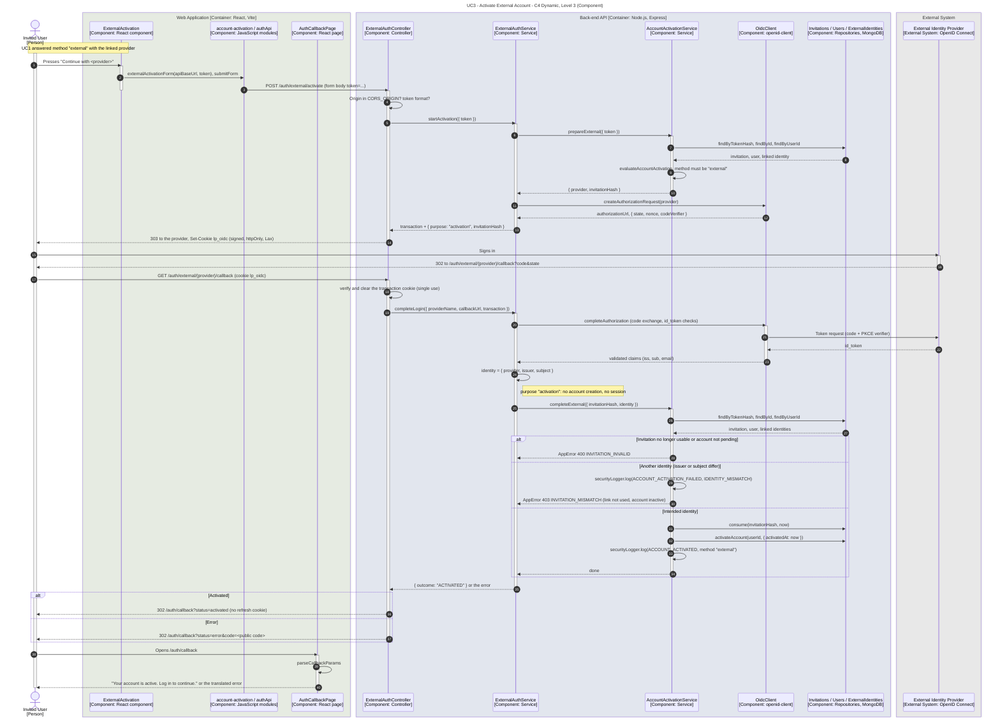

# UC3 - Activate External Account

| Attribute | Value |
|---|---|
| C4 view | Dynamic diagram, Level 3 (Component) |
| SAD view | Process View, Level 3 |
| Containers | Web Application, Back-end API, Database, External Identity Provider |
| Endpoints | `POST /auth/external/activate` (form, `application/x-www-form-urlencoded`, field `token`), then `GET /auth/external/{provider}/callback` |
| Allowed roles | Public (Guest): the account is not active yet |
| Success response | 303 to the identity provider; after the sign-in, 302 to `/auth/callback?status=activated` (no session, no refresh cookie) |
| Error handling | Always a redirect to the SPA with a public code: `INVITATION_INVALID` (malformed, unknown, used, replaced or expired link, or local account), `INVITATION_MISMATCH` (another identity), `ACCESS_DENIED` (cancelled at the provider), `AUTH_FAILED` (origin not allowed, provider disabled, failed code exchange, missing or tampered transaction) |
| ADRs | [ADR-0051](../../adr/0051-administrator-role-role-change-records-and-activation-invitations.md), [ADR-0052](../../adr/0052-account-activation-method-session-and-oidc-transaction.md) |

## Description

Since 2026-11-21 the first external login creates the account **active** (AA02 clarification), and a successful login at the linked provider also activates an account still waiting for activation (`activateIfPending` in `ExternalAuthService`). This flow therefore only concerns external accounts created inactive before that change that still hold a valid invitation; it is kept so those links keep working. After [UC1](./inspect-activation-link.md) answered `method: "external"`, `ExternalActivation` shows "The account <masked e-mail> signs in with <provider>. Continue with the <provider> account this invitation was sent to, to confirm it is you." and the "Continue with <provider>" button.

**Step 1 - start (`POST /auth/external/activate`).** The button calls `authApi.startExternalActivation(token)`, which builds a hidden form (`externalActivationForm`, `submitForm`) and submits it as a top-level POST. The token travels in the body, never in a URL, and the answer can set a cookie and redirect like the AA02 login. The button is disabled after the first click. The Back-end API:

1. `express.urlencoded` (1 kB). `ExternalAuthController.activate` refuses an `Origin` that is not in `CORS_ORIGIN` (`AUTH_FAILED`) and a token that is not 43 base64url characters (`INVITATION_INVALID`), both as a `303` to the SPA.
2. `ExternalAuthService.startActivation` calls `AccountActivationService.prepareExternal`: the same lookup and rules as UC1, and the account must have a linked identity (`METHOD_MISMATCH` otherwise). It returns the provider of that identity and the hash of the token.
3. `OidcClient.createAuthorizationRequest(provider)` creates state, nonce and the PKCE verifier. The transaction is marked `purpose: "activation"` and keeps `invitationHash`, never the token.
4. The controller signs the transaction (`TransactionCodec`, HMAC-SHA256) into the `lp_oidc` cookie (httpOnly, `SameSite=Lax`, path `/api/v2/auth/external`, 10 min) and answers `303` to the authorization endpoint of the provider.

**Step 2 - callback (`GET /auth/external/{provider}/callback`).** After the sign-in, the provider redirects the browser to the callback, as in AA02:

1. The controller reads and clears the transaction cookie (single use). A cancelled sign-in, a missing or tampered transaction, or another provider answers with an error code.
2. `ExternalAuthService.completeLogin` exchanges the code (`OidcClient.completeAuthorization`, id_token validated: signature, issuer, audience, expiry, nonce) and builds the identity (`provider`, `issuer`, `subject`). A failure is `AUTH_FAILED` and nothing is activated.
3. Because the transaction is an activation, `completeLogin` calls `AccountActivationService.completeExternal` **before** the normal login logic and returns `ACTIVATED`: it never creates an account and never opens a session.
4. `completeExternal` checks the invitation and account again (`loadPending` with `invitationHash`; it may have expired or been replaced while the user was at the provider). `isInvitedIdentity` then compares the authenticated issuer and subject with the identity linked to the account. Another identity is logged (`IDENTITY_MISMATCH`) and answered `403 INVITATION_MISMATCH`; the invitation is not used and the account stays inactive.
5. With the intended identity: `consume(invitationHash, now)`, then `activateAccount(userId, { activatedAt: now })` (no password), both conditional, and `ACCOUNT_ACTIVATED` (`method: "external"`).
6. The controller redirects to `/auth/callback?status=activated` without setting the refresh cookie; errors redirect to `/auth/callback?status=error&code=<public code>`.

`AuthCallbackPage` reads the result with `parseCallbackParams` (unknown values become `AUTH_FAILED`) and shows "Your account is active. Log in to continue." or the translated error. The user then signs in with "Continue with <provider>" (AA02), which opens the session with the roles assigned to the account.

## Diagram

See the [README](./README.md) for the notation key and the element catalogue.
