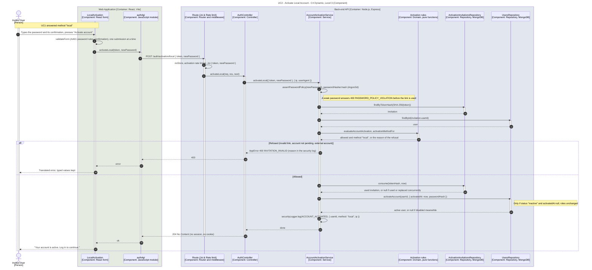

# UC2 - Activate Local Account

| Attribute | Value |
|---|---|
| C4 view | Dynamic diagram, Level 3 (Component) |
| SAD view | Process View, Level 3 |
| Containers | Web Application, Back-end API, Database |
| Endpoint | `POST /auth/activation/local` with body `{ "token", "newPassword" }` |
| Allowed roles | Public (Guest): the account is not active yet |
| Success response | 204 No Content (no session, no cookie) |
| Error handling | 400 `VALIDATION_FAILED`, 400 `PASSWORD_POLICY_VIOLATION` (checked before the link is used), 400 `INVITATION_INVALID` (invalid, used, replaced or expired link, account not waiting for activation, or account that must be activated at its identity provider), 429 `RATE_LIMITED` |
| ADRs | [ADR-0041](../../adr/0041-administrator-role-role-change-records-and-activation-invitations.md), [ADR-0042](../../adr/0042-account-activation-method-session-and-oidc-transaction.md) |

## Description

After [UC1](./inspect-activation-link.md) answered `method: "local"` (an account created by an Administrator), `LocalActivation` shows "Choose the password of the account <masked e-mail>", the password rules and the note that activating the account does not subscribe to marketing communications. The user types the password and its confirmation. The form checks them with the AA01 rules (`passwordRules()`, `sameAs('newPassword')`) before sending, and `useSubmit` allows one request at a time. The typed values are kept after an error.

The Back-end API:

1. **Route:** `noStore`, the `activation` rate limiter and Joi `{ token, newPassword }`.
2. **Password first:** `assertPasswordPolicy(newPassword)` (`400 PASSWORD_POLICY_VIOLATION`) and `passwordHasher.hash` (Argon2id), before the invitation is read, so a weak password never spends the link.
3. **Checks:** the same lookup and rules as [UC1](./inspect-activation-link.md) (`loadPending`). An account with a linked external identity is refused (`METHOD_MISMATCH` in the log, `400 INVITATION_INVALID` in the answer).
4. **Use the invitation:** `invitationsRepository.consume(tokenHash, now)`, one conditional update (`usedAt: null`, `revokedAt: null`, `expiresAt > now`). `null` means that another request used or replaced it in the meantime: `400 INVITATION_INVALID`.
5. **Activate:** `usersRepository.activateAccount(userId, { activatedAt: now, passwordHash })`, a conditional update on `status: "inactive", activatedAt: null` that sets only `status: "active"`, `activatedAt`, `failedLoginCount: 0`, `lockedUntil: null` and `passwordHash`. Roles and every other field stay as they are. `null` means that the account was disabled in the meantime: the link is spent and the account stays disabled (`ACCOUNT_NOT_PENDING` in the log, `400 INVITATION_INVALID`).
6. **Log and answer:** `ACCOUNT_ACTIVATED` (`userId`, `method: "local"`, `ip`) and `204`. No session is created and no cookie is set.

The page shows "Your account is active. Log in to continue." and a link to the login. The user then signs in with the normal login (AA01), which loads the roles assigned by AA06 (AA03).

## Diagram

See the [README](./README.md) for the notation key and the element catalogue.
