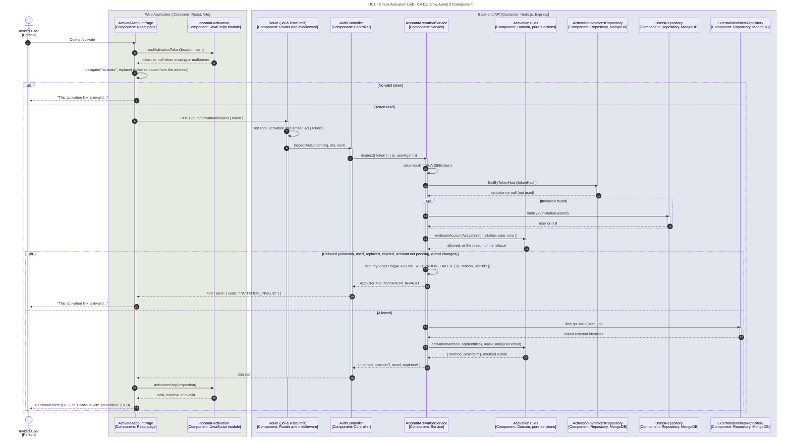

# UC1 - Check Activation Link

| Attribute | Value |
|---|---|
| C4 view | Dynamic diagram, Level 3 (Component) |
| SAD view | Process View, Level 3 |
| Containers | Web Application, Back-end API, Database |
| Endpoint | `POST /auth/activation/inspect` with body `{ "token" }` |
| Allowed roles | Public (Guest): the account is not active yet |
| Success response | 200 OK `{ "method": "local" \| "external", "provider"?, "email": "<masked>", "expiresAt": "<ISO date>" }` |
| Error handling | 400 `VALIDATION_FAILED` (malformed token, value never echoed), 400 `INVITATION_INVALID` (unknown, used, replaced or expired link, or account not waiting for activation), 429 `RATE_LIMITED` |
| ADRs | [ADR-0041](../../adr/0041-administrator-role-role-change-records-and-activation-invitations.md), [ADR-0042](../../adr/0042-account-activation-method-session-and-oidc-transaction.md) |

## Description

The invited user opens the link of the invitation e-mail, `{APP_BASE_URL}/activate#token=...`. `ActivateAccountPage` reads the token from the fragment once (`readActivationToken`: 43 characters in base64url, otherwise the page shows "invalid link" without calling the API) and replaces the address with `/activate`, so the token does not stay in the address bar nor in the history. It then asks the back end which step to show, with `authApi.inspectActivation(token, signal)` (`feedback: 'silent'`: the page explains the errors itself).

The Back-end API:

1. **Route:** `noStore`, the `activation` rate limiter (only failed requests count) and Joi `{ token }` (`400 VALIDATION_FAILED`; Joi messages never contain the value).
2. **Lookup:** `AccountActivationService.inspect` hashes the token (`tokenService.hashOpaqueToken`, SHA-256) and reads the invitation by its hash (`findByTokenHash`; nothing is used) and its account (`usersRepository.findById`).
3. **Rules:** `evaluateAccountActivation` checks that the invitation is usable (known, not used, not replaced, not expired), that the account exists, is `inactive` and was never activated, and that it still has the e-mail of the invitation. A refusal is logged with its reason (`ACCOUNT_ACTIVATION_FAILED`) and answered with the generic `400 INVITATION_INVALID`.
4. **Method:** `externalIdentitiesRepository.findByUserId` and `activationMethodFor`: `external` with the provider of the linked identity, otherwise `local`.
5. **Answer:** 200 with the method, the provider (external only), the masked e-mail (`maskEmail`, for example `m***a@laprizza.pt`) and the expiry. The invitation stays valid.

`activationStep` turns the answer into the step to show: the password form ([UC2](./activate-local-account.md)), the "Continue with <provider>" button ([UC3](./activate-external-account.md)), or "invalid link" for any other answer, so the page never offers a step the back end did not ask for. `INVITATION_INVALID` and `VALIDATION_FAILED` show "This activation link is invalid, was already used, was replaced or has expired"; a network failure or `429` shows the translated error and a "Try again" button.

## Diagram

See the [README](./README.md) for the notation key and the element catalogue.
