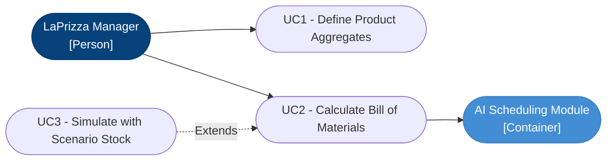

# AI Bill of Materials - Design Diagrams (Mermaid)

AI01 calculates, in Prolog, the **Bill of Materials (BOM)** of the pizzas ordered in an AI scenario: the quantities of aggregates and raw materials they need, the stock available, the hypothetical remaining stock and the replenishment needs. It works before a complete ordering workflow exists, with simulated orders and either the real stock or a simulated stock stored in the scenario. The parts are:

- **Back end:** the product **aggregate** (produced or purchased, with its composition), the **AI scenarios** (simulated orders and an optional stock), the planning snapshot of a scenario (`GET /ai-data/snapshot?scenarioId&stockMode`, [AI06](../ai-knowledge-base/README.md)) and an idempotent **demonstration seed**.
- **AI Scheduling Module:** the BOM calculation (`bom.pl`), on the knowledge base loaded from the snapshot (`kb.pl`), exposed by the Prolog HTTP service on `POST /bom` ([AI05](../ai-service-access/README.md)).

Every calculation is a simulation (`simulation: true`): it never changes stored stock, including the stock of a scenario, and never creates purchase orders.

Process View (SAD), Level 3, documented as C4 dynamic diagrams of the **Back-end API** container. The AI Scheduling Module is shown as a container; its internal rules are described in [Calculation rules](#calculation-rules).

## Use Cases

The use cases are described in the [Use Case Views](../../analysis/use-case-views.md#ai01-prolog-bill-of-materials-and-stock-requirements).

## Diagrams

| Use case | Endpoint | Caller | Success | Document |
|---|---|---|---|---|
| [UC1 - Define Product Aggregates](./define-product-aggregates.md) | `POST /products`, `PATCH /products/{id}` (field `aggregate`) | MANAGER | 201 / 200, product with `aggregate` | `define-product-aggregates.md` |
| [UC2 - Calculate Bill of Materials](./calculate-bill-of-materials.md) | `POST /bom` (AI Scheduling Module) → `GET /ai-data/snapshot` (back end) | MANAGER (token forwarded) | 200, BOM result | `calculate-bill-of-materials.md` |
| [UC3 - Simulate with Scenario Stock](./calculate-bill-of-materials.md) | Same as UC2 with `stockMode: "scenario"` | MANAGER | 200, BOM result with the scenario stock | `calculate-bill-of-materials.md` |

The initial data and the expected result of every demonstration scenario are in [Demonstration Scenarios](./demonstration-scenarios.md). The same BOM started from the Web Application, through the back end with a service key, is [AI05 UC1](../ai-service-access/calculate-bom.md).

## REST API summary

### Back end

| Method and path | Use case | Body / query | Success | Errors |
|---|---|---|---|---|
| `POST /products`, `PATCH /products/{id}` | UC1 | Product fields plus `aggregate: { classification: "PRODUCED" \| "PURCHASED", items: [{ productId, quantity }] }` or `null` | 201 / 200, product with `aggregate` | 400 `BAD_REQUEST` (Joi), 400 `AGGREGATE_*`, 401, 403, 404, 409 |
| `GET /ai-data/snapshot?scenarioId&stockMode` | UC2, UC3 | `scenarioId` `^[A-Z0-9-]{1,64}$`, `stockMode` `live` or `scenario` (both or neither) | 200, scenario snapshot ([format](../ai-knowledge-base/snapshot-format.md)) | 400 `BAD_REQUEST`, 401, 403, 404 `AI_SCENARIO_NOT_FOUND`, 400 `SCENARIO_WITHOUT_STOCK` |

`products:write` and `planning:execute` are granted only to MANAGER. Without `scenarioId` the snapshot keeps its original format, used by the other consumers.

### AI Scheduling Module

| Method and path | Identity | Body | Success | Errors |
|---|---|---|---|---|
| `POST /bom` | `Authorization: Bearer <Manager token>`, forwarded to the back end | `{ scenarioId, stockMode }` | 200, BOM result | 401 `TOKEN_MISSING`, 400 `VALIDATION_ERROR`, 401/403 of the back end, 404 `AI_SCENARIO_NOT_FOUND`, 422 `AI_INVALID_DATA`, 503 `AI_DATA_UNAVAILABLE`, 504 `AI_DATA_TIMEOUT` |
| `GET /health` | None | - | 200 `{ status: "ok", backend }` | |

The service listens only on `127.0.0.1` (`AI_PORT`, 5000 by default). The other routes of the service (`/service/bom` with a service key, `/requirements`) are documented in [AI Service Access](../ai-service-access/README.md).

## Calculation rules

`bom_calculate/2` runs on the knowledge base of one snapshot ([ADR-0021](../../adr/0021-knowledge-base-loaded-per-calculation.md)) and follows [ADR-0040](../../adr/0040-product-aggregates-and-stock-first-bom-expansion.md):

1. **Validation first (phase A).** Every problem is collected: invalid request, snapshot without a scenario or of another scenario (`SCENARIO_MISMATCH`), ordered pizza that is not predefined (`NOT_PREDEFINED_PIZZA`), size not allowed (`INVALID_SIZE`), incomplete recipe (`INCOMPLETE_RECIPE`: no BOM lines, a missing or invalid consumption, an unknown component, a produced aggregate without a measured consumption). With any problem there is no calculation, and the answer is 422 without quantities.
2. **Direct demand.** For each component: Σ (ordered quantity × consumption in that pizza and size).
3. **Pass 1, aggregates, stock first.** `used = min(required, available)`, `shortage = required − used`. Only the shortage of a **produced** aggregate is expanded into its items (`toProduce × item quantity`). A **purchased** aggregate is never expanded; its shortage is a replenishment need.
4. **Pass 2, simple products once.** `required = requiredDirect + requiredFromAggregates`, then the same balance.
5. **Balances.** `remaining = available − used` is never negative. Products without stock control have `null` balances and never block. A stock-controlled item without a stock entry is a problem (`MISSING_SCENARIO_STOCK` or `MISSING_STOCK`), never treated as 0.
6. **Result.** `shortages` lists the stock-controlled items not produced internally with `replenishmentNeeded`; `production` lists the produced aggregates with `toProduce`, `canProduce` and `missingIngredients`; `feasible` is `true` when `shortages` is empty.

**Worked example (`DEMO-PARTIAL`).** 3 × Margherita M need 3 Massa, 3 Molho and 6 Mozzarella. Stock: Massa 1, Molho 5, Mozzarella 4.

| Step | Massa (produced) | Molho (purchased) | Mozzarella | Farinha (item of Massa) |
|---|---|---|---|---|
| Direct demand | 3 | 3 | 6 | 0 |
| Stock used | 1 | 3 | 4 | - |
| Shortage | 2 → `toProduce: 2` | 0 (remaining 2) | 2 → replenish | - |
| Derived demand | - | - | - | 2 × 2 = 4 |

The dough in stock is not expanded, so the flour is 4 and not 6; the mozzarella remaining is 0, never −2.

## Result format

| Field | Meaning |
|---|---|
| `status`, `simulation` | `"ok"` and always `true` |
| `feasible` | `true` when there are no shortages; `false` is a result, not an error |
| `scenario` | `{ id, name, version, stockMode }` of the AI scenario |
| `inputs` | `{ snapshotId, sources }`: origin and version (or retrieval time) of the catalogue, the stock and the orders |
| `orders[]` | The simulated order lines, with the pizza and size names |
| `items[]` | Per product: `kind` (`aggregate_produced`, `aggregate_purchased`, `simple`), `stockControlled`, `required`, `requiredDirect`, `requiredFromAggregates`, `available`, `used`, `remaining`, `shortage`, and `toProduce` for produced aggregates |
| `shortages[]` | `{ productId, name, kind, replenishmentNeeded }` |
| `production[]` | `{ productId, name, toProduce, canProduce, missingIngredients[] }` |
| `warnings[]` | Non-blocking remarks: `PIZZA_STOCK_IGNORED`, `UNMEASURED_NON_STOCK_COMPONENT` of a simple component, other non-blocking issues of the snapshot |

An invalid calculation answers 422 `AI_INVALID_DATA` with `details { scenario, inputs, problems[] }` and no quantities.

## Business rules shown in the diagrams

- **The back end owns the data and the classification.** The Prolog service gets everything from the snapshot, never from the database, and uses the production-or-purchase classification of the back end ([ADR-0020](../../adr/0020-planning-snapshot-as-the-data-contract-with-the-ai-service.md)).
- **One level of aggregates.** An aggregate cannot contain a pizza or another aggregate, so recipes cannot be cyclic; the rules are checked when the product is saved and again when the snapshot is loaded.
- **No double counting.** The stock of an aggregate is used first, and only the remaining demand of a produced aggregate reaches its ingredients.
- **Same rules for real and simulated inputs.** Live and scenario stock produce the same snapshot format and the same calculation; only `meta.sources.stock` changes ([ADR-0041](../../adr/0041-simulated-bom-scenarios-with-selectable-stock-and-a-resettable-demo-seed.md)).
- **Calculation separate from consumption.** Balances are results only. The real stock changes only through an explicit stock operation of the back end (BCK09), and the stock of a scenario only through the seed.
- **Problems are reported, never hidden.** Unknown items, invalid quantities and incomplete recipes answer 422 with every problem; nothing is replaced by a default.
- **The user's token is never logged** by the AI Scheduling Module, and only the back end decides who may calculate (`planning:execute`).

## Related ADRs

| ADR | Decision | Status |
|---|---|---|
| [ADR-0040](../../adr/0040-product-aggregates-and-stock-first-bom-expansion.md) | Product aggregates and stock-first BOM expansion | Accepted |
| [ADR-0041](../../adr/0041-simulated-bom-scenarios-with-selectable-stock-and-a-resettable-demo-seed.md) | Simulated BOM scenarios with selectable stock and a resettable demo seed | Accepted |
| [ADR-0020](../../adr/0020-planning-snapshot-as-the-data-contract-with-the-ai-service.md) | Planning snapshot as the data contract (pull path with the user's token) | Accepted |
| [ADR-0021](../../adr/0021-knowledge-base-loaded-per-calculation.md) | Knowledge base loaded per calculation | Accepted |
| [ADR-0011](../../adr/0011-isolate-database-versioning-with-migrations.md) | Database versioning with migrations (`ai01-bom-aggregates-and-scenarios`) | Accepted |
| [ADR-0053](../../adr/0053-permission-based-authorization-matrix.md) | Permission-based authorization (`products:write`, `planning:execute`) | Accepted |

## Notation key

| Notation | Meaning |
|---|---|
| Actor (stick figure) | Person using the system, with the role shown in the label |
| Shaded box "Back-end API" | Container (Node.js, Express) that holds the back-end components |
| Participant "AI Scheduling Module" | Container (SWI-Prolog), shown as a whole |
| Participant "Database" | Container (MongoDB) |
| Participant label | `Name`, followed by `[Type: technology]` |
| Solid arrow | Call or request |
| Dashed arrow | Return value or response |
| Arrow to the same participant | Work done inside that participant |
| Number on an arrow | Order of the interaction (autonumber) |
| `alt` / `else`, `opt`, `par` frames | Alternative, optional and parallel flows |
| `Note` | Remark or reference to another diagram |

## Element catalogue

| Element | Type | Technology | Responsibility | Used in |
|---|---|---|---|---|
| Manager | Person | - | Back-office user with the MANAGER role, the only one with `products:write` and `planning:execute` | [UC1](./define-product-aggregates.md), [UC2](./calculate-bill-of-materials.md) |
| Route (Joi & Permissions) | Component | Express router and middleware | `products.routes.js`: `requirePermission(Permission.PRODUCTS_WRITE)`, `aggregateSchema`. `ai-data.routes.js`: `requirePermission(Permission.PLANNING_EXECUTE)`, `snapshotQuerySchema` | [UC1](./define-product-aggregates.md), [UC2](./calculate-bill-of-materials.md) |
| ProductsController | Component | Express controller | `create`, `update` | [UC1](./define-product-aggregates.md) |
| ProductsService | Component | Node.js module | `createProduct`, `updateProduct`, `validateAggregate`; invalidates the `catalogue` and `ai-data` caches | [UC1](./define-product-aggregates.md) |
| Products Domain | Component | Node.js module (`products.domain.js`) | `normalizeAggregate`, `validateAggregateShape`, `validateAggregateItems`, `validateAggregateOwner`, codes `AGGREGATE_*` | [UC1](./define-product-aggregates.md) |
| ProductsRepository / PredefinedPizzaRepository | Component | Repository, MongoDB | `create`, `update`, `findAggregateInfoByIds`, `existsAggregateWithItem`, `findPizzaProductIds` | [UC1](./define-product-aggregates.md) |
| AiDataController | Component | Express controller | `getSnapshot`: passes the validated query to the service | [UC2](./calculate-bill-of-materials.md) |
| AiDataService | Component | Node.js module | `getSnapshot` → `getScenarioSnapshot` → `buildScenarioSnapshot` (`buildBom`, `buildAggregates`, `buildPizzas`, `buildLiveStock`, `buildScenarioStock`); errors 404 `AI_SCENARIO_NOT_FOUND`, 400 `SCENARIO_WITHOUT_STOCK` | [UC2](./calculate-bill-of-materials.md) |
| AiDataRepository / AiScenarioRepository | Component | Repository, MongoDB | `listProducts` (with `aggregate`), `listSizes`, `listPredefinedPizzas`, `listStock`, `findActiveScenarioByCode` (collection `AI BOM Scenarios`) | [UC2](./calculate-bill-of-materials.md) |
| Database | Container | MongoDB | Products with aggregates, predefined pizzas, stock, AI scenarios | [UC1](./define-product-aggregates.md), [UC2](./calculate-bill-of-materials.md) |
| AI Scheduling Module | Container | SWI-Prolog (`server.pl`, `kb.pl`, `bom.pl`) | Validates the request, gets the snapshot with the user's token, loads the knowledge base and calculates the BOM | [UC2](./calculate-bill-of-materials.md) |

## Notes

- **Demonstration.** Seed (`cd backend && npm run seed:ai01-demo -- --confirm`), start the AI Scheduling Module with `AI_BACKEND_URL` pointing to that back end (`./ai-scheduling/start-server.sh` or `swipl ai-scheduling/server.pl`) and run `npx httpyac send --all -o short test-flows/bom-demo-test-flow.http` in `backend/`. The flow reads the back end in use from the `/health` of the AI Scheduling Module, so it follows the configuration of the service. Expected values: [Demonstration Scenarios](./demonstration-scenarios.md).
- **Configuration of the AI Scheduling Module** (`ai-scheduling/.env`, template `.env.example`): `AI_BACKEND_URL` (default `http://127.0.0.1:3000/api/v1`), `AI_PORT` (5000), `AI_BACKEND_TIMEOUT_SECONDS` (10). Variables already set in the environment win over the file.
- **No endpoint for AI scenarios.** They are created and reset by the seed; the back end only reads them.
- Tests:
  - Back end ([ADR-0033](../../adr/0033-mock-based-unit-testing.md)): `test/domain/products.domain.test.js`, `test/application/products.service.test.js` and `test/api/api.products.test.js` (aggregate rules), `test/domain/ai-scenario.domain.test.js`, `test/infrastructure/ai01.models.test.js`, `test/scripts/seed-ai01-demo.test.js`, `test/application/ai-data.service.test.js` and `test/api/api.ai-data.test.js` (scenario snapshot, both stock modes, 404/400, no cache, original format unchanged).
  - Integration ([ADR-0014](../../adr/0014-use-testcontainers-for-automated-integration-testing.md)): `test-integration/infrastructure/ai01.integration.test.js` (migration, repositories, seed idempotent, the snapshot of `DEMO-PARTIAL` built from the seed equals the fixture of the Prolog tests).
  - Prolog (`ai-scheduling/run-tests.sh`, not run by the CI): `test/kb_ai01.plt` (fixtures and validation of aggregates and scenarios), `test/bom.plt` (demonstration scenarios, reference example, problems, warnings), `test/server.plt` (routes, validation, error mapping, token never exposed, concurrent requests).
  - httpyac: `backend/test-flows/bom-demo-test-flow.http` (four scenarios, live stock unchanged, 401, 403, 404, 400).
