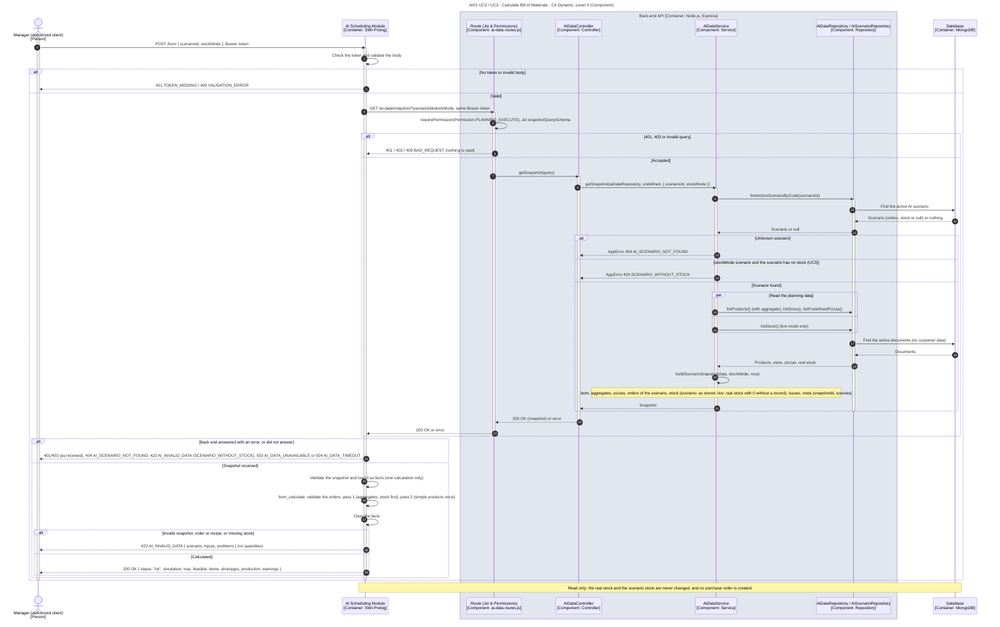

# AI01 UC2 / UC3 - Calculate Bill of Materials (with Scenario Stock)

| Attribute | Value |
|---|---|
| C4 view | Dynamic diagram, Level 3 (Component) |
| SAD view | Process View, Level 3 |
| Containers | AI Scheduling Module, Back-end API, Database |
| Endpoints | AI Scheduling Module: `POST /bom` with `{ scenarioId, stockMode }` (`stockMode` `live` or `scenario`). Back end: `GET /ai-data/snapshot?scenarioId&stockMode` |
| Allowed roles | MANAGER (permission `planning:execute`), with the `Authorization: Bearer` token forwarded by the AI Scheduling Module to the back end |
| Success response | 200 OK, `{ status: "ok", simulation: true, feasible, calculatedAt, scenario, inputs, orders[], items[], shortages[], production[], warnings[] }` |
| Error handling | 401 `TOKEN_MISSING`, 400 `VALIDATION_ERROR`, 401/403 of the back end (as received), 404 `AI_SCENARIO_NOT_FOUND`, 422 `AI_INVALID_DATA` (scenario without stock in scenario mode, invalid snapshot, invalid order or recipe, missing stock), 503 `AI_DATA_UNAVAILABLE`, 504 `AI_DATA_TIMEOUT` |
| ADRs | [ADR-0052](../../adr/0052-product-aggregates-and-stock-first-bom-expansion.md), [ADR-0053](../../adr/0053-simulated-bom-scenarios-with-selectable-stock-and-a-resettable-demo-seed.md), [ADR-0039](../../adr/0039-planning-snapshot-as-the-data-contract-with-the-ai-service.md), [ADR-0040](../../adr/0040-knowledge-base-loaded-per-calculation.md) |

## Description

The Manager asks the AI Scheduling Module for the Bill of Materials of an AI scenario. The diagram shows the direct call to the Prolog service (pull path), used by the demonstration flow and by tests. From the Web Application the same calculation runs through the back end (`POST /planning/bom`, push path, [AI05 UC1](../ai-service-access/calculate-bom.md)); the snapshot, the knowledge base and `bom.pl` are the same in both paths.

**UC2, the calculation.**

1. The AI Scheduling Module requires `Authorization: Bearer` (401 `TOKEN_MISSING`, the back end is not called) and validates the body: `scenarioId` `^[A-Z0-9-]{1,64}$` and `stockMode` `live` or `scenario` (400 `VALIDATION_ERROR` with `details[{ field, type, message }]`).
2. It asks the back end for the planning snapshot of the scenario, with the same token ([AI06 UC1](../ai-knowledge-base/provide-planning-snapshot.md)). The back end checks `planning:execute` (an Employee or Customer gets 403), loads the active AI scenario by code (404 `AI_SCENARIO_NOT_FOUND`) and builds the snapshot from the current catalogue, the pizza BOM per size, the aggregates and the stock chosen by `stockMode`. The scenario snapshot is never cached.
3. The snapshot is validated and loaded as facts for this calculation only ([ADR-0040](../../adr/0040-knowledge-base-loaded-per-calculation.md)). Any problem of the snapshot answers 422 `AI_INVALID_DATA` with every problem.
4. `bom_calculate/2` validates the order lines (predefined pizza, allowed size, complete recipe), then calculates in two passes: each aggregate uses its stock first and only the missing part of a produced aggregate is expanded into its ingredients; every simple product is then counted once, with its direct and derived demand ([ADR-0052](../../adr/0052-product-aggregates-and-stock-first-bom-expansion.md)). The rules and a worked example are in the [README](./README.md#calculation-rules).
5. The answer reports, for each item, the quantity required, the stock available and used, the hypothetical remaining stock (never negative) and the shortage; the replenishment needs (`shortages`), the aggregates to produce (`production`), the warnings, and the scenario and inputs used. Shortages are a result, not an error (`feasible: false`). The facts are cleared after the calculation.

**UC3, simulate with scenario stock (extends UC2).** With `stockMode: "scenario"` the back end puts the stock stored in the scenario in the snapshot instead of the real stock, so the same scenario always gives the same result. A scenario without its own stock answers 400 `SCENARIO_WITHOUT_STOCK` in the back end, which the AI Scheduling Module returns as 422 `AI_INVALID_DATA` (`details.problems[0].code`). With `stockMode: "live"` the real stock of every active stock-controlled product is used, 0 when it has no record.

Nothing is written: the real stock and the stock of the scenario are read only, and the calculation creates no purchase order. In the pull path no planning run is saved (the push path of AI05 saves one).

## Diagram

See the [README](./README.md) for the notation key, the calculation rules and the element catalogue, and [Demonstration Scenarios](./demonstration-scenarios.md) for the initial data and the expected results.
