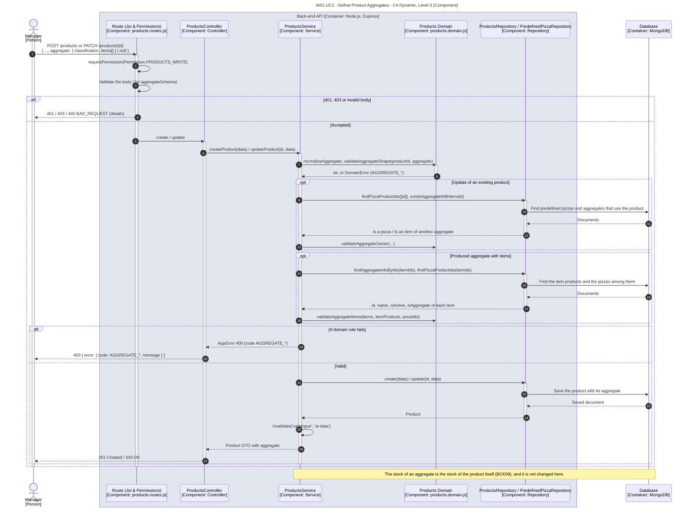

# AI01 UC1 - Define Product Aggregates

| Attribute | Value |
|---|---|
| C4 view | Dynamic diagram, Level 3 (Component) |
| SAD view | Process View, Level 3 |
| Containers | Back-end API, Database |
| Endpoints | `POST /products` and `PATCH /products/{id}` with the field `aggregate` (`null` removes it) |
| Allowed roles | MANAGER (permission `products:write`) |
| Success response | 201 Created / 200 OK, the product with `aggregate { classification, items[{ productId, quantity }] }` or `aggregate: null` |
| Error handling | 401 (no valid token), 403 (no permission), 400 `BAD_REQUEST` (Joi `details`), 400 with an `AGGREGATE_*` code (domain rules), 404 (product not found on update), 409 (duplicate name on create) |
| ADRs | [ADR-0052](../../adr/0052-product-aggregates-and-stock-first-bom-expansion.md), [ADR-0002](../../adr/0002-layered-domain-driven-design-(ddd)-architecture.md), [ADR-0046](../../adr/0046-permission-based-authorization-matrix.md) |

## Description

An aggregate is a product made of other products. It is classified by the back end as **produced** internally from its items (for example a dough from flour, water and yeast) or **purchased** ready-made (for example a sauce). The Bill of Materials uses this classification to decide whether the missing part of an aggregate is expanded into ingredients or replenished directly ([UC2](./calculate-bill-of-materials.md)).

The aggregate is an optional part of the product, so it is created and changed with the product endpoints of BCK05; there is no separate resource.

1. `requirePermission(Permission.PRODUCTS_WRITE)` authenticates the user and checks the permission (Manager only).
2. The Joi schema (`createProductSchema` or `updateProductSchema` with `aggregateSchema`) checks the shape: `classification` `PRODUCED` or `PURCHASED`, `items` a list of `{ productId (24 hex), quantity (integer ≥ 1) }` (empty by default), or `aggregate: null`. Invalid fields answer 400 `BAD_REQUEST` with `details[{ field, type, message }]`.
3. `ProductsService.validateAggregate` normalizes the aggregate and applies the domain rules (`products.domain.js`). Every rule answers 400 with its code:

| Rule | Code |
|---|---|
| Classification must be `PRODUCED` or `PURCHASED` | `AGGREGATE_INVALID_CLASSIFICATION` |
| A produced aggregate needs at least one item | `AGGREGATE_PRODUCED_WITHOUT_ITEMS` |
| A purchased aggregate has no composition | `AGGREGATE_PURCHASED_WITH_ITEMS` |
| Item quantity is an integer ≥ 1 | `AGGREGATE_INVALID_QUANTITY` |
| The same item at most once; a product is not an item of itself | `AGGREGATE_DUPLICATE_ITEM`, `AGGREGATE_SELF_REFERENCE` |
| Every item exists and is active | `AGGREGATE_ITEM_NOT_FOUND`, `AGGREGATE_ITEM_INACTIVE` |
| An item is not a pizza and not another aggregate (one level only, so no cycles) | `AGGREGATE_ITEM_IS_PIZZA`, `AGGREGATE_NESTED` |
| On update: the product is not a pizza and not an item of another aggregate | `AGGREGATE_OWNER_IS_PIZZA`, `AGGREGATE_OWNER_IS_ITEM` |

4. The product is saved with the aggregate, and the caches `catalogue` and `ai-data` are invalidated, so the next planning snapshot already has the new composition ([AI06 UC1](../ai-knowledge-base/provide-planning-snapshot.md)).

The stock of an aggregate is the stock of the product itself (BCK09): a produced dough that is already made is counted in the stock of the dough, not in the stock of its ingredients. The same rules are checked again by the knowledge base when a snapshot is loaded ([ADR-0052](../../adr/0052-product-aggregates-and-stock-first-bom-expansion.md)).

## Diagram

See the [README](./README.md) for the notation key and the element catalogue.
