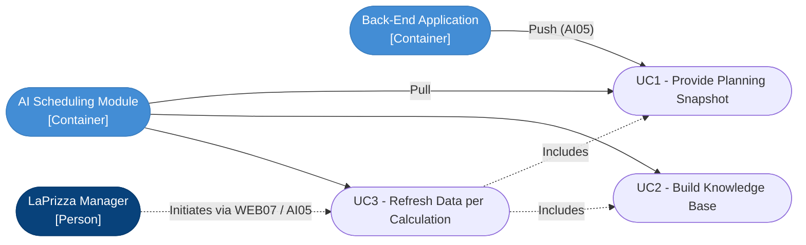

# AI Knowledge Base - Design Diagrams (Mermaid)

AI06 connects the back end and the AI Scheduling Module. The back end owns the business data and exposes it as one document, the **planning snapshot** (`GET /ai-data/snapshot`). The Prolog service validates the snapshot, loads it as facts for one calculation and clears them afterwards. The calculations themselves (BOM and requirements planning) are AI01, AI02 and AI05 ([AI Service Access](../ai-service-access/README.md)); WEB07 UC9 starts them from the Web Application.

Process View (SAD), Level 3, documented as C4 dynamic diagrams of the **Back-end API** and **AI Scheduling Module** containers. The snapshot format is in [Planning Snapshot Format](./snapshot-format.md).

## Use Cases

The use cases are described in the [Use Case Views](../../analysis/use-case-views.md#ai06-back-end-data-and-prolog-knowledge-base).

## Diagrams

| Use case | Endpoint / predicate | Caller | Result | Document |
|---|---|---|---|---|
| [UC1 - Provide Planning Snapshot](./provide-planning-snapshot.md) | `GET /ai-data/snapshot?scenarioId&stockMode[&forecastId&supplierScenarioId]` → `getSnapshot` | AI Scheduling Module (pull), PlanningService (push) | 200 OK, snapshot | `provide-planning-snapshot.md` |
| [UC2 - Build Knowledge Base](./build-knowledge-base.md) | `with_snapshot/2` → `load_unlocked/1` → `snapshot_entries/3` | AI Scheduling Module | Facts loaded for one calculation, or 422 `AI_INVALID_DATA` | `build-knowledge-base.md` |
| [UC3 - Refresh Data per Calculation](./refresh-per-calculation.md) | Pull: `fetch_with_deadline/3` → `fetch_snapshot/3`. Push: `POST /service/{bom,requirements}` with the snapshot. Always `clear_unlocked` at the end | AI Scheduling Module, Back-End Application | A new snapshot per calculation | `refresh-per-calculation.md` |

## How the snapshot reaches the Prolog service

| Path | Caller | How the snapshot arrives | Authentication | Used by |
|---|---|---|---|---|
| **Push** (AI05, main path) | Back end: `POST {AI_SERVICE_URL}/service/bom` or `/service/requirements` | The back end builds it (`getSnapshot`) and sends `{ request: { scenarioId, stockMode }, snapshot }`; the Prolog service does not call the back end | `X-Api-Key: <AI_SERVICE_KEY>`; without the key configured the `/service/*` routes answer 401 | `POST /planning/{bom,requirements}` of the back end (WEB07 UC9) |
| **Pull** (AI01, alternative path) | A client with a Manager token: `POST /bom` or `POST /requirements` on the Prolog service | The Prolog service calls `GET {AI_BACKEND_URL}/ai-data/snapshot?scenarioId&stockMode` with the token of the request (`fetch_snapshot/3`) | `Authorization: Bearer <token>` forwarded; never logged nor returned | Direct calls to the service (tests, Postman) |

The pull path sends only `scenarioId` and `stockMode`, so it always uses the active forecast and supplier scenario. A chosen forecast or supplier scenario version is only possible in the push path.

## REST API summary

### Back end

The path is under `/api/v2` (`/api/v1` is a deprecated alias). The route requires a valid token (`401`) and the permission `planning:execute` (`403` otherwise; granted only to MANAGER).

| Method and path | Use case | Success | Errors |
|---|---|---|---|
| `GET /ai-data/snapshot` | UC1 | 200, snapshot without scenario (older WEB07 format) | |
| `GET /ai-data/snapshot?scenarioId&stockMode[&forecastId&supplierScenarioId]` | UC1 | 200, scenario snapshot (format used by the calculations) | 400 `BAD_REQUEST` (Joi: `scenarioId` `^[A-Z0-9-]{1,64}$`, `stockMode` `live` or `scenario`, both or neither, ids 24 hex; nothing is read), 400 `SCENARIO_WITHOUT_STOCK`, 404 `AI_SCENARIO_NOT_FOUND`, 404 `FORECAST_NOT_FOUND`, 404 `SUPPLIER_SCENARIO_NOT_FOUND` |

### AI Scheduling Module (`ai-scheduling/server.pl`)

The service listens only on `127.0.0.1` (port `AI_PORT`, 5000 by default). Errors use the back-end format `{ "error": { "status", "code", "message", "details"? } }`; unknown paths answer 404 `NOT_FOUND` and wrong methods 405 `METHOD_NOT_ALLOWED`.

| Method and path | Authentication | Body | Success | Errors |
|---|---|---|---|---|
| `GET /health` | None | - | 200 `{ status: "ok", backend: <AI_BACKEND_URL> }` (never calls the back end) | |
| `POST /bom`, `POST /requirements` | `Authorization: Bearer <Manager token>` | `{ scenarioId, stockMode }` | 200, result | 401 `TOKEN_MISSING`; 400 `VALIDATION_ERROR`; 401/403 of the back end, returned as received; 404 `AI_SCENARIO_NOT_FOUND`; 422 `AI_INVALID_DATA` (snapshot rejected by the back end with 400, or by the knowledge base); 503 `AI_DATA_UNAVAILABLE` (`details.reason`: `connection_failed`, `invalid_backend_response`, `backend_error` or `unexpected_backend_response`, with `backendStatus`); 504 `AI_DATA_TIMEOUT` |
| `POST /service/bom`, `POST /service/requirements` | `X-Api-Key: <AI_SERVICE_KEY>` | `{ request: { scenarioId, stockMode }, snapshot }` | 200, result | 401 `SERVICE_UNAUTHORIZED`; 400 `VALIDATION_ERROR` (`request.scenarioId`, `request.stockMode`, `snapshot`); 422 `AI_INVALID_DATA` with `details { scenario, inputs, problems }` |

The back end maps the answers of the push path in `AiServiceClient`: 422 stays 422; connection refused, invalid answer or rejected key become 503 `AI_SERVICE_UNAVAILABLE` (with `Retry-After`); a timeout becomes 504 `AI_SERVICE_TIMEOUT` (see [WEB07 UC9](../ai-planning/execute-forecast.md)).

## Business rules shown in the diagrams

- **One data contract.** The Prolog service gets business data only from the snapshot of the back end, over HTTP with a user token (pull) or a service key (push). It never accesses the database and keeps no copy of the data after a calculation.
- **Only planning data.** The snapshot has products (`id`, `name`, `sellable`, `stockControlled`, `isPizzaComponent`), sizes, BOM, aggregates, pizzas, stock, simulated orders, forecast and supplier scenario. No customer names, contacts or dietary profiles are read (`AiDataRepository` has no customer access).
- **Pizza BOM** (`buildBom`): one row per pizza, size and stock-controlled component, with the `stockUnitsConsumed` of the component for that size. A missing or non-integer consumption is reported in `issues` (`MISSING_OR_INVALID_STOCK_UNITS`), never defaulted. In the scenario format, components without stock control are kept when they define a consumption and reported otherwise (`UNMEASURED_NON_STOCK_COMPONENT`). Aggregates (`buildAggregates`) carry their classification (`production` for `PRODUCED`, `purchase` for `PURCHASED`) and their items; the expansion and calculation are done in Prolog.
- **Stock.** `stockMode: "live"` lists every stock-controlled product with its current stock (0 when there is no record) and reports invalid rows in `issues`. `stockMode: "scenario"` uses exactly the stock stored in the AI scenario and does not read the real stock; a scenario without stock answers 400 `SCENARIO_WITHOUT_STOCK`.
- **WEB07 inputs.** The forecast and the supplier scenario are the ones chosen by id or, without an id, the most recently created active ones (`getActiveForecast`, `getActiveSupplierScenario`); there may be none.
- **Origin and version of each input** (`meta`): `snapshotId` (SHA-256 of the content, 16 hex, independent of the order of the data and of the time), one `retrievedAt` for the whole snapshot, `simulated`, and `sources` with `catalogue` (with a `version`, hash of the catalogue and BOM), `stock` (`backend-live`, or `scenario` with the scenario code and version), `orders` (the scenario), `forecast` and `supplierScenario` (id, name and version). The planning run of WEB07 records these values.
- **Simulation.** A scenario snapshot has `meta.simulated: true`, the scenario and its orders are simulated, and supplier scenarios are always simulated. In Prolog `kb_is_simulation/0` is true if any of them is, and the result has `simulation: true`.
- **Validation without defaults.** `snapshot_entries/3` turns each entry into a fact or a problem, keeps checking the rest and then runs the cross checks (`check_problem/2`). Codes: `INVALID_SNAPSHOT`, `INVALID_QUANTITY`, `DUPLICATE_ENTRY`, `UNKNOWN_ITEM`, `STOCK_NOT_CONTROLLED`, `INCOMPLETE_AGGREGATE`, `NESTED_AGGREGATE`, `PIZZA_AS_COMPONENT`, `PURCHASED_WITH_COMPOSITION`. The forecast and supplier sections report their first error (missing key, invalid date, period, quantity, price, stock units, lead time or supply limit, duplicate entry, supplier or offer) as one `INVALID_SNAPSHOT` problem of that section. The `issues` of the back end are loaded as `kb_issue` facts.
- **Atomic load, one calculation at a time.** With any problem, `load_unlocked/1` throws `kb_error(invalid_data(Problems))` and loads nothing; otherwise it replaces the facts in one `transaction`. `with_snapshot/2` runs inside `with_mutex(kb, ...)`, calls the calculation once and always clears the facts (`setup_call_cleanup`).
- **Refresh policy.** Every calculation gets a new snapshot. The scenario snapshot is never cached. Only the snapshot without a scenario, which the calculations do not use, is cached for 60 s (`cached('ai-data', key, 60, ...)`, only when Redis is configured, [ADR-0016](../../adr/0016-introduce-redis-for-caching.md)). If the back end does not answer in time (`AI_BACKEND_TIMEOUT_SECONDS`, 10 s by default, plus 0.5 s), the pull fails with 504 and nothing is calculated.
- **Read-only.** `ai-data` and `planning` never write stock nor purchase orders; the only write of an execution is the planning run (WEB07). The flow `planning-test-flow.http` checks that the real stock and the stock of the AI scenario are unchanged after the executions.

## Related ADRs

| ADR | Decision | Status |
|---|---|---|
| [ADR-0004](../../adr/0004-contract-first-rest-api.md) | Contract-first REST API | Accepted |
| [ADR-0015](../../adr/0015-api-uri-routing-versioning-strategy.md) | API URI versioning | Accepted |
| [ADR-0016](../../adr/0016-introduce-redis-for-caching.md) | Redis for caching | Accepted |
| [ADR-0018](../../adr/0018-secrets-management-strategy.md) | Secrets management (`AI_SERVICE_KEY`) | Accepted |
| [ADR-0033](../../adr/0033-mock-based-unit-testing.md) | Mock-based unit testing with `node:test` | Accepted |
| [ADR-0047](../../adr/0047-recording-planning-runs-with-their-input-versions.md) | Recording planning runs with their input versions | Accepted |
| [ADR-0020](../../adr/0020-planning-snapshot-as-the-data-contract-with-the-ai-service.md) | Planning snapshot as the single data contract between back end and Prolog (pull with user token, push with service key) | Accepted |
| [ADR-0021](../../adr/0021-knowledge-base-loaded-per-calculation.md) | Knowledge base loaded per calculation (mutex, transaction, cleared after use) | Accepted |

## Notation key

| Notation | Meaning |
|---|---|
| Actor (stick figure) | Person, or a caller outside the diagram |
| Shaded box "Back-end API" | System boundary of the container (Node.js, Express) that holds the components |
| Shaded box "AI Scheduling Module" | Container (SWI-Prolog) that holds the HTTP server and the knowledge base |
| Participant label | `Name`, followed by `[Type: technology]` |
| Solid arrow | Call or request |
| Dashed arrow | Return value or response |
| Arrow to the same participant | Work done inside that component |
| Number on an arrow | Order of the interaction (autonumber) |
| `alt` / `else` frame | Alternative flows, only one of them runs |
| `opt` frame | Optional flow |
| `loop` frame | Flow that repeats |
| `par` frame | Flows that run in parallel |
| `Note` | Reference to another diagram or a remark |

## Element catalogue

| Element | Type | Technology | Responsibility | Used in |
|---|---|---|---|---|
| Route (Joi & Permissions) | Component | Express router and middleware | `requirePermission(Permission.PLANNING_EXECUTE)` (authenticates the token and checks the permission) and `snapshotQuerySchema` | [UC1](./provide-planning-snapshot.md) |
| AiDataController | Component | Express controller | `getSnapshot`: passes only the query keys that were sent | [UC1](./provide-planning-snapshot.md) |
| AiDataService | Component | Node.js module | `getSnapshot`, `getScenarioSnapshot`, `buildScenarioSnapshot`, `buildSnapshot`, `buildBom`, `buildAggregates`, `buildPizzas`, `buildLiveStock`, `buildScenarioStock`, `toSnapshotForecast`, `toSnapshotSupplierScenario` | [UC1](./provide-planning-snapshot.md), [UC3](./refresh-per-calculation.md) |
| AiDataRepository | Component | Repository, MongoDB/mock | Read-only access: `listProducts`, `listSizes`, `listPredefinedPizzas`, `listStock`, `findActiveScenarioByCode`, `getActiveForecast`, `getActiveSupplierScenario`, `findForecastById`, `findSupplierScenarioById` | [UC1](./provide-planning-snapshot.md) |
| AiScenarioRepository | Component | Repository, MongoDB (model `AiScenario`, collection `AI BOM Scenarios`) | `findActiveByCode`, exposed as `findActiveScenarioByCode` | [UC1](./provide-planning-snapshot.md) |
| Cache | Component | Node.js module, Redis (optional) | `cached(namespace, parts, ttlSeconds, loader)`; used only for the snapshot without a scenario | [UC1](./provide-planning-snapshot.md) |
| PlanningService | Component | Node.js module | Push path: `loadSnapshot` (= `getSnapshot`), then `aiServiceClient.calculate` (see WEB07) | [UC3](./refresh-per-calculation.md) |
| AiServiceClient | Component | Node.js module, `fetch` | `POST /service/{bom,requirements}` with `X-Api-Key` and the snapshot | [UC3](./refresh-per-calculation.md) |
| AI HTTP Server | Component | SWI-Prolog HTTP server (`server.pl`) | Routes `/health`, `/bom`, `/requirements`, `/service/bom`, `/service/requirements`; `service_key_ok/1`, `plan_request/5`, `service_plan_request/4`, `fetch_with_deadline/3`, `calculate/5`; JSON errors | [UC1](./provide-planning-snapshot.md), [UC2](./build-knowledge-base.md), [UC3](./refresh-per-calculation.md) |
| Knowledge Base | Component | SWI-Prolog module (`kb.pl`) | `fetch_snapshot/3`, `validate_snapshot/2`, `with_snapshot/2`, `load_kb_from_dict/1`, `clear_kb/0`, `kb_is_simulation/0`, `kb_summary/0`; `refresh_kb/0` (legacy) | [UC1](./provide-planning-snapshot.md), [UC2](./build-knowledge-base.md), [UC3](./refresh-per-calculation.md) |
| BOM / Requirements | Component | SWI-Prolog modules (`bom.pl`, `requirements.pl`) | Use the facts to calculate (AI01, AI02, AI05); outside AI06 | [UC2](./build-knowledge-base.md) |

## Facts of the knowledge base

All facts are `dynamic` and listed in `kb_predicates/1`, so `clear_unlocked` removes all of them.

| Fact | From the snapshot |
|---|---|
| `kb_meta(SnapshotId, RetrievedAt, Simulated)` | `meta` |
| `kb_source(Kind, Info)` | `meta.sources.{catalogue, stock, orders, forecast, supplierScenario}` |
| `kb_scenario(Id, Name, Version, Simulated, StockMode)` | `scenario` |
| `product(Id, Name, Sellable, StockControlled)` | `products[]` |
| `size(Id, Name)` | `sizes[]` |
| `pizza(Id)`, `pizza_size(PizzaId, SizeId)` | `pizzas[]` |
| `bom_item(PizzaId, SizeId, ComponentId, Quantity)` | `bom[]` |
| `aggregate(Id, Classification)`, `aggregate_item(AggregateId, ItemId, Quantity)` | `aggregates[]` |
| `stock(ProductId, Quantity)` | `stock[]` |
| `order(Id, Simulated)`, `ordered_item(OrderId, PizzaId, SizeId, Quantity)` | `orders[]` |
| `forecast(Id, Name, Version, Start, End)`, `forecast_item(Id, Date, ProductId, SizeId, Quantity)` | `forecast` |
| `supplier_scenario(Id, Version, Simulated)`, `supplier(Id, Name)` | `supplierScenario` |
| `supplier_offer(SupplierId, ProductId, PriceEur, StockUnits, LeadTimeDays)` | `supplierScenario.products[].offers[]` |
| `supplier_limit(SupplierId, ProductId, Limit)` | `supplyLimit`, only when present (no limit is not 0) |
| `kb_issue(Code, Info)` | `issues[]` |

## Notes

- **Configuration of the Prolog service** (`ai-scheduling/.env`, read by `server.pl`; variables already set in the environment win): `AI_BACKEND_URL` (normalized to `.../api/v1`; default `http://127.0.0.1:3000/api/v1`; only used by the pull path and `/health`), `AI_PORT` (5000), `AI_BACKEND_TIMEOUT_SECONDS` (10) and `AI_SERVICE_KEY` (the same value as in the back end; the start-up warns when it is missing or shorter than 32 characters). In the back end: `AI_SERVICE_URL`, `AI_SERVICE_KEY` and `AI_SERVICE_TIMEOUT_SECONDS`.
- **Legacy loader.** `refresh_kb/0` (`AI_BACKEND_URL` + `AI_SERVICE_TOKEN`, snapshot without scenario) is kept only for `test/kb.plt`. It is not used by the server.
- **Two snapshot formats.** Without `scenarioId`, `GET /ai-data/snapshot` returns the older format (`buildSnapshot`: no `scenario`, `orders` or `pizzas`, `aggregates: []`, `simulated: false`, cached for 60 s). The calculations always use the scenario format, because `scenarioId` is required by the Prolog routes and by `/planning/*`.
- The Prolog service never writes the user token to the console nor puts it in an error, and `normalize_backend_url` rejects URLs with credentials.
- Tests:
  - Back end ([ADR-0033](../../adr/0033-mock-based-unit-testing.md)): `test/application/ai-data.service.test.js` (BOM rows, issues instead of defaults, no customer data, stable `snapshotId`, scenario snapshot, live and scenario stock, no cache, 404 and 400), `test/api/api.ai-data.test.js` (401/403/200, formats, invalid query reads nothing, 404, 400), `test/planning/ai-service.client.test.js`, `test/planning/planning.service.test.js`.
  - Prolog (`ai-scheduling/run-tests.sh`, SWI-Prolog ≥ 9): `test/kb.plt`, `test/kb_ai01.plt`, `test/service.plt`, `test/server.plt`, with the snapshot fixtures in `ai-scheduling/fixtures/`.
  - httpyac flows: `backend/test-flows/ai-data-test-flow.http` (401, 200, integer stock units, only stock-controlled products in the stock, no customer data) and `planning-test-flow.http` (stock unchanged after the executions).
