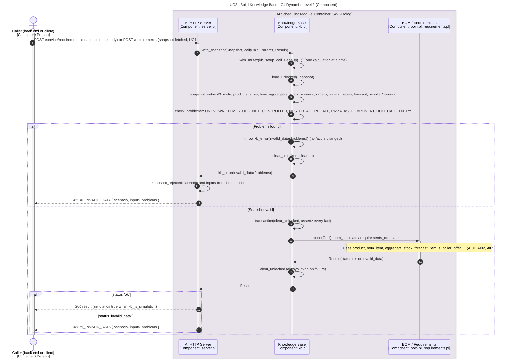

# AI06 UC2 - Build Knowledge Base

| Attribute | Value |
|---|---|
| C4 view | Dynamic diagram, Level 3 (Component) |
| SAD view | Process View, Level 3 |
| Containers | AI Scheduling Module |
| Entry point | `with_snapshot/2` (`kb.pl`), called by `calculate/5` (`server.pl`) for every calculation, in both paths |
| Allowed callers | `POST /bom`, `POST /requirements` (Manager token, pull) and `POST /service/bom`, `POST /service/requirements` (`X-Api-Key`, push) |
| Success response | n/a (facts loaded for one calculation; the calculation answers 200) |
| Error handling | Any problem in the snapshot: nothing is loaded, 422 `AI_INVALID_DATA` with `details { scenario, inputs, problems }`. An unexpected failure of the calculation: 500 `INTERNAL_ERROR`. The facts are cleared in every case. |
| ADRs | [ADR-0040](../../adr/0040-knowledge-base-loaded-per-calculation.md), [ADR-0039](../../adr/0039-planning-snapshot-as-the-data-contract-with-the-ai-service.md) |

## Description

`calculate(Calc, Snapshot, Params, Status, Body)` calls `with_snapshot(Snapshot, call(Calc, Params, Result))`, where `Calc` is `bom_calculate` or `requirements_calculate`. `with_snapshot/2` takes the `kb` mutex, so only one calculation uses the knowledge base at a time, and wraps the work in `setup_call_cleanup`, so `clear_unlocked` always runs at the end, whether the calculation succeeds, fails or throws.

`load_unlocked/1` calls `snapshot_entries/3`, a tolerant parser (DCG) that goes through the sections in this order: `meta` (with `sources`), `products`, `sizes`, `bom`, `aggregates`, `stock`, `scenario` (and then `orders` and `pizzas`, which are mandatory with a scenario), `issues`, `forecast` and `supplierScenario`. Each entry becomes `e(Path, Fact)` or a problem `p(Problem)` with its path, for example `bom[3]`. A malformed entry is reported and the parser keeps going, so every problem is found in one pass:

- `INVALID_SNAPSHOT`: missing section, missing field (`missing_field`), wrong type, `meta.simulated` not a boolean;
- `INVALID_QUANTITY`: BOM, aggregate, order or stock quantity that is not a valid integer;
- `INCOMPLETE_AGGREGATE` (production aggregate without items) and `PURCHASED_WITH_COMPOSITION` (purchase aggregate with items);
- forecast and supplier scenario: the first error of the section (missing key, invalid date, period, quantity, price, stock units, lead time or supply limit, duplicate forecast entry, supplier or offer) is reported as one `INVALID_SNAPSHOT` problem of that section.

`check_problem/2` then runs the cross checks over the parsed entries: `UNKNOWN_ITEM` (a reference to a product, size, pizza or supplier that is not in the snapshot), `STOCK_NOT_CONTROLLED`, `NESTED_AGGREGATE`, `PIZZA_AS_COMPONENT` and `DUPLICATE_ENTRY`.

If there is any problem, `load_unlocked/1` throws `kb_error(invalid_data(Problems))` before touching the facts. `calculate/5` turns it into 422 `AI_INVALID_DATA`, with the scenario and the inputs (`snapshotId`, `sources`) taken from the snapshot itself. No default value is ever invented for missing data.

Otherwise `load_unlocked/1` replaces the facts in one `transaction(( clear_unlocked, maplist(assertz, Facts) ))`. The facts keep the business identifiers of the back end; each supplier offer keeps its product, price in EUR, quoted stock units and lead time (`supplier_offer/5`), and `supplier_limit/3` exists only when a supply limit was given. The `issues` of the back end become `kb_issue/2` facts. `once(Goal)` then runs the calculation (BOM or requirements). If the facts make the calculation a simulation (`kb_is_simulation/0`), the result has `simulation: true`. A calculation that finds invalid data returns `status: "invalid_data"`, which is also answered as 422.

## Diagram

See the [README](./README.md) for the notation key and the element catalogue.
