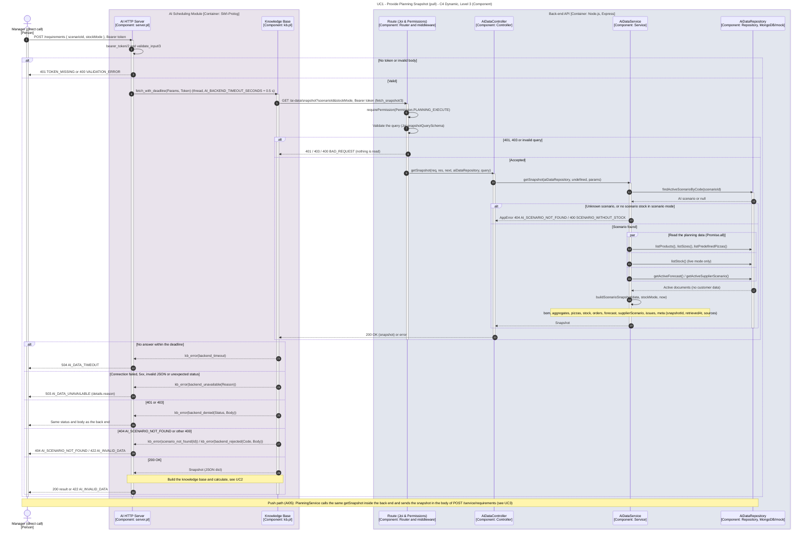

# AI06 UC1 - Provide Planning Snapshot

| Attribute | Value |
|---|---|
| C4 view | Dynamic diagram, Level 3 (Component) |
| SAD view | Process View, Level 3 |
| Containers | AI Scheduling Module, Back-end API, Database |
| Endpoint | `GET /ai-data/snapshot?scenarioId&stockMode[&forecastId&supplierScenarioId]` (back end); called by `fetch_snapshot/3` of the Prolog service (pull) or by `PlanningService` in the back end (push) |
| Allowed roles | MANAGER (permission `planning:execute`) |
| Success response | 200 OK, planning snapshot ([format](./snapshot-format.md)) |
| Error handling | Back end: 401 (no valid token), 403 (no permission), 400 `BAD_REQUEST` (invalid query; nothing is read), 404 `AI_SCENARIO_NOT_FOUND`, 400 `SCENARIO_WITHOUT_STOCK`, 404 `FORECAST_NOT_FOUND` / `SUPPLIER_SCENARIO_NOT_FOUND`. As seen by a client of the Prolog service (pull): 401/403 of the back end as received, 404 `AI_SCENARIO_NOT_FOUND`, 422 `AI_INVALID_DATA` (other 400 of the back end), 503 `AI_DATA_UNAVAILABLE`, 504 `AI_DATA_TIMEOUT`. |
| ADRs | [ADR-0020](../../adr/0020-planning-snapshot-as-the-data-contract-with-the-ai-service.md), [ADR-0004](../../adr/0004-contract-first-rest-api.md), [ADR-0018](../../adr/0018-secrets-management-strategy.md) |

## Description

The snapshot is built only by the back end and is the only way business data reaches the Prolog service. The diagram shows the pull path: a client with a Manager token calls `POST /requirements` (or `POST /bom`) on the Prolog service, which asks the back end for the snapshot with the same token. In the push path, used by the Web Application, `PlanningService` calls the same `getSnapshot` inside the back end and sends the result to `POST /service/requirements` ([UC3](./refresh-per-calculation.md), [WEB07 UC9](../ai-planning/execute-forecast.md)).

The Prolog service:

1. Checks the `Authorization: Bearer` header (401 `TOKEN_MISSING`) and the body `{ scenarioId, stockMode }` (`validate_input/3`, 400 `VALIDATION_ERROR` with the back-end detail format).
2. Calls `fetch_with_deadline/3`, which runs `fetch_snapshot/3` in its own thread and waits at most `AI_BACKEND_TIMEOUT_SECONDS` + 0.5 s (10.5 s by default), because the connection timeout of `http_open` cannot be interrupted on every platform. A late answer is discarded.
3. `fetch_snapshot/3` sends `GET {AI_BACKEND_URL}/ai-data/snapshot?scenarioId=..&stockMode=..` with `Authorization: Bearer <token>` and `Accept: application/json`. Only these two parameters are sent, so the active forecast and supplier scenario are used. The token is never logged and never part of an error term.

The back end:

1. `requirePermission(Permission.PLANNING_EXECUTE)` authenticates the token and checks the permission (Manager only).
2. Validates the query with `snapshotQuerySchema` (`scenarioId` `^[A-Z0-9-]{1,64}$` and `stockMode` `live` or `scenario`, both or neither; `forecastId` and `supplierScenarioId` 24 hex; other keys allowed). An invalid query answers 400 `BAD_REQUEST` and reads nothing.
3. `AiDataController.getSnapshot` passes only the keys that were sent to `getSnapshot(aiDataRepository, undefined, params)`. With `scenarioId`, `getScenarioSnapshot` loads the active AI scenario by code (`findActiveScenarioByCode`, 404 `AI_SCENARIO_NOT_FOUND`) and rejects `stockMode: "scenario"` when the scenario has no stock (400 `SCENARIO_WITHOUT_STOCK`).
4. Reads in parallel the active products, sizes and predefined pizzas, the real stock (only in `live` mode), the forecast and the supplier scenario: by id when given (404 when unknown or inactive), otherwise the most recently created active ones.
5. `buildScenarioSnapshot` builds the BOM (`buildBom`, reporting problems in `issues`), the aggregates (`buildAggregates`), the pizzas and their sizes (`buildPizzas`), the stock (`buildLiveStock` or `buildScenarioStock`), the orders of the scenario, the forecast and the supplier scenario, and `meta` with the `snapshotId` (hash of the content), one `retrievedAt` and the source and version of every input. This path is never cached.

Back in the Prolog service, a 200 is parsed as JSON (otherwise 503 `invalid_backend_response`). 401 and 403 of the back end are returned to the client as received; 404 `AI_SCENARIO_NOT_FOUND` becomes 404 `AI_SCENARIO_NOT_FOUND`; another 400 becomes 422 `AI_INVALID_DATA`; 5xx, other answers and connection failures become 503 `AI_DATA_UNAVAILABLE`; no answer in time becomes 504 `AI_DATA_TIMEOUT`. With a snapshot, the knowledge base is built for the calculation ([UC2](./build-knowledge-base.md)).

## Diagram

See the [README](./README.md) for the notation key and the element catalogue.
