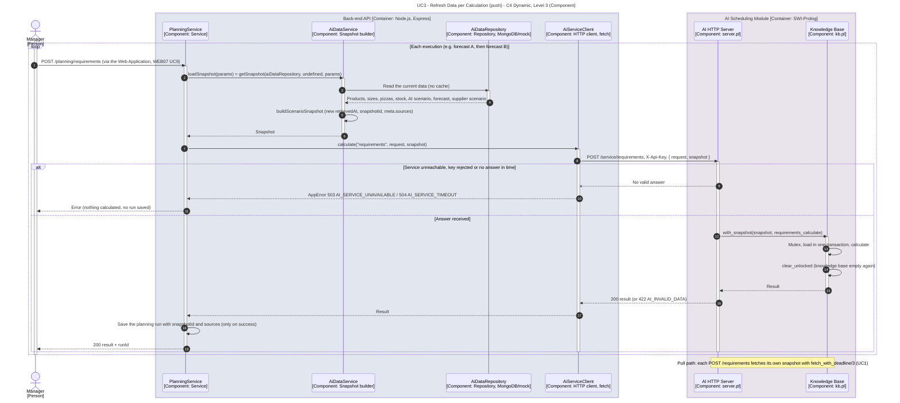

# AI06 UC3 - Refresh Data per Calculation

| Attribute | Value |
|---|---|
| C4 view | Dynamic diagram, Level 3 (Component) |
| SAD view | Process View, Level 3 |
| Containers | Web Application, Back-end API, Database, AI Scheduling Module |
| Endpoints | Push: `POST /planning/requirements` (back end) → `POST /service/requirements` (Prolog). Pull: `POST /requirements` (Prolog) → `GET /ai-data/snapshot` (back end) |
| Allowed roles | MANAGER (`planning:execute`); back end to Prolog with `X-Api-Key` |
| Success response | 200 OK per calculation, each with its own `snapshotId` and `meta.sources` |
| Error handling | Back end unavailable: push 503 `AI_SERVICE_UNAVAILABLE` / 504 `AI_SERVICE_TIMEOUT` (from the back end), pull 503 `AI_DATA_UNAVAILABLE` / 504 `AI_DATA_TIMEOUT` (from the Prolog service). Nothing is calculated with older data and no run is saved. |
| ADRs | [ADR-0020](../../adr/0020-planning-snapshot-as-the-data-contract-with-the-ai-service.md), [ADR-0021](../../adr/0021-knowledge-base-loaded-per-calculation.md), [ADR-0047](../../adr/0047-recording-planning-runs-with-their-input-versions.md) |

## Description

The refresh policy is one snapshot per calculation. Nothing is kept between two calculations:

- **Back end:** the scenario snapshot is built from the current data on every request and is never cached. Only the snapshot without a scenario, which the calculations do not use, is cached for 60 s (when Redis is configured).
- **Prolog service:** the knowledge base is empty between requests. `with_snapshot/2` loads the snapshot of the calculation, runs it and clears the facts; the `kb` mutex serializes concurrent calculations, so one never sees the data of another.
- **Consistent input set:** the snapshot is built in one go with one `retrievedAt`, and the knowledge base is replaced in one transaction or not at all ([UC2](./build-knowledge-base.md)). If the back end does not answer, the calculation fails and the service never falls back to data loaded earlier.

The diagram shows the push path with two executions in a row (for example forecast A and then forecast B, WEB07). Each execution makes the back end build a new snapshot (`getSnapshot`), with its own `retrievedAt`, `snapshotId` and versions in `meta.sources`, and send it to `POST /service/requirements` with the service key. The planning run of each execution records those values ([WEB07 UC10](../ai-planning/consult-planning-results.md)), so two results are always traceable to two input sets.

In the pull path the same happens inside the Prolog service: every `POST /requirements` calls `fetch_with_deadline/3` → `fetch_snapshot/3` for a new snapshot ([UC1](./provide-planning-snapshot.md)).

## Diagram

See the [README](./README.md) for the notation key and the element catalogue.
