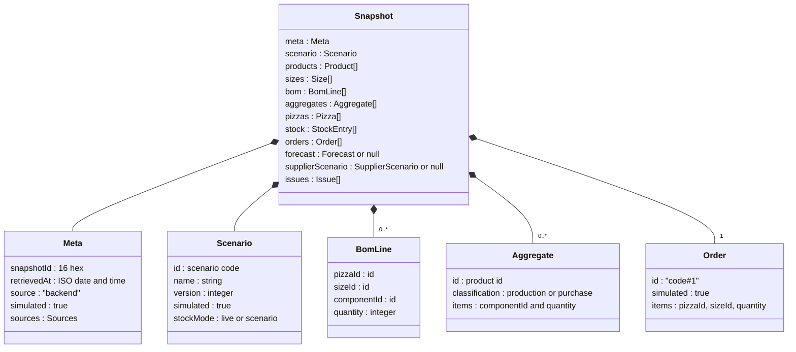

# Planning Snapshot - Format

The planning snapshot is the JSON document returned by `GET /ai-data/snapshot` and sent in the body of `POST /service/{bom,requirements}`. It is built by `buildScenarioSnapshot` (with `scenarioId`) or `buildSnapshot` (without it) in `application/ai-data/ai-data.service.js`, and it is read by `snapshot_entries/3` in `ai-scheduling/kb.pl`. Quantities are integers in **abstract stock units**. Every list is sorted, so the `snapshotId` depends only on the content.

## Scenario snapshot (used by the calculations)

`GET /ai-data/snapshot?scenarioId=<code>&stockMode=<live|scenario>[&forecastId=<id>&supplierScenarioId=<id>]`

| Property | Content | Source in the back end |
|---|---|---|
| `meta` | `snapshotId` (SHA-256 of the content, first 16 hex characters), `retrievedAt` (one instant for the whole snapshot), `source: "backend"`, `simulated: true`, `sources` (see below) | `buildScenarioSnapshot` |
| `scenario` | `{ id, name, version, simulated: true, stockMode }`: the AI scenario (`id` is its code) and the stock mode of the request | AI scenario (`findActiveScenarioByCode`) |
| `products[]` | `{ id, name, sellable, stockControlled, isPizzaComponent }` of every active product | `toPlanningProduct` |
| `sizes[]` | `{ id, name }` of every active pizza size | `toPlanningSize` |
| `bom[]` | `{ pizzaId, sizeId, componentId, quantity }`: one line per predefined pizza, size of the pizza and component of its default configuration, with the `stockUnitsConsumed` of the component for that size. Components without stock control are kept only when they define a positive consumption | `buildBom(..., { reportUnmeasured: true })` |
| `aggregates[]` | `{ id, classification, items: [{ componentId, quantity }] }`; `classification` is `production` (`PRODUCED`) or `purchase` (`PURCHASED`) | `buildAggregates` |
| `pizzas[]` | `{ id, sizeIds[] }` of every active predefined pizza | `buildPizzas` |
| `stock[]` | `{ productId, quantity }`. `live`: every stock-controlled product, 0 when there is no stock record. `scenario`: exactly the stock stored in the AI scenario | `buildLiveStock` / `buildScenarioStock` |
| `orders[]` | One simulated order `{ id: "<code>#1", simulated: true, items: [{ pizzaId, sizeId, quantity }] }` with the orders of the AI scenario | AI scenario |
| `forecast` | `{ id, name, version, startDate, endDate, entries: [{ date, productId, sizeId?, quantity }] }`, dates `YYYY-MM-DD`; `sizeId` only when the entry has one; `null` when there is none | `toSnapshotForecast` |
| `supplierScenario` | `{ id, name, version, simulated, suppliers: [{ id, name }], products: [{ productId, offers: [{ supplierId, priceEur, stockUnits, leadTimeDays, supplyLimit? }] }] }`; `supplyLimit` only when present; `null` when there is none | `toSnapshotSupplierScenario` |
| `issues[]` | `{ code, ... }`: data problems found while building, never replaced by defaults | `buildBom`, `buildLiveStock` |

### `meta.sources`

| Key | Content |
|---|---|
| `catalogue` | `{ source: "backend", retrievedAt, version }`; `version` is a hash of the products, sizes, BOM, aggregates and pizzas (recorded as `bomVersion` in a planning run) |
| `stock` | `{ source: "backend-live", retrievedAt }`, or `{ source: "scenario", scenarioId, scenarioVersion, retrievedAt }` |
| `orders` | `{ source: "scenario", scenarioId, scenarioVersion, retrievedAt }` |
| `forecast` | `{ source: "backend", id, name, version, retrievedAt }`, only when there is a forecast |
| `supplierScenario` | `{ source: "backend", id, name, version, retrievedAt }`, only when there is a supplier scenario |

### Issues reported by the back end

| Code | Meaning |
|---|---|
| `UNKNOWN_COMPONENT` | A pizza configuration references a product that is not active |
| `MISSING_OR_INVALID_STOCK_UNITS` | A stock-controlled component has no integer `stockUnitsConsumed` ≥ 0 for the size |
| `UNMEASURED_NON_STOCK_COMPONENT` | A component without stock control defines no positive consumption |
| `STOCK_UNKNOWN_PRODUCT`, `STOCK_NOT_CONTROLLED`, `STOCK_INVALID_QUANTITY` | A live stock record of an unknown product, of a product without stock control, or with an invalid quantity (left out of `stock`) |

## Snapshot without a scenario (older format)

`GET /ai-data/snapshot[?forecastId&supplierScenarioId]` returns `meta` (`snapshotId`, `retrievedAt`, `source: "backend"`, `simulated: false`, and `sources` only for the forecast and supplier scenario), `products`, `sizes`, `bom` (stock-controlled components only), `aggregates: []`, `stock`, `forecast`, `supplierScenario` and `issues`, without `scenario`, `orders` or `pizzas`. It is cached for 60 s when Redis is configured. It is kept for the WEB07 data flow and the legacy loader `refresh_kb/0`; the calculations do not use it.

## Validation in the knowledge base

`kb.pl` checks the snapshot before loading it ([UC2](./build-knowledge-base.md)). Every problem has a `code`, a `path` (for example `bom[3]`) and the details of the case:

| Code | Example |
|---|---|
| `INVALID_SNAPSHOT` | Missing `meta`, a missing or wrongly typed field, `meta.simulated` not a boolean, the first error of the forecast or supplier scenario section |
| `INVALID_QUANTITY` | A BOM, aggregate, order or stock quantity that is not a valid integer |
| `DUPLICATE_ENTRY` | The same product, size, pizza, BOM line, aggregate item, order line or stock entry twice |
| `UNKNOWN_ITEM` | A reference to a product, size, pizza or supplier that is not in the snapshot |
| `STOCK_NOT_CONTROLLED` | Stock of a product without stock control |
| `INCOMPLETE_AGGREGATE` | A production aggregate without items |
| `NESTED_AGGREGATE` | An aggregate that contains another aggregate |
| `PIZZA_AS_COMPONENT` | A pizza used as a BOM component or aggregate item |
| `PURCHASED_WITH_COMPOSITION` | A purchase aggregate with items |

A snapshot with any problem is rejected as a whole (422 `AI_INVALID_DATA`).

## Related

- [UC1 - Provide Planning Snapshot](./provide-planning-snapshot.md)
- [UC2 - Build Knowledge Base](./build-knowledge-base.md)
- [Supplier Scenario JSON Format](../ai-planning/supplier-json-format.md)
- [README](./README.md)
