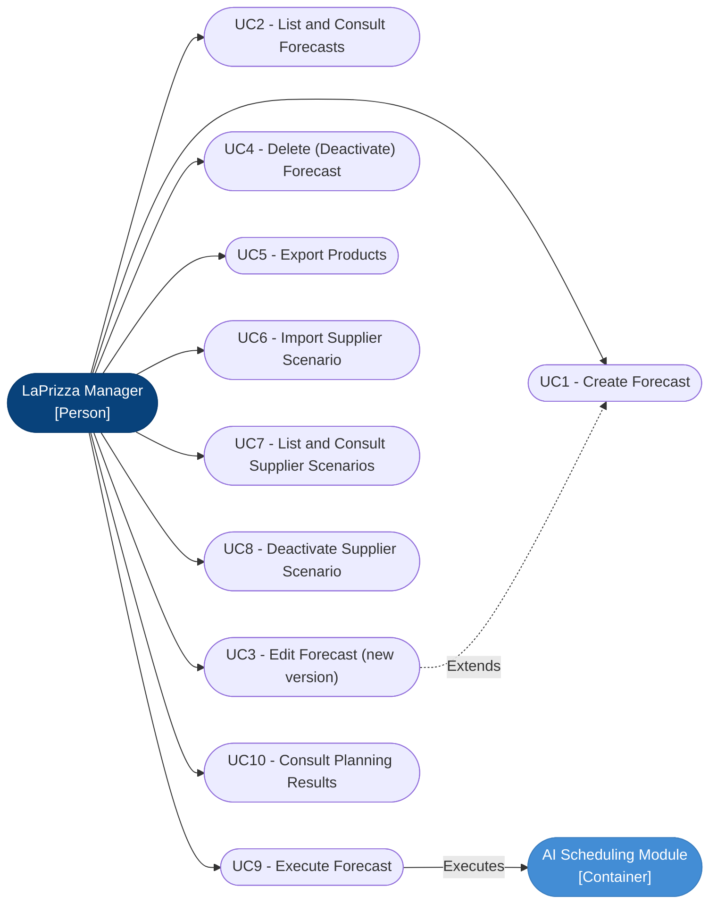

# AI Planning - Design Diagrams (Mermaid)

The AI Planning feature (WEB07) prepares the inputs of the requirements planning and runs it through the AI Scheduling Module. A Manager keeps daily product-consumption forecasts and supplier scenarios, both immutable and versioned, executes a forecast version with a supplier scenario and consults every saved result together with the exact inputs it used. Every calculation is a simulation: it never changes the stock nor creates purchase orders.

Process View (SAD), Level 3, documented as C4 dynamic diagrams of the **Web Application** and **Back-end API** containers (and of the **AI Scheduling Module** for the execution). The accepted supplier JSON format is in [Supplier Scenario JSON Format](./supplier-json-format.md).

## Use Cases

The use cases are described in the [Use Case Views](../../analysis/use-case-views.md#web07-artificial-intelligence-configuration-and-execution).

## Diagrams

| Use case | Endpoint | Roles | Success | Document |
|---|---|---|---|---|
| [UC1 - Create Forecast](./create-forecast.md) | `POST /forecasts` | MANAGER | 201 Created | `create-forecast.md` |
| [UC2 - List and Consult Forecasts](./list-and-consult-forecasts.md) | `GET /forecasts`, `GET /forecasts/{id}` | MANAGER | 200 OK | `list-and-consult-forecasts.md` |
| [UC3 - Edit Forecast (new version)](./edit-forecast.md) | `POST /forecasts` (same name) | MANAGER | 201 Created | `edit-forecast.md` |
| [UC4 - Delete (Deactivate) Forecast](./deactivate-forecast.md) | `PUT /forecasts/{id}` | MANAGER | 200 OK | `deactivate-forecast.md` |
| [UC5 - Export Products](./export-products.md) | `GET /ai-data/products/export` | MANAGER | 200 OK | `export-products.md` |
| [UC6 - Import Supplier Scenario](./import-supplier-scenario.md) | `POST /supplier-scenarios/validate`, `POST /supplier-scenarios` | MANAGER | 200 OK, 201 Created | `import-supplier-scenario.md` |
| [UC7 - List and Consult Supplier Scenarios](./list-and-consult-supplier-scenarios.md) | `GET /supplier-scenarios`, `GET /supplier-scenarios/{id}` | MANAGER | 200 OK | `list-and-consult-supplier-scenarios.md` |
| [UC8 - Deactivate Supplier Scenario](./deactivate-supplier-scenario.md) | `PUT /supplier-scenarios/{id}` | MANAGER | 200 OK | `deactivate-supplier-scenario.md` |
| [UC9 - Execute Forecast](./execute-forecast.md) | `POST /planning/requirements` | MANAGER | 200 OK | `execute-forecast.md` |
| [UC10 - Consult Planning Results](./consult-planning-results.md) | `GET /planning/runs`, `GET /planning/runs/{id}` | MANAGER | 200 OK | `consult-planning-results.md` |

## REST API summary

All paths are under `/api/v2` (current version). `/api/v1` is a deprecated alias served by the same router (`api-versions.js`). Authorization is by permission (AA05): every route requires a valid token (`401`, for example `TOKEN_MISSING`, otherwise) and the permission in the table (`403 FORBIDDEN` otherwise). In `ROLE_PERMISSIONS` these permissions are granted only to MANAGER.

| Method and path | Use case | Permission | Success | Errors |
|---|---|---|---|---|
| `GET /forecasts[?name=]` | UC2 | `forecasts:read` | 200 (active versions) | 400 `BAD_REQUEST` (query) |
| `POST /forecasts` | UC1, UC3 | `forecasts:write` | 201 (DTO with the assigned `version`) | 400 `BAD_REQUEST` (Joi), 400 `VALIDATION_ERROR` (business rules), 409 `CONFLICT` (version taken by a concurrent request) |
| `GET /forecasts/{id}` | UC2 | `forecasts:read` | 200 | 400 `BAD_REQUEST` (invalid id), 404 `NOT_FOUND` (unknown or inactive) |
| `PUT /forecasts/{id}` body `{ "isActive": false }` | UC4 | `forecasts:write` | 200 (DTO, `isActive: false`) | 400 `BAD_REQUEST` (id or body), 404 `NOT_FOUND` |
| `GET /ai-data/products/export` | UC5 | `planning:execute` | 200 `{ exportedAt, products[] }` | |
| `GET /supplier-scenarios[?name=]` | UC7 | `suppliers:read` | 200 (active versions) | 400 `BAD_REQUEST` (query) |
| `POST /supplier-scenarios/validate` | UC6 (dry-run, nothing stored) | `suppliers:import` | 200 `{ "valid": true, "nextVersion": n }` | 400 `BAD_REQUEST` (Joi), 400 `VALIDATION_ERROR` (business rules) |
| `POST /supplier-scenarios` | UC6 | `suppliers:import` | 201 (DTO, `simulated: true`) | 400 `BAD_REQUEST`, 400 `VALIDATION_ERROR`, 409 `CONFLICT` |
| `GET /supplier-scenarios/{id}` | UC7 | `suppliers:read` | 200 | 400 `BAD_REQUEST`, 404 `NOT_FOUND` |
| `PUT /supplier-scenarios/{id}` body `{ "isActive": false }` | UC8 | `suppliers:import` | 200 | 400 `BAD_REQUEST`, 404 `NOT_FOUND` |
| `POST /planning/requirements` | UC9 | `planning:execute` | 200 (result of the AI Scheduling Module + `runId`) | 400 `VALIDATION_ERROR` (body), 400 `SCENARIO_WITHOUT_STOCK`, 404 `AI_SCENARIO_NOT_FOUND` / `FORECAST_NOT_FOUND` / `SUPPLIER_SCENARIO_NOT_FOUND`, 422 `AI_INVALID_DATA`, 503 `AI_SERVICE_UNAVAILABLE` (with `Retry-After: 5`), 504 `AI_SERVICE_TIMEOUT` |
| `GET /planning/runs[?kind&forecastId&supplierScenarioId]` | UC10 | `planning:execute` | 200 (summaries, 100 most recent, without `result`) | 400 `VALIDATION_ERROR` (query) |
| `GET /planning/runs/{id}` | UC10 | `planning:execute` | 200 (with `result`) | 400 `BAD_REQUEST` (invalid id), 404 `PLANNING_RUN_NOT_FOUND` |

Errors follow `{ "error": { "status", "code", "message", "details"? } }`. Validation `details` are `[{ field, type, message }]`:

- Joi (`BAD_REQUEST` on forecasts and supplier scenarios, `VALIDATION_ERROR` on planning): `type` is the Joi type (`any.required`, `string.hex`, `number.min`, ...) and `field` uses dots (`entries.0.date`).
- Business rules (`VALIDATION_ERROR`): `type` is a stable code (`productUnknown`, `dateOutside`, ...) and `field` uses brackets (`entries[0].date`). The page turns both into the dot form and translates the codes as `feedback.validation.ai_<code>`.

The same `POST /planning/{kind}` route also serves `POST /planning/bom` ([AI05 UC1](../ai-service-access/calculate-bom.md)); the WEB07 execution uses `requirements`. The service access (identities, outcomes, interface examples) is in the [AI Service Access README](../ai-service-access/README.md).

## Business rules shown in the diagrams

- **Forecasts are immutable and versioned.** `POST /forecasts` always creates a document. Its version is `forecastRepository.getLatestVersion(name) + 1`, where the name is compared without case (collation `en`, strength 2) and inactive versions count, so a version number is never reused. A unique index `{ name, version }` with the same collation turns a concurrent save into `409` ("try again"). A `version` in the body is validated (integer ≥ 1) but ignored. "Edit" in the page is a `POST` with the same name ([ADR-0033](../../adr/0033-immutable-versioned-forecasts-and-supplier-scenarios.md)).
- **Forecast rules** (`findForecastProblems`, all problems returned together, `400 VALIDATION_ERROR`): `dateInvalid` (not a real day), `periodInvalid` (end before start), `noEntries`, `dateOutside` (entry outside the period), `productUnknown` (not an active product, or `sellable !== true`), `sizeRequired` (predefined pizza without size), `sizeIncompatible` (size not in the pizza's `sizeIds`, or a size on a product without sizes), `duplicate` (same date, product and size). Quantity is an integer ≥ 0 (Joi); omitted entries mean zero consumption.
- **Delete is a deactivation.** `PUT /{id}` accepts only `{ "isActive": false }`. Inactive forecasts and scenarios are not listed, answer 404 by id and can no longer be selected for an execution, but stay in the database, so saved runs keep their reference.
- **Product export** (`buildProductsExport`): purchased aggregates (`purchasedAggregate`), stock-controlled products sold directly (`directSale`) and the other stock-controlled products (`rawMaterial`). Produced aggregates and products without stock control are left out. `sellingPriceEur` is present only for sellable products with a positive price; a missing price never excludes a product. Rows are sorted by name.
- **Supplier scenario rules**: Joi checks the structure and values (`priceEur ≥ 0`, `stockUnits` integer ≥ 1, `leadTimeDays ≥ 0`, optional `supplyLimit` integer ≥ 0, `productId` 24 hex). `findSupplierScenarioProblems` checks `supplierIdDuplicate`, `productUnknown` (against all active products), `productDuplicate`, `offerSupplierUnknown` and `offerDuplicate`. `offers: []` is allowed and means "no supplier". A supplier without a name gets its id as name. Every saved scenario has `simulated: true`; `version` and `simulated` sent by the client are ignored.
- **Inspect before saving.** The page parses the JSON (error with line and column), runs the same structural checks as the back end and then calls `POST /supplier-scenarios/validate`, which runs the same Joi schema and rules, stores nothing and returns the next version. Only what was inspected can be confirmed; any change to the text or name discards the inspection. A rejected file saves nothing, so the previous scenario stays in use ([ADR-0035](../../adr/0035-supplier-import-with-client-side-checks-and-server-dry-run.md)).
- **Execution.** The back end builds the snapshot itself (`getSnapshot` → `buildScenarioSnapshot`): catalogue and BOM, stock (live, or the AI scenario's own stock), AI scenario orders, forecast and supplier scenario. Without `forecastId` or `supplierScenarioId` it uses the most recently created active one. It then calls `POST {AI_SERVICE_URL}/service/requirements` with `X-Api-Key` (never the user's token) and waits up to 15 s (`AI_SERVICE_TIMEOUT_SECONDS`). The calculation is synchronous and nothing in it writes stock or orders ([ADR-0036](../../adr/0036-synchronous-ai-execution-with-duplicate-submission-guard.md)).
- **One request per click.** The execution form uses a synchronous lock (`useRef`), disables its fields and button and shows a progress bar while the request runs.
- **Runs.** Only a successful calculation is saved (`PlanningRun`, append-only): the request, `snapshotId`, AI scenario, `forecast` and `supplierScenario` as `{ id, name, version }`, `bomVersion` (hash of the catalogue and BOM), `stockSource`, status, the full result and `requestedBy`. These versions come from the snapshot the back end built, not from the AI answer. A failure saves nothing ([ADR-0034](../../adr/0034-recording-planning-runs-with-their-input-versions.md)).
- **No supplier scenario** is not an error: the AI Scheduling Module adds the warning `NO_SUPPLIER_SCENARIO`, and every shortage is reported as unmet with the reason `NO_SUPPLIER_OFFER`. A missing forecast is: `422 AI_INVALID_DATA` with the problem `MISSING_FORECAST`.

## Related ADRs

| ADR | Decision | Status |
|---|---|---|
| [ADR-0005](../../adr/0005-contract-first-rest-api.md) | Contract-first REST API | Accepted |
| [ADR-0014](../../adr/0014-api-uri-routing-versioning-strategy.md) | API URI versioning (`/api/v2`, `/api/v1` deprecated alias) | Accepted |
| [ADR-0018](../../adr/0018-internationalization-of-the-web-application-%28english-and-portuguese%29.md) | Internationalization of the Web Application (English and Portuguese) | Accepted |
| [ADR-0028](../../adr/0028-mock-based-unit-testing.md) | Mock-based unit testing with `node:test` | Accepted |
| [ADR-0029](../../adr/0029-frontend-end-to-end-%28e2e%29-testing-framework.md) | Frontend end-to-end testing framework: Playwright | Accepted |
| [ADR-0032](../../adr/0032-secure-session-handling-in-the-api-and-the-spa.md) | Secure session handling in the API and the SPA | Accepted |
| [ADR-0033](../../adr/0033-immutable-versioned-forecasts-and-supplier-scenarios.md) | Immutable versioned forecasts and supplier scenarios (edit = new version, delete = deactivate) | Accepted |
| [ADR-0034](../../adr/0034-recording-planning-runs-with-their-input-versions.md) | Recording planning runs with their input versions | Accepted |
| [ADR-0035](../../adr/0035-supplier-import-with-client-side-checks-and-server-dry-run.md) | Supplier import: client-side checks and server dry-run before confirmation | Accepted |
| [ADR-0036](../../adr/0036-synchronous-ai-execution-with-duplicate-submission-guard.md) | Synchronous AI execution with a client-side duplicate-submission guard | Accepted |

## Notation key

| Notation | Meaning |
|---|---|
| Actor (stick figure) | Person using the system, with the role shown in the label |
| Shaded box "Web Application" | Container (React, Vite) that holds the page components |
| Shaded box "Back-end API" | System boundary of the container (Node.js, Express) that holds all the components |
| Shaded box "AI Scheduling Module" | Container (SWI-Prolog) that calculates the requirements planning |
| Participant label | `Name`, followed by `[Type: technology]` |
| Solid arrow | Call or request |
| Dashed arrow | Return value or response |
| Arrow to the same participant | Work done inside that component |
| Number on an arrow | Order of the interaction (autonumber) |
| `alt` / `else` frame | Alternative flows, only one of them runs |
| `opt` frame | Optional flow |
| `Note` | Reference to another diagram or a remark |

## Element catalogue

| Element | Type | Technology | Responsibility | Used in |
|---|---|---|---|---|
| Manager | Person | - | Back-office user with the MANAGER role, the only one with the WEB07 permissions | All diagrams |
| AiPage | Component | React page | Page `/ai` (route guard: `planning:execute`) with four ARIA tabs (Forecasts, Suppliers, Execution, Results) and the simulation banner; passes the chosen forecast to the execution and the `runId` to the results | [UC9](./execute-forecast.md), [UC10](./consult-planning-results.md) |
| ForecastsPanel | Component | React, TanStack Query | Lists the active forecasts grouped by name, shows a version (`ForecastDetail`), opens the editor for a new forecast or a new version, deactivates after a confirmation dialog, starts an execution with a version | [UC1](./create-forecast.md), [UC2](./list-and-consult-forecasts.md), [UC3](./edit-forecast.md), [UC4](./deactivate-forecast.md) |
| ForecastForm | Component | React form | Edits name (read-only for a new version), period and entries (date, product, size, quantity; duplicate to the next day, remove); checks the form before sending and shows the API violations per field | [UC1](./create-forecast.md), [UC3](./edit-forecast.md) |
| forecast-model | Component | JavaScript module, pure functions | `buildProductOptions` (sellable products, pizza sizes), `validateForecast` (same codes as the back end), `toPayload` (no `version`), `fromForecast`, `groupForecasts` | [UC1](./create-forecast.md), [UC2](./list-and-consult-forecasts.md), [UC3](./edit-forecast.md) |
| SuppliersPanel | Component | React, TanStack Query | `ExportCard` (download), `FormatCard` (format, example with real ids, LLM prompt), `ImportCard` (Inspect, preview, Confirm), `ScenariosCard` (list, view, deactivate) | [UC5](./export-products.md), [UC6](./import-supplier-scenario.md), [UC7](./list-and-consult-supplier-scenarios.md), [UC8](./deactivate-supplier-scenario.md) |
| supplier-model | Component | JavaScript module, pure functions | `parseSupplierJson` (line and column of a syntax error), `toScenarioPayload`, `validateScenarioStructure` (same paths and types as the back end; product references are left to the server), `buildPreviewRows` | [UC6](./import-supplier-scenario.md), [UC7](./list-and-consult-supplier-scenarios.md) |
| SupplierPreview | Component | React component | Table of offers (price, units, price per unit, lead time, limit, "Simulated") and "No configured supplier" rows | [UC6](./import-supplier-scenario.md), [UC7](./list-and-consult-supplier-scenarios.md) |
| PlanningPanel | Component | React form | Chooses calculation, AI scenario, stock mode, forecast version and supplier scenario; synchronous lock, progress bar, failure states; refreshes the saved runs | [UC9](./execute-forecast.md) |
| planning-errors | Component | JavaScript module, pure functions | `validatePlanningInput`, `toPlanningRequest`, `classifyPlanningError` (invalid input, missing information, unavailable, forbidden, unauthenticated) | [UC9](./execute-forecast.md) |
| RequirementsResult | Component | React component | Shows a result: simulation and "stock not changed", forecast version, daily needs, production, replenishment by product, daily plan (supplier, price, delivery, late, unmet), warnings | [UC9](./execute-forecast.md), [UC10](./consult-planning-results.md) |
| RunsPanel | Component | React, TanStack Query | Lists the saved requirements runs (filter by forecast version) and opens one (`RunDetail`) | [UC10](./consult-planning-results.md) |
| ai-api / ai-errors | Component | JavaScript modules | WEB07 endpoints (`feedback: 'silent'`, errors explained inline); normalization of `entries[0]` to `entries.0` and of business codes to `ai.<code>` | All diagrams |
| Route (Joi & Permissions) | Component | Express router and middleware | Authenticates the token and checks the permission (`requirePermission`), validates id, query and body with Joi and delegates to the controller | All diagrams |
| ForecastController | Component | Express controller | `list`, `create`, `getById`, `update` | [UC1](./create-forecast.md) to [UC4](./deactivate-forecast.md) |
| ForecastService | Component | Node.js module | `listForecasts`, `getForecastById`, `createForecast`, `updateForecast`, `toForecastDto` | [UC1](./create-forecast.md) to [UC4](./deactivate-forecast.md) |
| Forecast rules | Component | Node.js module, pure functions | `findForecastProblems` (no Express or Mongoose) | [UC1](./create-forecast.md), [UC3](./edit-forecast.md) |
| SupplierScenarioController | Component | Express controller | `list`, `create`, `validate`, `getById`, `update` | [UC6](./import-supplier-scenario.md) to [UC8](./deactivate-supplier-scenario.md) |
| SupplierScenarioService | Component | Node.js module | `listSupplierScenarios`, `getSupplierScenarioById`, `validateSupplierScenario`, `createSupplierScenario`, `updateSupplierScenario`, `toSupplierScenarioDto` | [UC6](./import-supplier-scenario.md) to [UC8](./deactivate-supplier-scenario.md) |
| SupplierScenario rules | Component | Node.js module, pure functions | `findSupplierScenarioProblems` | [UC6](./import-supplier-scenario.md) |
| AiDataController | Component | Express controller | `getProductsExport` (and `getSnapshot`, AI06) | [UC5](./export-products.md) |
| AiDataService | Component | Node.js module | `buildProductsExport`, `getProductsExport`, `getSnapshot`, `buildScenarioSnapshot` | [UC5](./export-products.md), [UC9](./execute-forecast.md) |
| AiDataRepository (catalogue reader) | Component | Repository, MongoDB/mock | Read-only access to products, sizes, predefined pizzas, stock, AI scenarios and the active or chosen forecast and supplier scenario | [UC1](./create-forecast.md), [UC3](./edit-forecast.md), [UC5](./export-products.md), [UC6](./import-supplier-scenario.md), [UC9](./execute-forecast.md) |
| PlanningController | Component | Express controller | `calculateRequirements` (and `calculateBom`), `listRuns`, `getRun` | [UC9](./execute-forecast.md), [UC10](./consult-planning-results.md) |
| PlanningService | Component | Node.js module | `createPlanningService` → `calculateRequirements`, `listRuns`, `getRun`; `toPlanningRunRecord`, `toPlanningRunSummaryDto`, `toPlanningRunDto` | [UC9](./execute-forecast.md), [UC10](./consult-planning-results.md) |
| AiServiceClient | Component | Node.js module, `fetch` | `calculate(kind, request, snapshot)`: calls the AI Scheduling Module with `X-Api-Key` and maps its answers to 200, 422, 503 or 504 | [UC9](./execute-forecast.md) |
| ForecastRepository | Component | Repository, MongoDB/mock (model `Forecast`) | `list`, `search`, `findById`, `getLatestVersion`, `create`, `update` | [UC1](./create-forecast.md) to [UC4](./deactivate-forecast.md) |
| SupplierScenarioRepository | Component | Repository, MongoDB/mock (model `SupplierScenario`) | `list`, `search`, `findById`, `getLatestVersion`, `create`, `update` | [UC6](./import-supplier-scenario.md) to [UC8](./deactivate-supplier-scenario.md) |
| PlanningRunRepository | Component | Repository, MongoDB/mock (model `PlanningRun`) | `create`, `list` (summary fields, newest first, at most 100), `findById` | [UC9](./execute-forecast.md), [UC10](./consult-planning-results.md) |
| AI service | Component | SWI-Prolog HTTP server (`server.pl`, `requirements.pl`) | `POST /service/requirements`: checks the service key, loads the snapshot into the knowledge base and calculates the plan (`requirements_calculate`) | [UC9](./execute-forecast.md) |

## Notes

- Authorization in WEB07 is by permission (AA05), not by role: `requirePermission(Permission.X)` authenticates the Bearer token through `app.locals.authenticate` and then checks the permission. The diagrams write it as `requirePermission(...)`.
- `POST /supplier-scenarios/validate` is registered before `/:id`, so that `validate` is not read as an id.
- The page never calls `GET /forecasts/{id}` nor `GET /supplier-scenarios/{id}`: the list already carries every field, so the detail is built from it. Both endpoints are available through the API.
- The endpoint paths are the ones implemented in `forecast.routes.js`, `supplier-scenario.routes.js`, `ai-data.routes.js` and `planning.routes.js`. The OpenAPI description remains the contract ([ADR-0005](../../adr/0005-contract-first-rest-api.md)).
- All texts of the page are in English and Portuguese (`web07-messages.js`, merged into `message.js`) ([ADR-0018](../../adr/0018-internationalization-of-the-web-application-%28english-and-portuguese%29.md)).
- Tests:
  - Unit tests with `node:test` mocks ([ADR-0028](../../adr/0028-mock-based-unit-testing.md)): `test/application/forecast.service.test.js`, `supplier-scenario.service.test.js`, `ai-data.service.test.js`, `ai-data.products-export.test.js`, `planning.service.test.js`, `test/planning/planning.service.test.js`, `test/planning/ai-service.client.test.js`.
  - API tests: `test/api/api.forecasts.test.js`, `api.supplier-scenario.test.js`, `api.ai-data.test.js`, `api.planning-runs.test.js` and `api.authorization-matrix.test.js` (matrix in `test/support/authorization-matrix.js`).
  - httpyac flows: `test-flows/forecast-test-flow.http`, `supplier-scenarios-test-flow.http` and `planning-test-flow.http`. The planning flow needs the Prolog service and checks that both the real stock and the stock of the AI scenario are unchanged after the executions.
  - SPA: `frontend/test/ai/*.test.js` (forecast and supplier models, planning errors, error normalization) and `frontend/test/e2e/web07-ai.spec.js` (Playwright with a mocked API, [ADR-0029](../../adr/0029-frontend-end-to-end-%28e2e%29-testing-framework.md)).
  - Prolog: `ai-scheduling/run-tests.sh` (`test/requirements.plt`, `test/service.plt`, ...).
