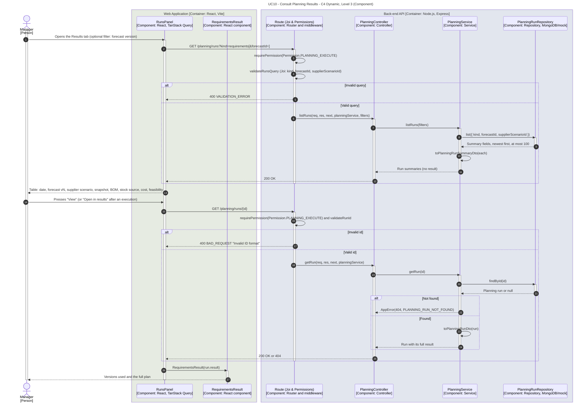

# UC10 - Consult Planning Results

| Attribute | Value |
|---|---|
| C4 view | Dynamic diagram, Level 3 (Component) |
| SAD view | Process View, Level 3 |
| Containers | Web Application, Back-end API, Database |
| Endpoints | `GET /planning/runs[?kind&forecastId&supplierScenarioId]` (list), `GET /planning/runs/{id}` (one run) |
| Allowed roles | MANAGER (permission `planning:execute`) |
| Success response | 200 OK. List: up to 100 run summaries, newest first, `{ id, kind, createdAt, requestedBy, request, snapshotId, scenario, forecast, supplierScenario, bomVersion, stockSource, status, summary, feasible }` without `result`. Detail: the same fields plus the full `result`. |
| Error handling | 400 `VALIDATION_ERROR` (query: `kind` not `bom`/`requirements`, ids not 24 hex), 400 `BAD_REQUEST` "Invalid ID format" (run id), 404 `PLANNING_RUN_NOT_FOUND`, 401/403 |
| ADRs | [ADR-0047](../../adr/0047-recording-planning-runs-with-their-input-versions.md) |

## Description

Every successful execution ([UC9](./execute-forecast.md)) is saved as a planning run (`PlanningRun`, append-only, never updated). A run records:

- `kind` and `request` (`scenarioId`, `stockMode`, `forecastId`, `supplierScenarioId` as sent, `null` when not chosen);
- `snapshotId`, `scenario` (the AI scenario), `forecast` and `supplierScenario` as `{ id, name, version }`, `bomVersion` (hash of the catalogue and BOM) and `stockSource` (`{ source: "backend-live", retrievedAt }` or `{ source: "scenario", scenarioId, scenarioVersion, retrievedAt }`), all taken from the snapshot built by the back end, not from the AI answer;
- `status`, the full `result` and `requestedBy` (user id).

This is what links each result to the forecast version, the stock snapshot, the pizza BOM and the supplier scenario it used. Since a forecast or a supplier scenario is never changed (an edit creates a new version, a delete deactivates), an old result keeps its meaning after later edits.

The Results tab (`RunsPanel`) loads `GET /planning/runs?kind=requirements`, optionally with the `forecastId` chosen in the filter. The filter offers the active forecast versions; runs of deactivated versions are still listed under "All forecasts". `planningRunRepository.list(filters)` filters by `kind`, `forecast.id` and `supplierScenario.id`, reads only the summary fields (`result.summary` and `result.feasible`, not the full plan), sorts by `createdAt` descending and returns at most 100 runs. The table shows the date, the forecast version, the supplier scenario (or "No supplier scenario"), the snapshot id, the BOM version, the stock source ("Current stock" or "Stock of the scenario"), the total cost and the feasibility.

"View", or "Open in results" after an execution, opens `RunDetail`, which loads `GET /planning/runs/{id}` and shows the same associations and the full plan with the component used by the execution (`RequirementsResult`).

## Diagram

See the [README](./README.md) for the notation key and the element catalogue.
