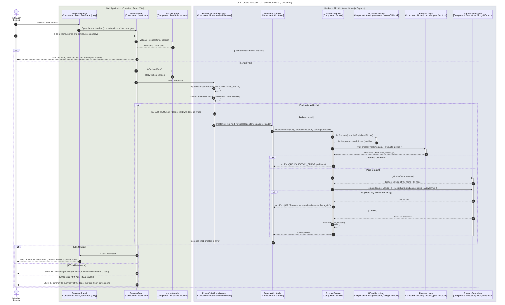

# UC1 - Create Forecast

| Attribute | Value |
|---|---|
| C4 view | Dynamic diagram, Level 3 (Component) |
| SAD view | Process View, Level 3 |
| Containers | Web Application, Back-end API, Database |
| Endpoint | `POST /forecasts` |
| Allowed roles | MANAGER (permission `forecasts:write`) |
| Success response | 201 Created, forecast DTO `{ id, name, version, startDate, endDate, entries[], isActive }` with the version assigned by the back end (1 for a new name) |
| Error handling | 400 `BAD_REQUEST` (body rejected by Joi: missing field, date not `YYYY-MM-DD`, id not 24 hex, quantity not an integer ≥ 0), 400 `VALIDATION_ERROR` (business rules, every problem at once), 409 `CONFLICT` (the same version was saved by a concurrent request: try again), 401/403 (no valid token or no permission). Validation errors carry `details` `[{ field, type, message }]`. |
| ADRs | [ADR-0033](../../adr/0033-immutable-versioned-forecasts-and-supplier-scenarios.md), [ADR-0005](../../adr/0005-contract-first-rest-api.md), [ADR-0018](../../adr/0018-internationalization-of-the-web-application-%28english-and-portuguese%29.md) |

## Description

In the Forecasts tab, the Manager presses "New forecast" and fills in the name, the start and end dates and the daily entries. Each entry has a date, a product, a size and a quantity. The product list offers only active, sellable products (`buildProductOptions`, fed by `GET /products?sellable=true&isActive=true`, `GET /predefined-pizzas` and `GET /pizza-size`). A predefined pizza offers only its own sizes, and the size is chosen automatically when there is only one. Other products have no size. "Duplicate" copies an entry to the next day and "Remove" deletes it. The form states that omitted entries mean zero consumption.

On Save, `validateForecast` checks the form with the same rules and codes as the back end (required fields, real dates, end not before start, at least one entry, dates inside the period, known product, size required or not applicable, integer quantity ≥ 0, no duplicate date/product/size). If there is a problem, the fields are marked, the first invalid one gets the focus and no request is sent. Otherwise `toPayload` builds the body, without `version`, and the form sends `POST /forecasts`.

The Back-end API:

1. **Authorization:** `requirePermission(Permission.FORECASTS_WRITE)` authenticates the token and checks the permission.
2. **Joi (`forecastSchema`, `abortEarly: false`, `stripUnknown`):** `name`, `startDate`, `endDate` (`YYYY-MM-DD`) and `entries[]` with `date`, `productId` (24 hex), optional `sizeId` (24 hex or `null`) and `quantity` (integer ≥ 0). A `version` in the body is accepted (integer ≥ 1) but ignored.
3. **Business rules:** `createForecast` reads the active products and predefined pizzas through the catalogue reader (`AiDataRepository`) and calls `findForecastProblems`, which returns every problem with its field (`entries[2].sizeId`) and code (`dateInvalid`, `periodInvalid`, `noEntries`, `dateOutside`, `productUnknown`, `sizeRequired`, `sizeIncompatible`, `duplicate`).
4. **Version:** `forecastRepository.getLatestVersion(name)` returns the highest version of the name, ignoring case and counting inactive versions, or 0. The forecast is created with that number + 1, `sizeId: null` when absent and `isActive: true`. The unique index `{ name, version }` turns a concurrent save into 409.

On 201 the page shows the toast "“name” vN was saved.", refreshes the list and opens the detail of the new version. On a validation error the violations are shown per field: the page turns `entries[0].date` into `entries.0.date` and translates the codes (`feedback.validation.ai_<code>`). The errors are also listed in the summary at the top of the form (`FormErrors`), which shows any other failure too, because WEB07 requests are `silent` (no global toast).

Saving a forecast with an existing name is [UC3 - Edit Forecast (new version)](./edit-forecast.md).

## Diagram

See the [README](./README.md) for the notation key and the element catalogue.
