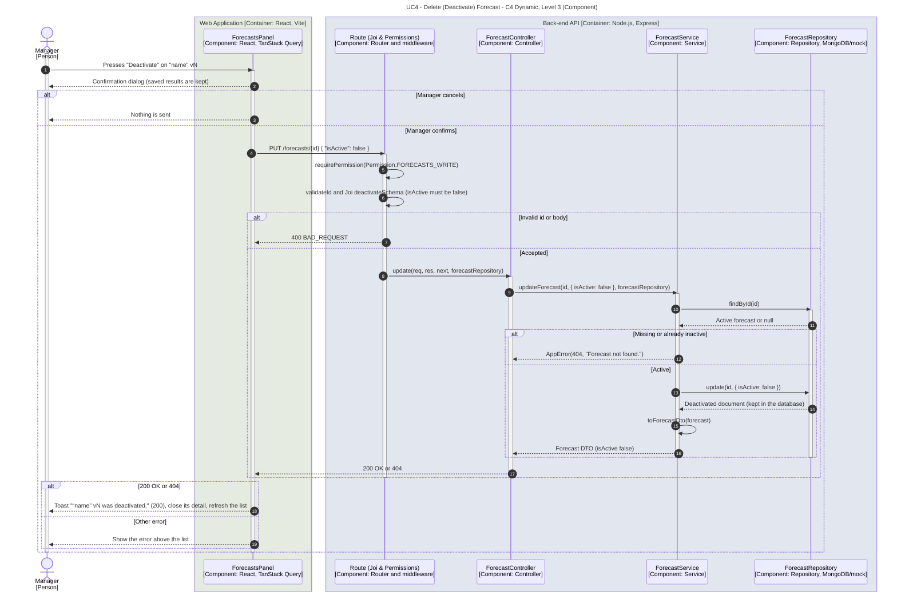

# UC4 - Delete (Deactivate) Forecast

| Attribute | Value |
|---|---|
| C4 view | Dynamic diagram, Level 3 (Component) |
| SAD view | Process View, Level 3 |
| Containers | Web Application, Back-end API, Database |
| Endpoint | `PUT /forecasts/{id}` with body `{ "isActive": false }` |
| Allowed roles | MANAGER (permission `forecasts:write`) |
| Success response | 200 OK, forecast DTO with `isActive: false` |
| Error handling | 400 `BAD_REQUEST` (invalid id format, or a body other than `{ "isActive": false }`: "Only deactivation is supported: isActive must be false"), 404 `NOT_FOUND` "Forecast not found." (unknown or already inactive), 401/403 |
| ADRs | [ADR-0033](../../adr/0033-immutable-versioned-forecasts-and-supplier-scenarios.md) |

## Description

Deleting a forecast is a soft delete. The Manager presses "Deactivate" on a version and the page asks for confirmation in a dialog: "Deactivate “name” vN? It is no longer listed nor used in new calculations. Saved results are kept." Cancelling sends nothing.

On confirmation the page sends `PUT /forecasts/{id}` with `{ "isActive": false }`. The route checks the permission, the id format and the body: the Joi schema accepts only `isActive: false`. `updateForecast` checks the value again, loads the forecast (404 if it does not exist or is already inactive) and sets `isActive: false`.

The document stays in the database. It is no longer listed, `GET /forecasts/{id}` answers 404, and an execution that asks for it answers 404 `FORECAST_NOT_FOUND`. Saved planning runs keep its `{ id, name, version }`, so their results are still consulted in [UC10](./consult-planning-results.md). Because `getLatestVersion` counts inactive versions, the version number is never given to a new forecast.

On success the page shows "“name” vN was deactivated.", refreshes the list and closes the detail if it showed that version. A 404 also refreshes the list, since it means that the version was already deactivated elsewhere. Other errors are shown above the list.

## Diagram

See the [README](./README.md) for the notation key and the element catalogue.
