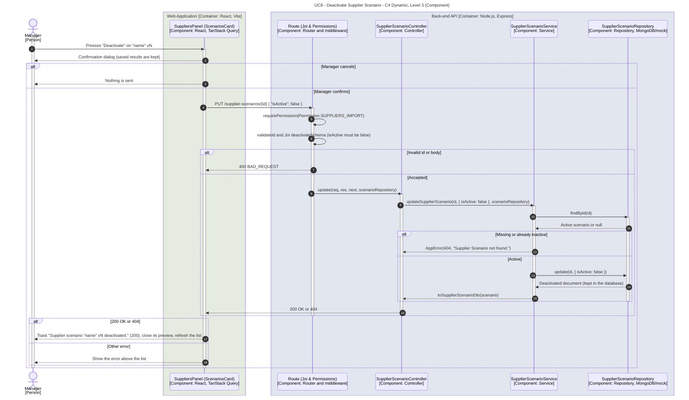

# UC8 - Deactivate Supplier Scenario

| Attribute | Value |
|---|---|
| C4 view | Dynamic diagram, Level 3 (Component) |
| SAD view | Process View, Level 3 |
| Containers | Web Application, Back-end API, Database |
| Endpoint | `PUT /supplier-scenarios/{id}` with body `{ "isActive": false }` |
| Allowed roles | MANAGER (permission `suppliers:import`) |
| Success response | 200 OK, supplier scenario DTO with `isActive: false` |
| Error handling | 400 `BAD_REQUEST` (invalid id format, or a body other than `{ "isActive": false }`), 404 `NOT_FOUND` "Supplier Scenario not found." (unknown or already inactive), 401/403 |
| ADRs | [ADR-0046](../../adr/0046-immutable-versioned-forecasts-and-supplier-scenarios.md) |

## Description

Same soft delete as [UC4](./deactivate-forecast.md), for supplier scenarios. In `ScenariosCard` the Manager presses "Deactivate" and confirms the dialog "Deactivate “name” vN? It is no longer used in new calculations. Saved results are kept." The page sends `PUT /supplier-scenarios/{id}` with `{ "isActive": false }`. The route checks the permission, the id and the body (only `isActive: false`), and `updateSupplierScenario` loads the scenario (404 if missing or already inactive) and sets `isActive: false`.

The document stays in the database. It is no longer listed nor offered in the execution form, it is no longer the default scenario of an execution (the back end takes the most recently created active one), and an execution that asks for it by id answers 404 `SUPPLIER_SCENARIO_NOT_FOUND`. Saved runs keep its `{ id, name, version }`. The version number is never reused.

On success the page shows "Supplier scenario “name” vN deactivated.", refreshes the list and closes the preview if it showed that scenario. A 404 also refreshes the list (already deactivated elsewhere); other errors are shown above the list.

## Diagram

See the [README](./README.md) for the notation key and the element catalogue.
