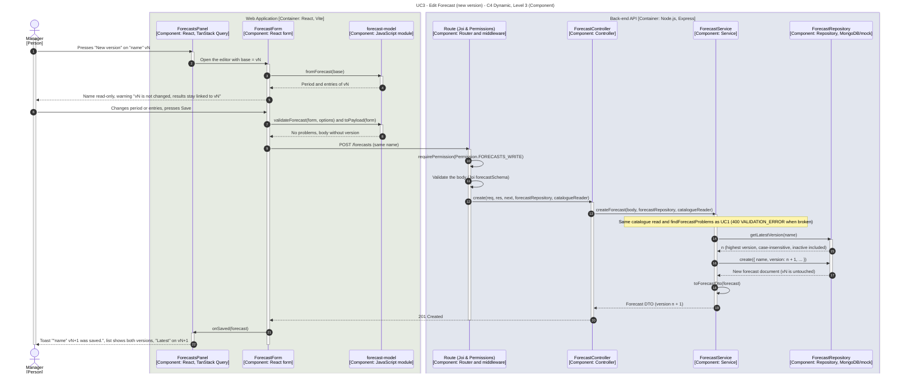

# UC3 - Edit Forecast (new version)

| Attribute | Value |
|---|---|
| C4 view | Dynamic diagram, Level 3 (Component) |
| SAD view | Process View, Level 3 |
| Containers | Web Application, Back-end API, Database |
| Endpoint | `POST /forecasts` with the name of the edited forecast |
| Allowed roles | MANAGER (permission `forecasts:write`) |
| Success response | 201 Created, forecast DTO with `version` = highest version of the name + 1 |
| Error handling | Same as [UC1](./create-forecast.md): 400 `BAD_REQUEST` (Joi), 400 `VALIDATION_ERROR` (business rules), 409 `CONFLICT` (concurrent save), 401/403 |
| ADRs | [ADR-0046](../../adr/0046-immutable-versioned-forecasts-and-supplier-scenarios.md), [ADR-0047](../../adr/0047-recording-planning-runs-with-their-input-versions.md) |

## Description

Forecasts are immutable, so editing one never changes it: it saves the next version of the same name. "New version" (in a row of the list or in the detail) opens `ForecastForm` with `base` set to the chosen version. `fromForecast(base)` prefills the period and the entries. The name is read-only, the title is "New version of “name” (vN+1)" and a warning says that vN is not changed and that the results already calculated stay linked to vN.

The Manager changes the period or the entries and presses Save. From there the flow is the one of [UC1](./create-forecast.md): the same checks in the browser, `POST /forecasts` without `version`, the same Joi schema and the same `findForecastProblems` rules. The only difference is in the version: `getLatestVersion(name)` finds the existing versions of the name (case-insensitive, inactive ones included) and the new document gets the next number. The version that was edited, and any older one, stay in the database exactly as they were.

Because each planning run records the `{ id, name, version }` of the forecast it used ([UC10](./consult-planning-results.md)), the results calculated before the edit still point to the old version and keep their meaning.

The page also accepts a new forecast typed with a name that already exists. The back end then creates the next version of that name in the same way.

## Diagram

The error branches (Joi, business rules, 409) are the same as in [UC1](./create-forecast.md).

See the [README](./README.md) for the notation key and the element catalogue.
