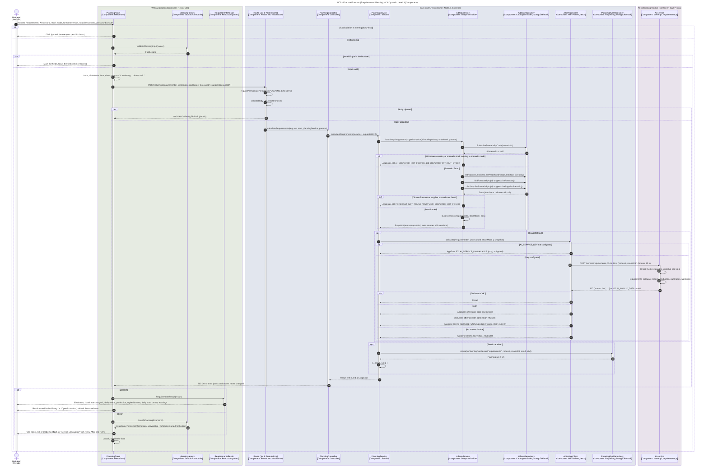

# UC9 - Execute Forecast (Requirements Planning)

| Attribute | Value |
|---|---|
| C4 view | Dynamic diagram, Level 3 (Component) |
| SAD view | Process View, Level 3 |
| Containers | Web Application, Back-end API, Database, AI Scheduling Module |
| Endpoint | `POST /planning/requirements` with body `{ scenarioId, stockMode, forecastId?, supplierScenarioId? }` |
| Allowed roles | MANAGER (permission `planning:execute`) |
| Success response | 200 OK, result of the AI Scheduling Module plus `runId`: `{ status: "ok", simulation: true, calculatedAt, scenario, inputs, plan, summary, requirements[], production[], purchases[], warnings[], runId }` |
| Error handling | 400 `VALIDATION_ERROR` (body: `scenarioId` must match `^[A-Z0-9-]{1,64}$`, `stockMode` `live` or `scenario`, ids 24 hex), 400 `SCENARIO_WITHOUT_STOCK` (`stockMode: "scenario"` on an AI scenario without stock), 404 `AI_SCENARIO_NOT_FOUND`, 404 `FORECAST_NOT_FOUND` / `SUPPLIER_SCENARIO_NOT_FOUND` (unknown or inactive id), 422 `AI_INVALID_DATA` (the data needed is invalid or incomplete, `details.problems`, for example `MISSING_FORECAST`), 503 `AI_SERVICE_UNAVAILABLE` (`details.reason`: `not_configured`, `connection_failed`, `invalid_ai_response`, `service_auth_failed`, `ai_service_error`; header `Retry-After: 5`), 504 `AI_SERVICE_TIMEOUT`, 401/403 |
| ADRs | [ADR-0034](../../adr/0034-recording-planning-runs-with-their-input-versions.md), [ADR-0036](../../adr/0036-synchronous-ai-execution-with-duplicate-submission-guard.md) |

## Description

The Manager opens the Execution tab, or presses "Run with this forecast" in a forecast detail, which opens the tab with the requirements calculation, live stock and that forecast version already selected. The form (`PlanningPanel`) asks for the calculation (Requirements; BOM is the AI05 calculation), the AI scenario code (for example `DEMO-PARTIAL`, typed in upper case), the stock mode (the AI scenario's own stock or the current stock), the forecast version and the supplier scenario. The last two lists show the active versions and default to "Latest active forecast" and "Latest active supplier scenario". If they cannot be loaded, the page says that the latest active ones will be used.

On Execute, the page:

1. Ignores the click if a calculation is already running. The lock is a `useRef`, so two clicks in the same tick cannot both start a request.
2. Checks the input with `validatePlanningInput` (same rules as the Joi schema) and focuses the first invalid field.
3. Disables the form and the button and shows a `<progress>` bar with "Calculating... please wait.", then sends `toPlanningRequest`: the forecast and supplier scenario ids only when chosen. The request is `silent` and has a 30 s timeout.

The Back-end API:

1. **Authorization and body:** `requirePermission(Permission.PLANNING_EXECUTE)` and `validateBody` (Joi, `stripUnknown`; `400 VALIDATION_ERROR`).
2. **Snapshot:** `planningService.calculateRequirements(params, { requestedBy })` calls `loadSnapshot`, which is `getSnapshot(aiDataRepository, undefined, params)`. It loads the AI scenario by code (404 `AI_SCENARIO_NOT_FOUND`), rejects `stockMode: "scenario"` when the AI scenario has no stock (400 `SCENARIO_WITHOUT_STOCK`), and reads in parallel the products, sizes, predefined pizzas, the live stock (only in `live` mode), the forecast and the supplier scenario. A given id must be an active document (404 `FORECAST_NOT_FOUND` or `SUPPLIER_SCENARIO_NOT_FOUND`); without an id the most recently created active one is used, and there may be none. `buildScenarioSnapshot` assembles catalogue and BOM, stock, the orders of the AI scenario, forecast and supplier scenario, and `meta` with the `snapshotId` (hash of the content) and the sources: `catalogue.version` (hash of the catalogue and BOM), `stock` (`backend-live` or `scenario`), `forecast` and `supplierScenario` with their id, name and version.
3. **Calculation:** `aiServiceClient.calculate('requirements', { scenarioId, stockMode }, snapshot)` sends `POST {AI_SERVICE_URL}/service/requirements` with `X-Api-Key` (the user's token is never forwarded) and the body `{ request, snapshot }`, and waits at most 15 s. The AI Scheduling Module checks the key, loads the snapshot into the knowledge base and runs `requirements_calculate` (calculation and supplier selection rules in [AI02](../ai-requirements-planning/README.md#calculation-rules)). The client maps its answers: 200 with `status: "ok"` is the result, 422 keeps its code and details, 401/403 become 503 `service_auth_failed`, any other answer becomes 503, a refused connection 503 `connection_failed`, a timeout 504. Without `AI_SERVICE_KEY` the back end answers 503 `not_configured` without calling the service.
4. **Run:** only after a successful result, `planningRunRepository.create(toPlanningRunRecord(...))` saves the run with the versions taken from the snapshot ([UC10](./consult-planning-results.md)). The answer is the result plus `runId`. A failure saves nothing.

Nothing in this flow writes stock or purchase orders: the result has `simulation: true` and the only document written is the planning run. Without a supplier scenario the calculation still runs, with the warning `NO_SUPPLIER_SCENARIO` and every shortage unmet with the reason `NO_SUPPLIER_OFFER`.

On success the page shows "Result saved in the history." with "Open in results", refreshes the saved runs and renders `RequirementsResult`: "Simulation", "Calculation only. Stored stock was not changed and no purchase order was created.", the forecast version, the reference date and the total cost, daily needs, production, replenishment by product (covered, status on time, late, partially covered or not covered), the daily plan (day, item, quantity, supplier, unit price, cost, delivery date with a "Late" tag, unmet quantity and reason) and the warnings. `classifyPlanningError` maps a failure to one state: invalid input (400 and the 404 codes, shown on the field), missing information (422, with the list of problems), service unavailable (503, 504, network or timeout: "Nothing was calculated nor changed.", the `Retry-After` time and a Retry button), forbidden (403) or unauthenticated (401).

## Diagram

See the [README](./README.md) for the notation key and the element catalogue.
