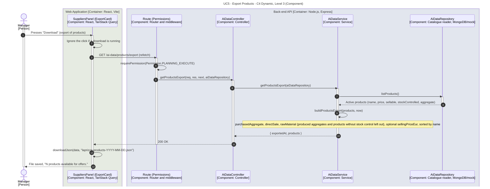

# UC5 - Export Products

| Attribute | Value |
|---|---|
| C4 view | Dynamic diagram, Level 3 (Component) |
| SAD view | Process View, Level 3 |
| Containers | Web Application, Back-end API, Database |
| Endpoint | `GET /ai-data/products/export` |
| Allowed roles | MANAGER (permission `planning:execute`) |
| Success response | 200 OK `{ "exportedAt": "<ISO date>", "products": [{ id, name, kind, stockUnit, sellable, sellingPriceEur? }] }` |
| Error handling | 401/403 (no valid token or no permission); no business errors |
| ADRs | [ADR-0035](../../adr/0035-supplier-import-with-client-side-checks-and-server-dry-run.md) |

## Description

The export is the starting point to prepare a supplier file, by hand or with an LLM ([Supplier Scenario JSON Format](./supplier-json-format.md)). When the Suppliers tab opens, `SuppliersPanel` loads the export once: the page uses it to show product names in the previews, to count the products available for offers and to list the products without a supplier. "Download" in `ExportCard` always fetches it again (`query.refetch()`) and saves the answer as `laprizza-products-YYYY-MM-DD.json`.

The Back-end API checks the permission and calls `getProductsExport(aiDataRepository)`, which reads the active products (`listProducts`) and builds the export with `buildProductsExport(products, now)`:

| Product | `kind` | In the export |
|---|---|---|
| Aggregate with `classification: "PURCHASED"` | `purchasedAggregate` | Yes |
| Aggregate with `classification: "PRODUCED"` | - | No, it is made in-house |
| Stock-controlled and sellable | `directSale` | Yes |
| Stock-controlled and not sellable | `rawMaterial` | Yes |
| Not stock-controlled (for example a pizza) | - | No |

Each row has `id`, `name`, `kind`, `stockUnit: "abstract stock unit"` and `sellable`. `sellingPriceEur` is added only for a sellable product with a positive price; a missing price never excludes a product. The rows are sorted by name (then id) and `exportedAt` is the ISO time of the export. The export reads data only.

## Diagram

See the [README](./README.md) for the notation key and the element catalogue.
