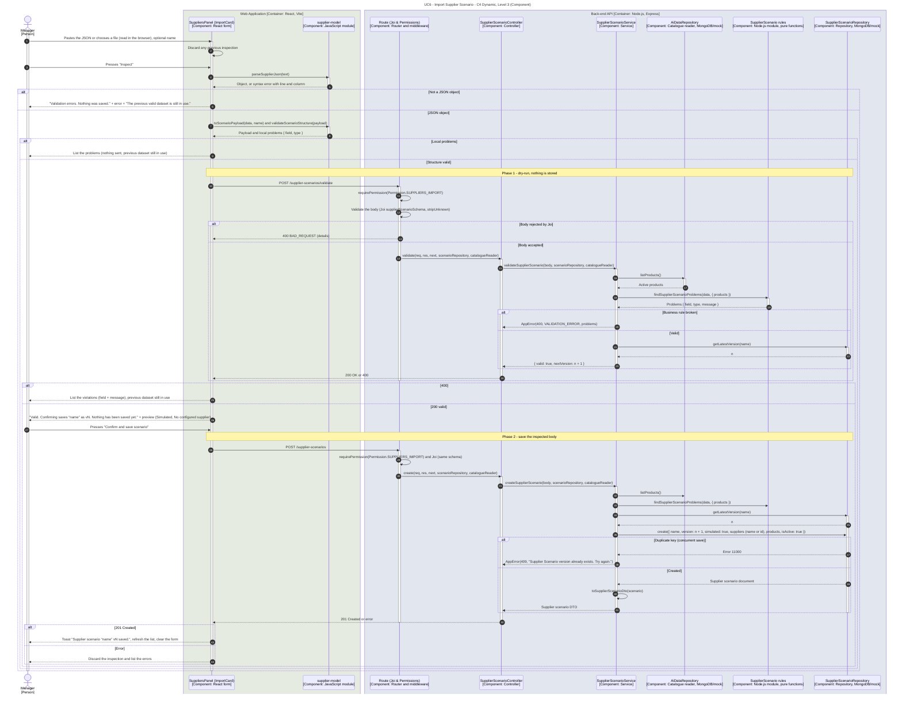

# UC6 - Import Supplier Scenario (inspect and confirm)

| Attribute | Value |
|---|---|
| C4 view | Dynamic diagram, Level 3 (Component) |
| SAD view | Process View, Level 3 |
| Containers | Web Application, Back-end API, Database |
| Endpoints | `POST /supplier-scenarios/validate` (dry-run, nothing stored), `POST /supplier-scenarios` (save) |
| Allowed roles | MANAGER (permission `suppliers:import`) |
| Success response | 200 OK `{ "valid": true, "nextVersion": n }` (dry-run), 201 Created, supplier scenario DTO with `version` and `simulated: true` (save) |
| Error handling | 400 `BAD_REQUEST` (Joi: missing field, wrong type, invalid value), 400 `VALIDATION_ERROR` (business rules: `supplierIdDuplicate`, `productUnknown`, `productDuplicate`, `offerSupplierUnknown`, `offerDuplicate`), 409 `CONFLICT` (concurrent save), 401/403. Validation errors carry `details` `[{ field, type, message }]`. |
| ADRs | [ADR-0033](../../adr/0033-immutable-versioned-forecasts-and-supplier-scenarios.md), [ADR-0035](../../adr/0035-supplier-import-with-client-side-checks-and-server-dry-run.md) |

The accepted JSON format is described in [Supplier Scenario JSON Format](./supplier-json-format.md).

## Description

In `ImportCard` the Manager pastes the JSON in a text area or chooses a file, which is read in the browser (`file.text()`) into the same text area. A scenario name can be typed; when it is empty the `name` of the file is used, and an existing name creates its next version. Any change to the text or to the name discards a previous inspection, so only what was inspected can be confirmed.

**Inspect** runs three checks, in order, and stops at the first that fails:

1. `parseSupplierJson(text)`: the text must be one JSON object. A syntax error is reported with its line and column.
2. `toScenarioPayload(data, name)` builds the body (name from the page or the file, `suppliers`, `products`; `version` and `simulated` are not sent) and `validateScenarioStructure(payload)` checks it with the same paths and types as the back end: required fields, ids, numbers and their limits, duplicate suppliers, products and offers, offers from unlisted suppliers. Whether a product exists is left to the server.
3. `POST /supplier-scenarios/validate`: the back end runs the same Joi schema and the same business rules as the save (`assertValidScenario`: active products from the catalogue reader, then `findSupplierScenarioProblems`), stores nothing and returns the version the scenario would get (`getLatestVersion(name) + 1`).

When the inspection passes, the page shows "Valid. Confirming saves “name” as vN. Nothing has been saved yet.", a summary (suppliers, offers, products without supplier) and the preview (`SupplierPreview`): one row per offer with price, units, price per unit, lead time, limit and the tag "Simulated", plus a "No configured supplier" row for every product without offers, including exported products missing from the file. Problems are listed under "Validation errors. Nothing was saved." with their field and translated message, followed by "The previous valid dataset is still in use."

**Confirm** sends the inspected body to `POST /supplier-scenarios`. The back end checks it again (Joi and rules), assigns the next version, gives each supplier without a name its id as name and stores the scenario with `simulated: true` and `isActive: true`. The page shows "Supplier scenario “name” vN saved.", refreshes the list and clears the form. If the save fails, the inspection is discarded and the errors are shown in the same way.

A rejected file never stores anything, so the scenario used by the executions (the latest active one, unless another is chosen) stays the same.

## Diagram

See the [README](./README.md) for the notation key and the element catalogue.
