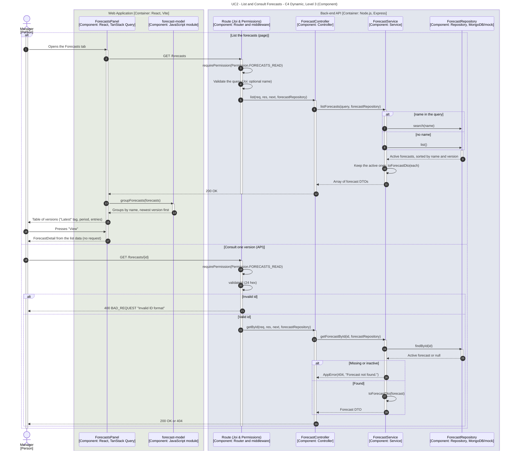

# UC2 - List and Consult Forecasts

| Attribute | Value |
|---|---|
| C4 view | Dynamic diagram, Level 3 (Component) |
| SAD view | Process View, Level 3 |
| Containers | Web Application, Back-end API, Database |
| Endpoints | `GET /forecasts[?name=]` (list, optional search by name), `GET /forecasts/{id}` (one version) |
| Allowed roles | MANAGER (permission `forecasts:read`) |
| Success response | 200 OK, array of forecast DTOs (active versions only) or one forecast DTO |
| Error handling | 400 `BAD_REQUEST` (invalid query or id format), 404 `NOT_FOUND` "Forecast not found." (unknown or inactive id), 401/403 (no valid token or no permission) |
| ADRs | [ADR-0046](../../adr/0046-immutable-versioned-forecasts-and-supplier-scenarios.md) |

## Description

When the Forecasts tab opens, `ForecastsPanel` loads the forecasts (`GET /forecasts`) and the catalogue it needs to show names (sellable products, predefined pizzas and sizes). The back end returns only active versions: `forecastRepository.list()` filters `isActive != false` and sorts by name and version, and `listForecasts` filters again before mapping each one with `toForecastDto`. With `?name=` the repository searches by name (case-insensitive regular expression, escaped).

`groupForecasts` groups the versions by name, ignoring case like the back-end versioning, with the newest version first and the tag "Latest" when there is more than one. Each row shows the version, the period, the number of entries and days, and the actions View, New version and Deactivate.

"View" opens `ForecastDetail` with the DTO already in the list. No extra request is made. The detail shows the period, the days with consumption, the total quantity, the id, the note "Omitted entries mean zero consumption" and the entries sorted by date and product name, plus the buttons "Run with this forecast" ([UC9](./execute-forecast.md)) and "New version" ([UC3](./edit-forecast.md)).

`GET /forecasts/{id}` returns one version and is available through the API. It answers 400 when the id is not 24 hex characters and 404 when the forecast does not exist or is inactive (`getForecastById`).

## Diagram

See the [README](./README.md) for the notation key and the element catalogue.
