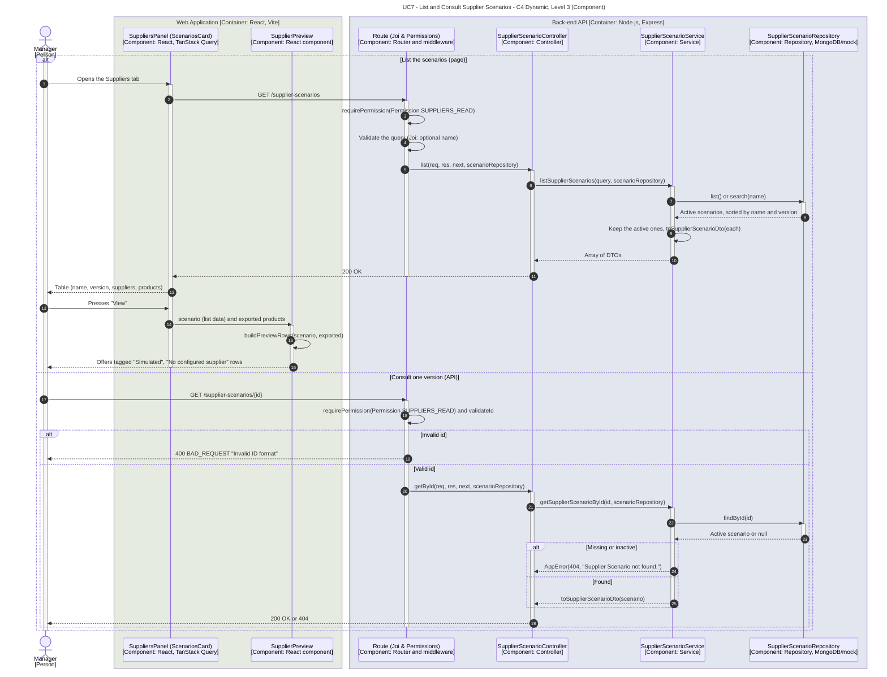

# UC7 - List and Consult Supplier Scenarios

| Attribute | Value |
|---|---|
| C4 view | Dynamic diagram, Level 3 (Component) |
| SAD view | Process View, Level 3 |
| Containers | Web Application, Back-end API, Database |
| Endpoints | `GET /supplier-scenarios[?name=]` (list, optional search by name), `GET /supplier-scenarios/{id}` (one version) |
| Allowed roles | MANAGER (permission `suppliers:read`) |
| Success response | 200 OK, array of supplier scenario DTOs (active versions only) or one DTO `{ id, name, version, simulated, suppliers[], products[], isActive }` |
| Error handling | 400 `BAD_REQUEST` (invalid query or id format), 404 `NOT_FOUND` "Supplier Scenario not found." (unknown or inactive id), 401/403 |
| ADRs | [ADR-0046](../../adr/0046-immutable-versioned-forecasts-and-supplier-scenarios.md) |

## Description

`ScenariosCard`, in the Suppliers tab, loads `GET /supplier-scenarios`. As for the forecasts, the repository returns only active versions sorted by name and version (or searches by name, case-insensitive), the service filters the active ones again and maps them with `toSupplierScenarioDto` (an offer without `supplyLimit` has no such field). The card explains that a calculation uses the scenario chosen in the execution, by default the latest one, and shows for each version its name, version, number of suppliers and number of products, with View and Deactivate.

"View" shows the scenario with `SupplierPreview`, built from the list data and the product export loaded by the tab ([UC5](./export-products.md)): one row per offer with supplier name, price, stock units, price per unit, lead time, supply limit ("No limit" when absent) and the tag "Simulated", and a "No configured supplier" row for every product of the scenario without offers and every exported product that the scenario does not mention.

`GET /supplier-scenarios/{id}` is available through the API: 400 for an id that is not 24 hex characters and 404 when the scenario does not exist or is inactive (`getSupplierScenarioById`).

## Diagram

See the [README](./README.md) for the notation key and the element catalogue.
