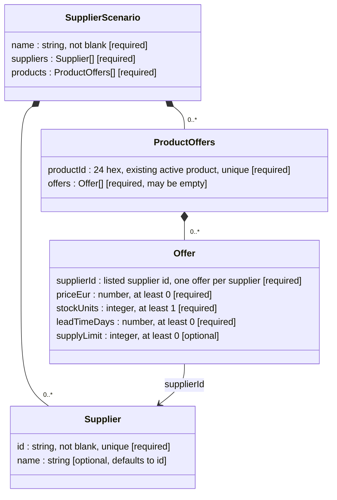

# Supplier Scenario - JSON Format

A supplier scenario is the supplier data used by the requirements planning: who sells each product, at what price, in which quantity and with which lead time. It is prepared by hand or with an LLM from the product export ([UC5](./export-products.md)), then imported on the page ([UC6](./import-supplier-scenario.md)). The format is validated by the Joi schema of `supplier-scenario.routes.js` and by `findSupplierScenarioProblems` (`supplier-scenario.rules.js`), and checked in the browser first by `validateScenarioStructure` (`supplier-model.js`).

All offers come from prepared files, so every saved scenario is marked `simulated: true`.

## Input: product export

`GET /ai-data/products/export` returns the products that can be bought:

```json
{
  "exportedAt": "<ISO date and time>",
  "products": [
    { "id": "<24 hex>", "name": "<raw material>", "kind": "rawMaterial", "stockUnit": "abstract stock unit", "sellable": false },
    { "id": "<24 hex>", "name": "<product sold directly>", "kind": "directSale", "stockUnit": "abstract stock unit", "sellable": true, "sellingPriceEur": <price> }
  ]
}
```

| Property | Rule |
|---|---|
| `kind` | `rawMaterial` (stock-controlled, not sellable), `purchasedAggregate` (aggregate classified `PURCHASED`) or `directSale` (stock-controlled and sellable) |
| `stockUnit` | Always `"abstract stock unit"`: quantities are counted in the stock unit of each product |
| `sellingPriceEur` | Only for a sellable product with a positive price; optional, never excludes a product |

Produced aggregates and products without stock control (pizzas) are not exported, because they are not bought.

## Structure



| Property | Type | Rule | Checked by |
|---|---|---|---|
| `name` | string | Required, not blank. The name typed on the page wins over the file. An existing name (case-insensitive) creates its next version | Joi |
| `suppliers[].id` | string | Required, not blank, **unique** in the file (`supplierIdDuplicate`) | Joi, rules |
| `suppliers[].name` | string | Optional; when missing or blank the id is stored as name | Joi |
| `products[].productId` | string | Required, 24 hex characters, an **active product** (`productUnknown`), listed only once (`productDuplicate`) | Joi, rules |
| `products[].offers` | array | Required; `[]` means the product has no supplier | Joi |
| `offers[].supplierId` | string | Required, must be in `suppliers` (`offerSupplierUnknown`), at most one offer per supplier and product (`offerDuplicate`) | Joi, rules |
| `offers[].priceEur` | number | Required, ≥ 0 | Joi |
| `offers[].stockUnits` | integer | Required, ≥ 1 | Joi |
| `offers[].leadTimeDays` | number | Required, ≥ 0 | Joi |
| `offers[].supplyLimit` | integer | Optional, ≥ 0 | Joi |
| `version`, `simulated` | - | Ignored when present: the back end assigns the version and stores `simulated: true`. Other unknown properties are removed (`stripUnknown`) | Joi |

The page sends only `name`, `suppliers` and `products`. `productUnknown` is checked only by the server, which knows every active product.

## Example

```json
{
  "name": "Fornecedores demo",
  "suppliers": [
    { "id": "SUP-A", "name": "Fornecedor A" },
    { "id": "SUP-B", "name": "Fornecedor B" }
  ],
  "products": [
    {
      "productId": "<id of a product of the export>",
      "offers": [
        { "supplierId": "SUP-A", "priceEur": 12.5, "stockUnits": 50, "leadTimeDays": 2, "supplyLimit": 500 },
        { "supplierId": "SUP-B", "priceEur": 11, "stockUnits": 50, "leadTimeDays": 5 }
      ]
    },
    { "productId": "<id of another product of the export>", "offers": [] }
  ]
}
```

The page offers this example for download with real ids of the export (`buildExample`), so it is valid in the current database.

## Preparing the file with an LLM

The Suppliers tab shows a prompt (English or Portuguese) to give an LLM together with the product export and the supplier price lists. It asks for one JSON object in this format, only `productId` values from the export, at most one offer per supplier and product, `"offers": []` for a product that no supplier sells, and no guessed prices or lead times. The answer is pasted in the import area and always inspected before it can be saved.

## How the offers are read

| Component | Reading |
|---|---|
| Page preview (`buildPreviewRows`) and LLM prompt | `priceEur` is the price of one offer of `stockUnits` units; the preview shows the price per unit as `priceEur / stockUnits`. The prompt describes `supplyLimit` as a maximum number of packs |
| AI Scheduling Module (`kb.pl`, `requirements.pl`) | An offer arrives `ceiling(leadTimeDays)` days after the reference date. `supplyLimit`, when present, is the total the supplier can deliver for the product in the whole plan; otherwise the capacity is `stockUnits`. The cost of an allocation is `priceEur × quantity` |

The two readings of `priceEur` and `supplyLimit` are not the same in the current code; this table records them as implemented.

## Validation errors

A rejected file saves nothing and the previous scenario stays in use. Errors use `{ field, type, message }`:

| Step | Example `field` | Example `type` |
|---|---|---|
| Parse in the browser | - | `ai.jsonSyntaxAt` (with line and column), `ai.jsonNotObject`, `ai.jsonEmpty` |
| Structure (browser, then Joi, `400 BAD_REQUEST`) | `products.0.offers.1.priceEur` | `any.required`, `number.base`, `number.min`, `number.integer`, `string.hex` |
| Business rules (server, `400 VALIDATION_ERROR`) | `products[0].productId` | `productUnknown`, `productDuplicate`, `supplierIdDuplicate`, `offerSupplierUnknown`, `offerDuplicate` |

The page shows bracket paths in the dot form (`products.0.productId`) and translates the business codes as `feedback.validation.ai_<code>`.

## Related

- [UC5 - Export Products](./export-products.md)
- [UC6 - Import Supplier Scenario](./import-supplier-scenario.md)
- [UC7 - List and Consult Supplier Scenarios](./list-and-consult-supplier-scenarios.md)
- [README](./README.md)
