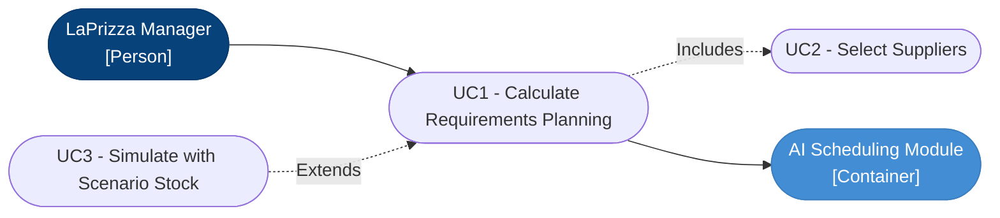

# AI Requirements Planning - Design Diagrams (Mermaid)

AI02 calculates, in Prolog, the **Requirements Planning** of a daily consumption forecast: the daily material needs derived from the forecast and the pizza BOM, the aggregates to produce, the daily net needs after the stock, and a purchase plan that proposes, for each product, the supplier of the confirmed supplier scenario, the quantity, the order date, the expected delivery date, the cost in EUR and the needs that stay uncovered.

- **Back end:** the forecasts and the supplier scenarios (prepared in WEB07), the planning snapshot that carries them with the catalogue, the BOM and the stock (`GET /ai-data/snapshot`, [AI06](../ai-knowledge-base/README.md)), and, from the Web Application, the call to the AI Scheduling Module and the record of the run (`POST /planning/requirements`, [WEB07 UC9](../ai-planning/execute-forecast.md), [AI05 UC2](../ai-service-access/README.md)).
- **AI Scheduling Module:** the calculation (`requirements.pl`), on the knowledge base loaded from the snapshot (`kb.pl`), exposed by the Prolog HTTP service on `POST /requirements` (pull, Manager token) and `POST /service/requirements` (push, service key).

Every calculation is a simulation (`simulation: true`): it never changes stored stock, including the stock of a scenario, and never creates purchase orders.

Process View (SAD), Level 3, documented as C4 dynamic diagrams of the **Back-end API** container (UC1) and of the **AI Scheduling Module** container (UC2).

## Use Cases

The use cases are described in the [Use Case Views](../../analysis/use-case-views.md#ai02-prolog-requirements-planning-and-supplier-selection).

## Diagrams

| Use case | Endpoint | Caller | Success | Document |
|---|---|---|---|---|
| [UC1 - Calculate Requirements Planning](./calculate-requirements-planning.md) | `POST /requirements` (AI Scheduling Module) → `GET /ai-data/snapshot` (back end) | MANAGER (token forwarded) | 200, requirements result | `calculate-requirements-planning.md` |
| [UC2 - Select Suppliers](./select-suppliers.md) | - (inside `requirements_calculate`) | AI Scheduling Module | `purchases[]` and `summary` of the result | `select-suppliers.md` |
| [UC3 - Simulate with Scenario Stock](./calculate-requirements-planning.md) | Same as UC1 with `stockMode: "scenario"` | MANAGER | 200, requirements result with the scenario stock | `calculate-requirements-planning.md` |

The same calculation started from the Web Application, through the back end with a service key and recorded as a planning run, is [WEB07 UC9 - Execute Forecast](../ai-planning/execute-forecast.md); its results are consulted with [WEB07 UC10](../ai-planning/consult-planning-results.md). The forecast and the supplier JSON formats are in [AI Planning](../ai-planning/README.md) and [Supplier Scenario JSON Format](../ai-planning/supplier-json-format.md).

## REST API summary

### Back end

| Method and path | Use case | Body / query | Success | Errors |
|---|---|---|---|---|
| `GET /ai-data/snapshot?scenarioId&stockMode[&forecastId&supplierScenarioId]` | UC1, UC3 | `scenarioId` `^[A-Z0-9-]{1,64}$`, `stockMode` `live` or `scenario`; `forecastId`, `supplierScenarioId` 24 hex (optional: without them, the most recently created active forecast and supplier scenario) | 200, scenario snapshot with `forecast` and `supplierScenario` ([format](../ai-knowledge-base/snapshot-format.md)) | 400 `BAD_REQUEST`, 401, 403, 404 `AI_SCENARIO_NOT_FOUND` / `FORECAST_NOT_FOUND` / `SUPPLIER_SCENARIO_NOT_FOUND`, 400 `SCENARIO_WITHOUT_STOCK` |
| `POST /planning/requirements` | WEB07 UC9 | `{ scenarioId, stockMode, forecastId?, supplierScenarioId? }` | 200, requirements result + `runId` | See [WEB07 UC9](../ai-planning/execute-forecast.md) |

`planning:execute` is granted only to MANAGER. Paths under `/api/v2` (`/api/v1` is a deprecated alias).

### AI Scheduling Module

| Method and path | Identity | Body | Success | Errors |
|---|---|---|---|---|
| `POST /requirements` | `Authorization: Bearer <Manager token>`, forwarded to the back end | `{ scenarioId, stockMode }` | 200, requirements result | 401 `TOKEN_MISSING`, 400 `VALIDATION_ERROR`, 401/403 of the back end (as received), 404 `AI_SCENARIO_NOT_FOUND`, 422 `AI_INVALID_DATA` (including `MISSING_FORECAST` when there is no active forecast, and `SCENARIO_WITHOUT_STOCK` rejected by the back end), 503 `AI_DATA_UNAVAILABLE`, 504 `AI_DATA_TIMEOUT` |
| `POST /service/requirements` | `X-Api-Key: <AI_SERVICE_KEY>` (back end only) | `{ request: { scenarioId, stockMode }, snapshot }` | 200, requirements result | 401 `SERVICE_UNAUTHORIZED`, 400 `VALIDATION_ERROR`, 422 `AI_INVALID_DATA` |

The pull path only sends `scenarioId` and `stockMode`, so the back end puts the active forecast and supplier scenario in the snapshot; choosing a saved forecast version or supplier scenario is done through the push path of the Web Application (WEB07 UC9). The service listens only on `127.0.0.1` (`AI_PORT`, 5000 by default). All the routes, requests and errors are in [AI Service Interface](../ai-service-access/service-interface.md).

## Calculation rules

`requirements_calculate/2,3` runs on the knowledge base of one snapshot ([ADR-0040](../../adr/0040-knowledge-base-loaded-per-calculation.md)) and follows [ADR-0055](../../adr/0055-requirements-planning-with-chronological-net-needs-and-on-time-cheapest-supplier.md):

1. **Validation first (phase A).** Every problem is collected: invalid request or a snapshot of another scenario (as in AI01), no forecast (`MISSING_FORECAST`), a forecast line of a pizza without a size or with a size the pizza does not have (`INVALID_SIZE`), a line with a size that is not a predefined pizza (`NOT_PREDEFINED_PIZZA`), an incomplete recipe (`INCOMPLETE_RECIPE`), an invalid reference date (`INVALID_SNAPSHOT`). With any problem there is no calculation (422, no quantities).
2. **Gross demand per day.** A forecast line with a size is a pizza: Σ (quantity × consumption of each component in that pizza and size). A line without a size is the direct demand of a directly sold product, one stock unit per unit sold.
3. **Produced aggregates, stock first.** The daily demand of a produced aggregate consumes its stock in date order; only what is left is produced (`production[].schedule`), and the quantities produced each day are expanded into its ingredients. A produced aggregate is never bought. A purchased aggregate is a product like the others.
4. **Net need per day.** For each stock-controlled product, the stock is consumed in date order: the need of a day is what the cumulative demand exceeds the stock by, minus what was already short on earlier days (`net_series/3`). A stock-controlled product needed without a stock entry is `MISSING_SCENARIO_STOCK` / `MISSING_STOCK` (422), never 0. Products without stock control have `null` balances and no needs.
5. **Purchase plan.** Every product with needs gets a purchase entry from the supplier selection (UC2, rules below).
6. **Warnings.** Without a supplier scenario every product is `unavailable` and the result carries the warning `NO_SUPPLIER_SCENARIO`.

### Supplier selection rules

| Rule | Implementation |
|---|---|
| Reference date | Purchases are placed on `plan.referenceDate`: the day of `meta.retrievedAt` (execution date), or the `today(Date)` option of `requirements_calculate/3` (historical simulations, Prolog only) |
| Arrival | `referenceDate + ceiling(leadTimeDays)` calendar days; on time when `arrivalDate <= forDate` (a need is due at the start of its day) |
| Common price basis | `unitPriceEur = priceEur / stockUnits`; cost = unit price × quantity, pro rata (no pack rounding, no minimum order) |
| Capacity | `supplyLimit` is the total for the whole plan (`0` = no capacity). Without it: unbounded and `capacityStated: false` on the allocation |
| Pass 1, on time | Needs in date order; the cheapest on-time offer, ties by earliest arrival and then supplier id |
| Pass 2, late | Needs still open take the capacity left: earliest arrival first, then the cheapest; `onTime: false` |
| Status | `on_time` (all on time), `late` (covered, some lines late), `partial` (part uncovered), `unavailable` (nothing covered) |
| Unmet | `{ date, quantity, reason }` with `NO_SUPPLIER_OFFER` (the product has no offer) or `INSUFFICIENT_SUPPLY` |
| Feasible | `summary.feasible` is `true` only when every product is `on_time` |

### Worked example (`sample-snapshot.json`)

Forecast `fc-week-1`: 40 Margherita M on 2026-11-02; 55 Margherita M and 20 Prosciutto L on 2026-11-03; 15 Margherita S on 2026-11-04. Reference date 2026-11-02. Stock: dough 50, mozzarella 3000, ham 500, flour 5000.

| Product | Gross demand (11-02 / 11-03 / 11-04) | Net need | Offers (unit price, arrival) | Plan | Status, cost |
|---|---|---|---|---|---|
| Dough (produced) | 40 / 75 / 15 | Produce 65 on 11-03 and 15 on 11-04 (cumulative 40, 115, 130 against 50) | - | Production, never bought | - |
| Flour (150 per dough) | 0 / 9750 / 2250 | 4750 on 11-03, 2250 on 11-04 | sup-b 8 / 1000 = 0.008, 11-05 | Both from sup-b, late | `late`, 56.00 EUR |
| Mozzarella (120 M, 160 L, 80 S) | 4800 / 9800 / 1200 | 1800, 9800, 1200 | sup-a 12.5 / 100 = 0.125, 11-04, no limit; sup-b 11.9 / 100 = 0.119, 11-06, limit 500 | Pass 1: 1200 for 11-04 from sup-a. Pass 2: 1800 and 9800 from sup-a (earliest arrival) | `late`, 12800 × 0.125 = 1600.00 EUR |
| Ham (60 per Prosciutto L) | 0 / 1200 / 0 | 700 on 11-03 | sup-a 9 / 50 = 0.18, 11-03 | 700 from sup-a, on time | `on_time`, 126.00 EUR |
| Tomato, mushrooms, yeast | - | Short | None | Nothing covered | `unavailable`, `NO_SUPPLIER_OFFER` |

`summary`: `productsToBuy: 6`, `totalCostEur: 1782`, `feasible: false`. Only the 80 doughs to produce are expanded into flour: the 50 in stock are not counted again. With the reference date 2026-10-29 every mozzarella need is on time and the cheapest on-time offer wins: sup-b gives its whole limit (500 for 11-02) and sup-a covers the rest, 500 × 0.119 + 12300 × 0.125 = 1597.00 EUR. These values are asserted by `test/requirements.plt`.

## Result format

| Field | Meaning |
|---|---|
| `status`, `simulation`, `calculatedAt` | `"ok"`, always `true`, calculation time |
| `scenario`, `inputs` | AI scenario (`id`, `name`, `version`, `stockMode`) and `{ snapshotId, sources }`: origin and version of the catalogue, stock, forecast and supplier scenario |
| `plan` | `{ forecastId, forecastName, version, startDate, endDate, referenceDate }` |
| `summary` | `{ totalCostEur, productsToBuy, feasible }` |
| `requirements[]` | Per product: `kind` (`simple`, `aggregate_purchased`), `stockControlled`, `required`, `available`, `shortage`, `needs[{ date, quantity }]` |
| `production[]` | Produced aggregates: `required`, `available`, `toProduce`, `schedule[{ date, quantity }]` |
| `purchases[]` | Per product: `shortage`, `covered`, `uncovered`, `costEur`, `status`, `allocations[{ supplierId, supplierName, forDate, quantity, unitPriceEur, costEur, arrivalDate, onTime, capacityStated }]`, `unmet[{ date, quantity, reason }]` |
| `warnings[]` | `NO_SUPPLIER_SCENARIO` |

An invalid calculation answers 422 `AI_INVALID_DATA` with `details { scenario, inputs, problems[] }` and no quantities.

## Business rules shown in the diagrams

- **The back end owns the data.** Forecasts, supplier scenarios, catalogue, BOM and stock reach the Prolog service only in the snapshot, never from the database ([ADR-0039](../../adr/0039-planning-snapshot-as-the-data-contract-with-the-ai-service.md)). Each offer keeps its product, price in EUR, quoted stock units and lead time.
- **No double counting.** The stock of a produced aggregate is used first, and only the part produced reaches its ingredients ([ADR-0052](../../adr/0052-product-aggregates-and-stock-first-bom-expansion.md)).
- **Dates first, then cost.** An offer that arrives on time always wins over a late one; among the on-time offers the cheapest unit price wins ([ADR-0055](../../adr/0055-requirements-planning-with-chronological-net-needs-and-on-time-cheapest-supplier.md)).
- **Capacity is never invented.** A stated limit is applied over the whole plan; a missing limit is flagged, not read as zero or as verified.
- **Missing data and unsuitable suppliers are explained.** Missing data answer 422 with every problem; needs without a suitable supplier are listed in `unmet`, and the plan is not feasible.
- **Calculation separate from stock and purchase orders.** Hypothetical balances and planned deliveries are results only; no stock is changed and no purchase order is created, so repeated requests create nothing. An operational order would need a separate explicit confirmation through the back end.
- **The user's token is never logged** by the AI Scheduling Module, and only the back end decides who may calculate (`planning:execute`).

## Related ADRs

| ADR | Decision | Status |
|---|---|---|
| [ADR-0055](../../adr/0055-requirements-planning-with-chronological-net-needs-and-on-time-cheapest-supplier.md) | Requirements planning with chronological net needs and the cheapest on-time supplier | Accepted |
| [ADR-0052](../../adr/0052-product-aggregates-and-stock-first-bom-expansion.md) | Product aggregates and stock-first BOM expansion | Accepted |
| [ADR-0033](../../adr/0033-immutable-versioned-forecasts-and-supplier-scenarios.md) | Immutable, versioned forecasts and supplier scenarios | Accepted |
| [ADR-0039](../../adr/0039-planning-snapshot-as-the-data-contract-with-the-ai-service.md) | Planning snapshot as the data contract with the AI service | Accepted |
| [ADR-0040](../../adr/0040-knowledge-base-loaded-per-calculation.md) | Knowledge base loaded per calculation | Accepted |
| [ADR-0046](../../adr/0046-permission-based-authorization-matrix.md) | Permission-based authorization (`planning:execute`) | Accepted |

## Notation key

| Notation | Meaning |
|---|---|
| Actor (stick figure) | Person using the system, with the role shown in the label |
| Shaded box "Back-end API" | Container (Node.js, Express) that holds the back-end components |
| Shaded box "AI Scheduling Module" | Container (SWI-Prolog) that holds the Prolog components (UC2) |
| Participant "AI Scheduling Module" | Container (SWI-Prolog), shown as a whole (UC1) |
| Participant "Database" | Container (MongoDB) |
| Participant label | `Name`, followed by `[Type: technology]` |
| Solid arrow | Call or request |
| Dashed arrow | Return value or response |
| Arrow to the same participant | Work done inside that participant |
| Number on an arrow | Order of the interaction (autonumber) |
| `alt` / `else`, `opt`, `loop`, `par` frames | Alternative, optional, repeated and parallel flows |
| `Note` | Remark or reference to another diagram |

## Element catalogue

| Element | Type | Technology | Responsibility | Used in |
|---|---|---|---|---|
| Manager | Person | - | Back-office user with the MANAGER role, the only one with `planning:execute` | [UC1](./calculate-requirements-planning.md) |
| Route (Joi & Permissions) | Component | Express router and middleware (`ai-data.routes.js`) | `requirePermission(Permission.PLANNING_EXECUTE)`, snapshot query schema | [UC1](./calculate-requirements-planning.md) |
| AiDataController | Component | Express controller | `getSnapshot`: passes the validated query to the service | [UC1](./calculate-requirements-planning.md) |
| AiDataService | Component | Node.js module | `getSnapshot` → `getScenarioSnapshot` (`loadForecast`, `loadSupplierScenario`) → `buildScenarioSnapshot`; errors 404 `AI_SCENARIO_NOT_FOUND`, `FORECAST_NOT_FOUND`, `SUPPLIER_SCENARIO_NOT_FOUND`, 400 `SCENARIO_WITHOUT_STOCK` | [UC1](./calculate-requirements-planning.md) |
| AiDataRepository | Component | Repository, MongoDB | `findActiveScenarioByCode`, `listProducts`, `listSizes`, `listPredefinedPizzas`, `listStock`, `getActiveForecast`, `findForecastById`, `getActiveSupplierScenario`, `findSupplierScenarioById` | [UC1](./calculate-requirements-planning.md) |
| Database | Container | MongoDB | Catalogue, BOM, stock, AI scenarios, forecasts, supplier scenarios | [UC1](./calculate-requirements-planning.md) |
| AI Scheduling Module | Container | SWI-Prolog | Validates the request, gets the snapshot, loads the knowledge base and calculates the plan | [UC1](./calculate-requirements-planning.md) |
| AI HTTP Server | Component | SWI-Prolog `server.pl` | `POST /requirements` (`authenticated/4`, `plan_request/5`, `fetch_with_deadline/3`), `POST /service/requirements`, error mapping | [UC1](./calculate-requirements-planning.md), [UC2](./select-suppliers.md) |
| Knowledge Base | Component | SWI-Prolog `kb.pl` | `with_snapshot/2`: validates and loads the snapshot as facts for one calculation, then clears them | [UC1](./calculate-requirements-planning.md), [UC2](./select-suppliers.md) |
| Requirements Planning | Component | SWI-Prolog `requirements.pl` | `requirements_calculate/2,3`: validation, gross demand, production, net needs (`net_series/3`), purchase plan (`purchase_entry/3`, `offers_state/3`, `allocate_all/4`), result | [UC1](./calculate-requirements-planning.md), [UC2](./select-suppliers.md) |

## Notes

- **Historical simulations.** The reference date can be set with `today(Date)` only when `requirements_calculate/3` is called from Prolog (tests, top level). The HTTP routes always use the execution date (`meta.retrievedAt` of the snapshot).
- **Order date.** Every allocation is ordered on `plan.referenceDate`; the allocations carry `forDate` and `arrivalDate` but no field of their own for the order date.
- **Units.** All products share one abstract stock unit (`stockUnit: "abstract stock unit"` in the product export of WEB07), so needs and offers are always compared in the same unit and incompatible units are not flagged.
- **Execution.** From `ai-scheduling/`: `swipl -q -g "(run_tests([needs, suppliers, validation]) -> halt(0) ; halt(1))" test/requirements.plt`. `requirements_print_file/1` prints the plan of a snapshot file that includes `scenario` and `pizzas`.
- Tests:
  - Prolog (`ai-scheduling/run-tests.sh`): `test/requirements.plt` (groups `needs`, `suppliers`, `validation`: chronological net needs, aggregates stock first, direct demand, unit price, cheapest on-time offer, cumulative and zero limits, unbounded and flagged offers, late offers, late capacity never replacing an on-time need, products without offers, summary, missing forecast, invalid sizes, missing stock, invalid reference date, no supplier scenario, empty knowledge base after the calculation), `test/service.plt` (`/service/requirements`), `test/kb.plt` (forecast and supplier facts).
  - Back end: `test/application/ai-data.service.test.js` (forecast and supplier scenario in the snapshot), `test/planning/planning.service.test.js`.
  - httpyac: `backend/test-flows/planning-test-flow.http` (push path, stock unchanged).
