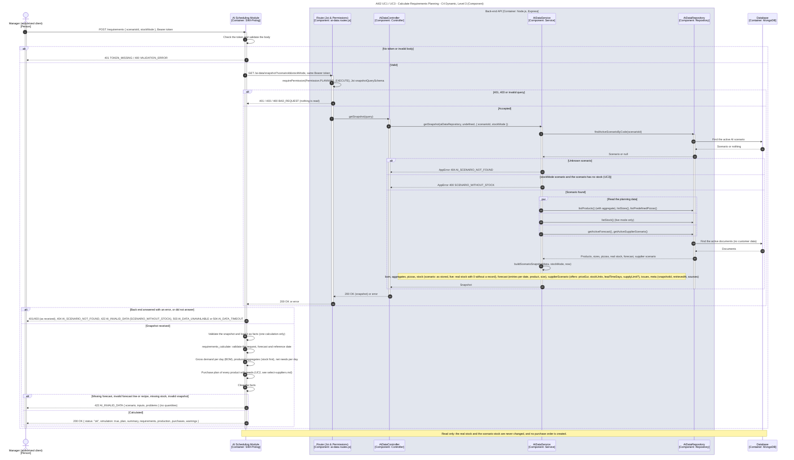

# AI02 UC1 / UC3 - Calculate Requirements Planning (with Scenario Stock)

| Attribute | Value |
|---|---|
| C4 view | Dynamic diagram, Level 3 (Component) |
| SAD view | Process View, Level 3 |
| Containers | AI Scheduling Module, Back-end API, Database |
| Endpoints | AI Scheduling Module: `POST /requirements` with `{ scenarioId, stockMode }` (`stockMode` `live` or `scenario`). Back end: `GET /ai-data/snapshot?scenarioId&stockMode` |
| Allowed roles | MANAGER (permission `planning:execute`), with the `Authorization: Bearer` token forwarded by the AI Scheduling Module to the back end |
| Success response | 200 OK, `{ status: "ok", simulation: true, calculatedAt, scenario, inputs, plan, summary, requirements[], production[], purchases[], warnings[] }` |
| Error handling | 401 `TOKEN_MISSING`, 400 `VALIDATION_ERROR`, 401/403 of the back end (as received), 404 `AI_SCENARIO_NOT_FOUND`, 422 `AI_INVALID_DATA` (scenario without stock in scenario mode, invalid snapshot, no forecast, invalid forecast line or recipe, missing stock, invalid reference date), 503 `AI_DATA_UNAVAILABLE`, 504 `AI_DATA_TIMEOUT` |
| ADRs | [ADR-0058](../../adr/0058-requirements-planning-with-chronological-net-needs-and-on-time-cheapest-supplier.md), [ADR-0040](../../adr/0040-product-aggregates-and-stock-first-bom-expansion.md), [ADR-0020](../../adr/0020-planning-snapshot-as-the-data-contract-with-the-ai-service.md), [ADR-0021](../../adr/0021-knowledge-base-loaded-per-calculation.md) |

## Description

The Manager asks the AI Scheduling Module for the requirements planning of the active forecast with the active supplier scenario. The diagram shows the direct call to the Prolog service (pull path), used by tests and demonstrations. From the Web Application the same calculation runs through the back end with a chosen forecast version and supplier scenario, and is recorded as a planning run (`POST /planning/requirements`, push path, [WEB07 UC9](../ai-planning/execute-forecast.md)); the snapshot, the knowledge base and `requirements.pl` are the same in both paths.

**UC1, the calculation.**

1. The AI Scheduling Module requires `Authorization: Bearer` (401 `TOKEN_MISSING`, the back end is not called) and validates the body: `scenarioId` `^[A-Z0-9-]{1,64}$` and `stockMode` `live` or `scenario` (400 `VALIDATION_ERROR` with `details[{ field, type, message }]`).
2. It asks the back end for the planning snapshot of the scenario, with the same token ([AI06 UC1](../ai-knowledge-base/provide-planning-snapshot.md)). The back end checks `planning:execute` (an Employee or Customer gets 403), loads the active AI scenario by code (404 `AI_SCENARIO_NOT_FOUND`), and builds the snapshot from the catalogue, the pizza BOM per size, the aggregates, the stock chosen by `stockMode`, the most recently created active forecast and the most recently created active supplier scenario. The scenario snapshot is never cached.
3. The snapshot is validated and loaded as facts for this calculation only ([AI06 UC2](../ai-knowledge-base/build-knowledge-base.md)). Any problem of the snapshot (for example an offer without a price or a lead time, a forecast line of an unknown product) answers 422 `AI_INVALID_DATA` with every problem.
4. `requirements_calculate/2` validates the request, the forecast and the reference date (no forecast is `MISSING_FORECAST`), then calculates: gross demand per day through the BOM; produced aggregates use their stock first and only what is produced is expanded into ingredients; the net need of each stock-controlled product per day, with the stock consumed in date order. The rules and a worked example are in the [README](./README.md#calculation-rules).
5. The supplier selection of every product with needs is [UC2](./select-suppliers.md): the cheapest offer that arrives on time, then the earliest late delivery for what is left, with the unmet quantities and their reason.
6. The answer reports the plan (forecast version, period and reference date), the summary (total cost, products to buy, feasible), the daily needs per product, the production schedule, the purchases by supplier with order date (`plan.referenceDate`), arrival date and cost, the warnings, and the scenario and inputs used. A plan with late or unmet needs is a result, not an error (`feasible: false`). The facts are cleared after the calculation.

**UC3, simulate with scenario stock (extends UC1).** With `stockMode: "scenario"` the back end puts the stock stored in the scenario in the snapshot instead of the real stock, so the same scenario always gives the same plan. A scenario without its own stock answers 400 `SCENARIO_WITHOUT_STOCK` in the back end, which the AI Scheduling Module returns as 422 `AI_INVALID_DATA` (`details.problems[0].code`). With `stockMode: "live"` the real stock of every active stock-controlled product is used, 0 when it has no record.

Nothing is written: the real stock and the stock of the scenario are read only, and the calculation creates no purchase order. In the pull path no planning run is saved (the push path of WEB07 UC9 saves one).

## Diagram

See the [README](./README.md) for the notation key, the calculation and supplier selection rules, the result format and the element catalogue.
