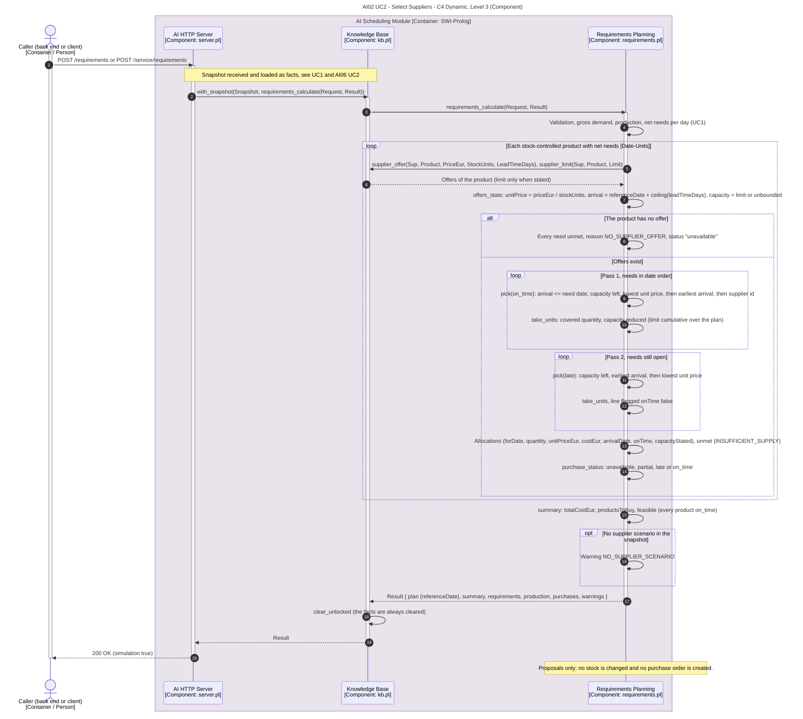

# AI02 UC2 - Select Suppliers

| Attribute | Value |
|---|---|
| C4 view | Dynamic diagram, Level 3 (Component) |
| SAD view | Process View, Level 3 |
| Containers | AI Scheduling Module |
| Entry point | `purchase_entry/3` (`requirements.pl`), called by `calculate/4` for every product with net needs, inside `requirements_calculate/2,3` ([UC1](./calculate-requirements-planning.md)) |
| Allowed callers | `POST /requirements` (Manager token, pull) and `POST /service/requirements` (`X-Api-Key`, push, [WEB07 UC9](../ai-planning/execute-forecast.md)) |
| Success response | n/a (part of the 200 result of UC1): `purchases[]` and `summary` |
| Error handling | No error of its own. A product without offers is `unavailable` with `unmet` reason `NO_SUPPLIER_OFFER`; capacity exhausted gives `partial` or `unavailable` with `INSUFFICIENT_SUPPLY`; without a supplier scenario every product is `unavailable` and the result has the warning `NO_SUPPLIER_SCENARIO` |
| ADRs | [ADR-0058](../../adr/0058-requirements-planning-with-chronological-net-needs-and-on-time-cheapest-supplier.md) |

## Description

The supplier selection runs on the facts of the confirmed supplier scenario carried by the snapshot: `supplier_offer(Supplier, Product, PriceEur, StockUnits, LeadTimeDays)` and, only when the offer states it, `supplier_limit(Supplier, Product, Limit)`. Its input is the list of net needs of one product, `[Date-Units]` in date order, from UC1.

1. **Offers of the product (`offers_state/3`).** For each offer: `unitPriceEur = priceEur / stockUnits` (the common stock-unit basis), the arrival date `referenceDate + ceiling(leadTimeDays)` calendar days, and the capacity: the supply limit for the whole plan, or `unbounded` when the offer has none. Offers of other products are never used.
2. **Pass 1, on time (`allocate_pass(on_time, ...)`).** Needs are served in date order. Each need takes the offer with capacity that arrives on or before its day, choosing the lowest unit price, then the earliest arrival, then the supplier id (`offer_key/5`), until the need is covered or no on-time capacity is left. The capacity taken is subtracted from the offer, so a limit is cumulative over the whole plan.
3. **Pass 2, late (`allocate_pass(late, ...)`).** The needs still open take the capacity left after pass 1, choosing the earliest arrival, then the lowest unit price. Pass 2 only sees what pass 1 did not use, so a late delivery never takes the capacity an on-time need received.
4. **Purchase entry.** Each allocation becomes `{ supplierId, supplierName, forDate, quantity, unitPriceEur, costEur, arrivalDate, onTime, capacityStated }` (`capacityStated: false` when the offer has no limit). What stays uncovered goes to `unmet[{ date, quantity, reason }]`: `NO_SUPPLIER_OFFER` when the product has no offer, `INSUFFICIENT_SUPPLY` otherwise. The status is `unavailable` (nothing covered), `partial` (part uncovered), `late` (covered, some lines late) or `on_time`. The cost of the product is the sum of its allocations, rounded to cents.
5. **Summary.** `totalCostEur` (sum of the products), `productsToBuy` and `feasible` (`true` only when every product is `on_time`).

All purchases are placed on `plan.referenceDate`. Nothing is written: the allocations are proposals of the plan, not purchase orders.

## Diagram

See the [README](./README.md#supplier-selection-rules) for the selection rules, the worked example and the element catalogue.
