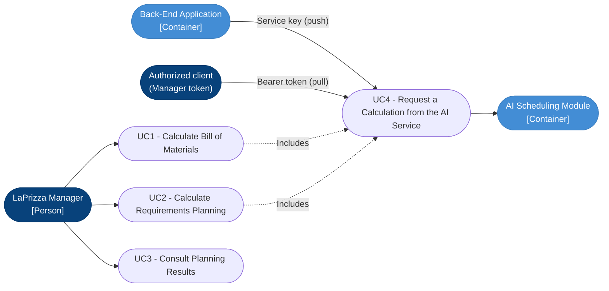

# AI Service Access - Design Diagrams (Mermaid)

AI05 exposes the Prolog calculations, **Bill of Materials** (`bom.pl`) and **Requirements Planning** (`requirements.pl`), as REST endpoints that the Web Application and other authorized components can call. There are two layers:

- **Back end (`/api/v2/planning/*`)**, the public interface used by the SPA. It authenticates the user, checks the permission `planning:execute`, builds the planning snapshot ([AI06](../ai-knowledge-base/README.md)), calls the AI Scheduling Module with its service identity and records the result as a planning run.
- **AI Scheduling Module (`ai-scheduling/server.pl`)**, the Prolog service. It answers on `/service/{bom,requirements}` to the back end, authenticated by a service key (push path, the main path), and on `/bom` and `/requirements` to a direct caller with a Manager token (pull path, used by tests and demos).

Every calculation is a simulation (`simulation: true`): it never changes stock and never registers purchase orders.

Process View (SAD), Level 3, documented as C4 dynamic diagrams of the **Web Application**, **Back-end API** and **AI Scheduling Module** containers. Representative requests, responses and errors of both layers are in [AI Service Interface](./service-interface.md).

## Use Cases

The use cases are described in the [Use Case Views](../../analysis/use-case-views.md#ai05-artificial-intelligence-service-access).

## Diagrams

| Use case | Endpoint | Caller | Success | Document |
|---|---|---|---|---|
| [UC1 - Calculate Bill of Materials](./calculate-bom.md) | `POST /planning/bom` → `POST /service/bom` | MANAGER (SPA) | 200 OK, BOM result + `runId` | `calculate-bom.md` |
| [UC2 - Calculate Requirements Planning](../ai-planning/execute-forecast.md) | `POST /planning/requirements` → `POST /service/requirements` | MANAGER (SPA) | 200 OK, requirements result + `runId` | WEB07 UC9, `execute-forecast.md` |
| [UC3 - Consult Planning Results](../ai-planning/consult-planning-results.md) | `GET /planning/runs`, `GET /planning/runs/{id}` | MANAGER (SPA) | 200 OK | WEB07 UC10, `consult-planning-results.md` |
| [UC4 - Request a Calculation from the AI Service](./request-calculation.md) | Push: `POST /service/{bom,requirements}`. Pull: `POST /bom`, `POST /requirements` | Back end (`X-Api-Key`), or a client with a Manager token | 200 OK, result | `request-calculation.md` |

UC2 and UC3 are the WEB07 use cases. AI05 provides their service access, so they are not drawn again here. UC4 shows the access to the Prolog service for both identities; the snapshot itself is detailed in [AI06](../ai-knowledge-base/README.md).

## REST API summary

### Back end

All paths are under `/api/v2`, and `/api/v1` is a deprecated alias. Every route requires a valid token (401 otherwise) and the permission `planning:execute` (403 `FORBIDDEN` otherwise). In `ROLE_PERMISSIONS` this permission is granted only to MANAGER.

| Method and path | Use case | Body / query | Success | Errors |
|---|---|---|---|---|
| `POST /planning/bom` | UC1 | `{ scenarioId, stockMode }` | 200, `{ status: "ok", simulation: true, feasible, calculatedAt, scenario, inputs, orders[], items[], shortages[], production[], warnings[], runId }` | 400 `VALIDATION_ERROR`, 400 `MALFORMED_JSON`, 400 `SCENARIO_WITHOUT_STOCK`, 404 `AI_SCENARIO_NOT_FOUND`, 422 `AI_INVALID_DATA`, 503 `AI_SERVICE_UNAVAILABLE` (`Retry-After: 5`), 504 `AI_SERVICE_TIMEOUT` |
| `POST /planning/requirements` | UC2 | `{ scenarioId, stockMode, forecastId?, supplierScenarioId? }` | 200, `{ status: "ok", simulation: true, calculatedAt, scenario, inputs, plan, summary, requirements[], production[], purchases[], warnings[], runId }` | Same as BOM, plus 404 `FORECAST_NOT_FOUND` / `SUPPLIER_SCENARIO_NOT_FOUND` |
| `GET /planning/runs[?kind&forecastId&supplierScenarioId]` | UC3 | `kind` `bom` or `requirements` | 200, summaries (100 most recent, without `result`) | 400 `VALIDATION_ERROR` |
| `GET /planning/runs/{id}` | UC3 | - | 200, with `result` | 400 `BAD_REQUEST`, 404 `PLANNING_RUN_NOT_FOUND` |

The OpenAPI description (`planning.openapi.js`, Swagger UI at `/api/v2/docs`, JSON at `/api/v2/openapi.json`) has the request and response examples of these routes ([ADR-0004](../../adr/0004-contract-first-rest-api.md)).

### AI Scheduling Module

The service listens only on `127.0.0.1` (port `AI_PORT`, 5000 by default), so it is not reachable from outside the machine. All answers are JSON, and errors use the back-end format `{ "error": { "status", "code", "message", "details"? } }`. Unknown paths answer 404 `NOT_FOUND` and wrong methods 405 `METHOD_NOT_ALLOWED`.

| Method and path | Identity | Body | Success | Errors |
|---|---|---|---|---|
| `POST /service/bom`, `POST /service/requirements` | Service: `X-Api-Key: <AI_SERVICE_KEY>` | `{ request: { scenarioId, stockMode }, snapshot }` | 200, result | 401 `SERVICE_UNAUTHORIZED` (no key, wrong key, user token, or no key configured), 400 `VALIDATION_ERROR` (`request.*`, `snapshot`), 422 `AI_INVALID_DATA` |
| `POST /bom`, `POST /requirements` | User: `Authorization: Bearer <Manager token>`, forwarded to the back end | `{ scenarioId, stockMode }` | 200, result | 401 `TOKEN_MISSING`, 400 `VALIDATION_ERROR`, 401/403 of the back end (as received), 404 `AI_SCENARIO_NOT_FOUND`, 422 `AI_INVALID_DATA`, 503 `AI_DATA_UNAVAILABLE`, 504 `AI_DATA_TIMEOUT` |
| `GET /health` | None | - | 200 `{ status: "ok", backend }` | |

## Outcomes seen by the Web Application

The interface tells apart a successful calculation, invalid input, missing information and service unavailability. `classifyPlanningError` (`planning-errors.js`) maps each answer of `/planning/*` to one of these states. The page shows translated texts and never the server message.

| Outcome | HTTP status and code | State in the SPA | What the page shows |
|---|---|---|---|
| Successful calculation | 200 (`status: "ok"`) | result | `BomResult` or `RequirementsResult`: quantities, shortages, production, suppliers (requirements) and warnings, with the "simulation, stock not changed" tag |
| Invalid input | 400 `VALIDATION_ERROR` / `MALFORMED_JSON` (`details[{ field, type, message }]`), 400 `SCENARIO_WITHOUT_STOCK`, 404 `AI_SCENARIO_NOT_FOUND` / `FORECAST_NOT_FOUND` / `SUPPLIER_SCENARIO_NOT_FOUND` | `invalidInput` | The error next to the field (`scenarioId`, `stockMode`, `forecastId`, `supplierScenarioId`) |
| Missing information | 422 `AI_INVALID_DATA` (`details.problems[]`, for example `MISSING_SCENARIO_STOCK`, `INCOMPLETE_RECIPE`, `MISSING_FORECAST`) | `missingInformation` | The list of problems, with the ids of the product, pizza or size |
| Service unavailable | 503 `AI_SERVICE_UNAVAILABLE` (`details.reason`, `Retry-After: 5`), 504 `AI_SERVICE_TIMEOUT`, network error | `unavailable` | "Service unavailable" and a retry hint with the seconds of `Retry-After` |
| Not allowed | 401 / 403 | `unauthenticated` / `forbidden` | Session message, or the route guard hides the page |

Most invalid input never leaves the browser: `validatePlanningInput` applies the same rules as the Joi schema of the back end.

## Access control

| Caller | Route | Credential | Check | Denied |
|---|---|---|---|---|
| SPA user | `/api/v2/planning/*` | `Authorization: Bearer <JWT>` | `requirePermission(Permission.PLANNING_EXECUTE)`: valid session (AA03/AA04) and the permission, granted only to MANAGER | 401 (`TOKEN_MISSING`, `TOKEN_INVALID`, `SESSION_REVOKED`), 403 `FORBIDDEN` |
| SPA navigation | Route `/ai` | Permissions of the session | Route guard `planning:execute`; the menu hides the page | `RequireAuth` shows the access-denied view |
| Back end (service identity) | `POST /service/{bom,requirements}` | `X-Api-Key: <AI_SERVICE_KEY>` | `service_key_ok/1` compares the key with the configured one. Without `AI_SERVICE_KEY` the routes are closed | 401 `SERVICE_UNAUTHORIZED`. The back end logs it and answers 503 `service_auth_failed`, because it is a configuration error and not a user error |
| Direct client | `POST /bom`, `POST /requirements` | `Authorization: Bearer <token>` | The Prolog service forwards the token to `GET /ai-data/snapshot`, where the back end checks `planning:execute` | 401 `TOKEN_MISSING`. An Employee or Customer token gets the 403 of the back end |

The user token never reaches the Prolog service in the push path, and the Prolog service never logs it in the pull path. The service key is a secret of both `.env` files ([ADR-0018](../../adr/0018-secrets-management-strategy.md)). The start-up warns when it is missing or shorter than 32 characters.

## Business rules shown in the diagrams

- **JSON and back-end identifiers.** Requests and results are JSON. A calculation uses only the identifiers of the snapshot: the AI scenario code (`scenarioId`, `^[A-Z0-9-]{1,64}$`) and the back-end ids of products, pizzas, sizes, forecasts and supplier scenarios. The result carries `scenario { id, name, version, stockMode }` and `inputs { snapshotId, sources }`, so each quantity can be traced to the data it came from. The only new id is the `runId` of the saved planning run.
- **One request, one fresh snapshot.** The back end builds the snapshot for every calculation and sends it in the body (`{ request, snapshot }`). The Prolog service loads it, calculates and clears the knowledge base ([AI06 UC3](../ai-knowledge-base/refresh-per-calculation.md), [ADR-0021](../../adr/0021-knowledge-base-loaded-per-calculation.md)).
- **Validation in three places.** The SPA checks the form, the back end checks the body with Joi (400, nothing is read) and the snapshot query, and the Prolog service checks the request and the whole snapshot. Missing or invalid data answer 422 with every problem together, never a default.
- **Warnings never block.** For example `PIZZA_STOCK_IGNORED` or `UNMEASURED_NON_STOCK_COMPONENT` in the BOM, and `NO_SUPPLIER_SCENARIO` in the requirements. They are returned in `warnings[]` next to a 200 result.
- **Synchronous call with a timeout.** The back end waits up to `AI_SERVICE_TIMEOUT_SECONDS` (15 s by default) and then answers 504. The page sends one request per click (synchronous `useRef` lock) and shows a progress bar ([ADR-0049](../../adr/0049-synchronous-ai-execution-with-duplicate-submission-guard.md)).
- **No silent changes.** `bom.pl` and `requirements.pl` only read the facts: stock balances, production and purchases are results only, and `purchases[]` are suggestions. The only write of a calculation is the `PlanningRun` document, saved only after a successful calculation ([ADR-0047](../../adr/0047-recording-planning-runs-with-their-input-versions.md)). A change to the stock is an explicit action of the user through the stock endpoints of the back end (BCK09). AI05 creates no purchase orders.
- **Service unavailable is explicit.** A refused connection, an invalid answer, a rejected key or a missing configuration become 503 `AI_SERVICE_UNAVAILABLE` with `details.reason` (`connection_failed`, `invalid_ai_response`, `service_auth_failed`, `not_configured`, `ai_service_error`) and `Retry-After: 5`. No run is saved.

## Related ADRs

| ADR | Decision | Status |
|---|---|---|
| [ADR-0004](../../adr/0004-contract-first-rest-api.md) | Contract-first REST API | Accepted |
| [ADR-0015](../../adr/0015-api-uri-routing-versioning-strategy.md) | API URI versioning (`/api/v2`, `/api/v1` deprecated alias) | Accepted |
| [ADR-0018](../../adr/0018-secrets-management-strategy.md) | Secrets management (`AI_SERVICE_KEY`) | Accepted |
| [ADR-0033](../../adr/0033-mock-based-unit-testing.md) | Mock-based unit testing with `node:test` | Accepted |
| [ADR-0047](../../adr/0047-recording-planning-runs-with-their-input-versions.md) | Recording planning runs with their input versions | Accepted |
| [ADR-0049](../../adr/0049-synchronous-ai-execution-with-duplicate-submission-guard.md) | Synchronous AI execution with a duplicate-submission guard | Accepted |
| [ADR-0020](../../adr/0020-planning-snapshot-as-the-data-contract-with-the-ai-service.md) | Planning snapshot as the data contract (push with service key, pull with user token) | Accepted |
| [ADR-0021](../../adr/0021-knowledge-base-loaded-per-calculation.md) | Knowledge base loaded per calculation | Accepted |

## Notation key

| Notation | Meaning |
|---|---|
| Actor (stick figure) | Person using the system, with the role shown in the label |
| Shaded box "Web Application" | Container (React, Vite) that holds the page components |
| Shaded box "Back-end API" | Container (Node.js, Express) that holds the back-end components |
| Shaded box "AI Scheduling Module" | Container (SWI-Prolog) that holds the HTTP server, the knowledge base and the calculations |
| Participant label | `Name`, followed by `[Type: technology]` |
| Solid arrow | Call or request |
| Dashed arrow | Return value or response |
| Arrow to the same participant | Work done inside that component |
| Number on an arrow | Order of the interaction (autonumber) |
| `alt` / `else` frame | Alternative flows, only one of them runs |
| `opt` frame | Optional flow |
| `Note` | Reference to another diagram or a remark |

## Element catalogue

| Element | Type | Technology | Responsibility | Used in |
|---|---|---|---|---|
| Manager | Person | - | Back-office user with the MANAGER role, the only one with `planning:execute` | [UC1](./calculate-bom.md) |
| PlanningPanel | Component | React form | Execution tab of `/ai`: calculation (BOM or Requirements), AI scenario, stock mode, forecast and supplier scenario (requirements only); lock, progress bar and failure states | [UC1](./calculate-bom.md) |
| planning-errors | Component | JavaScript module, pure functions | `validatePlanningInput`, `toPlanningRequest` (forecast and supplier ids only for requirements), `classifyPlanningError` | [UC1](./calculate-bom.md) |
| planning-api | Component | JavaScript module | `calculatePlanning(kind, body, signal)`: `POST /planning/{kind}` (`feedback: 'silent'`, errors shown inline) | [UC1](./calculate-bom.md) |
| BomResult / RequirementsResult | Component | React components | Show the result: items (required, in stock, used, remaining, shortage), production, replenishment, suppliers and purchases (requirements), warnings, and the scenario and snapshot used | [UC1](./calculate-bom.md) |
| Route (Joi & Permissions) | Component | Express router and middleware | `requirePermission(Permission.PLANNING_EXECUTE)`, `planningRequestSchema` (`allowUnknown`, `stripUnknown`), `validateRunsQuery`, `validateRunId` | [UC1](./calculate-bom.md) |
| PlanningController | Component | Express controller | `calculateBom`, `calculateRequirements` (with `requestedBy` = user id), `listRuns`, `getRun` | [UC1](./calculate-bom.md) |
| PlanningService | Component | Node.js module | `createPlanningService` → `calculateBom`, `calculateRequirements`: `loadSnapshot`, `aiServiceClient.calculate`, `planningRunRepository.create`; `toPlanningRunRecord` | [UC1](./calculate-bom.md) |
| AiDataService | Component | Node.js module | `getSnapshot` → `getScenarioSnapshot` → `buildScenarioSnapshot` (AI06) | [UC1](./calculate-bom.md) |
| AiServiceClient | Component | Node.js module, `fetch` | `calculate(kind, request, snapshot)`: `POST {AI_SERVICE_URL}/service/{kind}` with `X-Api-Key`, timeout, and the mapping of answers to 200, 422, 503 or 504 | [UC1](./calculate-bom.md) |
| PlanningRunRepository | Component | Repository, MongoDB (model `PlanningRun`) | `create`, `list`, `findById` | [UC1](./calculate-bom.md) |
| AI HTTP Server | Component | SWI-Prolog HTTP server (`server.pl`) | Routes, `service_key_ok/1`, `service_plan_request/4`, `plan_request/5`, `calculate/5`, JSON errors | [UC1](./calculate-bom.md), [UC4](./request-calculation.md) |
| Knowledge Base | Component | SWI-Prolog module (`kb.pl`) | `with_snapshot/2`: validates and loads the snapshot, runs the calculation and clears the facts (AI06) | [UC1](./calculate-bom.md), [UC4](./request-calculation.md) |
| BOM | Component | SWI-Prolog module (`bom.pl`) | `bom_calculate/2`: explodes the orders through the BOM, compares with the stock, returns items, shortages, production and warnings, or `invalid_data` with the problems | [UC1](./calculate-bom.md), [UC4](./request-calculation.md) |
| Requirements | Component | SWI-Prolog module (`requirements.pl`) | `requirements_calculate/2`: daily net requirements of the forecast and purchase plan with the supplier offers | [UC4](./request-calculation.md), [WEB07 UC9](../ai-planning/execute-forecast.md) |

## Notes

- **The Prolog API is not in Swagger.** The OpenAPI document describes the back end, the public interface. The contract of the Prolog routes is in [AI Service Interface](./service-interface.md) and in the tests of `ai-scheduling/test/service.plt` and `server.plt`.
- **Configuration.** Back end: `AI_SERVICE_URL` (default `http://127.0.0.1:5000`), `AI_SERVICE_KEY`, `AI_SERVICE_TIMEOUT_SECONDS` (15). Prolog service (`ai-scheduling/.env`): `AI_SERVICE_KEY` (the same value), `AI_PORT` (5000), `AI_BACKEND_URL` and `AI_BACKEND_TIMEOUT_SECONDS` (pull path only).
- **Saved BOM runs.** `POST /planning/bom` saves a run with `kind: "bom"`. The Results tab of the page lists the requirements runs, and the BOM runs are available through `GET /planning/runs?kind=bom`.
- **Demonstration in the common solution.** With the back end, the Prolog service and the AI01 demo seed (`npm run seed:ai01-demo -- --confirm`), the Manager opens `/ai` → Execution, chooses "Bill of Materials", `DEMO-PARTIAL` and "Scenario stock", and executes. The result shows the shortage of mozzarella and the production of dough. A Requirements execution is in [WEB07 UC9](../ai-planning/execute-forecast.md).
- Tests:
  - Back end ([ADR-0033](../../adr/0033-mock-based-unit-testing.md)): `test/planning/planning.service.test.js` (snapshot then calculation, errors propagated, no run on failure), `test/planning/ai-service.client.test.js` (service key, 422, 503 reasons, 504, `Retry-After`), `test/api/api.planning-runs.test.js` (an execution recorded with its versions, validations, 404 and RBAC of the runs) and `api.authorization-matrix.test.js` (`POST /planning/bom` and `/planning/requirements` are MANAGER only).
  - Prolog (`ai-scheduling/run-tests.sh`): `test/service.plt` (service routes: key missing, wrong or a user token is 401; routes closed without a configured key; 400 with prefixed fields; malformed JSON; 422; 405), `test/server.plt`, `test/bom.plt`, `test/requirements.plt`.
  - SPA: `frontend/test/ai/planning-errors.test.js` (the four outcomes) and `frontend/test/e2e/web07-ai.spec.js`.
  - httpyac flows: `backend/test-flows/bom-demo-test-flow.http` (pull path: four demo scenarios, live stock unchanged, 401 without a token, 403 for an Employee, 404 unknown scenario, 400 invalid body) and `planning-test-flow.http` (push path through `/planning/requirements`, stock unchanged).
